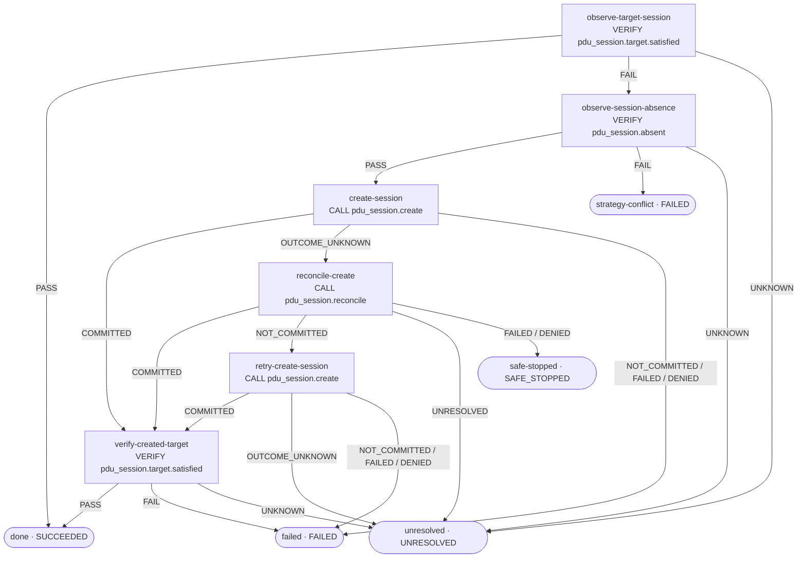

# ensure-pdu-session · Graph Projection Blueprint

**状态：Observed source mapping + Proposed Visual projection**

本文件把当前 Demo 中的 `ensure-pdu-session` 实际 Procedure、Contract、Predicates 和 5 个 Case 投影为 Procedure Designer 的具体样本。所有节点 ID、Operator、路由目标和 Binding expression 均以固定源 Commit 为准。

## 1. 来源与资格边界

- Source repository: `odango-chan/ca-agent-demo`
- Source commit: `bf445ad777149af5af2dfa0a5bdea18d0451303e`
- Procedure: `skills/ensure-pdu-session/assurance/procedure.yaml`
- Contract: `skills/ensure-pdu-session/assurance/contract.yaml`
- Predicates: `skills/ensure-pdu-session/assurance/predicates.yaml`
- Skill guide: `skills/ensure-pdu-session/SKILL.md`
- Cases: `skills/ensure-pdu-session/cases/01-* ... 05-*/case.yaml`

当前源文件定义一个命名 Procedure：`ensure-session`，共 11 个节点，没有 Child Procedure，也没有节点级 Preconditions / Postconditions。

### 1.1 Contract header

| 字段 | Source value |
|---|---|
| `skillType` | `executable` |
| `goal` | `pdu_session.ensure_target` |
| `entryProcedure` | `ensure-session` |
| Contract precondition | `ue.registered == PASS` |
| Contract postcondition | `pdu_session.target.satisfied == PASS` |
| `planning.maxActions` | `6` |
| `allowDynamicProcedure` | `false` |
| `failureSemantics.outcomeUnknown.requireReconcile` | `true` |

Contract 允许的 Capability 是 `pdu_session.create`、`pdu_session.reconcile`、`pdu_session.query`。当前 Procedure 实际调用前两者；`pdu_session.query` 只出现在 allowedResources / Case resource 声明中，不能因此额外画出一个 Query 节点。

Contract 的 `ue.registered` 是 **Procedure 图外的 Contract Gate**。首屏可在 Graph Header 显示它，但不能把它伪造成 `ensure-session.nodes` 中的一个节点。

### 1.2 Environment boundary

`pdu_session.target.satisfied` 与 `pdu_session.absent` 都读取 `pdu.session.snapshot`，作用域是精确的 UE 与 PDU Session ID，freshness 为 5s。

- `pdu_session.target.satisfied` 要求 `established == true`，并且 DNN、SST、SD 与请求一致。
- `pdu_session.absent` 要求 `exists == false`；只有权威证据能证明精确 Session 不存在时才 PASS。
- `UNKNOWN` 不是 absence，不得放行 create。

该 Predicate 的强语义来自当前 Demo 的 `env-5gc-sim` owner-backed profile。Skill 文档明确指出，不能把同样的 established / absence 事实能力推广到真实 Open5GS。

## 2. Procedure 概览

- Procedure ID：`ensure-session`
- Source `start`：`observe-target-session`
- Node count：11
- Child Procedure：0
- Terminal nodes：5

### 2.1 完整控制流

以下是从当前 `on` 路由逐条投影出的控制流。边标签是源文件中的原始 outcome；不是根据节点名称推测出来的业务含义。

## 3. Root Node 清单与路由

表中节点顺序与 YAML 的 `nodes` 映射顺序一致。画布布局可以按控制流组织，但 Source Outline 必须保留这个源顺序。

| # | Node ID | Operator | Operator outcome → target |
|---:|---|---|---|
| 1 | `observe-target-session` | `verify: pdu_session.target.satisfied` | `PASS → done`；`FAIL → observe-session-absence`；`UNKNOWN → unresolved` |
| 2 | `observe-session-absence` | `verify: pdu_session.absent` | `PASS → create-session`；`FAIL → strategy-conflict`；`UNKNOWN → unresolved` |
| 3 | `create-session` | `call: pdu_session.create` | `COMMITTED → verify-created-target`；`NOT_COMMITTED → failed`；`OUTCOME_UNKNOWN → reconcile-create`；`FAILED / DENIED → failed` |
| 4 | `reconcile-create` | `call: pdu_session.reconcile` | `COMMITTED → verify-created-target`；`NOT_COMMITTED → retry-create-session`；`UNRESOLVED → unresolved`；`FAILED / DENIED → safe-stopped` |
| 5 | `retry-create-session` | `call: pdu_session.create` | `COMMITTED → verify-created-target`；`NOT_COMMITTED → failed`；`OUTCOME_UNKNOWN → unresolved`；`FAILED / DENIED → failed` |
| 6 | `verify-created-target` | `verify: pdu_session.target.satisfied` | `PASS → done`；`FAIL → failed`；`UNKNOWN → unresolved` |
| 7 | `done` | `terminal: SUCCEEDED` | Terminal |
| 8 | `strategy-conflict` | `terminal: FAILED` | Terminal |
| 9 | `failed` | `terminal: FAILED` | Terminal |
| 10 | `unresolved` | `terminal: UNRESOLVED` | Terminal |
| 11 | `safe-stopped` | `terminal: SAFE_STOPPED` | Terminal |

### 3.1 Route semantics that must remain visible

- `observe-target-session.FAIL` is not a create authorization. It only moves to the exact-absence check.
- Only `observe-session-absence.PASS` reaches `create-session`.
- `create-session.OUTCOME_UNKNOWN` must go to the exact `reconcile-create` node. There is no direct retry edge.
- Reconcile `NOT_COMMITTED` is the only route to `retry-create-session`.
- Retry `OUTCOME_UNKNOWN` goes to `unresolved`; this source does not define a second Reconcile loop.
- Reconcile `FAILED / DENIED` goes to `safe-stopped`, not the ordinary `failed` terminal.
- Both original create and retry must be followed by `verify-created-target` after COMMITTED.

## 4. Node Inspector: exact source details

### 4.1 `observe-target-session`

- Operator: `verify`
- Predicate: `pdu_session.target.satisfied`
- Observation: `pdu.session.snapshot`
- Scope: `subject.ueRef + request.pduSessionId`
- Freshness: `5s`
- Evaluator: CEL
- Business meaning: the exact Session is established and its DNN / S-NSSAI matches the request.

### 4.2 `observe-session-absence`

- Operator: `verify`
- Predicate: `pdu_session.absent`
- Observation: `pdu.session.snapshot`
- Scope: `subject.ueRef + request.pduSessionId`
- Freshness: `5s`
- Evaluator: CEL
- Business meaning: exact Session absence is authoritatively proven.
- Safety note: `FAIL` means a Session exists but does not match the target; `UNKNOWN` means absence is not proven. Neither permits creation.

### 4.3 `create-session`

- Operator: `call: pdu_session.create`
- Inputs: `supi`、`pduSessionId`、`dnn`、`sst`、`sd`
- Outcome domain in this source: `COMMITTED / NOT_COMMITTED / OUTCOME_UNKNOWN / FAILED / DENIED`
- `COMMITTED` means the mutation committed; it does not replace the subsequent target verification.

### 4.4 `reconcile-create`

- Operator: **Call**, not DSL Reconcile.
- Exact source: `call: pdu_session.reconcile`
- Input identity: the original `create-session` operation's backend and protocol transaction references.
- It consumes the original create output; it is not a new create and not a generic global session lookup.

### 4.5 `retry-create-session`

- Operator: `call: pdu_session.create`
- Reuses the original target inputs.
- Adds `retryOfBackendOperationRef` from `reconcile-create.output.controlledRetryBackendOperationRef`.
- This is a controlled retry after the exact Reconcile result `NOT_COMMITTED`, not a retry after timeout.

### 4.6 `verify-created-target`

- Operator: `verify: pdu_session.target.satisfied`
- Re-evaluates the same business target predicate after a committed create.
- It is the final Procedure-level fact check before `done`.

## 5. Binding Inspector: exact provenance

### 5.1 Procedure inputs

| Input | Source expression | Consumer |
|---|---|---|
| `supi` | `context.subject.ueRef` | create / reconcile / retry |
| `pdu-session-id` | `context.request.pduSessionId` | create / reconcile / retry |
| `dnn` | `context.request.dnn` | create / retry |
| `sst` | `context.request.sst` | create / retry |
| `sd` | `context.request.sd` | create / retry |

These are Procedure input declarations, not node-to-node data edges.

### 5.2 Create → Reconcile

`reconcile-create.with` reads the following exact fields from `create-session.output`:

- `c6BackendOperationRef`
- `c6OperationSemantic`
- `c6ResultCode`
- `c6BackendEffectDispatch`
- `c6WorldRef`
- `c6WorldGeneration`
- `c6EndWorldRevision`
- `c6SubjectRef`
- `protocolTransactionRefs`
- `protocolTransactions`

It also receives `supi` and `pduSessionId` from Procedure inputs.

### 5.3 Reconcile → controlled retry

| Consumer field | Exact source expression |
|---|---|
| `retryOfBackendOperationRef` | `reconcile-create.output.controlledRetryBackendOperationRef` |

The Binding Inspector should show this as a producer/consumer relation and retain the entire path. Do not draw it as a control-flow edge.

## 6. Case source semantics: five fixture-shaped cases (visual overlay deferred)

These Case files contain exact trace expectations and fixture-shaped data. They remain Package source assets and are useful as future Case Editor / Expected Trace Preview inputs. A Case overlay is deferred from the first Procedure Designer release; their presence does not mean the cases have been executed in Runtime.

| Case | Expected trace / branch | Expected terminal |
|---|---|---|
| `01-already-established` | `observe-target-session: PASS` | `SUCCEEDED` |
| `02-create-missing` | target `FAIL` → absence `PASS` → create `COMMITTED` → verify `PASS` | `SUCCEEDED` |
| `03-existing-identity-mismatch` | target `FAIL` → absence `FAIL` | `FAILED` via `strategy-conflict` |
| `04-create-unknown-reconciled` | target `FAIL` → absence `PASS` → create `OUTCOME_UNKNOWN` → reconcile `COMMITTED` → verify `PASS` | `SUCCEEDED` |
| `05-absence-unknown-safe-stop` | target `FAIL` → absence `UNKNOWN`; no create action | `UNRESOLVED` |

The Case fixtures explicitly mark `forbiddenImmediateRetryAfterUnknown: true` for Case 04. Case 05 may declare create as an available resource, but its expected trace contains no create action: an available Capability does not override an UNKNOWN absence Predicate.

First-version behavior:

- List and open the five Case source files through Package Explorer.
- Do not add a Case selector or graph overlay to the first Procedure Designer release.
- If a future Expected Trace Preview is implemented, it must use exact `expect.trace.ordered` node references and be labeled `Expected Trace · Not Executed`.
- Never infer execution history, percentage or coverage from five Case definitions.

## 7. Recommended canvas composition

1. Put `observe-target-session` and `observe-session-absence` on the primary vertical decision lane.
2. Put `create-session` on the mutation lane.
3. Put `reconcile-create` and `retry-create-session` in a recovery branch beside the original create.
4. Put all five terminal nodes in a visually distinct terminal area.
5. Keep Predicate observation details and create/reconcile Binding lists in the Inspector.
6. Do not create a Child Procedure panel: this Procedure has none.
7. Do not invent Preconditions / Postconditions phase blocks: this source uses only node-level operators and `on`.

The first selected node should open Overview; the Bindings tab for `reconcile-create` should make the original create output provenance immediately inspectable.

## 8. Source line anchors

Line numbers refer to the pinned source file:

| Source section | Lines |
|---|---:|
| `ensure-session` Procedure / inputs / start | 1–20 |
| `observe-target-session` | 21–27 |
| `observe-session-absence` | 28–34 |
| `create-session` | 35–54 |
| `reconcile-create` | 55–88 |
| `retry-create-session` | 89–110 |
| `verify-created-target` | 111–117 |
| Terminals | 118–128 |

## 9. Implementation acceptance checklist

- [ ] Graph contains exactly 11 source nodes in this Procedure.
- [ ] Entry is `observe-target-session`.
- [ ] All 6 non-terminal nodes have the exact route targets listed above.
- [ ] Contract `ue.registered` is shown as an external Contract Gate, not a fabricated Procedure node.
- [ ] `reconcile-create` is rendered as Call Operator `pdu_session.reconcile`, not DSL `reconcile:`.
- [ ] Retry is reachable only from Reconcile `NOT_COMMITTED`.
- [ ] The retry input points to `controlledRetryBackendOperationRef`.
- [ ] All five terminals and their terminal values remain distinct.
- [ ] The five Case traces can highlight exact source nodes without implying that the Cases have run.
- [ ] The environment-specific authoritative absence boundary is visible.
