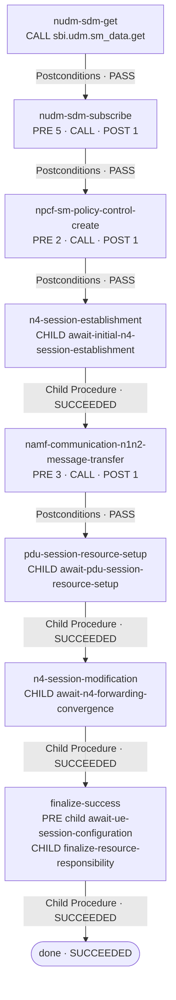

# establish-pdu-session · Graph Projection Blueprint

**状态：Observed source mapping + Proposed Visual projection · Transitional / Not Runtime-qualified**

本文件把当前 Demo 中的 CreatedSession 根 Procedure、5 个 Child Procedure、节点内部阶段、Binding、Contract、Predicate 和 Case qualification 状态，落实为可逐项核对的 Procedure Designer 蓝图。

所有 source identifier、operator、route target 和 Binding expression 以固定源 Commit 为准。这里的图形是 authoring source 的投影，不是 Runtime lowered graph。

## 1. 来源与资格边界

- Source repository: `odango-chan/ca-agent-demo`
- Source commit: `bf445ad777149af5af2dfa0a5bdea18d0451303e`
- Procedure: `skills/establish-pdu-session/assurance/procedure.yaml`
- Contract: `skills/establish-pdu-session/assurance/contract.yaml`
- Predicates: `skills/establish-pdu-session/assurance/predicates.yaml`
- Skill guide: `skills/establish-pdu-session/SKILL.md`
- Authoring model: `skills/establish-pdu-session/design/README.md`
- Case obligations: `skills/establish-pdu-session/cases/README.md`
- Transitional validator: `scripts/validate_docs.py`
- Pinned local Schema: `tests/contracts/ca-skill-toolchain/03a42764ee2a67e39f57ab550b63c7a5d7966199/procedure-source.schema.yaml`

当前 Editor Capability Manifest 对该 Skill 的记录：

| 属性 | 当前事实 |
|---|---|
| Package role | `source-first-createdsession-candidate` |
| `activeInRouting` | `false` |
| `runtimeCompatible` | `false` |
| Case count | `36` |
| Case kind | `semantic-qualification-obligations` |
| Transitional phase evidence | `demo-custom-validated` |

**不要把它显示为当前已安装、已激活、可执行或 Runtime-qualified 的 Skill。** Contract 中的 `skillType: executable` 是源文件声明，不等于当前 Runtime 已经支持这份 authoring source。

## 2. Contract 与 Profile Header

### 2.1 Contract

| 字段 | Source value |
|---|---|
| `skillType` | `executable` |
| `goal` | `pdu_session.initial_request_fulfilled` |
| `entryProcedure` | `ue-requested-pdu-session-establishment` |
| Required context facts | `createdsession_ingress`、`createdsession_lifecycle` |
| `planning.maxActions` | `32` |
| `allowDynamicProcedure` | `false` |
| `failureSemantics.outcomeUnknown.requireReconcile` | `true` |

Contract 的最终 Postconditions 必须独立显示：

1. `createdsession.ran.setup_accepted == PASS`
2. `createdsession.n4.forwarding_ready == PASS`
3. `createdsession.ue.configuration_accepted == PASS`
4. `createdsession.resources.managed == PASS`

这些是 Skill Contract 的最终验收条件，不是一个合并后的 Predicate，也不等于根 Procedure 的某一个节点级 Postconditions block。

### 2.2 Supported profile

从 `SKILL.md` 显示的 profile 限制：

- local, non-roaming UE-requested initial establishment；
- Request Type = initial request；
- IPv4 PDU Session；
- SSC mode 1；
- one default non-GBR flow；
- 不包含 secondary PDU Session authentication / authorization with DN-AAA；
- 不推断 conditional SM Policy Association Modification 已经执行。

建议在 Graph Header 显示 `CreatedSession · Transitional Profile` 和 profile 摘要。不要把省略的 3GPP 条件分支画成已成功或已覆盖。

## 3. Root Procedure 结构

- Procedure ID：`ue-requested-pdu-session-establishment`
- Source `start`：`nudm-sdm-get`
- Root node count：17
- Child Procedure definitions：5
- Procedure definitions total：6
- Root terminal nodes：4

Root Procedure applicability 声明 `createdsession.ingress.eligible: PASS`。这属于 Procedure applicability，不是一个业务 Node。

### 3.1 Procedure inputs

| Input | Type | Source expression |
|---|---|---|
| `ue-ref` | string | `context.subject.ueRef` |
| `psi` | integer | `context.request.pduSessionId` |
| `pti` | integer | `context.request.pti` |
| `request-type` | integer | `context.request.requestType` |
| `dnn` | string | `context.request.dnn` |
| `slice` | object | `context.request.sNssai` |
| `plmn` | object | `context.request.servingPlmn` |
| `ingress-ref` | string | `context.facts.createdsession_ingress` |
| `lifecycle-ref` | string | `context.facts.createdsession_lifecycle` |
| `requested-type` | string | `context.request.requestedPduSessionType` |
| `requested-ssc` | integer | `context.request.requestedSscMode` |

## 4. Root Node 顺序

以下顺序是源文件映射顺序；前 8 个节点对应 authoring design 规定的主业务顺序。后续节点属于资源 finalization、Reconcile 和 terminal mechanics。

| # | Node ID | Operator | Role in projection |
|---:|---|---|---|
| 1 | `nudm-sdm-get` | `call: sbi.udm.sm_data.get` | Nudm_SDM_Get |
| 2 | `nudm-sdm-subscribe` | `call: sbi.udm.sdm_subscription.create` | Nudm_SDM_Subscribe |
| 3 | `npcf-sm-policy-control-create` | `call: sbi.pcf.sm_policy.create` | Npcf_SMPolicyControl_Create |
| 4 | `n4-session-establishment` | `procedure: await-initial-n4-session-establishment` | N4 Session Establishment convergence |
| 5 | `namf-communication-n1n2-message-transfer` | `call: sbi.amf.n1n2.transfer` | Namf_Communication_N1N2MessageTransfer |
| 6 | `pdu-session-resource-setup` | `procedure: await-pdu-session-resource-setup` | PDU Session Resource Setup convergence |
| 7 | `n4-session-modification` | `procedure: await-n4-forwarding-convergence` | N4 Session Modification / forwarding convergence |
| 8 | `finalize-success` | `procedure: finalize-resource-responsibility` | UE completion wait + successful resource finalization |
| 9 | `finalize-failed` | `procedure: finalize-resource-responsibility` | Failed resource finalization |
| 10 | `finalize-unresolved` | `procedure: finalize-resource-responsibility` | Unresolved resource finalization |
| 11 | `reconcile-nudm-sdm-subscribe` | `reconcile: nudm-sdm-subscribe` | Reconcile exact UDM Subscribe mutation |
| 12 | `reconcile-npcf-sm-policy-control-create` | `reconcile: npcf-sm-policy-control-create` | Reconcile exact PCF Create mutation |
| 13 | `reconcile-n1n2-message-transfer` | `reconcile: namf-communication-n1n2-message-transfer` | Reconcile exact AMF transfer mutation |
| 14 | `done` | `terminal: SUCCEEDED` | Terminal |
| 15 | `failed` | `terminal: FAILED` | Terminal |
| 16 | `unresolved` | `terminal: UNRESOLVED` | Terminal |
| 17 | `safe-stopped` | `terminal: SAFE_STOPPED` | Terminal |

### 4.1 Main business lane

The normal business progression should remain visually recognizable:

This is the success lane only. It intentionally omits failure and uncertainty branches; those are listed exhaustively in the route matrix below. Dashed / implicit phase transitions inside a node must not be mistaken for explicit `on` routes.

## 5. Root Route Matrix

### 5.1 Nodes with Preconditions / Operator / Postconditions

| Node | Preconditions routes | Node Operator routes | Postconditions routes |
|---|---|---|---|
| `nudm-sdm-get` | — | `FAILED → failed`; `DENIED → failed`; `UNKNOWN → unresolved` | `PASS → nudm-sdm-subscribe`; `FAIL → failed`; `UNKNOWN → unresolved` |
| `nudm-sdm-subscribe` | `FAILED → failed`; `UNRESOLVED → unresolved` | `NOT_COMMITTED → finalize-failed`; `OUTCOME_UNKNOWN → reconcile-nudm-sdm-subscribe`; `FAILED / DENIED → finalize-failed` | `PASS → npcf-sm-policy-control-create`; `FAIL → finalize-failed`; `UNKNOWN → finalize-unresolved` |
| `npcf-sm-policy-control-create` | `FAILED → finalize-failed`; `UNRESOLVED → finalize-unresolved` | `NOT_COMMITTED → finalize-failed`; `OUTCOME_UNKNOWN → reconcile-npcf-sm-policy-control-create`; `FAILED / DENIED → finalize-failed` | `PASS → n4-session-establishment`; `FAIL → finalize-failed`; `UNKNOWN → finalize-unresolved` |
| `namf-communication-n1n2-message-transfer` | `FAILED → finalize-failed`; `UNRESOLVED → finalize-unresolved` | `NOT_COMMITTED → finalize-failed`; `OUTCOME_UNKNOWN → reconcile-n1n2-message-transfer`; `FAILED / DENIED → finalize-failed` | `PASS → pdu-session-resource-setup`; `FAIL → finalize-failed`; `UNKNOWN → finalize-unresolved` |

**Successful Operator outcome is an implicit phase transition** for nodes with Postconditions. The YAML does not declare a fake `COMMITTED → next-node` route. The successful read / mutation result enters Postconditions, and only the Postconditions PASS route advances business flow.

### 5.2 Child Procedure and finalization routes

| Node | Child Procedure | Node-level routes |
|---|---|---|
| `n4-session-establishment` | `await-initial-n4-session-establishment` | `SUCCEEDED → namf-communication-n1n2-message-transfer`; `FAILED → finalize-failed`; `UNRESOLVED → finalize-unresolved` |
| `pdu-session-resource-setup` | `await-pdu-session-resource-setup` | `SUCCEEDED → n4-session-modification`; `FAILED → finalize-failed`; `UNRESOLVED → finalize-unresolved` |
| `n4-session-modification` | `await-n4-forwarding-convergence` | `SUCCEEDED → finalize-success`; `FAILED → finalize-failed`; `UNRESOLVED → finalize-unresolved` |
| `finalize-success` | Preconditions child: `await-ue-session-configuration`; main child: `finalize-resource-responsibility` | Preconditions: `FAILED → finalize-failed`, `UNRESOLVED → finalize-unresolved`; child: `SUCCEEDED → done`, `FAILED → safe-stopped`, `UNRESOLVED → unresolved`, `SAFE_STOPPED → safe-stopped` |
| `finalize-failed` | `finalize-resource-responsibility` with `disposition: failed` | `SUCCEEDED → failed`; `FAILED → safe-stopped`; `UNRESOLVED → unresolved`; `SAFE_STOPPED → safe-stopped` |
| `finalize-unresolved` | `finalize-resource-responsibility` with `disposition: unresolved` | `SUCCEEDED → unresolved`; `FAILED → safe-stopped`; `UNRESOLVED → unresolved`; `SAFE_STOPPED → safe-stopped` |

### 5.3 Exact Reconcile branches

| Root node | DSL Operator target | Outcomes and targets |
|---|---|---|
| `reconcile-nudm-sdm-subscribe` | `reconcile: nudm-sdm-subscribe` | `COMMITTED / NOT_COMMITTED / UNRESOLVED → safe-stopped` |
| `reconcile-npcf-sm-policy-control-create` | `reconcile: npcf-sm-policy-control-create` | `COMMITTED / NOT_COMMITTED / UNRESOLVED → safe-stopped` |
| `reconcile-n1n2-message-transfer` | `reconcile: namf-communication-n1n2-message-transfer` | `COMMITTED / NOT_COMMITTED / UNRESOLVED → safe-stopped` |

All three Reconcile nodes point to the exact original mutation. Even if reconciliation resolves the original result as COMMITTED or NOT_COMMITTED, the current invocation safe-stops. Do not draw a retry edge or resume the business lane from these nodes.

### 5.4 Root terminals

| Node | Terminal value |
|---|---|
| `done` | `SUCCEEDED` |
| `failed` | `FAILED` |
| `unresolved` | `UNRESOLVED` |
| `safe-stopped` | `SAFE_STOPPED` |

## 6. Node Phase Inspector

Phase blocks belong inside their business Node. They must not be promoted into separate main-flow nodes.

### 6.1 `nudm-sdm-get` — Postconditions

- Main Operator: `call: sbi.udm.sm_data.get`
- Postcondition step: `verify: createdsession.udm.subscription_usable`
- Binding: `udmReadReceipt ← nudm-sdm-get.output`
- Routes: `PASS → nudm-sdm-subscribe`、`FAIL → failed`、`UNKNOWN → unresolved`

The Predicate reads `sbi.operation.result`, scoped by the exact UDM read receipt's invocation ID and transaction reference, freshness `1h`; evaluator is the Script `skill.evaluate-udm-read`. A successful UDM Get response alone is not proof that the subscription evidence is usable.

### 6.2 `nudm-sdm-subscribe` — Preconditions (5 ordered steps)

| # | Step | Operator | Exact purpose / key input |
|---:|---|---|---|
| 1 | `select-subscription-configuration` | Script | `scripts/select_establishment_configuration.py`; consumes requested DNN, S-NSSAI, PDU Session Type, SSC mode and `nudm-sdm-get.output.result` |
| 2 | `resolve-pcf-create-inputs` | Call | `ca.session.pcf_create_inputs.read`; reads exact UE / PSI / PTI / Request Type / ingress / lifecycle and selected configuration |
| 3 | unnamed Verify | Verify | `createdsession.pcf.create_inputs.ready`; binds `pcfCreateInputsRef` and `runtimeInvocationRef` from step 2 |
| 4 | unnamed Verify | Verify | `createdsession.ingress.eligible` |
| 5 | unnamed Verify | Verify | `createdsession.lifecycle.ready` |

Aggregate routes: `FAILED → failed`；`UNRESOLVED → unresolved`.

Main Operator:

- `call: sbi.udm.sdm_subscription.create`
- consumes `pcfCreateInputsRef`、`pcfCreateInputsInvocationRef`、selection、ingressRef、lifecycleRef.
- The PCF create inputs handle is evidence for this attempt. It is not an operation context and does not claim association ownership. The source comment also states that the operation-context `policy-create` purpose remains UNAVAILABLE: a read cannot prove ownership of an association that does not yet exist.

Postconditions:

- `verify: createdsession.udm.subscription_owned`
- `PASS → npcf-sm-policy-control-create`
- `FAIL → finalize-failed`
- `UNKNOWN → finalize-unresolved`

### 6.3 `npcf-sm-policy-control-create` — Preconditions (2 ordered steps)

| # | Step | Operator | Exact purpose |
|---:|---|---|---|
| 1 | unnamed Verify | Verify | `createdsession.pcf.create_governed` with exact `lifecycleRef` and `ingressRef` |
| 2 | unnamed Verify | Verify | `createdsession.lifecycle.ready` |

Aggregate routes: `FAILED → finalize-failed`；`UNRESOLVED → finalize-unresolved`.

**Important current blocker:** the Predicate definition and authoring comments state that no admitted owner currently supplies the clean lifecycle isolation and original-SMF competing-create governance evidence. Therefore `createdsession.pcf.create_governed` remains UNKNOWN and intentionally blocks PCF Create. The UI must not display this gate as PASS or portray the PCF Create success path as currently proven.

Main Operator:

- `call: sbi.pcf.sm_policy.create`
- consumes `pcfCreateInputsRef` from the earlier precondition output, selected configuration, lifecycleRef and `nudm-sdm-subscribe.output.subscriptionRef`.

Postconditions:

- `verify: createdsession.pcf.association_owned`
- `PASS → n4-session-establishment`
- `FAIL → finalize-failed`
- `UNKNOWN → finalize-unresolved`

The Predicate describes Agent management state (`creationState=CREATED`, `ownership=AGENT`, `managementState=DURABLE`). Its source comment explicitly says this is not proof of native PCF exclusivity. The UDM subscription ownership Predicate uses the same creation / ownership / durable-management shape.

### 6.4 `namf-communication-n1n2-message-transfer` — Preconditions (3 ordered steps)

| # | Step | Operator | Exact purpose |
|---:|---|---|---|
| 1 | `resolve-effective-session-configuration` | Call | `ca.session.operation_context.read`, purpose literal `nas-and-n2-delivery`; consumes selection and `policyResultRef` |
| 2 | unnamed Verify | Verify | `createdsession.delivery_context.ready`; consumes `contextRef` and `runtimeInvocationRef` from step 1 |
| 3 | `prepare-establishment-response` | Call | `ca.session.establishment_response.prepare`; consumes operation context, invocation, PSI, PTI, selection and policy result |

Aggregate routes: `FAILED → finalize-failed`；`UNRESOLVED → finalize-unresolved`.

Main Operator:

- `call: sbi.amf.n1n2.transfer`
- consumes `operationContextRef`、`runtimeInvocationRef`、`lifecycleRef`、`responseArtifactRef`.

Postconditions:

- `verify: createdsession.amf.transfer_initiated`
- Binding: `amfTransferOperationRef ← namf-communication-n1n2-message-transfer.output.operationRef`
- `PASS → pdu-session-resource-setup`
- `FAIL → finalize-failed`
- `UNKNOWN → finalize-unresolved`

The `delivery_context.ready` Predicate proves input facts such as address allocation, complete NAS inputs and delegated caller authorization. Its source comment says sender uniqueness belongs to the governed transfer mutation; the context read cannot reserve a sender. Do not show a fake sender-reservation output on this precondition.

### 6.5 `finalize-success` — completion entry

Preconditions contain one Child Procedure step:

- `await-ue-session-configuration`
- its result must be `SUCCEEDED` before the main finalizer child is called;
- `FAILED → finalize-failed`；
- `UNRESOLVED → finalize-unresolved`.

Main Operator is `procedure: finalize-resource-responsibility` with literal `disposition: success`. This makes UE configuration convergence a completion-entry condition, not a new 3GPP business stage after N4 Modification.

## 7. Child Procedure Drill-in Blueprints

Each Child Procedure is an independent graph with its own `start`, `nodes` and terminal outcomes. The root graph displays a Child Procedure card; it does not flatten the child nodes.

### 7.1 `await-initial-n4-session-establishment`

- Root caller: `n4-session-establishment`
- Child start: `await-initial-resources`
- Node Operator: `call: ca.session.evidence.await`
- Purpose literal: `n4-session-establishment`
- Inputs: `sessionInstanceRef` from `input.session-instance-ref`; `lifecycleRef` from `input.lifecycle-ref`
- Postcondition: `verify: createdsession.n4.initial_resources_ready`
- Routes: Post `PASS → done`、`FAIL → failed`、`UNKNOWN → unresolved`; Operator `FAILED / UNKNOWN → unresolved`、`DENIED → failed`
- Terminals: `done=SUCCEEDED`、`failed=FAILED`、`unresolved=UNRESOLVED`

The root caller supplies `session-instance-ref` from `nudm-sdm-subscribe.preconditions.resolve-pcf-create-inputs.output.currentSessionInstanceRef`. This exact current SMF/UPF session-instance reference is the N4 correlation value. Do **not** substitute the five-second `pcfCreateInputsRef` handle.

### 7.2 `await-pdu-session-resource-setup`

- Root caller: `pdu-session-resource-setup`
- Child start: `await-ran-result`
- Node Operator: `call: ca.session.evidence.await`
- Purpose literal: `ran-setup-result`
- Inputs: `operationContextRef`、`afterOperationRef`、`lifecycleRef`
- Postcondition: `verify: createdsession.ran.setup_accepted`
- Routes: Post `PASS → done`、`FAIL → failed`、`UNKNOWN → unresolved`; Operator `FAILED / UNKNOWN → unresolved`、`DENIED → failed`
- Terminals: `SUCCEEDED / FAILED / UNRESOLVED`

The root caller binds `operation-context-ref` from the AMF node's `resolve-effective-session-configuration.output.contextRef`, and `after-operation-ref` from the AMF transfer's `output.operationRef`.

### 7.3 `await-n4-forwarding-convergence`

- Root caller: `n4-session-modification`
- Child start: `await-forwarding`
- Node Operator: `call: ca.session.evidence.await`
- Purpose literal: `n4-forwarding`
- Inputs: `operationContextRef`、`afterOperationRef`、`lifecycleRef`
- Postcondition: `verify: createdsession.n4.forwarding_ready`
- Routes: Post `PASS → done`、`FAIL → failed`、`UNKNOWN → unresolved`; Operator `FAILED / UNKNOWN → unresolved`、`DENIED → failed`
- Terminals: `SUCCEEDED / FAILED / UNRESOLVED`

This is a distinct convergence Procedure after RAN setup. Do not merge it into the initial N4 establishment wait.

### 7.4 `await-ue-session-configuration`

- Root caller: the Preconditions of `finalize-success`
- Child start: `await-ue`
- Node Operator: `call: ca.session.evidence.await`
- Purpose literal: `ue-configuration`
- Inputs: `operationContextRef`、`afterOperationRef`、`lifecycleRef`
- Postcondition: `verify: createdsession.ue.configuration_accepted`
- Routes: Post `PASS → done`、`FAIL → failed`、`UNKNOWN → unresolved`; Operator `FAILED / UNKNOWN → unresolved`、`DENIED → failed`
- Terminals: `SUCCEEDED / FAILED / UNRESOLVED`

### 7.5 `finalize-resource-responsibility`

- Root callers: `finalize-success`、`finalize-failed`、`finalize-unresolved`
- Child start: `transfer`
- Node Operator: `call: ca.session.resource_responsibility.transfer`
- Inputs: `lifecycleRef` and `disposition`
- Postcondition: `verify: createdsession.resources.managed`
- Post routes: `PASS → done`、`FAIL → safe-stopped`、`UNKNOWN → unresolved`
- Operator routes: `NOT_COMMITTED → safe-stopped`、`OUTCOME_UNKNOWN → reconcile-transfer`、`FAILED / DENIED → safe-stopped`
- Child Reconcile: `reconcile: transfer`; `COMMITTED / NOT_COMMITTED / UNRESOLVED → safe-stopped`
- Terminals: `done=SUCCEEDED`、`unresolved=UNRESOLVED`、`safe-stopped=SAFE_STOPPED`

There is no `FAILED` terminal in this Child Procedure. Do not invent one.

## 8. Binding Inspector: shared preparation and exact producer paths

`from` is a data dependency; `on` is control flow. Keep them in separate UI layers. The following are the most important shared Binding paths in this source.

| Producer | Produced value / exact path | Consumers |
|---|---|---|
| `nudm-sdm-get` | `nudm-sdm-get.output.result` | `select-subscription-configuration` step |
| `preconditions.select-subscription-configuration` | `preconditions.select-subscription-configuration.output` | PCF inputs read; UDM Subscribe; PCF Create; operation-context read; response preparation |
| `preconditions.resolve-pcf-create-inputs` | `...output.pcfCreateInputsRef` | UDM Subscribe; PCF Create |
| `preconditions.resolve-pcf-create-inputs` | `...output.runtimeInvocationRef` | PCF input-readiness Verify; UDM Subscribe |
| `preconditions.resolve-pcf-create-inputs` | `...output.currentSessionInstanceRef` | initial N4 Child Procedure's `session-instance-ref` |
| `npcf-sm-policy-control-create` | `npcf-sm-policy-control-create.output.policyResultRef` | operation-context read; response preparation |
| `nudm-sdm-subscribe` | `nudm-sdm-subscribe.output.subscriptionRef` | PCF Create |
| `preconditions.resolve-effective-session-configuration` | `...output.contextRef` | delivery-context Verify; response preparation; AMF transfer; RAN / N4 / UE wait Child Procedures |
| `preconditions.resolve-effective-session-configuration` | `...output.runtimeInvocationRef` | delivery-context Verify; response preparation; AMF transfer |
| `preconditions.prepare-establishment-response` | `...output.responseArtifactRef` | AMF transfer |
| `namf-communication-n1n2-message-transfer` | `...output.operationRef` | AMF transfer Postcondition; RAN / N4 / UE Child Procedure `afterOperationRef` |

### 8.1 Three configuration layers

The Inspector should expose, without merging:

1. Requested Session Parameters;
2. Subscription-Constrained Selection;
3. Effective Session Configuration.

The `select-subscription-configuration` Script is semantically shared procedure data even though its current producer path is nested inside `nudm-sdm-subscribe.preconditions`. Do not duplicate the calculation or move it to a new main-flow node.

### 8.2 Two opaque handles must not be substituted

| Handle | Producer | Meaning / consumers |
|---|---|---|
| `pcfCreateInputsRef` | `ca.session.pcf_create_inputs.read` | Five-second PCF-create input-readiness handle; UDM Subscribe / PCF Create evidence only; not operation context, ownership, creation or N4 correlation |
| `contextRef` | `ca.session.operation_context.read` | Effective Session Configuration operation context for N1/N2 delivery and downstream convergence |
| `currentSessionInstanceRef` | Same PCF create inputs read | Exact SMF/UPF session-instance correlation for initial N4 wait; not the PCF handle |

### 8.3 Transitional Binding syntax

The following paths occur in this source:

- node-local: `preconditions.<step>.output.*`
- cross-node: `<node>.preconditions.<step>.output.*`

These are not covered by the pinned generic `procedure-source.schema.yaml` binding pattern, which declares `input.*`、`context.*`、`<node>.output.*` and `loop.*`. The current Demo uses a narrow `validate_createdsession_authoring_source` validator for these transitional paths.

Binding Inspector must show evidence level `Demo Transitional` and the exact source expression. Do not label these paths as generic Schema support or Runtime-compatible.

## 9. Predicate Inspector: authoritative observation summary

The Predicate Inspector should show the exact Predicate ID, Observation reference, scope, freshness and evaluator type. The following table lists the important source definitions; it is not an inferred runtime status.

For the four final Contract facts, the source evaluators require: RAN result `ACCEPTED` plus required-flow and current-instance match; N4 forwarding current binding plus required-flow / downlink-tunnel match and forwarding gates; UE SM state `ACTIVE` plus selected-configuration and current-instance match; resource management `ACCEPTED` plus all resources covered and pending responsibilities retained.

| Predicate | Observation ref | Freshness | Evaluator |
|---|---|---:|---|
| `createdsession.ingress.eligible` | `createdsession.procedure_context` | 5s | CEL |
| `createdsession.pcf.create_inputs.ready` | `createdsession.pcf_create_inputs` | 5s | CEL |
| `createdsession.pcf.create_governed` | `createdsession.pcf_create_governance` | 5s | CEL |
| `createdsession.udm.subscription_usable` | `sbi.operation.result` | 1h | Script `skill.evaluate-udm-read` |
| `createdsession.udm.subscription_owned` | `createdsession.udm_subscription_resource` | 1h | CEL |
| `createdsession.pcf.association_owned` | `createdsession.pcf_association_resource` | 1h | CEL |
| `createdsession.n4.initial_resources_ready` | `createdsession.n4_initial_resources` | 5s | CEL |
| `createdsession.delivery_context.ready` | `createdsession.nas_delivery_context` | 5s | CEL |
| `createdsession.amf.transfer_initiated` | `createdsession.amf_transfer_result` | 1h | Script `skill.evaluate-transfer-start` |
| `createdsession.ran.setup_accepted` | `createdsession.ran_setup_result` | 1h | CEL |
| `createdsession.n4.forwarding_ready` | `createdsession.n4_forwarding_resources` | 5s | CEL |
| `createdsession.ue.configuration_accepted` | `createdsession.ue_sm_configuration` | 5s | CEL |
| `createdsession.resources.managed` | `createdsession.resource_responsibility` | 5s | CEL |
| `createdsession.lifecycle.ready` | `createdsession.lifecycle_registration` | 5s | CEL |

Important provenance constraints from the source:

- UDM usability is bound to the exact UDM invocation and transaction receipt.
- AMF transfer initiation is bound to the exact AMF operation reference.
- RAN / N4 / UE evidence belongs to the current occurrence and lifecycle.
- Resource responsibility belongs to the current lifecycle.
- Do not substitute latest-per-UE / latest-per-session evidence for exact occurrence provenance.

## 10. Resource responsibility and recovery presentation

The first resource-creating mutation is `nudm-sdm-subscribe`. Before that boundary, failure / unresolved paths may exit directly without resource finalization (for example, UDM Get failure or UDM Subscribe precondition failure).

After resource responsibility is active:

- normal FAILED / UNRESOLVED exits route through `finalize-failed` or `finalize-unresolved`;
- each branch calls `finalize-resource-responsibility` with its explicit disposition;
- an `OUTCOME_UNKNOWN` mutation is the exception: reconcile the exact original mutation first;
- the current invocation then `SAFE_STOPPED`, regardless of whether Reconcile returns COMMITTED or NOT_COMMITTED;
- late-result responsibility remains retained for a later admitted recovery decision.

The canvas should visually separate:

1. Main business lane;
2. Normal resource-finalization lane;
3. Exact mutation Reconcile / SAFE_STOPPED lane;
4. Four root terminal outcomes.

Do not merge FAILED, UNRESOLVED and SAFE_STOPPED into one generic red failure edge.

## 11. Case assets: 36 semantic obligations (no graph overlay)

Current Case status is **36 semantic qualification obligations**, not executable Runtime fixtures.

The current Case README explicitly says the historical trace and mock fixture sections were removed because they referred to the retired explicit execution graph. Do not invent replacement flattened node IDs.

First-version Studio behavior:

- list the actual Case files under Package Explorer and allow Source viewing;
- do not add a Qualification panel, Case selector or graph overlay to Procedure Designer;
- do not infer node coverage or attach individual obligations to visually similar nodes;
- Case 32 remains an action-budget enforcement obligation;
- only after Toolchain / Runtime lowering and stable trace lineage exist may Cases be rebound to executable traces in a separately designed future workflow.

## 12. Transitional syntax and validator boundary

The pinned generic Schema snapshot declares core operators such as `call`、`verify`、`script`、`procedure`、`reconcile` and `terminal`, but does not declare node-level `preconditions` / `postconditions` in its node shape.

Current source support is narrower and explicit:

- node Preconditions: ordered `steps` + `on`; current step operators are `script / call / verify / procedure`;
- current allowed precondition calls: `ca.session.operation_context.read`、`ca.session.pcf_create_inputs.read`、`ca.session.establishment_response.prepare`;
- current allowed script: `scripts/select_establishment_configuration.py`;
- current allowed child Procedure: `await-ue-session-configuration`;
- Preconditions route outcomes: `FAILED / UNRESOLVED`;
- node Postconditions: ordered Verify steps + `on`;
- Postconditions route outcomes: `PASS / FAIL / UNKNOWN`;
- the specialized validator checks the root business-node prefix order, route targets, required just-in-time Preconditions on UDM Subscribe, and exact Reconcile targets for the three uncertain mutations.

This is `demo-custom-validated`, not generic Schema support and not Runtime compatibility. The authoring design itself says **NOT YET RUNTIME-COMPATIBLE**.

## 13. Recommended canvas composition

### Default root view

- Main lane: the 8 business-significant nodes in source order.
- Side lane: `finalize-failed` and `finalize-unresolved`.
- Recovery lane: the three exact Reconcile nodes.
- Terminal area: `done`、`failed`、`unresolved`、`safe-stopped`.
- Child Procedure cards remain collapsed until Drill-in.
- Phase details stay inside Node Inspector; show compact chips such as `PRE 5 · CALL · POST 1`.
- Binding data dependencies remain hidden until selected.

### Selected-node Inspector examples

| Selected node | Overview chips | Phases tab |
|---|---|---|
| `nudm-sdm-get` | `CALL` · `POST 1` | Postcondition Verify |
| `nudm-sdm-subscribe` | `PRE 5` · `CALL` · `POST 1` | 5 ordered preparation / gate steps, Call inputs, ownership Verify |
| `npcf-sm-policy-control-create` | `PRE 2` · `CALL` · `POST 1` | governed-create gate, lifecycle gate, Call, association Verify |
| `namf-communication-n1n2-message-transfer` | `PRE 3` · `CALL` · `POST 1` | operation-context read, delivery-context Verify, response preparation, transfer Verify |
| `n4-session-establishment` | `CHILD` | Open `await-initial-n4-session-establishment` |
| `finalize-success` | `PRE CHILD` · `CHILD` | UE configuration await, then resource finalization |

## 14. Source line anchors

Line numbers refer to the pinned 758-line `assurance/procedure.yaml`.

### Root Procedure

| Source element | Line |
|---|---:|
| Root Procedure declaration | 2 |
| `nudm-sdm-get` | 44 |
| `nudm-sdm-subscribe` | 70 |
| `npcf-sm-policy-control-create` | 156 |
| `n4-session-establishment` | 198 |
| `namf-communication-n1n2-message-transfer` | 225 |
| `pdu-session-resource-setup` | 305 |
| `n4-session-modification` | 329 |
| `finalize-success` | 353 |
| `finalize-failed` | 401 |
| `finalize-unresolved` | 424 |
| `reconcile-nudm-sdm-subscribe` | 447 |
| `reconcile-npcf-sm-policy-control-create` | 454 |
| `reconcile-n1n2-message-transfer` | 461 |
| Root terminals | 468–475 |

### Child Procedures

| Procedure | Declaration line | Start node |
|---|---:|---|
| `await-initial-n4-session-establishment` | 477 | `await-initial-resources` |
| `await-pdu-session-resource-setup` | 529 | `await-ran-result` |
| `await-n4-forwarding-convergence` | 586 | `await-forwarding` |
| `await-ue-session-configuration` | 643 | `await-ue` |
| `finalize-resource-responsibility` | 700 | `transfer` |

## 15. Implementation acceptance checklist

- [ ] Root graph contains exactly 17 nodes and starts at `nudm-sdm-get`.
- [ ] The five Child Procedures open as separate graphs; none is flattened into the root.
- [ ] The 8-step business progression remains readable.
- [ ] Every root route is shown with its source phase and exact outcome.
- [ ] Implicit success into Postconditions is not rendered as a fabricated explicit `on` edge.
- [ ] The three mutation Reconcile nodes point to their exact original node and all outcomes reach `safe-stopped`.
- [ ] The `pcf.create_inputs.ready` input-readiness gate is distinct from `pcf.create_governed` mutation authorization.
- [ ] Current `pcf.create_governed` owner-evidence gap is visible as a blocking / unresolved fact, not a PASS badge.
- [ ] `pcfCreateInputsRef`、`currentSessionInstanceRef` and operation-context `contextRef` remain distinct.
- [ ] `delivery_context.ready` does not claim sender uniqueness or reservation.
- [ ] UE configuration wait is shown inside `finalize-success` Preconditions, not as a fake main 3GPP node.
- [ ] Final resource responsibility is retained on normal exits after the first mutation.
- [ ] Four root terminal states remain distinct.
- [ ] 36 Cases appear as semantic obligations only: no invented node mapping, no executed / qualified coverage.
- [ ] All Preconditions / Postconditions and precondition-output Binding paths carry the Demo Transitional evidence label.
- [ ] No Run / Execute affordance implies Runtime or Live 5GC support.
