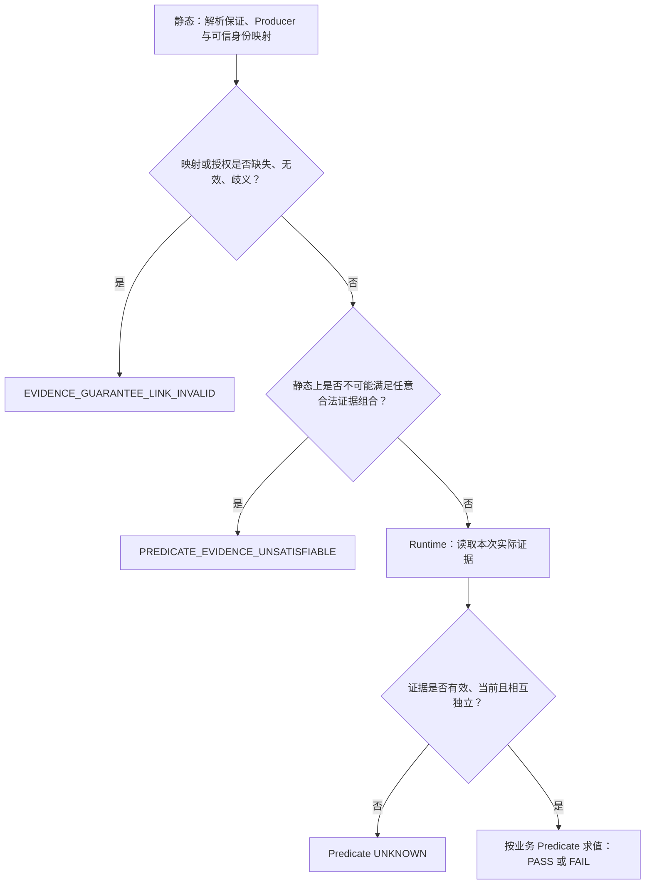

# ConnectionAgent Skill Language Specification（CA-SL）

**中文名称：** ConnectionAgent Skill 语言规范  
**简称：** CA-SL  
**目标版本：** `connectionagent.io/v1alpha3`（简称 v1alpha3；`vNext` 仅为资料性系列别名）  
**状态：** FROZEN — CA-SL v1alpha3（语言与已规定的互操作语义；产品实现 NOT QUALIFIED）  
**规范所有者：** odango-chan/ca-skills  
**适用对象：** Skill 作者、Skill Studio、Compiler、Agent Host / Runtime、Tool Owner、Schema Owner、语言服务及符合性评审机构  
**更新日期：** 2026-11-15

**文件效力。** 本文件是 CA-SL vNext / v1alpha3 的规范性语言定义。源码格式、静态链接、执行语义、授权、Evidence、诊断及附录所列规范性预期均以本文件为准。其他资料不得覆盖本文件的规范性要求。

**规范性用语。** MUST、MUST NOT、REQUIRED、SHOULD、SHOULD NOT、MAY、OPTIONAL 按 RFC 2119 和 RFC 8174 解释。相应中文规范性措辞包括“必须”“不得”“应当”“不建议”“可以”。

**单文件评审版（2026-11-15）。** 此文件已经整合各轮 v1alpha3 勘误、术语澄清、字段权威表、作者指南、执行决策、符合性分工和资料性测试候选。**只需评审这一份 Markdown**：§0–§45 及附录 A–H 包含现行规范正文、完整 E01–E114 预期、F/G 互操作规则和 H 诊断索引；附录 I 是合并后的作者指南，附录 J 是决策与历轮裁决摘要，附录 K 是测试候选及验收报告（后三者均 Informative）。历史 PR/勘误文件仅保留审计记录，不是解释本规范的必读文件，也不能覆盖本文件。语言语义继续 FROZEN，产品符合性继续 NOT QUALIFIED。

**评审导航：** §0 确定效力与范围；§9–§14 检查 Owner 契约、DAG、SourcePath 和数据绑定；§17–§24 检查 Evidence、Reconcile、路由与诊断；§32–§45 检查 Script、可信依赖及产品门槛；**附录 E** 含全部 E01–E114 预期，**F/G** 为规范性互操作和 Schema/CEL 规则，**H** 为统一诊断索引；**I/J/K** 分别是作者指南、最终裁决与待实施验收材料（资料性）。所有内容均在当前文件中。

---

# 第一部分：背景与目标

**默认效力：Normative。**

## 0. 规范状态与适用范围

CA-SL vNext / v1alpha3 的作者源码语法、静态语义、运行语义、附录 F/G 的互操作约束及附录 H 的诊断分类具有规范性效力（Normative）。

| 术语或状态 | 含义 | 效力 |
|---|---|---|
| `vNext` | 本规范对应的演进版语言系列名称，不独立指定机器可解析版本 | 资料性别名 |
| `connectionagent.io/v1alpha3` | 本版语言目标的精确标识；构建时仍由 BuildRequest 明确指定 | 规范性目标 |
| `API v1alpha3` | 本文规定的抽象互操作语言版本，不等于所有外部 Owner、BuildRequest 或 Artifact 协议均采用同一版本 | 规范性语义边界 |
| `FROZEN` | 本版已冻结语言语法、链接和运行语义；语义变更按 §45.1 升版 | 语言状态 |
| `NOT QUALIFIED` | §45.2 的独立产品符合性门槛尚未完成，不得推断 Compiler、Studio、Host、Tool Owner 或真实 5GC 已通过验收 | 产品状态 |

附录 E 中的示例数据和测试装配为资料性内容（Informative），其明确规定的预期诊断和行为具有规范性效力。

**冻结范围及规范效力（交叉索引）：**

| 规范内容 | 本版效力及唯一判定入口 |
|---|---|
| Contract / Procedure / PredicateSet 作者源码、阶段与图、SourcePath、Evidence、Reconcile 和终态 | **Normative、FROZEN**；§10–§24 与附录 G.1–G.9。§22.1 决定必需路由键；§24.1/§24.2 决定触发规则，附录 H 决定 `(Code, Phase)` 诊断身份及分类 |
| ToolCatalog、CapabilityContracts、Evidence Descriptor 等已声明的抽象互操作逻辑属性 | **Normative、FROZEN**；附录 F/G 与 §9/§17/§34 共同规定；实际 Owner 发布与可信传输格式按独立版本契约和 §45.2 验收 |
| 附录 E 的测试示例及组装数据 | **Informative 示例数据**；其明确写出的预期诊断和结果 **Normative**，不得因示例使用教学 Owner 身份而推断真实发布物已存在 |
| §28–§31 的 5GC 教学 Procedure、Schema、CEL 片段及 §9 的示意 Owner ID | **Informative 教学数据**；引用的通用语义仍依对应 Normative 条款，示例的 Host/Owner 假设须在真实发布前独立验证 |
| Skill Eligibility / Root Routing 的选中算法和完整 `Applicability` YAML 作者语法 | **未在 v1alpha3 作者源码语法中定义或冻结**；属于独立 Host/Root Routing 契约。§12.8 已冻结的“不能唯一匹配则拒绝准入”安全要求仍有效，但不得把此条件误认作完整选择协议已发布；不得默许旧 `applicability.when` |
| Compiler Artifact、Runtime Trace、BuildRequest 的物理 framing/运输及真实 Tool Owner 的发布物 | **由各自版本契约拥有**；不得从 CA-SL FROZEN 推断其序列化格式或产品符合性已通过 |

**符合性声明类型矩阵（Informative，细分 §45.2 已有验收义务，不是新的语言语法或产品协议）。** 对外报告不得只写“符合 CA-SL v1alpha3”而不列实现对象、测试能力、版本与受信证据。规范文本的 `FROZEN` 不是任一种产品的 PASS。

| 可声明的范围 | 所需精确边界与已存在的验收门槛 | 不得推导的结论 |
|---|---|---|
| **规范语义冻结**（Language specification） | 精确 `connectionagent.io/v1alpha3` 和本规范受审提交；§45.1 的变更边界 | 不表示任何 Compiler、Host、Owner 已执行通过 |
| **Compiler 静态符合性** | §45.2 第 2/3/4/8 项中适用于静态链接的受信输入、E 变体和 H 的 `C_STATIC/C_WARNING` 诊断；Native/WASM 使用同一冻结源与原始结果 | 不表示 Runtime/Owner、Root Routing 或完整部署已验收 |
| **Studio/LSP 静态一致性** | 相同源码与依赖快照下与 Compiler 的诊断/语言行为一致；§45.2 第 4/8 项，注明该产品实现版本 | 不表示 Studio 实现了 Runtime 或取得真实 Owner 证据 |
| **Host/Runtime 执行符合性** | §45.2 第 1/2/5/7/8 项及适用动态用例，要求经版本化的 Artifact/Trace、隔离、Scope、责任和真实回包/模拟证据 | 不包含未交付的 Owner 物理协议或完整 Root Routing 自动选中能力 |
| **Owner/Deployment 互操作符合性** | 版本化的可信 Owner 发布物、身份输入标注、Capability、Evidence 域/共同事实、Reconcile 专用关联及真实原始字节/摘要/授权；§45.2 第 1/2/8 项 | 无发布物时不能凭 F/G 的逻辑模型宣称互操作通过 |
| **Root Routing 产品符合性** | 独立版本化的 Eligibility / `Applicability` 选择协议及 Host 歧义拒绝验收，须写明对应版本和范围 | §12.8 仅冻结拒绝歧义原则，不提供完整选择算法 |
| **集成/真实 5GC E2E 符合性** | 上述实际适用层已获可信证据，§45.2 第 6 项真实 5GC 36 Case 与相关 Owner 验证；记录失败和遗漏 | 单独编译通过、规范文本冻结、未执行的 E/DFX 不构成 E2E PASS |

**声明规则：** 在报告中按实际执行层分别注明 `claimScope`、规范提交、所用外部协议版本、确切 Fixture/测试套件版本、已执行变体、失败/未覆盖、原始结果与发布者授权；未覆盖的层写 `NOT_TESTED` 或 `NOT_QUALIFIED`。其中 `claimScope` 等名称只描述附录 K 的**资料性报告视图**，不是本语言新增的线协议字段。E01–E114 只是冻结的规范预期编号，完整 E 列表和 H 的诊断集合均**不意味着已存在可执行套件**；套件的具体版本、覆盖率与执行证据须单独登记（§45.2、K.4）。

**规范文件完整性。** 附录 E（测试预期）、F（互操作字段）、G（闭合性补充）、H（诊断索引），以及 §30–§45 均属于**本文件的组成部分**；第十一部分 §46–§91 为资料性技术问答/设计说明。附录 I/J/K 已收编原先另行维护的作者指南、决策追踪、勘误裁决及测试/报告辅助材料，全部为 Informative；它们不增加字段或放宽 Normative 条款。本版完整评审仅需当前 `docs/skill-language-spec.zh-CN.md` 的**同一受审提交**，无需跨文件拼合；仅摘取 §0–§29 或截断 CEL 片段不能替代全文符合性评审。

BuildRequest 传输格式、Compiler Artifact、Runtime Trace 及 Tool Owner 发布物分别受其自身的版本契约管理。本文件的冻结状态不构成上述产品或发布物通过符合性验收的证明。历史 v1alpha2 冻结记录及 v1alpha3 修订记录不覆盖本文件；互操作字段以附录 F/G 为准。

### 作者使用说明（资料性）

附录 E.8 提供最小作者源码实例，包括 Contract Goal、Host Context Schema、Predicate 签名、Postcondition 参数及 PASS 到 SUCCEEDED 的路由。业务前置条件使用 Precondition；外部调用使用 Operation 和相应的 Capability 声明；权威状态查询使用 Observation，并将查询结果及其 Evidence 显式绑定至 Predicate。

| 诊断代码 | 检查事项 |
|---|---|
| SOURCE_NOT_AVAILABLE | 检查 Producer 在所有到达路径均成功，且所取字段为必需；可改绑外层对象 |
| ROUTE_OUTCOME_MISSING | 按 §22.1 补齐当前阶段的必填边 |
| PREDICATE_EVIDENCE_UNSATISFIABLE | 核对 Producer、Outcome、值路径和保证声明 |

## 1. 背景与问题定义

ConnectionAgent Skill 定义在明确的业务目标、输入、上下文和授权条件下执行的确定性过程。其内容包括控制流、事实验证、异常处理及可审计的执行结果。Prompt 文本或非约束性 Tool 描述不属于本规范定义的可执行契约。

以 5G PDU Session Establishment 为例，规范涉及以下约束：

- 请求属于哪个 UE、PDU Session、PTI 和生命周期；
- 输入来自哪个权威来源，是否仍然有效；
- 哪个 Tool 可以执行什么动作，输入输出由谁定义；
- 某次调用是 READ 还是 MUTATION，是否被授权；
- 某个状态是 Operation Result、Observation Result，还是 Host 捕获的 Context；
- Mutation 已提交但响应丢失时，如何避免重复创建；
- Predicate 的 PASS 判定及其 Evidence 依据；
- Evidence 缺失、过期、冲突或不可取得时的 UNKNOWN 处理；
- 多个 UE、多个 Session 和多个 Invocation 如何保持隔离。

上述要求通过可静态检查、可链接和可审计的语言契约表达。

## 2. 设计目标

CA-SL 的规范性设计要求如下：

1. 业务目标清晰：Skill 描述业务目标和完成条件，不把网元实现细节伪装成业务语义。
2. 执行确定：Procedure 明确表达步骤、依赖、分支、失败处理和终态，不依赖隐式前序节点或模型临场猜测。
3. 输入有来源：每个输入来自 Skill 自有 Schema、Owner Schema、Operation Result、Host Context 或显式 Observation Query。
4. 契约归属唯一：Schema 由数据或接口的权威 Owner 发布；消费者不得复制并重新定义外部结构。
5. 权限可证明：Skill 授予 Capability；Procedure 调用精确 callable；部署侧 CapabilityContracts 定义 callable 归属和 Effect。
6. 观察与操作分离：Operation Result 与 Observation Result 保持不同语义；Observation 是受治理的只读查询能力。
7. Evidence 独立：Evidence 证明业务值的来源、主体、时间和相关性，不是业务 Payload 的替代品。
8. 不确定性显式：PASS、FAIL、UNKNOWN 不得混为一谈；Mutation 结果不确定时，按 §20 调和原操作或安全停止。
9. 运行时边界明确：Script 只做确定性本地计算；Tool 负责外部交互；Host / Runtime 负责授权、隔离、Evidence 和执行治理。
10. 工具链同源：Compiler、LSP、Skill Studio 和 Runtime 消费同一套语言语义。
11. 可演进：语言版本、Schema 身份和 Owner 契约版本明确；破坏性变化不通过静默兼容掩盖。
12. 可审查性：规范性规则独立于特定实现，能够据此进行符合性判定。

## 3. 不适用范围

CA-SL 不定义通用编程语言、BPMN 执行引擎、Prompt DSL、Tool/MCP/HTTP 接口协议、包管理器、依赖解析服务、数据库、记忆系统、Python 执行环境、实时网络状态权威来源或符合性测试执行器；也不重新定义 3GPP 协议字段。

CA-SL 的适用范围限于已发布 Owner 契约之上的确定性业务编排。3GPP、OpenAPI、AsyncAPI、Provider API 及网元内部协议的规范性职责不受本文件替代。

## 4. 符合性角色

| 角色 | 责任 |
|---|---|
| Skill Package | 遵守源码、身份、引用、绑定和授权规则 |
| Compiler | 解析、链接、校验、生成诊断和规定的派生产物 |
| Skill Studio | 编辑、依赖快照、语义导航和诊断体验 |
| Tool Owner | 发布真实、完整、版本化 ToolCatalog 与 Input/Output Schema |
| Observation Owner | 发布查询身份、QueryContext、输出、来源、范围和 Evidence 保证 |
| Capability Owner / Deployment | 发布可信 CapabilityContracts，定义授权边界 |
| Host / Runtime | 授权、Effect、Scope、Evidence、Deadline、Cancellation 和隔离 |
| Script | 只做确定性本地计算，不越过 Tool / Runtime 边界 |

静态构建成功、Runtime 就绪、单次 Invocation 成功与真实 5GC 系统验收属于不同的符合性层级，应分别提供验证结果（§45.2）。

---

# 第二部分：概念模型与术语

**默认效力：Normative。**

## 5. 源码与执行分层

1. **Skill 契约层：** 业务目标、全局前置条件、公共 Request Schema、Context 要求、公共依赖和显式 Capability Grants，由 contract.yaml 声明；Skill 身份由 Package 路径确定。
2. **Procedure 层：** 单一确定性执行图，包含入口 Precondition、Operation / Observation、局部判断、最终 Postcondition、分支和终态。
3. **Predicate 层：** 可复用的纯判断定义；CEL 或受约束的 Python evaluator。
4. **Tool / Capability 层：** Owner 发布的 callable 契约、Schema、Effect，以及部署侧精确授权关系。
5. **Host / Runtime 层：** 执行隔离、Admission、Evidence、Correlation、Freshness、Deadline、Cancellation 和最终状态。

~~~text
Skill Package
 ├── SKILL.md
 ├── assurance/contract.yaml   # Goal / Preconditions / Request / Context / Dependencies / Capability Grants
 ├── assurance/procedure.yaml  # Procedure graph only
 ├── assurance/predicates.yaml
 ├── schemas/                  # Skill-owned Schemas only
 ├── scripts/                  # Skill-owned deterministic Scripts
 └── cases/ / references/
Compiler
 └── normalized Skill artifact / execution graph / generated Schemas
DependencySnapshot ── ToolCatalog + Owner Schemas
CapabilityContracts ── exact callable → Capability + Effect
Host / Runtime ── admission, execution, correlation, Evidence
~~~

## 6. 术语

**Host** 负责准入、Root Routing、上下文物化、Evidence 保管及责任记录持久化。**Runtime** 负责执行已链接 Procedure、推进阶段、选择路由、派发准入及预算和 Deadline。二者可以共进程；分离部署的传输由 Runtime Artifact Contract 定义。

### 6.1 Skill / Skill Package

Skill 是具有明确业务目标、输入契约、授权范围和执行入口的可复用业务能力包。Skill 不是 Tool；一个 Skill 可以调用多个 Tool，也可以被 Agent Router 选择。

vNext 作者维护的 Package：

~~~text
skills/<skill-name>/
├── SKILL.md
├── assurance/
│   ├── contract.yaml
│   ├── procedure.yaml
│   └── predicates.yaml
├── cases/<case-name>/case.yaml
├── schemas/       # 仅 Skill 自有 Schema，例如公共 Request Schema
├── scripts/       # Skill 自有确定性 Python
└── references/    # 可选知识资料
~~~

| 资产 | 职责 |
|---|---|
| SKILL.md | 面向 Agent 的业务指导，不是第二份执行图 |
| contract.yaml | Skill 公共契约：Goal、全局前置条件、Request Schema、Context 要求、公共依赖和 Capability Grants |
| procedure.yaml | 唯一 Procedure 执行图：start、节点、路由和最终 Postcondition |
| predicates.yaml | 可复用 Predicate 定义及其参数签名 |
| cases/ | 业务场景和预期语义义务 |
| schemas/ | 仅存放 Skill 自有的 Schema |
| scripts/ | Skill 自有确定性 Python；可作为 Procedure 的本地 Script Operation，也可实现 Predicate |
| references/ | 可选知识资料，不是执行契约或 Evidence |

vNext 保留作者维护的 assurance/contract.yaml，但不再使用重复的 apiVersion、kind、metadata 等机器对象包装。Contract 声明 Skill 的公共业务契约、依赖需求和 Capability Grants；Skill 身份从 Package 根目录确定。语言版本由 BuildRequest / Compiler Target 决定。外部依赖的具体内容由 Studio / 调用方通过 DependencySnapshot 提供，不复制到 Skill Package 的 lib/。

### 6.2 Goal、Request、Invocation 与编译契约

- **Goal：** Skill 希望达成的业务目标，由 contract.yaml 声明。`GoalId` 是大小写敏感的标识，由一个或多个 §13.2 的 ASCII Identifier 以点号连接。每段以 ASCII 字母开头，后续可含 ASCII 字母、数字、下划线或连字符。Procedure 中的最终 Postcondition 以精确 GoalId 绑定该目标。
- **全局 Precondition：** Contract 的 `preconditions` 引用 Procedure 中必须 PASS 的前置判断，约束业务 Mutation 和成功终态。
- **Request：** 调用方为本次执行提供的业务请求，由 contract.yaml 的 requestSchema 指向 Skill 自有 Schema；Request 本身不证明网络状态。
- **Context Schema：** Skill 通过 `contextSchema` 选择 Host Owner 发布的 Invocation Context Schema。Compiler 以该 Schema 校验 Host 字段路径。
- **Dependencies：** Skill 声明所需的公共 Owner 契约身份（例如 ToolCatalog、Host Context、Observation、共享 Schema）。声明依赖身份，不携带下载地址、版本锁或依赖内容。
- **Capability Grants：** Skill 在 contract.yaml 中显式声明所需 Capability 身份。Compiler 逐一验证每个外部 callable 都属于已 Grant 的 Capability；不得从“源码调用了某个 Tool”自动推导授权。
- **Skill Identity：** 由规范化 Package 根路径 / Package 名确定，不再要求作者在 YAML 重复填写 metadata.name。
- **Compiled Skill Contract：** Compiler 将 contract.yaml、Procedure 和 Predicate 定义归一化为 Runtime 所需的契约投影。它是派生产物，不是第二份作者源码；若 Runtime 不需要独立 Contract 文件，也不必单独输出。
- **Invocation：** 一次 Skill 独立执行实例。每次 Invocation MUST 有独立运行身份和隔离上下文。不得因为 UE 相同而共享未声明的可变状态。

### 6.3 Invocation Context

- **Invocation Context / 有效 `context`：** 本次 Invocation 对 Procedure 开放的已校验逻辑数据视图。**Host Context** 仅指 Host 依据 `contextSchema` 物化并校验的 Invocation Context **Host 提供部分**；调用方 Request 经 `requestSchema` 独立校验后由 Runtime 在保留路径 `context.request` 拼接。两部分合成的只读逻辑视图称 `effectiveContext`（§11.5、G.6），不是并列存在的第二份可变 Context，也不能把 `request` 当成 Host Schema 自有字段重新校验。
- **UE Ref：** 本次业务执行的 UE 稳定引用，由 Host 解析并提供。
- **Correlation：** Host 接纳本次调用时确认的关联引用。5GC Invocation Context 包含 `correlation.ingressRef` 和 `correlation.lifecycleRef`。入口消息和原始 Evidence 由 Host 保管。

### 6.4 Procedure 与 Node

Procedure 是有向、确定性的执行图，定义输入、入口节点、动作、路由、恢复和终态。

Node 是图中的一个业务步骤，可包含 `precondition`、`operation`、`observation`、`postcondition`。阶段按 §12.1 顺序执行，至少声明一个。路由可以指向另一 Node 或直接结束本次 Invocation。一个 Node 可以经历多个阶段，Runtime 保留每个阶段的结果。

Precondition 和 Postcondition 只调用纯 Predicate，Operation 和 Observation 是同级阶段。前置判断若需先取证，可读取前序 Node 的输出。Contract 通过 `preconditions` 选择全局前置判断，各成功分支通过标记同一 Goal 的 Postcondition 完成全局验收。具体规则见 §12.9。

### 6.5 Tool、Tool Operation 与 Operation 阶段

- **Tool：** 由 Owner 注册、实现并发布契约的外部能力单元，可由 HTTP Adapter、MCP、内建集成或其他受治理实现提供。Tool 是实现和契约发布单元，不是 Skill 授权身份。
- **Tool Operation：** Tool 提供的精确外部可调用业务接口，声明唯一 ID、Effect、Input Schema、Output Schema，以及对 Mutation 可选的 `mutation.reconcile.recoverableOutputSchema/recoverableOutputPath` 恢复子对象定义。完整 Owner 调和回包仍由其独立 `outputSchema` 描述，不能按恢复子对象读取。它必须通过 CapabilityContracts 授权。
- **Operation 阶段：** Node 的三种互斥形态是：（1）**普通 Tool Operation**，调用已链接的外部 callable，受 READ/MUTATION Effect、Capability Grant、Scope 和派发准入约束；（2）**Procedure Script Operation**，只执行 Skill 自有的无外部业务副作用计算，不是 Tool callable、无需 Capability；（3）**Reconcile Operation**，按 §12.7 引用原 Mutation，通过该 Mutation 发布的**独立 READ Tool callable**调和，仍须为调和 callable 本身取得 Capability Grant、执行 Scope/原调用证明/预算校验，不能继承原 Mutation 的授权。三者均占用 `operation` 阶段，但只第（2）种属于本地纯计算。
- **Operation Result：** 普通 Tool Operation 与本地 Procedure Script 的规范化成功输出，以及 Reconcile 在已验证 `COMMITTED` 后按 `mutation.reconcile.recoverableOutputSchema/recoverableOutputPath` 提取、校验并可选暴露的**恢复业务子对象**。Reconcile 的完整 Owner 查询回包和 receipt 不是可绑定 Operation Result。所有实际可绑定结果保留其真实 Producer 身份及 Evidence 关联，不能伪装为 Observation Result（§12.7、G.2）。

### 6.6 Fact、Observation Query、Observation Result

必须区分：

- **Fact：** 关于业务、环境或执行状态的命题，例如“目标 UE 的指定 PDU Session 当前拥有已建立的 N4 资源”。
- **Observation Query：** 向权威事实 Owner 查询状态的独立只读 Tool 接口，是 Tool 体系中的特殊 callable，Effect 必须为 READ。
- **Observation Result：** Observation Query 返回的、带来源、Scope、时间和相关性语义的规范化事实表示。

Observation Query MUST 由事实权威 Owner 或经授权的查询 Owner 发布；必须有精确身份、QueryContext / Input Schema、Output Schema、READ Effect、权威来源、Scope、Temporal / Freshness、Correlation 和 Evidence 保证；必须通过 CapabilityContracts 授权和 Runtime Admission。

Observation Query MUST NOT 在 Predicate 内部隐式触发；不得强制与每个 Mutation 一对一配对；不得用于轮询刚调用的 Operation 的内部异步完成；不得仅因返回 JSON 就被视为可信事实。

一个 Tool 可以暴露多个 Observation Query。不存在 Mutation Operation 必须配套一个 Observation Query 的一对一要求。

### 6.7 Operation Result 与 Observation Result

| 维度 | Operation Result | Observation Result |
|---|---|---|
| 回答的问题 | 这一次调用返回了什么？ | Owner 对某个事实的查询结果是什么？ |
| 关联对象 | 一次 Operation Invocation | 明确查询 Scope 和查询时点 |
| 典型来源 | Tool 调用 | Observation Tool Query |
| 是否必然触发额外 Observation | 否，按 §12.6 判断结果是否充分 | 否，按 §12.6 判断是否还需其他事实 |
| 是否证明外部状态 | 取决于 Operation 契约和 Evidence | 取决于 Observation Owner 的权威和 Evidence |

若前序 Operation Result 已提供精确业务值，且 Evidence 足以证明来源、Scope、Correlation 和 Freshness，SHOULD 直接复用。

Mutation 成功响应也不自动证明网络状态达到目标。若 Mutation Result 仅证明请求已提交，仍需要最终结果或独立 Observation。

### 6.8 Evidence

Evidence 是对业务值或事实的来源、完整性、Scope、时间和相关性支持。Evidence 不属于业务 Payload，也不能由普通布尔值或未经验证的引用替代。

Evidence 至少需要表达或可由可信 Owner / Host 关联出：

| 维度 | 含义 |
|---|---|
| Producer / Owner | 谁产生或权威发布该事实 |
| Producer Contract | 哪个版本化 Operation / Observation 契约 |
| Producer Invocation | 哪一次调用产生该值 |
| Record / Artifact | 对应记录、资源、事件或产物引用 |
| Subject Scope | 属于哪个业务主体 |
| Resource Scope | 属于哪个 UE / Session / PSI / 资源实例 |
| Lifecycle / Generation | 属于哪个生命周期或资源代次 |
| Correlation | 对应哪次请求、事务或协议交互 |
| Temporal | 事件时间、Owner 观察时间、Host 接收时间 |
| Freshness | 有效时间窗、版本或新鲜度保证 |
| Integrity | 可选 Digest、签名或 Owner 完整性保证 |
| Schema Identity | 规范化 Payload Schema 身份 |

不是所有 Evidence 都必须平铺成一个 JSON 对象；Owner 可以使用内部结构，但对外契约 MUST 允许 Host 验证当前事实所需维度。

eventTime、observedAt 和 receivedAt 不得混为一个时间戳。

Payload 是 Predicate 判断的业务值；Evidence 是 Host 判断该值是否可信的依据；Evidence refs 是可信记录引用。Skill Script 不得创建或扩大 Evidence。

### 6.9 Predicate、Capability、Effect、Reconcile

- **Predicate：** 纯、可重复、无副作用的确定性计算 / 判断函数，声明有序类型参数，使用 CEL 或受限 Python Script 实现，返回 PASS / FAIL / UNKNOWN。它由 Procedure 的 Precondition 或 Postcondition 阶段调用，不是独立 Procedure Node。
- **Capability：** 部署侧授权分组和资源边界，不是 callable，也不是 Operation 别名。一个 Capability 可以包含多个 Operation 和 Observation Query。Skill 只声明 Capability Grant。
- **Effect：** 初始支持 READ 和 MUTATION。READ 仍需要授权、Scope 和审计。
- **Reconcile：** 对已经发起但结果不确定的原始 Mutation 进行调和。它是 Operation 的受约束执行模式，不是独立业务节点类型；必须针对原始身份、Operation Ref、Correlation 和 Scope，不得在未经声明及授权的情况下创建新 Mutation。

### 6.9.1 Evidence 互操作术语（说明性索引）

- **保证描述符（Guarantee Descriptor）：** 由受信 Evidence Owner 发布的保证定义，精确约束事实身份、Producer/outcome/valuePath、Scope、Correlation、Freshness、selection 及可选的 `sourceIdentity`、`factIdentity`；ToolCatalog 的 `provides` 只能引用它，不得复制权威。
- **可信绑定（Trusted Binding）：** 由获授权发布者和可信部署构建入口认证的 Package/Owner/导出/工件摘要及部署 Scope 对应关系，不由 Skill YAML、文件名或 Owner 自述建立权限。
- **独立域关系（IndependentDomains）：** 受信装配的底层来源身份域及经授权、不自反且无重复的无序独立域对；它不表示“Owner 名字不同就独立”，也不推导传递性（§34.0.2、G.3.1）。
- **共同事实绑定（Shared Fact Binding）：** 受信部署将多个 Owner 的 `factIdentity` 指向同一 namespace/fact，并验证参与 Owner、Scope 归一化、值 Schema 与发布者授权的关系（§G.3.1）。
- **可恢复输出 Schema（Recoverable Output Schema）：** 原 Mutation 发布的 `mutation.reconcile.recoverableOutputSchema`，只在调和已证明 `COMMITTED` 且 `recoverableOutputPath` 子对象校验成功时用于 `reconcile-node.operation.output`；不同于 Reconcile READ callable 的完整 `outputSchema`（§12.7、G.2）。

这些术语为已有规范的导航，不创建额外字段或授予隐式授权。

### 6.10 Script、Case、Reference

- **Script：** Skill Package 自有确定性 Python。Procedure Script 是 Operation 阶段的纯本地数据转换/选择目标，Predicate Script 是 Predicate 的 evaluator；两者均非独立 Procedure 节点或外部 Tool / Capability。
- **Case：** 业务场景和预期语义义务声明，不是执行器，不证明真实运行通过。
- **Reference：** 给 Agent 阅读的补充知识，不是 Tool Schema、Evidence 或自动 Runtime 输入。

**结果与诊断的命名空间提示（Informative，不新增 Trace 线格式）：** Owner Outcome、Procedure Stage Outcome、Route Target、Invocation Terminal Status 与 Diagnostic 是不同语义维度；具体允许集合及转换见 §22、§22.1、§24、附录 H。实现内部或可审计报告可分别命名为 `ownerOutcome`、`stageOutcome`、`routeTarget`、`terminalStatus`、`diagnostic.code` / `diagnostic.phase`，防止裸 `SUCCEEDED` / `FAILED` 被误解为最终状态。**这些名称只是示意性逻辑投影，不是 v1alpha3 新增的 JSON/YAML 字段**；真实 Trace 的物理字段、版本和兼容性归独立 Runtime Artifact Contract，按 §45.2 第 7/8 项验收。任何实际记录都必须能区分相应来源、阶段与终态，不得将阶段成功推断为 Invocation SUCCEEDED。

### 6.11 Action 与阶段 Outcome

Action 是按 §11.6 计入预算的一次执行动作。阶段 Outcome 是当前阶段用于选择后继边的结果，枚举见 §22。Invocation 终态按 §12.8 判定。

---

# 第三部分：架构边界与契约所有权

**默认效力：Normative。**

## 7. 唯一责任边界

| 事项 | Owner | 不得由谁代替 |
|---|---|---|
| Skill 业务目标和流程源 | ca-skills / Skill 作者 | Host 不得重写业务决策 |
| Skill 源码语义 | 本规范 | Compiler 不得自行发明语义 |
| Request Schema | Skill Owner | Host 不得复制定义 |
| Tool Input / Output Schema | Tool Owner | Skill 不得维护影子 Schema |
| Observation Query Schema | Observation Owner | Predicate 不得定义查询 Payload |
| Invocation Context | Host / Context Owner | Skill 不得伪造可信上下文 |
| Evidence 记录和校验 | Evidence Producer + Host | Script 不得制造可信 Evidence |
| Capability 成员和授权 | Deployment Capability Owner | Skill 不得扩大授权 |
| 依赖获取和快照 | Skill Studio / 调用方 | Compiler 不得联网获取 |
| 静态解析和链接 | Compiler | Runtime 不得静默修补源码 |
| 外部副作用 | Tool / Provider / Adapter | Script 不得直接访问外部系统 |
| Deadline / Cancellation | Host / Runtime | Skill 不得定义任意轮询循环 |
| 真实网络状态 | 对应网元 / Owner | Skill 本地变量不是真相来源 |

## 8. Schema 所有权和身份

Skill 自有的 Request Schema 和业务数据结构存放于 `schemas/`。

Tool Owner 必须发布 callable 的 Input、Output，以及受支持的 Mutation Reconcile 契约及其可恢复输出 Schema。下游需要静态访问嵌套字段时，Owner 必须提供完整结构，不得长期用宽泛 object 掩盖缺失字段。

Observation Owner 发布 QueryContext / Input 和规范化 Output Schema。不得在 Skill Package 或平行 Observation Registry 中复制第二份。

Host Owner 发布 Invocation Context Schema。Contract 的 `contextSchema` 引用其精确 Schema ID，Procedure 在调用点显式绑定 `context` 路径。Compiler 检查依赖别名、可信快照身份、Owner、精确 Schema 和实际引用的字段。Host 按 §11.5 校验上下文并保留来源关联。

Script 输入和输出：
- Procedure Script 作为 Operation 阶段的本地纯执行目标，输入和输出 Schema 分别从入口的参数和返回 TypedDict 派生，调用点显式绑定 arguments；
- Predicate Script 作为 Predicate evaluator，输入类型由 Predicate.parameters 派生，Host 附加只读 Evidence refs；
- Predicate Script 返回严格 PredicateEvaluationResult TypedDict，其中 result 为 PASS / FAIL / UNKNOWN，reasonCode 用于诊断，evidenceUsed 只能引用 Host 已附加的 Evidence；
- 作者不得维护重复 Script Input / Output Schema；
- Compiler 不得通过执行 Python 函数体推导静态类型或运行行为。

必须区分物理路径、Schema 身份和 Dependency Alias。外部 Schema 使用：

~~~yaml
type: ca-context::urn:connectionagent:ca:context:invocation:v1
~~~

ca-context 是依赖别名，后半部分是 Owner 发布的精确 Schema $id。Skill 自有 Schema 使用包内路径：

~~~yaml
type: schemas/establishment-request.schema.yaml
~~~

文件路径不是跨包公共身份。Compiler 必须验证引用指向真实 Schema 身份，不得由文件名推断。

## 9. ToolCatalog 和 CapabilityContracts

### 9.1 ToolCatalog

ToolCatalog 是 Tool Owner 发布的 callable 契约集合。vNext 要求同一 ToolCatalog 和依赖快照能够容纳 Operation 与 Observation Query 两种 callable。两者是不同类型，但共享精确导出身份、Owner、Schema、Effect、依赖解析、Capability 授权和 Runtime Admission。

### 9.2 Observation 在 ToolCatalog 中的规范表达

**效力：Normative（抽象规则及附录 F 的 v1alpha3 字段）；Informative（示例身份）。**

**规范性说明。** 类型化 ToolCatalog 导出与链接规则按附录 F.1 冻结；真实 Owner 发布独立验收。

以下是冻结的互操作结构的教学实例，并非当前 Owner 的正式发布物：

~~~yaml
apiVersion: connectionagent.io/toolcatalog/v1alpha3
kind: ToolCatalog
metadata:
  name: smf-session-state
  owner: smf-owner
spec:
  contracts:
    - kind: operation
      id: smf.session.create
      adapter: smf-http
      effect: MUTATION
      ownerOutcomes: [SUCCEEDED, FAILED]
      inputSchema:
        $ref: urn:example:smf:create-session-input:v1
      outputSchema:
        $ref: urn:example:smf:create-session-result:v1
    - kind: observation
      id: smf.session.n4_resources
      adapter: smf-state-query
      effect: READ
      ownerOutcomes: [SUCCEEDED, FAILED]
      queryContextSchema:
        $ref: urn:example:smf:n4-query-context:v1
      outputSchema:
        $ref: urn:example:smf:n4-observation-result:v1
      guarantees:
        evidence:
          provides:
            - guarantee: smf.n4-resources
              path: output
~~~

**Normative。** 同一依赖快照中，全部 callable 导出 ID 共享命名空间，跨 ToolCatalog 文件与 callable kind 也不得重复。不同快照可复用 ID，由显式依赖别名选定快照。Capability 成员仍按可信 Owner、callable ID 与 kind 匹配；不同快照中的同一成员身份须通过独立的归属、Effect 与授权检查。

**Normative。** `kind` 区分 Operation 与 Observation，`id` 编码上述导出 ID。`ownerOutcomes` 按 callable 类别及 Effect 映射 §22 的 Owner 结果集合，调和 callable 按 §20.3。Observation 不得在该集合声明 NOT_COMMITTED 或 OUTCOME_UNKNOWN。QueryContext Schema 表达查询输入，Observation Output Schema 表达 Owner 承诺的规范化结果。`guarantees.evidence.provides` 只链接保证及输出路径。`adapter` 表示 Owner 内部实现绑定。

不得通过通用 observation.read 和任意字符串 selector 暴露任意内部数据。字段含义按附录 F.1 固定；Tool Owner、Compiler 和 Runtime 须以相应版本的导出和 Fixture 完成产品符合性验收。

E.3 给出了带精确 Outcome 与 Evidence 描述符的独立 READ 样例。普通调用仅在 SUCCEEDED 边暴露成功输出。Reconcile 的路由和输出见 §12.7。

### 9.2.1 Mutation 发布契约

**效力：Normative（抽象属性与附录 F.1 字段）；Informative（示例 ID）。**

| 规范抽象属性 | v1alpha3 字段映射 |
|---|---|
| 提交证明 Schema、值路径和原调用关联 | `mutation.commitProof` |
| 互斥失败类别、阶段映射和未提交证明 | `mutation.failureClassPath`、`mutation.failureClasses[].id/outcome/proofSchema/proofPath` |
| 无遗留副作用的承诺及独立的重试许可 | `mutation.failureClasses[].noSideEffect/retryable` |
| 调和 callable、原调用绑定、证明路径及可选恢复输出路径与 Schema | `mutation.reconcile.callable/bind/proofSchema/proofPath/recoverableOutputSchema/recoverableOutputPath` |
| 资源或外部变更的身份、关联、责任与处置描述 | `resourceOutputs[]` 及其引用的责任记录 Schema |

v1alpha3 按附录 F.1 的字段映射到抽象属性，并执行规范性校验。其他外部协议版本必须显式版本化解码，不能默许不兼容字段或未知保证。

**Normative。** Mutation Owner 声明提交证明的 Schema、取值位置及原调用关联、互斥失败类别及其阶段映射、无遗留副作用承诺和重试资格。FAILED 类别必须证明未提交且无遗留副作用，重试资格为否。NOT_COMMITTED 只证明未提交，只有明确允许重试且无遗留副作用才授予受控重试资格。每个类别映射必须属于已声明 Owner Outcome。声明支持 Reconcile 时，还须链接其精确 callable、原调用身份绑定、证明 Schema 和可选的 COMMITTED 恢复输出 Schema。至多一次由 Runtime 对原调用持久化执行。每个可能遗留的资源或外部变更须有可验证的责任记录描述，包括来源、资源类型与句柄或变更身份、责任 Owner、原调用关联及处置状态。

**Normative 字段；Informative 示例值。** 下例是 §9.2 中 smf.session.create 的扩展正例。路径和 Schema ID 为教学输入，由 Fixture 提供。`receipt.commit` 与 `receipt.failureClass` 的首段 `receipt` 是 Owner 规范化回包的**证明通道锚点**，不是 `receiptSchema` 根对象的属性；静态剥离锚点后的子路径从 `receiptSchema.$ref` 的根检查，详见 G.2.2。未声明 Reconcile 的 Mutation 仍可直接停止。

~~~text
ownerOutcomes: [SUCCEEDED, FAILED, NOT_COMMITTED]
receiptSchema: {$ref: "urn:example:smf:receipt:v1"}
mutation:
  commitProof: {schema: "urn:example:smf:commit-proof:v1", path: receipt.commit, bind: originalInvocationId}
  failureClassPath: receipt.failureClass
  failureClasses:
    - {id: invalid-session, outcome: FAILED, proofSchema: "urn:example:smf:not-committed:v1", proofPath: receipt.commit, noSideEffect: true, retryable: false}
    - {id: transient-rejection, outcome: NOT_COMMITTED, proofSchema: "urn:example:smf:not-committed:v1", proofPath: receipt.commit, noSideEffect: true, retryable: true}
  reconcile:
    callable: smf.session.reconcile
    bind: originalInvocationId
    proofSchema: "urn:example:smf:reconcile-proof:v1"
    proofPath: receipt.commit
    recoverableOutputSchema: "urn:example:smf:create-session-result:v1"
    recoverableOutputPath: output.recovered
  resourceOutputs:
    - {path: output.sessionInstanceRef, resourceKind: smf.session, responsibilitySchema: "urn:example:smf:resource-responsibility:v1"}
~~~

**Normative。** Compiler 校验解码后描述符的 Schema、路径和关联是否可链接，Reconcile 绑定错误报 RECONCILE_CONTRACT_INVALID。Runtime 按 §20 先核验证明，再物化资源责任记录。只有经验证已完成且仍需处置的资源或已确认变更才能作为 §12.8 的 SAFE_STOPPED 依据。输出缺失时不得编造资源句柄。独立证明确认外部变更且尚待处置时，保留原调用身份和责任即可记录该变更。

### 9.3 CapabilityContracts

**效力：Normative（抽象规则及附录 F 的 v1alpha3 字段）；Informative（示例身份）。**

**规范性说明。** CapabilityContracts v1alpha3 互操作字段及授权与 Effect 语义均为 Normative（附录 F.2）。

CapabilityContracts 是部署侧可信输入，独立于普通 DependencySnapshot。冻结的互操作字段示例：

~~~yaml
apiVersion: connectionagent.io/capability-contracts/v1alpha3
kind: CapabilityContracts
metadata:
  name: 5gc-createdsession
spec:
  capabilities:
    - id: provider-5gc.session-mutation
      owner: deployment
      callables:
        - owner: provider-5gc
          id: sbi.udm.sdm_subscription.create
          kind: operation
          effect: MUTATION
          scopePolicyRef: deployment.smf-session-mutation
        - owner: smf-owner
          id: smf.session.n4_resources
          kind: observation
          effect: READ
          scopePolicyRef: deployment.registration-read
~~~

CapabilityContracts 使用稳定 Owner 身份、精确 callable ID 和 kind 标识成员。Compiler 查找该身份的所有成员记录，要求至少一个所属 Capability 已被 Skill Grant。仅对匹配且已 Grant 的成员解析 Scope。缺失或不可解析报 `CAPABILITY_SCOPE_UNRESOLVED`，静态可证的空交集报 `CAPABILITY_SCOPE_EMPTY_INTERSECTION`。未 Grant 成员无需解析 Scope，Effect 一致性检查仍适用。Scope 依赖实际 Runtime 参数时，在派发前裁决。

多个已 Grant 成员同时匹配时，实际 Scope 取这些成员边界与 callable、Invocation 授权范围的交集。空交集禁止派发。未 Grant 成员只参与 Effect 一致性检查。候选线格式可用成员级 `scopePolicyRef` 指向部署发布的规则。所有匹配记录的 Effect 必须与 ToolCatalog 一致，包括未获 Grant 的记录。Effect 描述 callable 本身，Grant 仅决定访问资格。检查未获 Grant 的成员可在授权变动前发现同一 callable 的身份冲突，部署侧须修复冲突记录后重新链接。同一 Capability 内重复声明同一成员报 `CAPABILITY_MEMBERSHIP_DUPLICATE`，跨 Capability 的一致成员合法。

Runtime 在派发时对可信部署契约重新执行同一 Effect 与授权检查。缺少 Grant、重复记录或 Effect 冲突时禁止派发。该 YAML 是 v1alpha3 互操作字段的示例，真实部署批准独立验证。

---

# 第四部分：源文件与 YAML 语法

**默认效力：Normative。**

## 10. 版本和文件

vNext 作者源码保留 contract.yaml、procedure.yaml 和 predicates.yaml 三个语义明确的入口文件。文件路径与所在目录决定源文件类型；这些文件不需要重复声明 apiVersion、kind 或 metadata 包装。

语言版本由 BuildRequest / Compiler Target 明确指定，而不是由每个 YAML 文件重复声明。Compiler 必须严格按指定版本解析；不支持的版本必须失败，不得猜测或兼容映射。编译产物记录实际采用的语言/API 版本、Skill Package 身份和生成器版本。

vNext 是破坏性版本。Compiler MUST NOT 静默把 v0.2 字段、旧路径或旧隐式输入模型转换为 vNext 语义。

当前仓库中的可执行 5GC Skill 仍有 v0.2 形态。本文示例说明目标语言，不代表旧文件已迁移或当前 Compiler 已支持。

## 10.1 YAML 语法子集与结构文法

CA-SL 使用 YAML 1.2 表达作者源码。YAML 是序列化格式，不是完整语言语义。Compiler MUST 使用安全解析器，并拒绝重复 Key、未知语义字段、非预期根类型、自定义 Tag、循环 Alias 和无法确定解释的标量。

vNext 的作者 assurance 源码由三个独立角色组成：**Skill Contract**（`contract.yaml`）、**Procedure 图**（`procedure.yaml`）和 **PredicateSet**（`predicates.yaml`）；各自承担公共需求、执行控制流及纯判断定义，互不替代：

~~~yaml
# assurance/contract.yaml
goal: pdu_session.initial_request_fulfilled
preconditions:
  - check-ue-registration.precondition
requestSchema: schemas/establishment-request.schema.yaml
contextSchema: ca-context::urn:connectionagent:ca:context:invocation:v1
dependencies:
  ca-context: urn:example:connectionagent:host-context
  ca-responsibility: urn:example:connectionagent:resource-responsibility
  ca: urn:example:connectionagent:5gc-tool-contracts
capabilities:
  - fivegc-session-read
  - fivegc-session-mutation
  - fivegc-session-assurance
  - fivegc-session-responsibility
~~~

~~~yaml
# assurance/procedure.yaml
start: observe-ue-registration
nodes:
  observe-ue-registration:
    observation:
      target: ca::ue.registration.current
      arguments:
        ueRef: context.ueRef
      routes:
        SUCCEEDED: check-ue-registration
        FAILED: FAILED
        UNKNOWN: UNRESOLVED
  check-ue-registration:
    precondition:
      predicate: createdsession.ue.registered
      arguments:
        - observe-ue-registration.observation.output
      routes:
        PASS: read-udm-subscription
        FAIL: FAILED
        UNKNOWN: UNRESOLVED
~~~

以上 Procedure 只展示入口，`read-udm-subscription` 在 §30 的完整教学图中定义。

规范性结构文法（抽象对象文法；map 表示 YAML 映射，字段 Schema 和静态语义另见 §11–14）：

结构记法：`map(key: Type, ...)` 表示 YAML 映射，键为指定字面量；`list<Type>` 表示 YAML 序列，键后的 `?` 表示该字段可省略。

~~~ebnf
Contract          = map(goal: GoalId,
                        preconditions?: list<PreconditionRef>,
                        requestSchema?: LocalSchemaPath,
                        contextSchema?: QualifiedSchemaId,
                        dependencies?: map<Alias, StablePackageId>,
                        capabilities?: list<CapabilityId>,
                        limits?: map(maxActions: PositiveInteger))
GoalId            = Identifier { "." Identifier }
PreconditionRef   = NodeId "." "precondition"
Procedure         = map(start: NodeId, nodes: map<NodeId, Node>)
Node              = map(precondition?: Precondition, operation?: Operation,
                        observation?: Observation, postcondition?: Postcondition)
Precondition      = map(predicate: PredicateId, arguments: list<Expression>,
                        routes?: OutcomeRoutes)
Postcondition     = map(predicate: PredicateId, arguments: list<Expression>,
                        goal?: GoalId, routes?: OutcomeRoutes)
Operation         = ToolOperation | ScriptOperation | ReconcileOperation
ToolOperation     = map(target: QualifiedCallableId, arguments: map<Name, Expression>,
                        retryOf?: NodeId, routes?: OutcomeRoutes)
ScriptOperation   = map(script: LocalScriptPath, arguments: map<Name, Expression>,
                        routes?: OutcomeRoutes)
Observation       = map(target: QualifiedQueryId, arguments: map<Name, Expression>,
                        routes?: OutcomeRoutes)
ReconcileOperation = map(reconcile: OriginalMutationNodeId,
                        routes?: OutcomeRoutes)
QualifiedCallableId = Alias "::" ExportId
QualifiedQueryId  = QualifiedCallableId  # resolves to an Observation export
Expression       = SourcePath | ScalarLiteral  # §13.2
Outcome          = StageOutcome  # exact set in §22
OutcomeRoutes     = map<Outcome, RouteTarget>
RouteTarget       = NodeId | TerminalStatus
TerminalStatus    = SUCCEEDED | FAILED | UNRESOLVED | SAFE_STOPPED
~~~

Node ID 与 `Identifier` 使用同一字符规则。Compiler 在解析 `start` 和路由前拒绝使用 `context` 或任一 `TerminalStatus` 精确拼写的 Node ID。`start` 必须引用真实 Node。Node 至少有一个阶段，各阶段最多声明一次。各阶段在自己的 `routes` 中按 Outcome 指定目标，允许键和必填键由 §12.1、§22 决定。省略 `routes` 与空映射等价，两者仅在该阶段的没有必须显式路由的非正常 Outcome 且后面还有阶段时合法。其他情况须写全 §22 要求的路由，缺键阻断构建。Reconcile 不接收 `arguments`。解析器拒绝未知字段和重复阶段，保留 YAML 标量的引号风格。

本版仅有单一 Procedure 图，不定义 entryProcedure、嵌套 ProcedureCall、通用 call、隐式 Step 或同名自动绑定。完整 PredicateSet 文法、标识符、绝对 Schema URI 以及 ScalarLiteral 字符集见 G.1；合法 YAML 但违反 CA-SL 标识符文法的源码必须以 IDENTIFIER_INVALID 或 QUALIFIED_REFERENCE_INVALID 拒绝。
Compiler 必须设置文档字节数、嵌套深度、Alias 展开规模的有限上限，并在超限时拒绝输入。

`context.request` 是根级保留路径。Host Schema 的嵌套对象可使用属性名 request。

## 11. Skill Contract 与 Procedure 源码

vNext 保留独立的 `assurance/contract.yaml`。它不是旧式带版本包装的 Kubernetes 风格资源对象，而是 Skill 的公共声明文件。它与 `procedure.yaml` 分工：

- Contract 声明 Skill 对外的业务目标、全局前置条件、公共输入、Context 要求、公共依赖和 Capability Grants。
- Procedure 声明如何确定性地完成目标：start、业务 Node 的四个阶段、路由和最终 Postcondition。
- PredicateSet 声明可复用的判断定义和参数签名。

### 11.1 Contract 示例

~~~yaml
# assurance/contract.yaml
goal: pdu_session.initial_request_fulfilled
preconditions:
  - check-ue-registration.precondition

requestSchema: schemas/establishment-request.schema.yaml
contextSchema: ca-context::urn:connectionagent:ca:context:invocation:v1

# 仅声明稳定依赖身份；alias 是本 Skill 内部引用名。
# 不写 Git URL、版本锁、digest、分支或下载指令。
dependencies:
  ca-context: urn:example:connectionagent:host-context
  ca-responsibility: urn:example:connectionagent:resource-responsibility
  ca: urn:example:connectionagent:5gc-tool-contracts

capabilities:
  - fivegc-session-read
  - fivegc-session-mutation
  - fivegc-session-assurance
  - fivegc-session-responsibility
~~~

### 11.2 Procedure 示例

以下是独立的只读教学 Skill。其 Contract 声明 `goal: udm.session_profile_verified` 和 `preconditions: [check-registration.precondition]`。完整 Contract 还需声明本例使用的 Request、Host Context Schema、依赖和 READ Capability。Predicate 签名见 §29。

~~~yaml
# assurance/procedure.yaml
# 配套 Contract 的 goal: udm.session_profile_verified
start: observe-registration
nodes:
  observe-registration:
    observation:
      target: ca::ue.registration.current
      arguments:
        ueRef: context.ueRef
      routes:
        SUCCEEDED: check-registration
        FAILED: FAILED
        UNKNOWN: UNRESOLVED
  check-registration:
    precondition:
      predicate: createdsession.ue.registered
      arguments:
        - observe-registration.observation.output
      routes:
        PASS: read-subscription
        FAIL: FAILED
        UNKNOWN: UNRESOLVED
  read-subscription:
    operation:
      target: ca::sbi.udm.sm_data.get
      arguments:
        ueRef: context.ueRef
        dnn: context.request.dnn
        sNssai: context.request.sNssai
      routes:
        FAILED: FAILED
        DENIED: FAILED
        UNKNOWN: UNRESOLVED
    postcondition:
      goal: udm.session_profile_verified
      predicate: createdsession.udm.session_profile_usable
      arguments:
        - read-subscription.operation.output.result
        - context.request.dnn
      routes:
        PASS: SUCCEEDED
        FAIL: FAILED
        UNKNOWN: UNRESOLVED
~~~

本例要求 Registration 查询输出与 §29 的 Registration 参数 Schema 匹配；UDM Get 的 output.result 与 Session Profile 参数 Schema 匹配。它使用虚构 Owner 契约来说明已冻结的语言语义，而非当前已可链接的真实 5GC Skill。

### 11.3 Contract 字段

| 字段 | 语义 | 约束 |
|---|---|---|
| goal | Skill 的业务目标及全局成功验收目标 | 必须声明。每条成功路径均须证明该 Goal |
| preconditions | 本次 Invocation 必须通过的全局前置判断 | 可省略。写唯一的 `<node-id>.precondition` 引用列表，全部必须 PASS。执行顺序由 Procedure 决定 |
| requestSchema | 公共 Request Schema | 有调用方 Request 时声明；指向 Skill 自有 `schemas/` 文件 |
| contextSchema | Host 提供的 Invocation Context | 引用已声明依赖别名的精确 Owner Schema ID；使用 Host Context 字段时必须声明 |
| dependencies | 公共依赖声明 | Alias → 精确稳定 Package ID，必须与可信调用方提供的快照身份绑定核对；不声明 URL、digest 或获取方式 |
| capabilities | Skill 请求的授权上界 | 只列 Capability ID；Compiler 对每个外部 callable 做精确 membership / Effect 校验 |
| limits.maxActions | 可选的 Skill 业务动作预算上界 | 正整数；Host 的实际预算只可进一步收紧，不能被该字段放宽 |

### 11.4 字段归属与省略规则

- `apiVersion`、`kind`：Skill 的 `contract.yaml`、`procedure.yaml`、`predicates.yaml` 省略这些包装。ToolCatalog 和 CapabilityContracts 是独立发布的资源，按各自契约声明版本。语言版本由 BuildRequest / Compiler Target 决定；文件路径和内容结构决定源文件类型。
- `metadata.name`：由 Skill Package 根目录确定，不重复维护。
- `skillType`：vNext Skill 都使用统一执行模型；除非未来出现有实质语义差异的 Skill 类型，否则不作为必填字段。
- `entryProcedure`：每个 Skill 只有一张入口 Procedure 图，入口由唯一 `procedure.yaml` 确定。
- `preconditions` 引用本 Skill 唯一 Procedure 中的 Precondition 阶段。省略和空列表语义相同。每项引用须能解析到存在的 Precondition，且不得重复。
- 全局 Postcondition 的验收目标由 `goal` 指定。Procedure 的显式 Postcondition 阶段提供该 Goal 的证明，记录 arguments、执行位置、Evidence lineage 和三态结果。
- `inputs`、`context.requiredFacts`、`context.schemas`：旧包装与拆分声明。公共请求和 Host 上下文分别通过顶层 `requestSchema`、`contextSchema` 声明，字段必需性由对应 Schema 和 Host 准入规则约束。
- `evidenceSchema`：通用 Evidence Envelope 由 Host / Runtime 统一定义和校验，不由 Skill 重复声明。
- `planning.allowDynamicProcedure`：不再需要。vNext Procedure 是静态 DAG，动态生成执行图不属于语言能力。
- `planning.maxActions`：旧名称删除。若 Skill 需要明确的业务动作上界，可在 Contract 中声明可选 `limits.maxActions`，与 Host / Deployment 的强制预算取较小值。
- `failureSemantics.outcomeUnknown.requireReconcile`：Mutation UNKNOWN 的通用安全规则见 §20。只有具备可安全执行的 Owner 契约时才调和原操作；否则停止并保留不确定状态。

Contract 中的依赖身份与 Capability Grants 是两件不同的事：Dependency 让 Compiler / Studio 获得并链接 Owner 契约；Capability Grant 才表达 Skill 被允许请求的业务能力。依赖存在不等于获得执行权限，Grant 也不能替代 ToolCatalog / Schema 依赖。

Skill Studio 创建 Skill 时应让作者从可用的公共依赖目录和可信 CapabilityContracts 中选择依赖与授权，再将稳定身份写入 `contract.yaml`。Studio 负责获取所选依赖的确切快照并把字节交给 Compiler；Compiler 只校验和链接，不联网解析、不下载依赖，也不管理版本锁。依赖快照 / 版本选择属于 Studio 项目配置或 Build 输入，不属于 Skill 公共 Contract。Owner Schema ID 如果自身包含不可变版本标识（例如 `...:v1`），该身份仍必须原样保留；这与在 Contract 顶层重复声明 `apiVersion` 不同。

### 11.5 Contract 与 Invocation Context

- `requestSchema` 指向 Skill 自有请求 Schema，约束 `context.request` 及其子路径。`contextSchema` 引用已声明依赖别名下 Host Owner 发布的精确对象 Schema ID，约束 `context` 下其余字段。`request` 为保留属性，Host Schema 经根引用解析后的有效根须为对象 Schema，显式设置 `additionalProperties: false`。允许通过可信 Schema 集内的根 `$ref` 复用对象定义。每级根引用只可含 `$ref` 和标识或文档注解，不得附带其他断言。Compiler 静态解析到最终对象，拒绝循环及未解析引用，并检查最终根闭合与保留字段。根字段只由 `properties` 声明。根组合和动态属性规则是 vNext 的暂时限制，待 Schema 子集能可靠判定保留字段及闭合语义后再评审放宽。根 `properties` 和 `required` 均不得出现 `request`。开放根或保留属性冲突报 `CONTEXT_REQUEST_COLLISION`，其他不支持的根结构报 `SCHEMA_INVALID`。嵌套字段仍按受支持的 Schema 子集校验。引用路径必须由对应 Schema 显式定义，缺少声明或字段时阻断构建。
- Host 在完成入口准入后物化当前 Invocation 的上下文，保留字段的 Schema 与来源关联。Runtime 分别以 `contextSchema` 校验 **Host 部分**、以 `requestSchema` 校验**请求部分**，在二者分别通过后物化本次 Invocation 的只读 `effectiveContext` 逻辑视图。该逻辑视图的根含保留属性 `request`，**不要求也不得当成 Host Schema 自身的整体对象再用 Host 根的 `additionalProperties: false` 重验**；此闭合性只约束未拼接的 Host 部分。对于引用的路径，Compiler 检查字段存在性、可选性、可空性和类型。调用点只能获得显式绑定的数据。
- 传统 5GC 使用 `ca-context::urn:connectionagent:ca:context:invocation:v1`。Host Schema 要求 `ueRef` 和 `correlation`，后者要求 `ingressRef`、`lifecycleRef`。Host 在准入时验证这些值属于本次调用，包含精确的已接纳入口引用和独立解析的生命周期绑定。Schema 的字段校验和 Host 的关联校验都必须通过。实时网络状态来自显式 Observation 或具有充分 Evidence 的 Operation Result。
- Compiler 独立检查依赖、Schema 与 Capability Grants。依赖用于链接 Owner 契约，外部调用还必须通过 §9.3 的 Capability 校验。

### 11.6 动作预算

`limits.maxActions` 可省略；省略时有效上限等于 Host 按部署策略提供的强制预算。若声明，必须是大于 0 的整数；每次外部 Operation、Observation 或 Reconcile 实际派发计一个 Action。每次本地 Procedure Script 执行开始计一个 Action。启动后的失败或不确定结果照计，启动前拒绝不计；受控再次尝试单独计数。Predicate 和终态发布不计 Action，仍受 Runtime 时间预算约束。Host 可另设内部节点预算，按进入业务 Node 计数。该预算由部署配置，不属于 Skill Contract。声明 Skill 上界时，有效上限为该值与 Host 上界的较小值。Admission 必须取得有效的 Host 上界。Host 上界缺失、不是正整数或为 0 时拒绝启动。不存在隐式 Runtime 默认值。该字段不影响 Capability Grant，不提供额外重试权限，也不能覆盖 Runtime 的 Deadline / Cancellation。

vNext 不允许直接把 Operation ID 放入 Capability 授权列表，不允许 localTools，不允许把 Host 内部 dataclass 路径写入 Skill，不允许推断未发布的 Context 字段，也不允许使用物理 lib 路径充当公共依赖身份。

## 12. Procedure

### 12.1 核心结构

Procedure 是确定性的有向执行图。一个业务 Node 可包含以下阶段，按此顺序执行，省略未声明的阶段：

1. `precondition` 调用 Predicate，正常 Outcome 为 PASS。
2. `operation` 调用 Tool、运行纯 Script 或调和原 Mutation。普通操作的正常 Outcome 为 SUCCEEDED，Reconcile 为 COMMITTED。
3. `observation` 调用只读查询，正常 Outcome 为 SUCCEEDED。
4. `postcondition` 调用 Predicate，正常 Outcome 为 PASS。

每个阶段以自身的 Outcome 决定如何推进：

- **仍有后续阶段，且返回正常 Outcome**：自动进入同一 Node 中的下一个已声明阶段。该 Outcome 不得出现在此阶段的 `routes` 中。
- **当前是最后一个阶段，且返回正常 Outcome**：必须在该阶段的 `routes` 中配置该 Outcome 对应的目标。
- **任一阶段返回其他合法 Outcome**：必须在该阶段的 `routes` 中配置目标，并跳过当前 Node 的剩余阶段。

`routes` 用精确的 Outcome 作为键。值精确匹配 `TerminalStatus` 时，按 §12.8 结束本次 Invocation。其他值按区分大小写的 Node ID 解析，进入目标 Node 的首个阶段。多个 Outcome 可以指向同一目标。声明顺序无关，无默认分支。Runtime Trace 记录来源 Node ID、阶段、原始 Outcome 和实际选择的路由。

同一 Node 的 Precondition 早于 Operation 和 Observation，不能读取它们的输出。需要先取证再作前置判断时，将查询放在前序 Node。若要验收本 Node 的操作或观察结果，使用其 Postcondition。跨业务步骤的数据与可恢复边仍通过图显式连接。外部调用、Script 和 Reconcile 仍按 §11.6 逐次计入 Action Budget。Runtime 在各阶段按其契约检查授权、Scope、Evidence 及取消状态。后续判断失败不会撤销已经提交的 Operation。

下例假定 Create 的 Owner 契约声明 SUCCEEDED、NOT_COMMITTED、FAILED，另按 §22 使用 Runtime 的 OUTCOME_UNKNOWN 与 DENIED，且 Reconcile 的 COMMITTED 输出 Schema 保证提供原订阅的精确 `subscriptionRef`。Create 的 SUCCEEDED 自动进入同一 Node 的 Postcondition，Reconcile 的 COMMITTED 自动进入同一 Node 的 Observation。若该 Operation 是末阶段，则须显式配置其正常 Outcome 的路由（§22）。

~~~yaml
# assurance/procedure.yaml：独立教学 Skill，Contract Goal 为 udm.subscription_verified
start: create-subscription
nodes:
  create-subscription:
    operation:
      target: ca::sbi.udm.sdm_subscription.create
      arguments:
        ueRef: context.ueRef
        dnn: context.request.dnn
      routes:
        NOT_COMMITTED: FAILED
        OUTCOME_UNKNOWN: reconcile-subscription
        DENIED: FAILED
        FAILED: FAILED
    postcondition:
      goal: udm.subscription_verified
      predicate: createdsession.udm.subscription_usable
      arguments:
        - create-subscription.operation.output.subscription
        - context.request.dnn
      routes:
        PASS: SUCCEEDED
        FAIL: SAFE_STOPPED
        UNKNOWN: SAFE_STOPPED
  reconcile-subscription:
    operation:
      reconcile: create-subscription
      routes:
        NOT_COMMITTED: FAILED
        UNRESOLVED: UNRESOLVED
    observation:
      target: ca::udm.subscription.current
      arguments:
        ueRef: context.ueRef
        subscriptionRef: reconcile-subscription.operation.output.subscriptionRef
      routes:
        FAILED: SAFE_STOPPED
        UNKNOWN: SAFE_STOPPED
    postcondition:
      goal: udm.subscription_verified
      predicate: createdsession.udm.subscription_usable
      arguments:
        - reconcile-subscription.observation.output.subscription
        - context.request.dnn
      routes:
        PASS: SUCCEEDED
        FAIL: SAFE_STOPPED
        UNKNOWN: SAFE_STOPPED
~~~

本例使用独立 Contract `goal: udm.subscription_verified`，并假设 Host 在派发前登记对创建尝试和迟到结果的责任。成功完成后该订阅由已登记的管理方接管。提交后的验证失败进入 SAFE_STOPPED。Tool Owner 须明确保证 Create 成功输出和独立 Observation 输出中的 subscription 均符合相同规范化 Subscription Schema，并发布相同权威的订阅状态保证（§17）；该假设须由正式 Owner Schema 确认，不能靠 Compiler 猜测。COMMITTED 只证明原 Mutation 已提交。

Observation 从 Reconcile 自身输出读取 `subscriptionRef`。若 Owner 未声明 Reconcile 输出，原样引用该输出报 `RECONCILE_OUTPUT_UNAVAILABLE`。只有能通过其他已绑定的精确引用验证本次资源归属时，才可改用权威查询。查询可留在同一 Node 的 Observation 阶段。只按 UE 或 DNN 查询其他订阅不能证明本次创建。两条成功路径分别通过标记同一 Goal 的 Postcondition PASS，各自沿 `PASS: SUCCEEDED` 结束。

### 12.2 Precondition

Precondition 在 Node 内的其他阶段之前执行 Predicate。它可以检查 Host Context、Request、此前 Operation Result 或 Observation Result。Precondition 不得隐式查询外部系统；若缺少事实，应先通过显式 Observation 获取，再调用 Predicate。Contract 的 `preconditions` 可引用这个阶段，将它作为 Invocation 的全局门禁。

~~~yaml
check-ue-registration:
  precondition:
    predicate: createdsession.ue.registered
    arguments:
      - observe-ue-registration.observation.output
    routes:
      PASS: create-session
      FAIL: FAILED
      UNKNOWN: UNRESOLVED
~~~

本片段引用 §30 的 Registration Observation 输出和 §29 的 Registration Schema。FAIL 与 UNKNOWN 直接指向 Invocation 终态。这个 Node 只声明 Precondition，因此在同一张 `routes` 表中列出 PASS、FAIL 和 UNKNOWN。若在这个 Node 内还声明 Operation，PASS 自动进入 Operation，FAIL 和 UNKNOWN 仍可各自跳转。

### 12.3 Operation

Operation 是 Node 内执行一次业务动作的阶段。若目标是外部 Tool Operation，其精确 callable 身份、Effect、Input / Output Schema 和必要的 Reconcile 契约由 Tool Owner 在 ToolCatalog 中发布；若目标是本地 Script，则按 §32 的纯计算约束执行，不属于 ToolCatalog 或 Capability 授权体系。

~~~yaml
create-policy:
  operation:
    target: ca::sbi.pcf.sm_policy.create
    arguments:
      ueRef: context.ueRef
      pduSessionId: context.request.pduSessionId
      dnn: context.request.dnn
      sNssai: context.request.sNssai
    routes:
      NOT_COMMITTED: FAILED
      OUTCOME_UNKNOWN: reconcile-policy
      DENIED: FAILED
      FAILED: FAILED
  postcondition:
    predicate: createdsession.pcf.association_owned
    arguments:
      - create-policy.operation.output
    routes:
      PASS: create-n4-session
      FAIL: SAFE_STOPPED
      UNKNOWN: SAFE_STOPPED
~~~

本片段复用 §30 的 Create 输出和 §29 的 Predicate，假定该输出及其 Evidence 足以支持验收。Operation 的 SUCCEEDED 在同一 Node 内进入 Postcondition，只有 Postcondition 的 PASS 才继续到下一项业务步骤。

Operation 的 arguments 是具名映射，键必须是 Owner Input Schema 中的字段名；值是显式来源表达式或 YAML 标量字面量。Compiler 按 Schema 检查 Required、类型、Optional、Nullability 和额外字段。Operation 的 Effect 由 ToolCatalog 和 CapabilityContracts 决定，Skill 不得自行声明或覆盖。

### 12.4 Observation

Observation 是 ToolCatalog 中由权威 Owner 发布的只读查询能力。它是可选阶段。按 §12.6 的结果充分性规则决定是否需要查询。

~~~yaml
inspect-policy:
  observation:
    target: ca::pcf.policy_association.current
    arguments:
      ueRef: context.ueRef
      pduSessionId: context.request.pduSessionId
    routes:
      FAILED: FAILED
      UNKNOWN: UNRESOLVED
  postcondition:
    predicate: createdsession.pcf.association_owned
    arguments:
      - inspect-policy.observation.output
    routes:
      PASS: create-n4-session
      FAIL: FAILED
      UNKNOWN: UNRESOLVED
~~~

本片段假定查询输出与 §29 的 Association 参数 Schema 兼容，并满足 Predicate 所需的 Evidence。Observation 的 arguments 同样是具名映射，并按 Query Input Schema 校验。Observation Query 可以使用前序 Operation Result 作为查询依据，例如：

~~~yaml
inspect-n4-resources:
  observation:
    target: ca::smf.session.n4_resources
    arguments:
      phase: "POST_CREATE"
      sessionInstanceRef: create-n4-session.operation.output.sessionInstanceRef
      baselineRef: read-n4-baseline.observation.output.baselineRef
~~~

上段只展示查询实参。完整 Node 仍须按 §12.1 声明所需路由。这里 Operation Result 只提供查询目标和关联身份；Observation 必须由其权威 Owner 实际执行查询并返回自己的 Result / Evidence，不得把 Operation Result 包装或改名成 Observation Result。

### 12.5 Postcondition

Postcondition 调用 Predicate 判断业务结果是否成立。其参数可以来自 Operation Result、Observation Result、Invocation Context 或多个来源的组合。

~~~yaml
verify-n4-session:
  postcondition:
    predicate: createdsession.n4.initial_resources_ready
    arguments:
      - inspect-n4-resources.observation.output
      - read-n4-baseline.observation.output.baselineRef
    routes:
      PASS: next-step
      FAIL: FAILED
      UNKNOWN: UNRESOLVED
~~~

本片段假设前序 `read-n4-baseline` 在 PRE_CREATE 阶段成功产生已确认的 `baselineRef`，且该输出在所有到达路径上可用。POST_CREATE 查询与 Predicate 均绑定同一 Ref；`inspect-n4-resources.observation.output` 使用 §29 所示的权威输出类型。

如果 Operation Result 已包含满足 Predicate 所需的事实、Scope、Correlation、Freshness 和 Evidence，可以直接作为 Postcondition 输入，不需要 Observation。

### 12.6 Operation Result 充分性原则

**Result Sufficiency Principle（结果充分性原则）：** Procedure SHOULD 优先复用已有且满足当前判断要求的 Operation Result、Context 和 Evidence。**本节的 SHOULD 是业务设计与 Studio Review Checklist 的判断原则，不是凭字段名推断“结果足够”的 Compiler 静态规则，也不新增独立诊断代码。** 业务评审需判断是否充分、是否需要独立权威观察；Compiler 只校验可静态判定的类型、值路径、可用性、授权链接和 Evidence 绑定，不能据此证明业务事实充分。

- Operation Result 已满足业务判断和 Evidence 要求时，按本节充分性原则评审是否复用已有结果。
- Operation Result 只证明请求已接受、未证明目标状态时，应根据业务需要执行 Observation 或等待由 Operation Owner 提供最终完成结果。
- Postcondition 可以同时接收 Operation Result 和 Observation Result，以验证二者之间的一致性。
- Operation 与 Observation 必须保留真实 Producer 身份；不得将 Operation Result 伪装成 Observation Result。
- Observation 的 Freshness 和 Scope 必须满足当前 Predicate 要求；“曾经观察到”不等于“当前仍成立”。

### 12.7 Reconcile

Reconcile 唯一跨 Node 入边是构建期硬约束。来源 Node 不可达时仍检查入边（§20.2、E60）。原 Mutation 的 `mutation.reconcile` 虽声明 proof/recovery 字段，但其调和证明必须从独立 Reconcile READ callable 的 receipt 提取；输出仅为已验证 COMMITTED 后的可恢复业务子对象。完整字段归属参见 G.2 的证明与恢复字段归属表。

Reconcile 是 `operation` 阶段的一种形态，用于调和已经派发的 Mutation。它引用本次 Procedure 中包含该原始 Mutation 的 Node ID：

~~~yaml
reconcile-policy:
  operation:
    reconcile: create-policy
    routes:
      COMMITTED: next-step
      NOT_COMMITTED: FAILED
      UNRESOLVED: SAFE_STOPPED
~~~

Runtime 必须使用原始 Mutation 的不可变 Invocation、Operation 身份、输入、Scope 和 Correlation 执行对应 Owner 契约的 Reconcile。Reconcile 不得变成新的 Create / Update 请求，不得接受另一组业务参数来改变原操作目标。Compiler 必须验证目标存在、目标确为 MUTATION 且发布了安全 Reconcile 契约。有安全 Reconcile 契约时，原 Mutation 的 `operation.routes.OUTCOME_UNKNOWN` 直接指向执行该 Reconcile 的 Node。

含 `operation.reconcile` 的 Node 不得声明 `precondition`，且不得用作 `start`。该 Node 从 Operation 阶段开始，可在 COMMITTED 后执行同一 Node 的 Observation 和 Postcondition。Compiler 按 §20.2 核对进入该 Node 的唯一跨 Node 路由，Runtime 只接纳该路由对应的未决、尚未调和的原调用。没有安全契约时按 §20.2 停止。Compiler 仅将 `reconcile-node.operation.output` 链接到原 Mutation 的 `mutation.reconcile.recoverableOutputSchema`；它由 `recoverableOutputPath` 指向调和 callable **完整 Owner 回包内的恢复子对象**。

完整的 Reconcile Owner `outputSchema` 和认证 `receiptSchema` 不是 Procedure 可绑定的 SourcePath。只有该子对象在 Reconcile `COMMITTED` 且经证明与 Schema 校验后才对后续阶段和可达消费者可用，其形状可与原 Mutation 的成功输出不同。Owner 未声明恢复输出时，COMMITTED 后不提供 `operation.output`，后续可显式读取权威状态。承诺的输出未通过校验时按 §20.2 停止。本节示例的 UNRESOLVED 边请求 SAFE_STOPPED，因为假定已有部分资源待保全。§12.1 的独立示例请求 UNRESOLVED。两种写法都由 Runtime 按 §12.8 计算实际终态。

### 12.8 Invocation 终态与 Applicability

`routes` 的值可以直接使用以下终态枚举。该值表达路径预期结束的状态。Runtime 根据已接纳的执行状态决定实际发布值。

| 终态 | 发布条件 |
|---|---|
| `SUCCEEDED` | 路由请求成功，且通过 §12.9 的全局前置条件和 Goal 证明复核。所有 Mutation 的提交状态均已确定，资源及迟到结果均有明确责任 |
| `SAFE_STOPPED` | 执行需要停止，且已有部分完成资源或已确认的外部变更需要保全、核实或处置 |
| `UNRESOLVED` | 执行需要停止，无上述待处理的已知资源或外部变更，但关键事实或已派发调用的提交状态仍不确定 |
| `FAILED` | 执行需要停止，无待处理的已知资源或外部变更，关键事实及提交状态均已确定 |

停止时按 `SAFE_STOPPED`、`UNRESOLVED`、`FAILED` 的顺序选择第一个满足条件的状态。任何停止路由都不会发布 `SUCCEEDED`。例如，`FAIL: FAILED` 遇到已确认的部分资源时发布 `SAFE_STOPPED`。若已通过静态校验的 `SUCCEEDED` 路由在运行时未通过发布复核，或执行因异常需要停止，也按同一顺序选择，保留原停止原因。没有匹配路由或 Outcome 未识别时，先按 §20 确定已派发 Mutation 的已知状态。派发前拒绝见 §24.2。

Trace 记录选中的终态路由和实际发布值。两者不同时另记 `TERMINAL_STATE_MISMATCH`。若异常发生时还未选中终态路由，记录原诊断和实际发布值。

Host 在派发 Mutation 前记录原调用身份和负责处理结果的 Owner / 责任引用。终态按发布时已接纳的状态判定；迟到结果由已登记责任方继续处理，并追加到责任记录。停止时持久化已有资源句柄、责任引用、未决调用与停止原因；即使没有已知资源，未知尝试的迟到结果责任也必须保留。后续清理或移交由已授权的 Owner 负责。

Skill Eligibility 属于 Root Routing / Host 准入。无法唯一匹配时必须拒绝准入，不得采用随机选择或隐式默认目标。Procedure Predicate 仅判定业务条件，不负责 Skill 身份选择。**本版没有 `Applicability` 作者级 YAML 字段、Root Routing 选择算法或匹配优先级的完整规范，不能凭本版源码构造出这些字段。** 它们应在独立版本化的 Root Routing 契约中冻结；其发布之前 Host 必须采用本版已定义的拒绝歧义安全条件，而不得从缺失的选择协议推断某 Skill 默认适用。历史 `applicability.when` 不作为隐式兼容语法（§0、§10.1、§45.1）。

### 12.9 全局前置条件、最终验收与控制流

- Contract 的 `preconditions` 列出本次 Invocation 必须通过的前置判断。每条从 `start` 到业务 Mutation 派发或 `SUCCEEDED` 终态路由的可达路径，都必须经过列表中每项 Precondition 的 PASS。未执行、FAIL 或 UNKNOWN 均不能满足该项。列表顺序不影响执行。Procedure 可以先用 READ 或 Observation 获取事实，也可以在同一个 Node 中先执行 Precondition 再派发 Mutation。
- 每次业务 Mutation 派发前，Runtime 复核所有全局前置条件以及适用于该派发的局部门禁。局部门禁包括同一 Node 的 Precondition，以及直接前驱 Node 正常完成时最后执行的局部判断（未被 Contract 引用的 Precondition 或无 `goal` 的 Postcondition）。跨 Node 的局部判定仅在其正常完成边直接进入目标 Mutation，且该 Mutation 是下一 Node 的首个阶段时复核。同一次 PASS 同时适用时只复核一次。Reconcile 按 §20 独立准入。
- 全局 Postcondition 要求证明 Contract 的单一 `goal`。`postcondition.goal` 必须精确匹配该 Goal，其 PASS 建立证明。各成功分支可以由不同 Node 的 Postcondition 建立证明。`start` 可指向带有 Goal Postcondition 的 Node。若同一验收需要同时检查多项事实，可在一个 Predicate 中明确组合判断。
- Runtime 发布 SUCCEEDED 前复核全部全局前置条件、当前 Goal 证明的来源与 Evidence，以及资源责任。所有门禁复核都使用原绑定和最新校验时间。若缺少要求的 PASS 或复核失败，按 §12.8 停止，保留原 Trace。Runtime 不隐式重新求值、查询、换绑证据或回退到更早的 Goal 证明。失败或停止终态按 §12.8 发布，无需全局 PASS 或 Goal 证明。

Compiler 构建以 `(Node ID, 阶段名)` 为顶点的分析图。每个合法 Outcome 对应一条边，边记录来源顶点、Outcome 与目标。若还有后续阶段，正常 Outcome 生成一条自动推进边，目标为同一 Node 的下一已声明阶段。其他边来自 `routes`，目标为另一 Node 的首个阶段或终态。两种边都按来源阶段和 Outcome 应用相同的门禁及证明更新规则。伪代码中的 `vertex.effect` 是普通 Tool Operation 经过链接校验的 Effect，只在普通 Tool Operation 的阶段顶点上有值。Reconcile 和 Procedure Script 的该值为空。

分析图的 vertex.kind 由已解析阶段及 Operation 目标决定，包括 observation、tool_operation、script_operation 和 reconcile；script_operation 仅对应 operation 的 script 目标。下文的 READ Operation 指链接后的 Effect 为 READ 的普通 Tool Operation。此处不增加作者源码字段。Compiler 先更新边上的状态，再检查每条可达的 `SUCCEEDED` 终态边。最后阶段的 Goal PASS 因此可以直接证明同一条成功边。入口顶点是 `start` Node 的第一个已声明阶段，进入时没有已通过的全局前置条件，也没有 Goal 证明。

可达图是从该入口经显式路由和自动推进得到的可达闭包，包含所有可达阶段及其出边，包括终态边。不可达阶段的出边不参与任何汇合。每个可达的非入口阶段至少有一条来自可达阶段的入边。汇合点仅对这些入边计算已通过条件的交集和 Goal 证明的 AND。不可达 Node 另报 `UNREACHABLE_NODE`。若存在可达 SUCCEEDED 且没有可达的 Goal Postcondition，报告 `FINAL_POSTCONDITION_MISSING`；否则缺少证明的成功路径报告 `SUCCESS_BYPASSES_FINAL_POSTCONDITION`。任一受保护的 Mutation 或成功终态绕过全局前置判断的 PASS 时，报告 `ENTRY_PRECONDITION_BYPASSED`。

正常完成的 READ Operation、Observation 与 Procedure Script 仅保留已有 Goal 证明及其原绑定。Runtime 仍按原绑定复核。后续调用产生的新值不能替换已记录的证明输入。若需以新状态证明 Goal，Procedure 必须显式将新的 Producer 输出绑定到 Goal Postcondition 并取得新的 PASS。

Compiler 在证明传播前按 §12.7 和 §24.1 校验 `start`。入口无效时报告相应错误，跳过以下证明传播。**还必须先校验全部已声明的 Postcondition：显式 `postcondition.goal` 不等于 `contract.goal` 时，报告 `FINAL_POSTCONDITION_GOAL_MISMATCH` 并阻断构建，不能以缺少 Goal 证明的后续错误替代；省略 `goal` 的局部 Postcondition 合法但不产生全局证明。** 下列伪代码以此检查通过为前提。

~~~text
required = set(contract.preconditions or empty list)
entry = first stage present in the start Node, in the execution order of §12.1
graph = reachable outcome graph from entry  # explicit routes and automatic advances
for vertex in topological_order(graph.stages):
    if vertex == entry:
        passed = empty set
        proof = false
    else:
        incoming = graph.incoming_edges(vertex)
        require incoming is not empty, else REACHABLE_STAGE_NO_INCOMING_EDGE
        passed = INTERSECT(edge.passed for edge in incoming)
        proof = AND(edge.proof for edge in incoming)
    if vertex.stage == operation and vertex.effect == MUTATION:
        require required is a subset of passed
    for edge in graph.outgoing_edges(vertex):  # includes automatic advances and terminal edges
        edge.passed = passed
        if vertex.stage == precondition and edge.outcome == PASS:
            ref = vertex.node_id + ".precondition"
            if ref is in required:
                edge.passed = passed UNION {ref}
        if vertex.stage == postcondition and vertex.goal == contract.goal and edge.outcome == PASS:
            edge.proof = true  # only an exact Contract Goal Postcondition PASS creates proof
        else if edge is PASS from any Precondition or a local Postcondition:
            edge.proof = proof
        else if edge.outcome == SUCCEEDED and (
            vertex.kind == observation or vertex.kind == script_operation or
            (vertex.kind == tool_operation and vertex.effect == READ)):
            edge.proof = proof
        else:
            edge.proof = false
        if edge targets the SUCCEEDED terminal status:
            require required is a subset of edge.passed
            require edge.proof
~~~

例如，全局 Precondition 的 PASS 自动推进到同一 Node 的 Mutation 时，该边先将 `<node-id>.precondition` 加入已通过集合。全局 Precondition 的 PASS 保留已有 Goal 证明。Mutation、Reconcile 和非正常 Outcome 清除证明。业务 Mutation 派发前及成功终态边仍必须满足全部全局前置条件。Mutation 的 SUCCEEDED 即使自动推进也会清除证明，随后 Goal Postcondition 的 PASS 可以重新建立证明。

**证明传播等价判断表（Informative；只是上面伪代码的判定展开，不新增可接受路径）。** `passed` 是本阶段入口沿全部可达入边交集取得的全局 Precondition PASS 集合；`proof` 是全部可达入边的 Goal 证明逻辑 AND。仅来自入口的初始状态为空集/false。所有边（包括同 Node 的自动推进）均先更新 `passed`，后独立更新 `proof`，绝不把局部 PASS 当作 Goal PASS。

| 入边/出边位置及情形 | `passed` 与 `proof` 的精确更新 | 对成功路径的后果 |
|---|---|---|
| 两条及更多**可达**入边汇入同一阶段 | `passed=∩ incoming.passed`，`proof=AND(incoming.proof)`；不按最后到达边取值；不可达边不参与 | 任一可能路径缺少全局门禁或 Goal 证明，都不能让汇合点继承该证明 |
| Contract 所列 Precondition 的 PASS | 当前边的 `passed` 增加本阶段精确 Ref；`proof` 保留入边值 | 不等于直接建立新的 Goal 证明 |
| 非全局 Precondition 的 PASS 或无 `goal` 的**局部 Postcondition** PASS | `passed` 不凭局部判断增加全局集合；`proof` 保留 | 局部 PASS 只受 §12.9 的 Runtime 局部门禁规则约束，不建立全局 Goal 证明 |
| `postcondition.goal == contract.goal` 的 PASS | `proof=true`；`passed` 不变 | 只有此边可重新建立 Goal 证明（前提是已通过静态 Goal 匹配校验） |
| READ Operation、Observation、Procedure Script 正常 SUCCEEDED（含自动推进） | 保留已有 `proof` 与 `passed`；不能换绑原证明所引用的值 | 仍受发布前的最新 Evidence 和原始绑定复核 |
| Mutation 的 SUCCEEDED、Reconcile COMMITTED、各类非正常结果 | `proof=false`；已有全局 `passed` 集合不自动伪造新的 PASS | Mutation 后若要成功，必须显式到新的 Goal Postcondition PASS 重建证明 |
| 显式 `SUCCEEDED` 终态边 | 必须具备完整全局 `passed` 和 `proof=true` | 即使静态通过，Runtime 仍按 §12.8 核验资源责任和最新 Evidence |

**现有规范的三个反例/正例组合（资料性，非新增 E 编号）：** （a）两条路径汇合，仅一条经过全局 Precondition PASS：交集缺项，后续业务 Mutation/成功终态拒绝；（b）一条边的 Goal PASS 与另一条没有 Goal PASS 的路径汇合：AND=false，不能靠前者借证明；（c）同 Node 自动推进经过 Mutation SUCCEEDED 后，先前的 Goal 证明清零，必须由**之后**的 Goal Postcondition PASS 显式重建；局部 Postcondition PASS 无 `goal` 时只能保留已有证明，不能重建。上述例子的精确机器 Fixture 仍需交付，参见 K.3 的复审候选说明。

§12.9 的伪代码只验证构建期的全局门禁路径覆盖与 Goal 证明。局部门禁的派发前复核由 Runtime 执行。

| 门禁/准入条件 | Compiler 构建期 | Runtime 派发或终态复核 |
|---|---|---|
| 同 Node Precondition 的 PASS | 检查阶段次序、PASS 边及可达性，不假定 Predicate 真值 | 在保护动作派发前复核其已接受的 PASS 及 Evidence 是否仍有效 |
| 直接前驱 Node 的局部 Postcondition PASS | 检查直接连接和可达性，不将局部 PASS 自动视为 Contract Goal | 在受保护 Mutation 派发前复核该 Postcondition 的关联、Scope 和时效 |
| 跨 Node 直接进入 Mutation 首阶段的局部判定 | 证明结构上的直接前驱及正常路由存在；无法证明业务事实真值 | 依据实际选中边与原局部证明复核；不隐式重新执行 Predicate |
| Contract 全局 Precondition | §12.9 路径敏感 PASS 交集、Mutation 与 SUCCEEDED 全覆盖 | 派发业务 Mutation 前以及发布 SUCCEEDED 前重验此前证明的来源/关联/时效 |
| Reconcile 独立准入 | §20.2 唯一入边、原调用和独立 READ callable/Grant 链接 | 核验原 Invocation、当前 Scope/Capability、预算、Deadline、取消和至多一次派发 |

**边界：** Compiler 静态检查的是必经的证明来源和图结构，不在构建时执行 Predicate；Runtime 只复核已选执行路径对应的证明及准入条件，不因直接前驱的某个分支名字自动授予权限。缺全局门禁 PASS 或 Goal 证明的成功路径会阻断构建。实际执行到 SUCCEEDED 路由时，Runtime 仍按 §12.8、§17.2、§20 复核证据、提交状态与资源责任。若证据到期或其他发布条件不成立，保留原 Trace 并发布相应停止终态。Node 间的图必须为 DAG，Node 内的阶段按固定顺序推进。受控新尝试由 §20 规定。

## 13. Arguments 与数据来源

### 13.1 统一表达

vNext 删除 Procedure Node 上的 `with` / `from` / `value` 包装，统一使用直接表达式：

- Tool Operation.arguments：具名映射，键为 Owner Input Schema 字段；Procedure Script Operation.arguments：具名映射，作为该次 Script 调用的完整输入投影；
- Observation.arguments：具名映射，键为 Query Input Schema 字段，值为来源表达式或标量字面量；
- Precondition / Postcondition.arguments：有序列表，位置与 Predicate.parameters 严格对应。各阶段的实参及跨 Node 路由写在该阶段内部。

~~~yaml
# assurance/procedure.yaml 的语法片段；Goal/授权属于 contract.yaml
start: create-session
nodes:
  create-session:
    operation:
      target: ca::smf.session.create
      arguments:
        ueRef: context.ueRef
        dnn: context.request.dnn
      routes:
        SUCCEEDED: verify-session
        FAILED: FAILED
~~~

该片段仅示范参数表达，不是完整可执行图：完整源文件须定义被引用的 Node，并在成功路径上提供最终 Postcondition。

### 13.2 参数表达式与 SourcePath

`context` 单独使用时报 SOURCE_PATH_INVALID。只能绑定有 Schema 的子路径，例如 `context.request` 或 `context.correlation`；适用的 Evidence 豁免按 §17.1 判定。

- `arguments` 映射的每个值和列表的每个元素都是 Expression。使用 YAML 1.2 Core 的**受支持标量子集**（G.1），并保留标量是否加引号及原始词法。解析器即使把 `Null`、`NULL` 或 `~` 识别为 Core Null，也不得当作本版合法的 null 字面量；本版只接受裸写 `null`，Boolean 只接受裸写 `true` / `false`，数字使用 G.1 限定的有限十进制。裸字符串仅在匹配 SourcePath 文法时合法；字符串常量须加引号。例如 context.ueRef、context.request.dnn、read-subscription.operation.output.result、read-subscription.operation.output.result.subscription.dnn。
- YAML 原生 Boolean、Number、Null 和带引号的 String 表示字面量。例如 `phase: "POST_CREATE"` 是合法字符串常量，`phase: POST_CREATE` 报 `SOURCE_PATH_INVALID`。`baselineRef: read-n4-baseline.observation.output.baselineRef` 是来源引用。
- 本版（v1alpha3）不允许在 arguments 中内联任意对象或数组字面量；复杂对象必须来自一个有 Schema 的 Request、Context 或 Producer Output。`context` 路径读取 §11.5 已校验的 Invocation 值。节点输出路径只能读取当前执行路径上已产生的有效输出。
- Predicate.arguments 必须是有序列表，位置与 Predicate.parameters 严格对应。
- Tool Operation、Procedure Script Operation 和 Observation.arguments 必须是具名映射。Tool / Observation 的键由 Owner Schema 定义；Procedure Script 的键构成该次 Script 调用的精确输入投影。
- Reconcile 不接受 arguments；其唯一输入是被引用的原始 Mutation Invocation。

无实参时，具名调用明确写 `arguments: {}`，零参数 Predicate 明确写 `arguments: []`。`Alias` 是已声明的依赖别名，`ExportId` 是该快照精确、非空、区分大小写的导出 ID。`ScalarLiteral` 为本节规定的 YAML 标量字面量。

抽象 SourcePath 文法：

~~~ebnf
SourcePath          = ContextPath | ProducerOutputPath ;
ContextPath         = "context", ".", Identifier, { ".", Identifier } ;
ProducerOutputPath  = NodeId, ".", ProducerStage, ".output", { ".", Identifier } ;
ProducerStage       = "operation" | "observation" ;
Identifier          = Letter, { Letter | Digit | "_" | "-" } ;
Letter              = "A"…"Z" | "a"…"z" ;
Digit               = "0"…"9" ;
~~~

SourcePath 只能引用已声明的 Invocation Context 或已成功产生的阶段输出。只有 Operation 和 Observation 可以提供可绑定的 `output`。Precondition 与 Postcondition 只产生判断 Outcome，没有可绑定的 `output`。同一 Node 可显式引用此前 Producer 阶段成功产生的输出，例如 `create-policy.operation.output.policyAssociationRef`；引用本阶段或后续阶段的输出报告 `SOURCE_NOT_AVAILABLE`。跨 Node 的引用必须在到达消费者的每一条路径上都有该阶段的有效输出。不得引用父 Procedure 隐式变量、全局变量、其他 Invocation、Runtime 私有字段或未声明的环境变量。

本版（v1alpha3）只支持静态点路径，不支持数组索引、动态下标、字符串插值、函数调用、通配符或运行时路径拼接。Owner Schema 中需要被 Skill 直接访问的字段必须使用可由 Identifier 表达的字段名；不符合该规则的外部字段应由 Owner 在规范化输出中提供稳定字段名。
### 13.3 静态校验

Compiler 必须验证：
- 参数名在目标 Schema 中存在；
- 所有 Required 参数均提供；
- 不得传入未声明字段；
- SourcePath 必须在每条可达路径上存在。Compiler 先解析 Producer 与其输出 Schema，再检查路径和 Outcome，最后检查类型可赋值性。路径某段未在对应 Schema 中声明时报告 `SOURCE_PATH_INVALID`。已声明的路径因当前分支没有相应 Producer Outcome 而不可用时报告 `SOURCE_NOT_AVAILABLE`；引用 Owner 未声明的 Reconcile 输出时按 §12.7 报 `RECONCILE_OUTPUT_UNAVAILABLE`。若属性在该 Outcome 的 Schema 中可缺失（包括 TypedDict 的 `NotRequired`），直接取该属性的路径报告 `SOURCE_NOT_AVAILABLE`。可绑定保证存在的外层对象，再由消费者按其 Schema 处理可选成员。Predicate PASS 本身不缩窄后续 SourcePath 类型。例如局部门禁确认 `read-policy.operation.output` 中的可选 `policyRef` 有值，即使 PASS 边直接连到 Mutation，其 `arguments.policyRef: read-policy.operation.output.policyRef` 仍在构建期报 `SOURCE_NOT_AVAILABLE`，该 Skill 因此无法运行，也不会执行 §12.9 的派发前局部门禁复核。若目标 Schema 允许，可省略该实参。若业务必需，由 Owner 在输出 Schema 中声明必需字段，或将保证存在的外层对象传给 Procedure Script。对于非身份实参，Script 只有能产生有效值时才返回包含必需字段的 TypedDict。若该字段参与 Scope 或身份校验，应由权威 Producer 或 Host 提供可直接绑定的必需字段。若字段缺失且无法得出有效引用，Script 显式抛出异常，由 Runtime 走 FAILED 边（§24.2、§32.1）。
- Source Schema 可赋给目标字段 Schema；
- Optional、Nullability、enum、const、范围和数组元素约束兼容；
- 来源的 Subject、Session、Lifecycle 和 Evidence Scope 没有被不安全地扩大；
- Reconcile 不接受普通 arguments，而引用原始 Mutation Invocation。

**Scope 与身份实参。** 外部 callable Owner 须在抽象契约中标明参与 Subject、Session、Lifecycle、Correlation 或资源句柄的输入值路径，包括复合实参内的相关子路径。可信部署 Scope 策略声明其参与授权计算的输入路径。Compiler 取两者并集，并对每条路径验证直接绑定来自对该身份有权威的 Producer 输出，或由 Host 契约提供可验证关联的 Context 子路径。权威和关联须覆盖对应身份维度，且可链接到当前 Invocation 所要求的 Scope。仅有相同 Schema、字段名或值不足以证明该关联。

将外层对象作为实参时，同样检查其所含身份字段的来源。请求字段、字面量及 Procedure Script 输出不能直接充当此类来源。**请求中的 pduSessionId、dnn 和 sNssai 不是天然可信的 Session/Scope 身份**：若 Owner 身份路径标注或部署 Scope 策略的授权路径包含其中任一字段，就必须为相应参数改用 Host 契约确认关联的身份/范围投影（例如已验证的 Session/PSI 绑定）或独立权威 Producer 的输出；不能因为请求已被接纳而豁免 provenance 检查。若这些字段仅用于选择/过滤查询或业务参数，且不用于授权身份归属与资源句柄比较，则原 Request SourcePath 可作为普通业务数据，Runtime 仍必须独立检查其业务范围和可信关系。

Compiler 须追溯 Script 派生实参的全部来源类别。身份标注缺失到无法判定所需绑定、来源无法追溯或身份绑定不符合上述规则时，报 `CALLABLE_ARGUMENT_PROVENANCE_INVALID`。Owner 标注与 Host 关联的传输格式按相应契约评审。**缺失与可信空集合不得混同（对现有规则的解释）：** 若 Owner 或部署 Scope 声明表明某个输入路径参与身份/授权，却拿不到该路径的可信身份标注、Schema 或来源关联，按既有 `CALLABLE_ARGUMENT_PROVENANCE_INVALID` 阻断链接。若一个 callable 的所有实参**确实只承载非身份业务数据**，也不能因 Owner 发布物“没写标注”就默认其身份路径集合为空；必须通过受信 Owner/部署契约判定本次实际需要检查的身份路径集合（可以经认证确认为空），并继续检查所有其他 Scope、输入和 Capability 义务。**无法认证究竟是空集合还是缺失资料时仍 fail-closed。** 该澄清不定义 `identityInputs` 的物理字段，也不放宽 §13.3 已有来源规则。

Runtime 在 Operation / Observation 派发前，对已物化身份实参逐项核验原绑定、来源记录与当前 Invocation 的关联，再执行 Capability Scope 检查。等待派发资格后按实际派发时重新核验。无法核验时记录 `CALLABLE_ARGUMENT_PROVENANCE_UNVERIFIED`，按 §24.2 停止。Reconcile 的原调用绑定仍按 §20 校验。

### 13.4 最小输入与无隐式转发

只传递目标契约实际需要的字段。不得自动转发调用方全部字段，不得从父 Procedure、Context 或上一个 Node 猜字段，不得根据字段同名自动绑定。目标 Schema 的可选参数可以省略。省略与显式 null 分别校验。Compiler 不从 JSON Schema 的 default 合成参数。

Skill Studio 可以通过语义身份和 Schema 提供参数补全、批量生成显式映射，但保存后的源码必须完整呈现最终参数映射。

## 14. PredicateSet

参数名 `evidence` 保留给 Runtime 投影，Predicate 不得声明同名业务参数（§17.3）。

~~~yaml
predicates:
  createdsession.udm.subscription_usable:
    parameters:
      - subscription: ca::urn:connectionagent:5gc:tool-output:udm-subscription-result:v1
      - requestedDnn: string
    evidence:
      requires:
        subscription: [ca::udm.subscription-state]
    evaluator:
      type: cel
      expression: subscription.dnn == requestedDnn &&
        subscription.status == "ACTIVE"
~~~

规则：
- parameters 是有序列表；
- 每项必须是单键映射，键声明参数名，值声明类型。名称在同一 Predicate 内唯一，供 evidence.requires 与 PredicateInput 引用；
- 参数名唯一；
- 类型为受支持 Primitive 或精确 Schema 引用；
- 结构化对象必须引用 Owner Schema；
- Precondition / Postcondition 的 arguments 数量必须完全一致，顺序必须一致；
- 不允许隐式 Optional、跳过位置、自动 null、类型猜测或重排；
- Predicate 签名是唯一业务输入契约；`evidence` 是独立的来源要求，字段和校验见 §17。
- `evidence.independence` 的结构和校验优先级见 G.1/G.3；每个 `(parameter, guarantee)` 成员必须已包含在同一 Predicate 的 `evidence.requires[parameter]` 列表中，不允许以独立性声明凭空增加 Evidence 来源。

当前 Evaluator 支持 CEL 和 Skill 自有 Script。Predicate 不得调用 Tool、Observation、网络、文件系统、时钟、随机数或全局 Context，也不得修改外部状态。

结果：
- PASS：输入和 Evidence 足以支持命题成立；
- FAIL：输入和 Evidence 足以支持命题不成立；
- UNKNOWN：无法可靠判断。

UNKNOWN 不是 FAIL 的别名，也不是“先通过再说”。Evidence 缺失、冲突、过期、Scope 不匹配或来源不可信时，不得接受没有依据的 PASS。

CEL 的布尔 `true` / `false` 分别产生 PASS / FAIL。静态可知的非布尔表达式阻断构建；求值异常、未绑定值或无法得出布尔结果时走 UNKNOWN。Script 返回不符合结果契约或抛出求值异常时也走 UNKNOWN；Host 级取消与执行截止按 §24.2 停止。

初始 Primitive：string、integer、number、boolean。结构化对象和数组使用 Schema 引用。Compiler 必须逐个绑定点检查 Source Schema 是否可赋给 Target Schema，并覆盖 integer / number、enum / const、required / optional、nullable / omitted、additionalProperties、数组元素、范围约束和组合 Schema。未支持的 Schema 关键字不得静默忽略；赋值规则已由附录 F.5 冻结；实现符合性需正负例验收。

---

# 第五部分：Observation 与 Evidence

**默认效力：Normative。**


## 15. Observation Query 调用时机

仅在以下情况执行 Observation Query：
1. Invocation 缺少所需事实；
2. 前序 Operation Result 没有提供该事实；
3. Host Context 不足以满足 Scope / Freshness / Authority；
4. 必须向事实 Owner 查询当前状态；
5. 业务规则要求独立核实。

不应增加 Observation Query：
- 前序 Operation Result 已提供精确值和充分 Evidence；
- Host Context 已是 Host 信任的权威输入；
- 只是为了每个 Predicate 都有独立读取结果；
- 只是为了轮询某个 Operation 的内部异步完成；
- 只是为了重复构造 Evidence ref。

## 16. Observation Scope 与时间

Observation Query 必须声明 Scope。5GC 场景可能涉及 Environment、UE / SUPI 可信引用、PSI、PTI、DNN、S-NSSAI、Lifecycle Ref、Policy Association Ref、N4 Session Instance Ref、Operation / Invocation / Transaction Ref。

不是每次查询都需要全部维度，必需项由 Owner Schema 和 Query Contract 声明。但结果 MUST 能证明属于调用方期望的 Scope。不能因为 UE 相同就混用不同 PSI、生命周期或 Session Instance。

至少区分：
- eventTime：事实或事件发生时间；
- observedAt：Owner 读取或确认事实的时间；
- receivedAt：Host 收到结果的时间。

Freshness 由 Owner Contract 声明可执行的有效性规则（例如从 observedAt 计时的最大时长）并由 Runtime 验证。旧事件、错误 Lifecycle、错误 Correlation 或过期结果不能证明当前状态。

## 17. Evidence 与 Predicate 参数

SourcePath 可选字段、Evidence 重验及 Owner Schema 投影的作者模式已收编在**本文件附录 I（Informative）**，不新增保证、不改变本章的静态与运行时判定。

### 17.1 业务签名与来源要求

**效力：Normative（来源、保证和附录 F.3 描述符字段）。**

`context` 根对象不是合法 SourcePath。下文对子路径的豁免不适用于整个 Invocation Context。

**规范性说明。** 保证身份、适用性、证据判定与 E.3 描述符 DSL 的字段语义均按附录 F.3 冻结。文件组织不是跨包导出身份；真实 Owner 记录仍须验证。

Predicate 的 `parameters` 声明业务值类型。`evidence.requires` 可选，是参数名到一组非空、无重复的精确 `alias::guaranteeId` 的映射；只允许引用已声明参数。每个列出的保证至少由一条有效 Evidence Ref 满足，列表全部满足才成立。需要独立证据时，引用不同保证并用 Owner 声明的独立来源约束校验，见 §17.1.1 与 §17.2。**省略某个已声明 Predicate 参数对应的 `evidence.requires` 条目**，仅在该参数于所有调用点的实参均满足下列来源豁免时合法；这里并非允许省略 `parameters` 参数或缩短 `arguments` 列表（两者仍受 §14 的严格 arity 约束）。**显式声明的 `evidence.requires` 优先于来源豁免：** 一旦为参数声明了任何保证，该参数在**每一个调用点**仍必须提供并通过这些保证；`context.ueRef`、`context.request.*`、字面量等来源豁免仅表示**在所有调用点均属可豁免来源时，允许不声明该参数的 `requires`**，绝不覆盖或取消已经声明的保证。若显式保证在某调用点静态无法满足，按 §17.2 报 `PREDICATE_EVIDENCE_UNSATISFIABLE`；静态可满足而本次执行缺少或无法验证有效记录时，Predicate 为 `UNKNOWN`。同一参数在不同调用点混用可豁免与非豁免来源而不声明保证，仍须报 `PREDICATE_EVIDENCE_REQUIRED`。不得通过优先级调整将任何声明的保证变为可选。

**逐参数、逐调用点的 Evidence 判定表（Informative；§17.1–§17.2 既有规则的可读性展开）：**

| 参数的 `evidence.requires` | 此参数所有调用点的真实来源 | 静态结果 | Runtime 结果 |
|---|---|---|---|
| 省略 | 全部来自已允许的 Request / Host 校验身份或关联 / 字面量；Script 衍生值仅继承可豁免来源 | 对此参数无 `PREDICATE_EVIDENCE_REQUIRED`；仍须通过类型、Scope 与其他约束 | 不凭来源豁免证明 Goal 或外部事实；按 Predicate 与其他门禁判断 |
| 省略 | 任一调用点直接使用需要 Evidence 的外部 Operation / Observation / Reconcile 输出，或 Script 输出继承不可豁免来源 | `PREDICATE_EVIDENCE_REQUIRED`；其他调用点豁免无效 | 构建已拒绝，不运行 |
| 已声明至少一个保证 | 任意调用点来源（包括表面上可豁免的 Request / Host 数据）不能静态满足全部已声明的精确保证 | `PREDICATE_EVIDENCE_UNSATISFIABLE`，不得取消已声明保证 | 构建已拒绝，不运行 |
| 已声明且全部调用点可静态满足 | 本次有与精确 Producer、Scope、Correlation、Freshness 一致的有效记录 | 本项不因来源或保证拒绝；还须通过 Schema/图/授权检查 | 验证全部声明保证后，才按业务表达式判断 PASS/FAIL |
| 已声明且全部调用点可静态满足 | 本次缺失、过期、冲突或不能认证必需记录 | 静态可链接，不能预先当作成功 | Predicate 为 `UNKNOWN`，依 §22.1 路由；入口或 Goal 复核不得发布成功 |
| 任一状态 | 保证描述符本身缺少可信 Owner/Producer、路径或独立性装配且无法链接 | **先按现有专用规则** `EVIDENCE_GUARANTEE_LINK_INVALID`；不能把结构错误伪装成“来源豁免” | 构建已拒绝，不运行 |

**判定顺序提示：** Compiler 为**每一个已声明参数**遍历**所有可达调用点**，先依 §13.3、§14、§17 验证有效路径和来源类别，再按有无 `requires` 作上表判断；独立性组再按 §17.1.1 检查。此表不改变 §24.1 的更具体诊断优先级，也不把可豁免 Request 字段提升为可信身份。对应规范预期 E19、E71、E74、E98 保持不变。

**省略 `requires` 的两种教学对照（Informative，不新增豁免）：** 若 Predicate 声明 `parameters: [{expectedPsi: integer}]`、省略该参数的 `evidence.requires`，且每个调用点都仅绑定 `context.request.pduSessionId` 等 §17.1 允许豁免的来源，**仅就 Evidence 声明**可通过（业务类型和 Scope/身份来源另按 §13.3 校验）。反例是同一个 Predicate 的任何调用点改绑 `observe-session.observation.output.psi`：即使其他调用点仍绑定请求字段，该输出属于权威外部 Producer，缺少覆盖其值路径的显式保证必须报 `PREDICATE_EVIDENCE_REQUIRED`；不能因为其他调用点豁免而忽略它。若已声明 `requires`，两种来源在每个调用点都必须实际满足该保证。

Compiler 按来源判定每个调用点的实参，覆盖所有可达路径。直接引用普通 Tool Operation、Observation 或 Reconcile 输出的实参必须为对应参数声明至少一个覆盖精确值路径的保证，即使该值仅用于比较。Host Context 字段同样要求保证，但请求字段 `context.request.*`、Host 已校验的身份 `context.ueRef`、关联信息 `context.correlation.*` 及其根对象 `context.correlation` **在未为相应参数显式声明保证时**可作为比对输入豁免。字面量和整个已校验的 `context.request` 也可豁免。此检查只约束参数来源。若 Goal 声明外部事实，Owner 须审定 Predicate 的命题与取证路径确实支持该 Goal。

Procedure Script 输出保守继承其全部绑定实参的来源类别，包括上游 Script 的传递来源。仅当全部来源均可豁免时，其输出可无保证。涉及外部事实的 Procedure Script 输出可用于 Operation 或 Observation 的非身份实参，须满足 §13.3 的来源追溯、类型与授权校验。需要 Evidence 的 Predicate 参数必须改绑到权威 Producer 输出或绑定到由 Host 契约提供可验证关联的 Context 子路径。直接绑定该 Script 输出不能满足所需保证。Script 不能继承输入 Evidence。缺少强制声明报 `PREDICATE_EVIDENCE_REQUIRED`；已声明却无法满足者按 §17.2 校验。

保证引用解析到可信 Owner 契约中的唯一精确身份。该描述符是对应 Evidence 保证的唯一权威。ToolCatalog 中 `provides` 只发布保证引用和输出路径。同一保证在 ToolCatalog 重复声明权威、Scope、Correlation、时间或 Freshness 等规则时，Compiler 报 `EVIDENCE_GUARANTEE_LINK_INVALID`。Runtime 只按链接后的描述符判定这些维度。可执行描述符至少给出权威 Owner、允许的 Producer 身份及值路径、适用的 Scope / Correlation 维度及其与当前 Invocation 或已校验调用参数的取值绑定、同一事实的记录选择规则，以及 Freshness 的时间基准和判定规则。

Predicate 参数 Schema 由 `parameters` 声明。Producer 值的 Schema 从已发布的输出或 Host Context Schema 按值路径解析，并对参数 Schema 检查可赋值性。`provides[].guarantee` 是该发布方快照中精确的描述符导出键，可以指向同一快照内的独立契约。Compiler 必须解析到唯一导出，并核对描述符允许的 Producer 身份、Outcome 与 `provides[].path`；`output` 指整个已声明的输出。缺失、歧义或路径不匹配均拒绝链接。声明的 `provides` 引用解析失败时报告 `EVIDENCE_GUARANTEE_LINK_INVALID`。

E.3 示范分文件声明。Operation Result 和 Observation Result 可提供同一个保证，前提是该权威 Owner 明确授权两条 Producer 路径。Skill 只引用保证 ID；Schema、Owner、相关性和有效期由 Owner 契约提供。描述符中，Observation Producer 的实参引用根为 `query`，Operation Producer 的实参引用根为 `arguments`。两者是保留根，指向相应 Producer 派发时物化并通过校验的实参。Compiler 按描述符中的 Producer kind 校验引用根与字段路径，未知根、根与 kind 不符或实参路径无法解析时报 `EVIDENCE_GUARANTEE_LINK_INVALID`。描述符字段的互操作要求按附录 F.3；真实 Owner 发布和 Transport 联调按 §45.2。

### 17.1.1 抽象保证模型

**效力：Normative（抽象规则及附录 F 的 v1alpha3 字段）；Informative（示例身份）。**

**Normative。** 解码后的保证描述符绑定精确 Producer 身份、阶段结果与值路径。实参引用区分 Observation 查询实参与 Operation 实参，均读取已物化的调用输入。执行身份引用独立于实参，读取 Runtime 分配的 Invocation ID 与当前 Producer 调用 ID。Compiler 对抽象引用类别与 Producer kind 进行匹配。

事实身份由权威命名空间、事实标识和规范化 Scope 构成。跨 Owner 比较须由可信部署绑定各 Owner 同意的共同事实身份、Scope 映射和可比较值投影。映射缺失或不兼容时拒绝链接。Evidence 的选择包含精确记录选择或按可信顺序选择最新记录，以及取时间基准与非负年龄上限。§17.2 中的字段拼写仅指相应的抽象属性。

Predicate 可声明独立性约束组，组成员为至少两个不同的（参数、保证）对且均已出现在 requires。Compiler 校验每组成员均有权威认证的底层来源身份提取规则，且该规则使用可比较的受信来源身份域。Runtime 必须在组内找到两两不同底层来源、同时满足所有保证的证据组合，否则结果为 UNKNOWN。同一底层记录的不同引用不算独立。诊断按**静态映射是否合法 → 静态组约束是否可能成立 → 当前运行证据是否满足**的次序唯一归类：（1）来源身份提取规则、受信 `IndependentDomains` 域对或跨 Owner 共同事实/Scope 映射**缺失、无效、未授权、重复、歧义或根本不可解析/不可比较**，在链接期报 `EVIDENCE_GUARANTEE_LINK_INVALID`；（2）身份与映射规则均**已验证有效**，但仅依据静态发布的 Producer 类别、约束及允许值就能证明该独立性组**对所有合法运行记录都不可能满足**，报 `PREDICATE_EVIDENCE_UNSATISFIABLE`；（3）前两项静态检查已通过，但本次执行缺少足够记录、实际底层源重复、记录过期或 Scope 不匹配，Predicate 得到 `UNKNOWN`，不可回报静态错误。不能将“静态域映射不可比较”和“本次缺少可比较记录”视为同一错误。

**v1alpha3 字段映射。** E.3 的 query / arguments / execution 分别映射为查询实参、操作实参及执行身份引用。selection.mode、orderBy、freshness.timestamp 与 maxAgeMs 分别映射为选择模式、顺序键、时间基准及年龄上限。v1alpha3 可用 `evidence.independence` 表达各组的参数和保证对，保证描述符用 `sourceIdentity` 发布底层来源投影，并用 `factIdentity` 表达共同命名空间、事实标识、Scope 映射及值投影。E46 的拼写变体按附录 F.3 验收，抽象类别不匹配规则适用于任何线格式。

**值路径覆盖。** 保证路径与参数路径须属于同一精确 Producer 及 Outcome。两条路径按字段段比较。路径相等时可覆盖；保证路径是真前缀时，只有 Owner 保证明确覆盖所请求的子值、且可信记录能验证该子值时才覆盖；子路径永远不能覆盖父对象或相邻字段。Compiler 另按 §13.3 检查参数实际绑定的子值 Schema 对参数 Schema 的可赋值性。整对象的 Schema 无需可赋给标量参数。断言只比较字段段，例如 output.result 不是 output.resultExtra 的前缀。

Host 身份与关联豁免可用于比较、拼接和存在性检查，例如 E.8 检查已经接纳的引用非空。仅凭该引用断言 UE 存在于外部系统或已注册，需要权威证据。此豁免仅用于 Predicate 参数，Operation / Observation 实参仍按各自 Owner 契约检查。

### 17.2 静态绑定与运行校验

1. Compiler 先检查参数数量和各 SourcePath 的可用性，再检查 Schema 可赋值性和 Evidence 要求。Producer 身份及精确值路径由 SourcePath 解析确定。每条可达路径必须提供所需保证及可解析的 Scope、Correlation 和 Freshness 规则。精确投影只保留 Owner 明确覆盖的证据。Procedure Script 的计算结果不能继承输入的权威 Evidence；派生值须由 Host 契约另行提供可验证的关联。
2. Runtime 固定本次校验时间与 Invocation 已接纳记录的视图。前置复核与后续派发共用同一派发决策；复核后若在实际派发前等待，须在取得派发资格时按该时刻重新复核。每个需要的保证必须有与本次参数的原 Producer 调用和物化值路径绑定的可信记录。逐条验证实际值、权威 Owner、Scope、该记录自身的 Correlation 和时间。描述符中的参数引用读取 Producer 派发前已物化、已校验并记录的 `arguments` 值。E.3 用 `query` 指 Observation 的实参，E.6 的 READ Operation 变体用 `arguments` 指 Operation 的实参。复核复用该值，不再求值 SourcePath。共享的目标维度必须一致，例如 Subject、PSI、Lifecycle 或 N4 实例；不同 Producer 的调用身份与事务按各自相关性校验。需要两条独立记录时，验证经 Owner 确认的来源记录身份或独立来源；同一底层记录的多个引用不能满足独立性。
3. Owner 的描述符规定该保证如何处理同一事实的多个记录。事实比较键由权威 Owner、该 Owner 内大小写敏感的非空 `fact` ID 和规范化 Scope 组成。`ue.registration` 是合法 ID；ID 的拼写或前缀本身不建立跨 Owner 等价关系。若命题只关于一次原调用，该调用身份必须是 Scope 的一部分。候选限于当前 Invocation 已接纳且由相应 Owner 验证、匹配该事实键的记录。当前参数使用的记录还必须符合本次调用的 Producer 关联。其他 Producer 记录只可用于判定更新或冲突，并须通过其自己的原调用关联校验。不同 Scope 的记录互不覆盖；不为选证据而触发外部查询。
   - `exact` 用于原调用结果或不可变事实。同一事实键下可信记录的规范化事实值不一致时，结论为 UNKNOWN。
   - `latest` 用于可变化状态。Owner 必须声明可验证的排序键，例如权威版本号或该 Owner 的 observedAt。可信排序键最大的记录决定当前值；并列且值不同、或不能确定顺序时，结论为 UNKNOWN。在复核既有判定时，已接纳的较新记录只用于使旧绑定失效。Predicate 始终消费显式绑定的 Producer 值；要使用新值必须显式绑定新 Producer。不得回退到旧记录绕过更新值已过期或不可用的情况。并列同值不构成冲突，但原绑定仍须位于最大排序键且有效。
   - 若多个保证要跨 Owner 比较同一事实，可信 Owner 契约必须显式声明共同事实身份、Scope 映射和可比较值。每个保证先在自身权威范围内按规则选出当前值。多个所需保证对同一事实给出不同的当前值时，该 Predicate 为 UNKNOWN。需要由一个权威来源先融合多个来源时，应由该 Owner 发布明确的融合结果和保证。不同事实之间的业务关系由 Predicate 显式判断。
4. Freshness 应给出时间基准和有效区间。使用 `maxAgeMs` 时，必须为正整数，并满足 `0 <= checkedAt - timestamp < maxAgeMs`。缺少时间基准、时间晚于本次校验时间或到达有效期上界均不可用。先按第 3 项确定当前版本，再检查该版本及原绑定的有效期。Invocation 已接纳的后来记录可以使早先通过的入口或 Goal 判定失效。
5. 只有全部要求成立才执行 evaluator 并接受其 PASS 或 FAIL；否则沿 UNKNOWN。Runtime 记录支撑实际判定的来源绑定及证据。受保护的 Mutation 派发前与 SUCCEEDED 发布前按 §12.9 在新的校验时间和已接纳记录视图上复核同一原绑定；原绑定被取代时直接认定复核不通过，按 §12.8 停止并保留先前判定。即使后来记录有效且值相同，也不自动换绑、重新求值或重走旧 Predicate 的路由。

### 17.3 Predicate Script 的 Evidence 投影

业务参数按名称传递；`input.evidence` 为 Runtime 生成的只读保留命名空间，业务参数不得命名为 `evidence`。

~~~python
input = {
    "subscription": {"dnn": "internet", "status": "ACTIVE"},
    "requestedDnn": "internet",
    "evidence": {"subscription": {"refs": ["evidence-ref-1"]}},
}
~~~

`evidenceUsed` 仅报告 Script 实际引用的已附加记录，可为空；Runtime 独立记录满足各项保证的证据。Script 不得创建、重绑或扩大证据。Runtime 在 Script 返回后、选择路由前，将 `evidenceUsed` 与该次调用的全部 `input.evidence.<parameter>.refs` 的并集比较。报告的任一 Ref 不在并集中时，结果无效，沿 UNKNOWN。CEL 只读取声明的业务参数，接受同一套 Runtime Evidence 检查。

## 18. Fact、Observation、Evidence、State 的区别

| 名称 | 回答的问题 | 示例 |
|---|---|---|
| Fact | 要判断的业务命题是什么？ | UE 目标 Session 已建立 |
| Operation Result | 一次操作返回了什么？ | PCF Create 返回 association handle |
| Observation Query | 如何向权威 Owner 查询？ | 查询 SMF N4 资源状态 |
| Observation Result | Owner 返回什么事实？ | 当前 Session 对应 N4 pair |
| Evidence | 为什么相信这个值？ | Owner 记录、Invocation、Correlation、时间 |
| State | Host / Owner 保存什么状态？ | 生命周期、资源责任记录 |
| Host Context | Skill 被允许读取什么？ | 本次已校验的 Host Context |

State 不自动等于 Evidence；Handle 不自动等于 State；Mutation 成功不自动等于业务 Fact；Observation Result 不自动等于 PASS；Evidence Ref 不包含业务 Payload。

---

# 第六部分：执行语义、异常与恢复

**默认效力：Normative。**

## 19. Invocation 生命周期

1. Host 接收 Invocation；
2. Root Router 选择唯一 Skill；
3. Host 校验入口、授权和运行条件；
4. Host 物化本次 Invocation 的可信上下文，Runtime 按 §11.5 分别校验 Host Context 和调用方 Request；
5. Runtime 创建隔离 Invocation；
6. Procedure 从 start 指定的入口 Node 执行；Invocation 级入口门禁可以由显式 Observation 获取所需事实，再由 Precondition 作出判断；
7. Runtime 按 §12.1 执行各阶段。非末阶段正常完成时继续执行同一 Node，跨 Node 跳转使用当前阶段的 `routes`；
8. 必要时显式执行 Observation Query，Predicate 只消费已物化输入和 Host 附加 Evidence；
9. Mutation 结果不确定时，按阶段的退出路由和 §20 调和原调用或停止；
10. 选中 `SUCCEEDED` 终态路由时，按 §12.9 检查实际路径的全局前置条件、Goal PASS 和责任状态；
11. Host 记录结果、Evidence、Trace 和资源责任。

必需步骤不得静默跳过。

## 20. READ、MUTATION 与 Reconcile

READ 必须校验 Capability、Effect、Input / Output Schema、Scope、Producer Invocation 和 Evidence。MUTATION 派发前还须校验入口门禁、Deadline、取消状态，并持久化原始调用身份、输入、Scope、Correlation 和结果责任。按 §12.8 处理准入失败或强制停止。下列 §20.1、§20.3 和 G.2.2 分别规定 Mutation、Reconcile 及证明结构的规范性判断；**本文件附录 J 的执行决策索引**仅用于资料性导航，不替代这些条款。

### 20.1 提交状态与输出

Runtime 只用可信且关联到本次原调用的证明记录提交状态。Owner 回包可同时包含提交证明和业务输出；二者按各自契约校验。以下规则也适用于超时、损坏回包、错误 Scope / Correlation 或未知 Outcome：

| 已派发 Mutation 的校验结果 | 路由或停止 |
|---|---|
| 提交证明有效，且 SUCCEEDED 边所承诺的输出及其保证均有效 | 记录已提交，沿 SUCCEEDED；无输出的 callable 按其已发布契约处理 |
| 提交证明有效，但 SUCCEEDED 边所承诺的输出缺失、无效或无法关联 | 保留已提交，隔离无效输出，记录 `COMMITTED_OUTPUT_UNAVAILABLE` 并按 §12.8 停止。该情况有已确认的外部变更待核实，发布 SAFE_STOPPED |
| Owner 明确证明原调用未提交 | 记录未提交。若可验证的 Owner 结果属于已声明的确定失败类别，且该类别由 Owner 保证没有遗留副作用，沿 FAILED。若已验证类别映射到已声明的 NOT_COMMITTED，则走该边。缺少可验证类别或其映射未声明时保留已证实状态并停止。FAILED 边不授予重试资格 |
| 没有可采信的提交或未提交证明，或可信证明之间存在未解决矛盾 | 保留原调用和迟到结果责任，沿 OUTCOME_UNKNOWN |

**路由脚注。** 上表的“沿 SUCCEEDED / FAILED / NOT_COMMITTED / OUTCOME_UNKNOWN”均指当前 **Mutation Operation 阶段**的 Outcome 边；尤其“沿 SUCCEEDED”不等于直接发布 Invocation 终态 `SUCCEEDED`，后者还须通过 §12.8–§12.9 的门禁与 Goal 验收。

副作用保证由 Mutation Owner 在失败类别契约中声明。Runtime 验证结果确属该类别及本次原调用。OUTCOME_UNKNOWN 由 Runtime 产生，Mutation 调用必须配置该边。NOT_COMMITTED 和 FAILED 必须与 Owner 已声明的失败类别一致。出现未声明的已验证结果时，保留提交状态并按 §12.8 停止，禁止映射到成功。

来源不可信或关联错误的回包不能作为提交证明。独立有效的提交证明可以来自同一回包中独立验证的证明，也可来自 Owner 已交付且已验证的记录；本步骤不触发隐式查询。网络超时、未收到输出及 Schema 错误都不能证明未提交。

### 20.1.1 责任记录与停止

**Normative。** Host 的已确认资源或变更记录须包含资源类型、资源句柄或变更身份、原调用身份、责任 Owner、Lifecycle 与 Correlation、验证证明引用，以及处置状态。处置状态至少区分 PENDING（需要保全、核实或处置）、TRANSFERRED（已验证交接完成）和 CLEANED（已验证清理完成）。独立证明确认变更但句柄缺失时，用可信变更身份或原调用身份追踪待处置变更。未确定提交的调用另存未决责任，不计为已确认资源。

因停止条件裁决终态时，有任何已确认的 PENDING 记录则 SAFE_STOPPED。否则有未决提交状态或关键业务事实不可判定则 UNRESOLVED，其余按 §12.8 评估为 FAILED。处置状态只能在责任转移或清理得到验证后解除待处置。线格式随 Runtime Artifact Contract 审定。

### 20.2 调和与受控新尝试

唯一入边校验覆盖声明图，防止图编辑让原先不可达的非法入口随节点变为可达而继承未经审定的连接。删除多余入边或改接合法目的节点。Reconcile 的至多一次保证原调用责任和预算按单次调和尝试核算。UNRESOLVED 当前 Invocation 结束，后续独立处置由 Owner 负责；另一次查询可能看到新事实，须遵守独立的责任和准入契约。

1. 有安全 Owner 契约时，原 Mutation 阶段的 `operation.routes.OUTCOME_UNKNOWN` 必须直接指向对应的 Reconcile Node。反向校验也必须成立：每个 Reconcile Node 的唯一声明入边是进入该 Node 的跨 Node 路由，必须来自其 `reconcile` 所引用的 Mutation 的 Operation 阶段，且 Outcome 为 `OUTCOME_UNKNOWN`。Compiler 检查所有已声明路由，包括不可达 Node 的路由。Reconcile Node 不得用作 `start`。Runtime 校验实际进入的边、未决调用的身份和状态，以及本次授权、Scope、Correlation、预算、Deadline 和取消状态，对同一次原调用至多派发一次。Reconcile 不引入新的业务副作用。
2. 没有安全契约时，OUTCOME_UNKNOWN 边必须直接指向 UNRESOLVED 或 SAFE_STOPPED。已有安全契约但当前不能派发时，Runtime 直接按 §12.8 停止。两种情况都保留原调用和责任。
3. Reconcile 确认 COMMITTED 或 NOT_COMMITTED 时，更新原调用状态。若 COMMITTED 契约承诺恢复输出，只有有效的 Reconcile 自身输出才在 COMMITTED 后提供；提交已确认但承诺恢复的输出无效时，按 §20.1 的 COMMITTED_OUTPUT_UNAVAILABLE 停止。契约未承诺输出时，后续节点可以显式读取权威状态。原 Mutation 丢失的输出不可用。COMMITTED 只更新原调用的提交状态。要到达 SUCCEEDED，该路径仍须通过新的 Goal Postcondition PASS（§12.9）。
4. Reconcile 缺少有效结论时沿 UNRESOLVED 边。该边必须直接指向 `UNRESOLVED` 或 `SAFE_STOPPED`，Runtime 按 §12.8 选择实际终态。普通业务查询不能替代原调用调和。
5. 显式重发同一业务 Mutation 时，在普通 MUTATION Operation 上写 `retryOf: <original-mutation-node>`。目标必须是同一 Procedure 中另一普通 Mutation。Compiler 检查每条到达该重试 Operation 的可达路径均须经过目标原调用的 NOT_COMMITTED 边，或其唯一 Reconcile 的 NOT_COMMITTED 边。经过原调用本身不能满足路径检查。Compiler 还要求两侧链接到兼容的 Owner 业务身份规则及允许重试的契约。引用非法、覆盖不足或契约不兼容报 `RETRY_CONTRACT_INVALID`。Runtime 在派发前比较物化后的业务身份，复核原调用绑定、可信未提交证明、重试许可及无遗留副作用保证。失败时记 `RETRY_ADMISSION_DENIED`，按 §12.8 直接停止。未声明 retryOf 的 Mutation 在 Runtime 检出与本 Invocation 既有调用的业务身份相同，也必须拒绝重复派发。每条未提交证明至多授权一次实际新派发，由 Runtime 原子消费。一次新尝试获得独立调用身份。Compiler 不靠节点名称推断业务身份。

**`retryOf` 路径验收示意（Informative）。** 以下均为同一原 Mutation、同一受信业务身份的可达控制流；前提是 Owner 明确允许重试、原调用未提交证明有效且没有残留副作用。

| 路径 | §20.2 静态验收 | 原因 |
|---|---|---|
| `create-session` 的 `OUTCOME_UNKNOWN` → 唯一 `reconcile-session` 的 `NOT_COMMITTED` → `retry-session`（声明 `retryOf: create-session`） | 符合路径覆盖条件；仍须验证 Owner/Scope/Proof/Capability | 所有到达重试的路径均经过**该原调用**的已证明 `NOT_COMMITTED` 出边 |
| `create-session` 的 `NOT_COMMITTED` → `retry-session`（相同 `retryOf`） | 符合路径覆盖条件；仍须独立检查无残留副作用及重试许可 | 直接的原调用 `NOT_COMMITTED` 出边同样可构成证明 |
| `create-session` 的 `SUCCEEDED` → `retry-session`，或旁路 Node → `retry-session` | `RETRY_CONTRACT_INVALID`，阻断构建 | 存在一条到达重试的路径没有经过目标原调用或其唯一 Reconcile 的 `NOT_COMMITTED` 出边 |
| 汇合路径：一条经 `reconcile-session.NOT_COMMITTED`，另一条从未证实状态直接进入 `retry-session` | `RETRY_CONTRACT_INVALID`，阻断构建 | 合流时不得把一条路径取得的未提交资格授予其他路径 |

**多个 `retryOf` 候选与同一未提交证明（Informative；不新增静态禁令或结果码）。** 本版未规定不同合法重试 Node 不得引用同一原 Mutation；但静态 `retryOf` 路径覆盖只证明**可达前提**，不会给每个 Node 各发一张重试资格。Runtime 对**同一个原 Mutation Invocation 的已验证未提交凭证**建立唯一消费记录：实际派发新的业务 Mutation 前，必须在原调用/证明/Scope/业务身份均验证后**原子抢占并消费一次**，成功者取得独立新 Invocation；其余候选（即使静态图上合法、另一个分支仍可达）不得复用同一证明，按现有 `RETRY_ADMISSION_DENIED` 保全停止。审计中保留原 Invocation ID、证明引用/验证结果、每个候选 Node/新调用身份、抢占/已消费状态和拒绝原因；不同执行调度不能使同一证明多次授权。**这里不新增并发调度顺序保证、不要求静态拒绝全部多候选图，也不改变 §20.2 第 5 项的受信前提。**

本表不改变 `UNRESOLVED` 的终止责任、`NOT_COMMITTED` 的一次性消费规则，也不将普通 Observation 代替原调用 Reconcile；精确判断仍以本条第 5 项为准。

### 20.3 Reconcile Owner 回包分类

**Normative。** Reconcile Owner 业务结果集必须包含 SUCCEEDED，可声明 FAILED。该集合由调和 callable 自身发布。Runtime 分别校验回包分类、原调用绑定的提交证明和恢复输出。证据须来自该契约声明的证明位置及 Schema，并匹配持久化的原调用身份、业务身份、Scope 和 Correlation。

| Owner 回包及独立证明 | Runtime 行为 |
|---|---|
| SUCCEEDED，可信证明已提交，承诺的恢复输出通过校验或未承诺恢复 | COMMITTED。仅发布已验证的恢复输出 |
| SUCCEEDED，可信证明已提交，承诺的恢复输出缺失或不合法 | 记录已提交与 COMMITTED_OUTPUT_UNAVAILABLE，隔离输出，按 §12.8 直接停止 |
| SUCCEEDED，可信证明未提交 | NOT_COMMITTED。重试许可与无遗留副作用保证单独校验 |
| 已声明 FAILED、超时或证明不足、冲突 | 经独立验证且无冲突的提交结论仍记录。无有效结论时沿 UNRESOLVED，保留原调用责任。若独立证明已确定结论但回包无法进入正常分支，按 §12.8 直接停止 |
| 未声明或不可识别的 Owner 结果（包括 Owner 自行返回 COMMITTED / NOT_COMMITTED / UNRESOLVED） | 隔离回包，保存可独立验证的原提交状态与责任，按 §24.2、§12.8 直接停止 |

**Normative。** §9.2.1 的 `reconcile` 示例可引用单独发布的调和 callable。该 callable 的结果集、证明路径与原调用绑定均须可解析，不能用恢复输出替代提交证明。

## 21. 异步 Operation：没有 Skill Wait

vNext 不定义 Skill 层 wait、await、polling node，也不要求 ca.session.evidence.await 作为 Skill callable。

异步协议交互属于执行该协议动作的 Tool / Provider / SMF Operation。例如：
- UPN.CREATE_UP_SESSION 负责内部 N4 Session 建立和完成确认；
- SSM.SIGNAL_UE_AN 负责内部 RAN signaling / adoption 完成；
- UPN.MODIFY_UP_SESSION 负责内部 N4 forwarding 修改和完成确认。

这些 Operation 在返回最终成功时，必须提供最终规范化结果和关联 Evidence。Procedure 只在最终结果可用后进入下一步。

Host / Runtime 仍负责 Deadline、Cancellation、Correlation、预算、UNKNOWN 和超时后的 Reconcile。这些 Runtime 控制不是 Skill 作者定义的 Wait Loop。

上述三个 Operation 是目标设计映射；真实 ToolCatalog、输入输出和 Evidence 契约仍须由 Owner 确认，不能因为本规范写出名称就声称已经实现。

## 22. 阶段 Outcome 与路由目标

`routes` 的键来自当前阶段的 Outcome，值是 Node ID 或 §12.8 定义的 Invocation 终态。这两种枚举按位置解析。`SUCCEEDED` 用作键时表示当前调用成功，用作值时请求发布 Skill 成功。比如 `UNKNOWN: UNRESOLVED` 表示当前判断缺少充分依据，并请求以未解决状态结束 Invocation。

| 阶段 | 正常 Outcome | 其他允许的 Outcome |
|---|---|---|
| Precondition / Postcondition | `PASS` | `FAIL`、`UNKNOWN` |
| READ Operation / Observation | `SUCCEEDED` | `FAILED`、`DENIED`、`UNKNOWN` |
| MUTATION Operation | `SUCCEEDED` | `FAILED`、`DENIED`、`NOT_COMMITTED`、`OUTCOME_UNKNOWN` |
| Procedure Script | `SUCCEEDED` | `FAILED` |
| Reconcile | `COMMITTED` | `NOT_COMMITTED`、`UNRESOLVED` |

Predicate 的 PASS 表示命题得到充分支持。FAIL 表示命题被充分证伪。UNKNOWN 表示无法可靠判断。Mutation 及 Reconcile 的提交语义见 §20。

普通 callable 的 Owner 业务结果为 SUCCEEDED、FAILED，以及仅 Mutation 可用的 NOT_COMMITTED。Owner 必须声明 SUCCEEDED，其余按支持情况声明。Runtime 保留普通 callable 的 DENIED、READ / Observation 的 UNKNOWN，以及 Mutation 的 OUTCOME_UNKNOWN。Owner 不得声明或返回这些 Runtime 结果。Reconcile 的 COMMITTED、NOT_COMMITTED、UNRESOLVED 是 Runtime 验证调和证明后产生的阶段结果。Predicate 和 Procedure Script 仍采用表中的完整集合。

**命名空间总览（资料性导航，判定以 §22.1、§20、§12.8、§24 及 H 为准）：**

| 名称 | 产生者与适用位置 | Owner 可声明？ | 可作 `routes` 键？ | 省略路由/对终态的作用 |
|---|---|---|---|---|
| `PASS` / `FAIL` / `UNKNOWN`（Predicate） | Predicate 判断；Pre/Postcondition | 非 callable Owner Outcome | 是：三者各有规则 | FAIL/UNKNOWN 不能建立 Goal PASS；按 §22.1 必须路由 |
| `SUCCEEDED` / `FAILED`（Owner） | 普通 READ/MUTATION、Observation 的 Owner 调用 | 是，SUCCEEDED 必需 | 是 | 正常 SUCCEEDED 非末阶段自动推进、末阶段必填；Owner 已声明的 FAILED 必须路由 |
| `SUCCEEDED` / `FAILED`（Script） | Procedure Script | 不属于 Tool Owner | 是 | 按 §22.1 正常推进或显式 FAILED 路由 |
| `DENIED`、`UNKNOWN`（READ） | Runtime 对普通 READ/Observation 的保留结果 | 否 | 可选 | 省略时按 §12.8 直接停止，不等于成功 |
| `OUTCOME_UNKNOWN`（MUTATION） | Runtime 无法确认本次 Mutation 提交状态 | 否 | 是，必须显式路由 | 只能经安全 Reconcile 或终止，不得推断 NOT_COMMITTED |
| `NOT_COMMITTED`（Mutation Owner） | Mutation Owner 的确定未提交结果 | 是（仅 Mutation） | 已声明时必填 | 仍需单独证明、无残留及重试授权；不等于 Invocation 终态 |
| `COMMITTED` / `NOT_COMMITTED` / `UNRESOLVED`（Reconcile） | Runtime 从独立受信调和结果映射 | 否 | 是（按 §22.1） | 不能由调和 Owner 自报；UNRESOLVED 直接请求安全终止 |
| `SUCCEEDED` / `FAILED` / `UNRESOLVED` / `SAFE_STOPPED`（Invocation） | Runtime 最终裁决；仅作 route 目标值 | 非 Owner callable Outcome | **否**，作为目标值 | `routes.PASS: SUCCEEDED` 仅请求终态，实际须经 Goal/责任/门禁复核 |
| `EFFECT_MISMATCH` 等诊断 | Compiler 或 Runtime（按 H 的 Phase） | 非 Outcome | **否** | 诊断说明原因，终态仍由 §12.8、§20 决定 |

普通 callable 的允许路由键是已声明 Owner 结果与适用 Runtime 保留结果的并集。Owner 的非正常结果及 Mutation 的 OUTCOME_UNKNOWN 必须显式路由；DENIED 与 READ / Observation 的 UNKNOWN 路由可选，省略时按 §24.2 停止。正常结果在末阶段必填，在非末阶段自动推进且禁止显式声明。全局 CANCELLED 与 DEADLINE_EXCEEDED 直接停止，不作为路由键。未知或未声明的 Owner 回包按 §24.2 隔离并停止。Compiler 构图时对省略的可选 Runtime 路由建模为直接停止，不传播成功证明。

### 22.1 路由矩阵

**规范权威性。** §22 的 Outcome 分类表说明产生者和允许集合；本节是路由键必填/禁止、正常阶段自动推进及可选 Runtime 结果省略行为的唯一规范性矩阵。§24.1/§24.2 决定具体诊断触发，附录 H 按 `(Code, Phase)` 规范化诊断身份及分类，附录 E 的明确预期具有规范性效力；它们不是彼此可互相替换的重复定义。若资料性镜像与这些对应主条款冲突，应修复镜像，不得自行选择更宽松的解释。

| 阶段 | 正常结果：非末 / 末 | 必须显式配置的其余结果 | 可选结果 | 省略可选路由时 |
|---|---|---|---|---|
| Precondition / Postcondition | PASS：禁止 / 必填 | FAIL、UNKNOWN | 无 | 不适用 |
| Procedure Script | SUCCEEDED：禁止 / 必填 | FAILED | 无 | 不适用 |
| READ / Observation | SUCCEEDED：禁止 / 必填 | 已声明的 Owner FAILED | Runtime DENIED、UNKNOWN | 按 §12.8 直接停止 |
| Mutation | SUCCEEDED：禁止 / 必填 | 已声明的 Owner FAILED、NOT_COMMITTED，以及 Runtime OUTCOME_UNKNOWN | Runtime DENIED | 按 §12.8 直接停止 |
| Reconcile | COMMITTED：禁止 / 必填 | NOT_COMMITTED、UNRESOLVED | 无 | 不适用 |

缺必填键报 ROUTE_OUTCOME_MISSING。可选 Runtime 边省略时直接进入 §12.8 的终态裁决，并保留诊断和责任。显式配置非末阶段的正常键报 ROUTE_NORMAL_OUTCOME_NOT_ALLOWED。正常构建缺少 Script FAILED 路由报 `ROUTE_OUTCOME_MISSING` 并阻断构建。§24.2 的缺边规则仅用于 Runtime 遇到异常执行图时的防御性停止。Studio 补全和 Compiler 校验应共用本矩阵。本节即为完整路由矩阵的唯一 Normative 判定入口；资料性测试视角见附录 K。任何外部机器镜像均不能取代本节或授权新 Outcome。

## 23. 并发、UE 与 Session 隔离

Skill Package 是静态定义，不是 UE 全局记忆。每次 Invocation 的状态必须通过 Host / Runtime 隔离上下文访问。

~~~text
Environment
 └── UE / Subject
      └── Lifecycle
           └── PDU Session (PSI)
                ├── PTI / Request
                ├── Policy Association
                └── N4 Session Instance
                     ├── SMF SEID
                     └── UPF SEID
~~~

这是概念层次，不是所有网元内部数据结构的强制定义。

不得只用 SUPI 作为所有资源的唯一选择条件；不得混用 PSI 相同但 Lifecycle 不同的记录；不得把 Pre-N4 Policy Association 当作 Post-N4 Session Instance；不得跨 Invocation 复用 Evidence；不得在并发 UE 之间共享可变 Predicate 输入；不得用全局缓存“最新一条”决定资源归属。

## 24. 错误分类

错误分为源代码错误、静态契约错误、Runtime 执行错误和业务结果。不得把它们压缩成含义不清的 FAILED。

### 24.1 Compiler 静态错误

同一绑定点先校验参数数量、SourcePath 及其可用性，再校验类型和 Predicate Evidence 要求。若前一项失败，Compiler 不依据未经解析或不兼容的值推导后续错误。依赖、导出 Owner 或 Schema 无法解析时，先报告相应的链接错误。

**已识别旧语法与普通未知字段的优先级（v1alpha3 诊断勘误）。** 先要求 YAML 安全解析成功；解析失败先报 YAML_PARSE_ERROR。解析成功后，若当前位置是已定义、可确定识别的旧式 Wait/Await 控制结构，报 UNSUPPORTED_WAIT；若是已知 v0.2 旧字段或隐式调用构造（例如 Node 的 verify），报 UNSUPPORTED_V02_SYNTAX。两种专用诊断均**优先于**对同一结构报 UNKNOWN_FIELD；其余没有确切识别为旧式结构的未知字段报 UNKNOWN_FIELD，不能以拼写相似臆测 Legacy。若同一文件有互不依赖的两个旧结构，可分别报告专用错误；不因多个错误改变禁止构建的结论。此勘误只消除同一输入触发多个候选诊断时的分派歧义，**不允许兼容转换旧语法**；精确用例尚待单独机器 Fixture 验收。

| 错误 | 示例 | 要求 |
|---|---|---|
| YAML_PARSE_ERROR | 非法 YAML 编码、重复 Key、非法基本标量 | 阻止构建 |
| IDENTIFIER_INVALID | G.1 普通标识符（含 PredicateId、Alias、GoalId）字符/空段非法 | 阻止构建 |
| QUALIFIED_REFERENCE_INVALID | alias::ExportId、alias::SchemaURI 或 URI scheme 格式不合法 | 阻止构建 |
| SOURCE_ROOT_INVALID | 文件根结构与文件角色不匹配 | 阻止构建 |
| LANGUAGE_TARGET_UNSUPPORTED | BuildRequest 指定的语言目标不受支持 | 阻止构建 |
| UNKNOWN_FIELD | 未定义语义字段 | 阻止构建 |
| DUPLICATE_ID | Procedure / Node / Predicate 重名 | 阻止构建 |
| PROCEDURE_START_MISSING | Procedure start 未解析到入口 Node，包括把终态写作 start | 阻止构建 |
| NODE_ID_RESERVED | Node ID 使用 `context` 或任一终态的精确拼写 | 阻止构建 |
| FINAL_POSTCONDITION_MISSING | 有可达 SUCCEEDED 路由，但没有可达的匹配 Contract Goal 的 Postcondition | 阻止构建 |
| FINAL_POSTCONDITION_GOAL_MISMATCH | Postcondition 的 goal 不等于 Contract Goal | 阻止构建 |
| ENTRY_PRECONDITION_REF_INVALID | Contract 全局前置条件引用格式错误、重复或无法解析到 Precondition 阶段 | 阻止构建 |
| ENTRY_PRECONDITION_BYPASSED | 某条路径可到达业务 Mutation 或 SUCCEEDED，但缺少任一全局前置条件的 PASS | 阻止构建 |
| SUCCESS_BYPASSES_FINAL_POSTCONDITION | SUCCEEDED 终态路由可绕过最终 Postcondition PASS | 阻止构建 |
| CONTROL_FLOW_CYCLE | vNext DAG 中出现循环或 back-edge | 阻止构建 |
| SOURCE_PATH_INVALID | SourcePath 使用未支持的根、索引、动态表达式或未声明的 Schema 路径段 | 阻止构建 |
| CONTROL_FLOW_DANGLING | 路由值既非终态也未解析到现有 Node | 阻止构建 |
| CONTROL_FLOW_AMBIGUOUS | 同一 Operation 阶段同时声明多个互斥调用目标。重复 YAML 阶段键由解析器先拒绝 | 阻止构建 |
| DEPENDENCY_REQUIREMENT_INVALID | dependencies 的值不是稳定 Package ID 字符串 | 阻止构建 |
| DEPENDENCY_ALIAS_MISSING | SourcePath / Schema 引用的 Alias 未在 Contract 声明 | 阻止构建 |
| DEPENDENCY_SNAPSHOT_MISSING | Contract 声明的实际使用依赖没有 Snapshot | 阻止构建 |
| DEPENDENCY_IDENTITY_UNVERIFIED | 缺少与别名、快照摘要绑定的可信身份元数据 | 阻止构建 |
| DEPENDENCY_ID_MISMATCH | Contract 与可信元数据声明的 Package ID 不同 | 阻止构建 |
| DEPENDENCY_OWNER_MISMATCH | 导出自带 Owner 与可信归属不一致，或 Owner 未获授权 | 阻止构建 |
| DEPENDENCY_EXPORT_OWNER_UNVERIFIED | 多 Owner 快照缺少某个导出的可信归属，或该归属重复、歧义 | 阻止构建 |
| DEPENDENCY_DUPLICATE | 同一 Alias 多份快照、或同一身份被歧义覆盖 | 阻止构建 |
| CONTEXT_SCHEMA_UNDECLARED | 读取 Host Context 字段但 Contract 未声明 contextSchema | 阻止构建 |
| CONTEXT_SCHEMA_MISMATCH | Context Schema、别名、字段路径或 Owner 不一致 | 阻止构建 |
| CONTEXT_REQUEST_COLLISION | Host Context Schema 声明或允许保留属性 request | 阻止构建 |
| REQUEST_SCHEMA_MISSING | 使用 context.request 但 Contract 未声明 Request Schema | 阻止构建 |
| ACTION_LIMIT_INVALID | limits.maxActions 不是正整数 | 阻止构建 |
| EXPORT_ID_MISSING | callable / Schema 不存在 | 阻止构建 |
| EXPORT_ID_AMBIGUOUS | 导出身份歧义 | 阻止构建 |
| SCHEMA_MISSING | 缺失的精确 Schema | 阻止构建 |
| SCHEMA_INVALID | Schema 不满足 G.4 子集或自相矛盾 | 阻止构建 |
| INPUT_REQUIRED_MISSING | 缺少必填输入 | 阻止构建 |
| REACHABLE_STAGE_NO_INCOMING_EDGE | 展开图的可达非入口阶段没有可达入边，属于图构造不变量失效 | 阻止构建 |
| INPUT_TYPE_MISMATCH | Source 不可赋给 Target，包括 enum、const、范围和数组元素约束不兼容（空值冲突按专用诊断） | 阻止构建 |
| INPUT_NULLABILITY_MISMATCH | nullable Source 绑定非 nullable Target | 阻止构建 |
| SOURCE_NOT_AVAILABLE | Producer 非所有路径可用，例如 Reconcile COMMITTED 后引用丢失的原始成功输出 | 阻止构建 |
| RECONCILE_OUTPUT_UNAVAILABLE | Reconcile 后使用未由 Owner 声明可恢复的输出 | 阻止构建 |
| ROUTE_OUTCOME_MISSING | 阶段缺少必须显式声明的 Outcome 路由 | 阻止构建 |
| ROUTE_OUTCOME_UNKNOWN | 路由键不属于该阶段的精确 Outcome 集 | 阻止构建 |
| ROUTE_NORMAL_OUTCOME_NOT_ALLOWED | 在非末阶段的 `routes` 中声明正常 Outcome，可能跳过同一 Node 的后续阶段 | 阻止构建 |
| PREDICATE_ARITY_MISMATCH | 参数数量不一致 | 阻止构建 |
| PREDICATE_TYPE_MISMATCH | 参数类型不兼容 | 阻止构建 |
| EVIDENCE_GUARANTEE_LINK_INVALID | 保证解析、Producer 绑定、身份提取或共同事实映射无效，见 §17.1–§17.1.1 | 阻止构建 |
| CALLABLE_ARGUMENT_PROVENANCE_INVALID | 实参来源不可追溯，或 Scope 与身份实参缺少 §13.3 要求的可验证来源 | 阻止构建 |
| PREDICATE_EVIDENCE_REQUIRED | 来源按 §17.1 要求保证，但对应参数未声明 | 阻止构建 |
| PREDICATE_EVIDENCE_UNSATISFIABLE | 参数绑定无法提供所声明的 Evidence 保证或缺少可验证的关联约束 | 阻止构建 |
| RETRY_CONTRACT_INVALID | retryOf 引用非法、路径覆盖不足或身份及重试契约不兼容 | 阻止构建 |
| CAPABILITY_INPUT_DIGEST_MISMATCH | 部署输入实测摘要与可信绑定不符 | 阻止构建 |
| CAPABILITY_INPUT_UNTRUSTED | 部署绑定缺失或发布者无权 | 阻止构建 |
| CAPABILITY_DEFINITION_CONFLICT | 工件集内同一 Capability ID 重复定义 | 阻止构建 |
| CAPABILITY_SCOPE_UNRESOLVED | 已 Grant 成员的 Scope 丢失或无法链接 | 阻止构建 |
| CAPABILITY_SCOPE_EMPTY_INTERSECTION | 已 Grant 成员的交集静态可证为空 | 阻止构建 |
| RECONCILE_CONTRACT_INVALID | `OUTCOME_UNKNOWN` 的目标与安全调和契约不符，Reconcile Node 声明了 Precondition、被用作 `start` 或入边不符合 §20.2，原调用无法绑定，或 Reconcile 的 `UNRESOLVED` 未直接指向 `UNRESOLVED` / `SAFE_STOPPED` | 阻止构建 |
| CAPABILITY_NOT_GRANTED | 未授予 Capability | 阻止构建 |
| CAPABILITY_MAPPING_MISSING | callable 没有任何 Capability 成员记录 | 阻止构建 |
| CAPABILITY_MEMBERSHIP_DUPLICATE | 同一 Capability 内重复声明同一 callable 成员 | 阻止构建 |
| EFFECT_MISMATCH | Tool 与任一匹配的 Capability 成员 Effect 不一致 | 阻止构建 |
| SCRIPT_CONTRACT_INVALID | Script 入口 / TypedDict 不合规 | 阻止构建 |
| CEL_INVALID | CEL 使用未允许的结构、类型或缺失字段守卫（G.4） | 阻止构建 |
| PACKAGE_PATH_INVALID | Skill 逻辑根或任意输入文件路径不满足 G.7 | 阻止构建 |
| UNSUPPORTED_WAIT | 出现 Wait / Await | 阻止构建 |
| UNSUPPORTED_V02_SYNTAX | 使用旧版隐式语法 | 阻止构建 |

`UNUSED_DEPENDENCY` 是警告，定位合法但未使用的 Contract 依赖。

`UNREACHABLE_NODE` 是警告，定位从 `start` 不可达的节点。节点仍须通过语法和链接校验。路由结构足以判定可达性时，可同时报告该警告和阻止构建的错误。是否阻止构建由错误决定，无需规定诊断输出顺序。

Compiler 不得自动补造 Schema、以开放对象规避类型检查、推断未声明的 Operation ID、扩大 Capability、将 UNKNOWN 转换为 PASS、删除未知字段或将旧版语法隐式映射为新语义。

### 24.2 Runtime 异常

回包无法解码时，记录 `RESPONSE_DECODE_FAILED`，再按调用类型处理。已派发 Mutation 在缺少独立有效提交证明时沿 OUTCOME_UNKNOWN；有独立提交证明时按 §20.1 处理，承诺的输出不可用时安全停止。
下表中的异常码用于诊断，与阶段 Outcome 和 Invocation 终态分别记录。READ / Observation 回包无法支持该次查询结果时隔离输出，沿 Owner 契约的 UNKNOWN 边；没有该边时按关键事实不确定停止。Procedure Script 抛出异常时记录 `SCRIPT_EXECUTION_FAILED`。若 `main` 正常返回但违反派生输出 Schema，则记录 `OUTPUT_SCHEMA_INVALID`。处理方式见表格对应行。若执行图异常导致 Script 没有 FAILED 边，按确定执行错误停止。派发异常按下表判定。门禁失效和全局限制直接按 §12.8 停止。全局取消、Deadline 和预算限制优先于继续沿图派发。

下表中的直接停止不产生阶段 Outcome。Runtime 按 §12.8 基于已知资源和未决事实计算实际终态。停止时保留此前调用的责任记录。派发前失败不新增已派发记录，Reconcile 无法派发时仍保留原 Mutation 的提交状态和责任。

| 触发条件 | 阶段 | 处理 |
|---|---|---|
| TOOL_UNAVAILABLE、INPUT_VALIDATION_FAILED、OWNER_CONTRACT_UNAVAILABLE | 派发前，任一调用阶段 | 确定执行错误，直接停止。不会借用 FAILED 或 DENIED 边 |
| CALLABLE_ARGUMENT_PROVENANCE_UNVERIFIED | 普通 Tool Operation 或 Observation 派发前 | 拒绝派发，按 §12.8 直接停止。关键身份关联无法核实时按关键事实不确定处理，保留已有责任 |
| AUTHORIZATION_DENIED | 派发前，普通 Tool Operation / Observation | 有已声明 DENIED 边则走该边，否则直接停止 |
| AUTHORIZATION_DENIED | 派发前，Reconcile / Procedure Script | 直接停止 |
| TOOL_UNAVAILABLE、OWNER_CONTRACT_UNAVAILABLE | 已派发 READ / Observation，结果不可验证 | 有已声明 UNKNOWN 边则走该边，否则按事实不确定停止 |
| TOOL_UNAVAILABLE、OWNER_CONTRACT_UNAVAILABLE | 已派发 Mutation / Reconcile | 分别按 §20.1 / §20.2 核验独立证明，保留原调用及责任。Reconcile 按 §20.3 分类 |
| SCRIPT_EXECUTION_FAILED、OUTPUT_SCHEMA_INVALID | Procedure Script 已调用 | 隔离输出，沿 FAILED 边。执行图异常缺边时按确定执行错误停止 |
| OWNER_OUTCOME_UNDECLARED：Owner 返回未声明或不可识别的 Outcome | 任何已派发外部调用 | 隔离输出并停止。Mutation / Reconcile 按 §20 判定并记录提交状态及责任，随后直接按 §12.8 停止 |

| 异常 | 处理原则 |
|---|---|
| AUTHORIZATION_DENIED | 不派发。普通调用有 DENIED 边时沿该边；Reconcile 或未声明 DENIED 时按 §12.8 停止 |
| EFFECT_MISMATCH | Fail-closed |
| TOOL_UNAVAILABLE | 按本节派发前后及调用类型表处理 |
| INPUT_VALIDATION_FAILED | 调用实参在 Runtime 校验失败时禁止派发并直接停止。静态绑定错误在构建期按 §13.3 报告 |
| RESPONSE_DECODE_FAILED | READ / Observation 沿 UNKNOWN 或按事实不确定停止；Mutation / Reconcile 按 §20 验证独立证明并决定结果 |
| SCRIPT_EXECUTION_FAILED | Procedure Script 抛出异常。保留执行失败原因，沿 FAILED 边，无成功输出 |
| OUTPUT_SCHEMA_INVALID | 已解码的外部输出或 Procedure Script 的正常返回值未通过输出 Schema 校验。隔离输出。Procedure Script 沿 FAILED 边。READ / Observation 沿已声明的 UNKNOWN 边，未声明时按关键事实不确定停止。Mutation / Reconcile 按 §20.1 / §20.2 独立核验提交证明 |
| SCOPE_MISMATCH / CORRELATION_MISMATCH | **已派发**的 READ / Observation 回包不满足本次 Scope 或 Correlation 时隔离输出；有已声明 UNKNOWN 边则沿 UNKNOWN，否则按关键事实未决停止。已派发 Mutation / Reconcile 必须按 §20 独立核验原调用的提交证明、保留责任；Predicate 所需 Evidence 不匹配时 Predicate 返回 UNKNOWN。派发前的授权 Scope 交集为空属于 `SCOPE_INTERSECTION_EMPTY`，普通 callable 才可按 §24.2 沿已声明 DENIED 边；不得将回包校验失败重分类为授权拒绝或沿 DENIED 边继续 |
| EVIDENCE_MISSING / EVIDENCE_STALE / EVIDENCE_CONFLICT | Predicate 沿 UNKNOWN；入口或 Goal PASS 复核失败按 §12.8 停止；调用结果的强制保证无效时按 §20.1 或本节失败规则处理 |
| DEADLINE_EXCEEDED / CANCELLED | 不再派发任何 Procedure 动作。记录已派发调用的已知状态及迟到结果责任，按 §12.8 停止 |
| OUTCOME_UNKNOWN | 按 §20 调和原 Mutation 或停止并保留责任 |
| RECONCILE_UNRESOLVED | 沿 Reconcile 的 UNRESOLVED 边请求停止，实际终态按 §12.8 |
| COMMITTED_OUTPUT_UNAVAILABLE | 保留已确认提交，隔离无效输出，按 §20.1 停止 |
| ENTRY_PRECONDITION_INVALIDATED | 全局前置条件缺少 PASS 或复核失败，阻止业务 Mutation 或 SUCCEEDED，按 §12.8 停止 |
| PRECONDITION_INVALIDATED | 局部门禁复核失败，阻止受保护的 Mutation，按 §12.8 停止 |
| TERMINAL_STATE_MISMATCH | 按 §12.8 发布实际终态并记录声明值 |
| DUPLICATE_RESOURCE | 诊断保留其来源。Predicate 有充分证据证明命题不成立时沿 FAIL。已派发 Mutation 按 §20.1 分类，只有 Owner 证明未提交且该确定失败类别保证没有遗留副作用时才沿 FAILED。只有重复资源的诊断且提交状态无可信证明时沿 OUTCOME_UNKNOWN |
| STALE_LIFECYCLE | 按 §12.8 停止当前尝试 |
| PARTIAL_COMPLETION | 需要停止且有已知部分完成时发布 SAFE_STOPPED，持久化已知资源及责任 |
| OWNER_CONTRACT_UNAVAILABLE | 按本节派发前后及调用类型表处理 |
| ADMISSION_CONTEXT_INVALID | Host Context 必需字段缺失、Schema 校验失败或关联引用未通过 Host 准入校验时拒绝启动 |
| ACTION_BUDGET_EXCEEDED | 不启动下一次 Action；保留已发生的外部副作用及未决调用责任，按 §12.8 停止 |
| CONCURRENT_MODIFICATION | 校验 Scope 和版本；失败时不派发新动作，按 §12.8 停止 |
| RETRY_ADMISSION_DENIED | 缺少可信未提交证明、无遗留副作用承诺或重复派发许可，不重发，按 §12.8 停止 |
| SCOPE_POLICY_UNAVAILABLE | 已 Grant 成员的 Runtime Scope 策略无法读取，普通 callable 有 DENIED 边则走该边，否则直接停止；Reconcile 直接停止 |
| SCOPE_INTERSECTION_EMPTY | 派发时授权 Scope 交集为空，按拒绝派发处理 |

构建期的策略解析与静态交集诊断见 §9.3 的 `CAPABILITY_SCOPE_UNRESOLVED` 和 `CAPABILITY_SCOPE_EMPTY_INTERSECTION`。派发前 Scope 策略不可读取或实际授权交集为空时，分别记录 `SCOPE_POLICY_UNAVAILABLE` 或 `SCOPE_INTERSECTION_EMPTY`；这与**已派发结果**不符合已接受 Scope/Correlation 约束所记录的 `SCOPE_MISMATCH` / `CORRELATION_MISMATCH` 不同。普通 callable 有 DENIED 边则走该边，否则按 §12.8 直接停止。Reconcile 直接停止并保留原调用责任。

§12.8 的终态取决于状态。前置条件证据缺失或不可判定时，无已知待处置资源则候选 UNRESOLVED；已有充分证据证伪且提交状态确定时可候选 FAILED。已有已确认且待处置资源时，局部门禁失效优先为 SAFE_STOPPED。COMMITTED_OUTPUT_UNAVAILABLE 表示已知变更，按 §20.1 安全停止。DUPLICATE_RESOURCE 本身不决定提交状态，按 §20.1 判定。

## 25. 典型业务异常

- **UE 尚未注册：** 必须通过可信 Host Context 或 Owner Observation 证明。请求中有 SUPI 不代表 UE 已注册。明确未注册按业务规则 FAIL；无法查询则 UNKNOWN。
- **UDM 无数据：** 明确无订阅数据可按业务规则 FAIL；UDM 不可用则 UNKNOWN；UE / DNN / S-NSSAI 不匹配则拒绝结果；不得用上一个 UE 缓存补齐。
- **UDM Subscribe 响应丢失：** 不得重新发送新 Subscribe。对原 Mutation 执行可用的 Owner Reconcile。确认已提交不等于原成功 Response 可用；只能使用 Reconcile 保证恢复的类型化结果，或再次独立 Observation 验证当前状态。确认未提交且业务契约允许才可发起受控新尝试；无法判断时按 §12.8 停止。
- **PCF Association 已存在：** Create 前验证准确的 Pre-N4 状态。已有冲突 Association 必须停止 Create。查询为空与查询失败不能混为一谈。
- **N4 尚未完成：** N4 异步建立属于 UPN.CREATE_UP_SESSION 内部完成责任。不得在最终完成前返回成功。结果必须关联本次 Policy Association、Lifecycle 和 Session Instance。Skill 不定义 Wait Loop。
- **AMF N1/N2 Transfer 部分失败：** 区分请求未发送、已发送但未知、明确失败和明确成功。传输超时不能解释为 AMF 未收到。保留 Operation Ref、目标 AMF、Response Artifact 和 Evidence。
- **RAN Setup 成功但 N4 Forwarding 失败：** 不得将 Session 标记成功。记录已完成资源和未完成资源，保留资源责任 Owner 和句柄，进入 SAFE_STOPPED。
- **多 Invocation 并发同一 UE：** 使用各自 Invocation / Lifecycle / PSI / Operation Ref。不能通过“最新记录”选择资源，不能把 A 的 Hold 用到 B 的 Mutation。
- **同一 UE 的两个 PSI：** PSI 必须参与 Session Scope。一个 PSI 的 N4 / Policy Association 不得绑定到另一个 PSI。
- **Observation 过期或冲突：** 过期结果不能证明当前状态；不同 Lifecycle 结果不能合并；多个 Owner 冲突时不能任意选择。无法消除冲突则 UNKNOWN。

---

# 第七部分：PDU Session 简化示例

**默认效力：Normative。**

## 26. 示例说明

本节展示语言结构，不重建全部 5GC ToolCatalog 或 36 个 Case。字段是教学示意，不构成 Owner Schema 发布声明。

流程：UE 注册验证 → UDM 查询 → UDM Subscription → PCF Association → N4 建立 → N1/N2 Transfer → RAN Setup → N4 Forwarding → 资源责任移交及最终验证。

真实 Owner Input / Output Schema、Effect、Capability 和 Evidence 必须由 Owner 发布。

## 27. Request Schema

~~~yaml
$schema: https://json-schema.org/draft/2020-12/schema
$id: establishment-request.schema.yaml
type: object
additionalProperties: false
required: [pduSessionId, pti, requestType, dnn, sNssai]
properties:
  pduSessionId:
    type: integer
    minimum: 1
    maximum: 15
  pti:
    type: integer
    minimum: 1
    maximum: 254
  requestType:
    type: integer
  dnn:
    type: string
    minLength: 1
  sNssai:
    type: object
    additionalProperties: false
    required: [sst]
    properties:
      sst:
        type: integer
        minimum: 0
        maximum: 255
      sd:
        type: [string, "null"]
~~~

UE 身份来自 Host Context，而不是调用方任意伪造的 UE Ref。此 Request Schema 只声明请求数据的形状，**不证明** pduSessionId、DNN 或 S-NSSAI 已被 Host 赋予身份权威。若真实 Tool Owner 把请求中的任何字段列为授权/资源身份实参，则须先通过可信 Host Context 或权威 Producer 的可验证投影取得绑定值；不能把请求字段强行作为身份来源（§13.3、E101）。

## 28. 5GC Skill 公共契约与 Procedure 入口

下表列出 Host Context 中实际开放的 5GC 字段。调用方请求另外通过 `context.request` 读取。

| SourcePath | 来源 |
|---|---|
| `context.ueRef` | Host 匹配运营侧 UE 档案后解析的引用 |
| `context.correlation.ingressRef` | Host 已接纳的 Fabric HELD 入口引用 |
| `context.correlation.lifecycleRef` | Host 独立解析并校验的生命周期绑定 |

~~~yaml
# assurance/contract.yaml（Owner ID 为教学占位，非已发布契约）
goal: pdu_session.initial_request_fulfilled
preconditions:
  - check-ue-registration.precondition
requestSchema: schemas/establishment-request.schema.yaml
contextSchema: ca-context::urn:connectionagent:ca:context:invocation:v1
dependencies:
  ca-context: urn:example:connectionagent:host-context
  ca-responsibility: urn:example:connectionagent:resource-responsibility
  ca: urn:example:connectionagent:5gc-tool-contracts
capabilities:
  - fivegc-session-read
  - fivegc-session-mutation
  - fivegc-session-assurance
  - fivegc-session-responsibility
~~~

~~~yaml
# assurance/procedure.yaml（只展示入口；完整简化流程见 §30）
start: observe-ue-registration
nodes:
  observe-ue-registration:
    observation:
      target: ca::ue.registration.current
      arguments:
        ueRef: context.ueRef
      routes:
        SUCCEEDED: check-ue-registration
        FAILED: FAILED
        UNKNOWN: UNRESOLVED
  check-ue-registration:
    precondition:
      predicate: createdsession.ue.registered
      arguments:
        - observe-ue-registration.observation.output
      routes:
        PASS: read-udm-subscription
        FAIL: FAILED
        UNKNOWN: UNRESOLVED
~~~

这两个文件的职责不能合并：由 Contract 声明 Goal、全局前置条件、公共 Schema、依赖与 Capability Grants；只有 Procedure 承载执行图和最终 Postcondition。此处的 urn:example 身份是教学样例，不宣称真实 Owner 已发布或可以通过当前 Compiler 链接。完整可链接的目标样例需要 Owner 正式快照和 §34 的身份校验。

## 29. PredicateSet

**教学示例（Informative）。** 本节的谓词参数与 CEL 片段属于 5GC 示例；其中 `expectedSessionInstanceRef` 必须与参数列表的精确名称一致，不能把截断文本里的 `expected` 当成已声明变量。无论示例是否完整，实际 Compiler 仍依 G.4 检查 CEL 输入和静态 boolean 约束。

~~~yaml
predicates:
  createdsession.ue.registered:
    parameters:
      - registration: ca::urn:connectionagent:5gc:observation:ue-registration:v1
    evidence:
      requires:
        registration: [ca::ue.registration-state]
    evaluator:
      type: cel
      expression: registration.state == "REGISTERED" &&
        registration.accessState == "ACTIVE"

  createdsession.udm.subscription_usable:
    parameters:
      - subscription: ca::urn:connectionagent:5gc:tool-output:udm-subscription-result:v1
      - requestedDnn: string
    evidence:
      requires:
        subscription: [ca::udm.subscription-state]
    evaluator:
      type: cel
      expression: subscription.dnn == requestedDnn &&
        subscription.status == "ACTIVE"

  createdsession.udm.session_profile_usable:
    parameters:
      - profile: ca::urn:example:ca:host-udm-session-profile:v1
      - requestedDnn: string
    evidence:
      requires:
        profile: [ca::udm.session-profile]
    evaluator:
      type: cel
      expression: profile.dnn == requestedDnn && profile.profileUsable

  # §30 中 create-pcf-association.operation.output 与
  # reconcile-pcf-association.observation.output 必须满足相同的 Owner 输出 Schema
  createdsession.pcf.association_owned:
    parameters:
      - association: ca::urn:connectionagent:5gc:pcf:association-result:v1
    evidence:
      requires:
        association: [ca::pcf.association-ownership]
    evaluator:
      type: cel
      expression: association.owned == true &&
        association.policyAssociationRef != ""

  createdsession.n4.initial_resources_ready:
    parameters:
      - initialResources: ca::urn:connectionagent:5gc:observation:createdsession.n4_initial_resources:v1
      - expectedBaselineRef: string
    evidence:
      requires:
        initialResources: [ca::smf.n4-resources]
        expectedBaselineRef: [ca::smf.n4-baseline]
    evaluator:
      type: cel
      expression: initialResources.bindingStatus == "CURRENT" &&
        initialResources.defaultFlowInstalled &&
        initialResources.uplinkEndpointBound &&
        initialResources.baselineEvidenceRef == expectedBaselineRef

  createdsession.session.network_ready:
    parameters:
      - ranSetup: ca::urn:connectionagent:5gc:observation:createdsession.ran_setup_result:v1
      - n4Forwarding: ca::urn:connectionagent:5gc:observation:createdsession.n4_forwarding_resources:v1
      - expectedSessionInstanceRef: string
    evidence:
      requires:
        ranSetup: [ca::ran.setup-state]
        n4Forwarding: [ca::upf.forwarding-state]
        expectedSessionInstanceRef: [ca::smf.session-instance]
    evaluator:
      type: cel
      expression: ranSetup.result == "ACCEPTED" &&
        ranSetup.requiredFlowMatched &&
        ranSetup.smfPduState == "active" &&
        n4Forwarding.bindingStatus == "CURRENT" &&
        n4Forwarding.smfPduState == "active" &&
        n4Forwarding.requiredFlowMatched &&
        n4Forwarding.downlinkTunnelMatched &&
        n4Forwarding.gatesAllowForwarding &&
        ranSetup.currentSessionInstanceRef == expectedSessionInstanceRef &&
        n4Forwarding.currentSessionInstanceRef == expectedSessionInstanceRef &&
        ranSetup.requiredQfi == n4Forwarding.defaultQfi &&
        ranSetup.lifecycleRef == n4Forwarding.lifecycleRef

  createdsession.session.established:
    parameters:
      - ranSetup: ca::urn:connectionagent:5gc:observation:createdsession.ran_setup_result:v1
      - n4Forwarding: ca::urn:connectionagent:5gc:observation:createdsession.n4_forwarding_resources:v1
      - responsibility: ca-responsibility::urn:connectionagent:5gc:observation:createdsession.resource_responsibility:v1
      - expectedSessionInstanceRef: string
    evidence:
      requires:
        ranSetup: [ca::ran.setup-state]
        n4Forwarding: [ca::upf.forwarding-state]
        expectedSessionInstanceRef: [ca::smf.session-instance]
        responsibility: [ca-responsibility::session.resource-responsibility]
    evaluator:
      type: cel
      expression: ranSetup.result == "ACCEPTED" &&
        ranSetup.requiredFlowMatched &&
        ranSetup.smfPduState == "active" &&
        n4Forwarding.bindingStatus == "CURRENT" &&
        n4Forwarding.smfPduState == "active" &&
        n4Forwarding.requiredFlowMatched &&
        n4Forwarding.downlinkTunnelMatched &&
        n4Forwarding.gatesAllowForwarding &&
        ranSetup.currentSessionInstanceRef == expectedSessionInstanceRef &&
        n4Forwarding.currentSessionInstanceRef == expectedSessionInstanceRef &&
        ranSetup.requiredQfi == n4Forwarding.defaultQfi &&
        ranSetup.lifecycleRef == n4Forwarding.lifecycleRef &&
        responsibility.lifecycleRef == ranSetup.lifecycleRef &&
        responsibility.managementState == "ACCEPTED" &&
        responsibility.currentSessionInstanceRef == expectedSessionInstanceRef &&
        responsibility.allResourcesCovered &&
        responsibility.pendingResponsibilitiesRetained
~~~

**责任摘要字段说明。** `responsibility.pendingResponsibilitiesRetained` 在本教学谓词中仅表示已知待处置责任及其审计记录已被保全，**不表示当前没有 `PENDING` 责任**，也不替代 `responsibility.allResourcesCovered`。若 Owner 仍有任何已确认的 `PENDING` 责任，即使本地 Goal Postcondition 对其他业务条件返回 `PASS`，Runtime 也必须按 §12.8、§20.1.1 与 G.5 拒绝发布 Invocation `SUCCEEDED`，实际停止终态为 `SAFE_STOPPED`；请求成功与实际终态不一致时记录 `TERMINAL_STATE_MISMATCH`。要在真实发布物中声明“已无待处置责任”，须由责任 Owner 发布可验证的独立字段或保证，并使 Host/Runtime 在终态检查时核实；不得从字段名或布尔值自行推断。

本节的 5GC 类型引用用于说明绑定形状。完整示例依赖 Owner 发布相应 Schema、精确 callable 输出绑定和保证；可脱离外部仓库复核的完整链接输入见附录 E。UDM Get 的 `output.result` 表示本次 SM 数据读取；订阅 Create 的 `output.subscription` 与 Reconcile 后查询的 `output.subscription` 表示订阅资源状态。两种命题分别使用 Session Profile 和 Subscription Predicate。Session Profile 的 `urn:example` 结构用于教学，真实迁移以 Host 规范化 Get 输出为准。

## 30. Procedure

**[Informative 教学假设 — 本节全部 UDM/PCF/RAN/N4 片段共同适用]** 本节不是 Owner 已发布或真实 5GC 已符合的声明：每个教学 Operation/Observation 假定其精确 `owner/kind/id`、Input/Output/Receipt Schema、Effect、Capability/Scope、身份关联、Evidence 保证、资源责任和 Reconcile（如适用）已经由各相应 Owner/Deployment **正式发布且可信链接**。缺少任一必需发布物或关联时，真实 Skill 应按 §13.3、§17、§20、§24 和 §45.2 fail-closed；不能把以下节点中的 `context.request.*` 和教学返回值当作受信 Session/PSI 身份。后续片段沿用本假设，无需重复印刷同样的声明。

**教学 Owner 的 Scope 与 PSI 约束。** 本图中的 `context.request.pduSessionId`、`context.request.dnn`、`context.request.sNssai` 仅为请求选择参数，**不得直接用于建立 Session/PSI 的可信身份或提升 Scope**；教学 ToolCatalog/Capability Scope Policy 不将这些 Request SourcePath 标注为身份或授权来源。教学场景仍须按 §23 对目标 `(UE, Lifecycle, PSI)` 分别隔离：在相关调用的派发准入中，Host 已验证的 `context.ueRef`、`context.correlation.lifecycleRef` 和受信入口关联、Owner 返回的 Session/资源关联证明必须共同约束并核对请求指定的 PSI。请求的 PSI 数值只参与与受信目标的比较，不构成该目标的权威证明。不同 PSI 不得因使用相同 UE Ref 而共用资源或通过 Scope 检查。若调用无法取得或核验目标 PSI 的受信绑定，则必须拒绝该调用；不得采用仅有 UE/Lifecycle 而无法区分 PSI 的宽泛授权。以上是教学 Owner 的前置契约假设，**不是对当前示例已具备真实 Host/Owner 发布物的符合性声明**。

若实际 Owner 或部署 Scope 策略将 PSI、DNN 或 S-NSSAI 字段列为身份/授权输入，则从 `context.request.*` 直接绑定这些输入的调用必须报 `CALLABLE_ARGUMENT_PROVENANCE_INVALID`；迁移时应使用由 Host 契约确认关联的 Session/PSI 引用（例如 Host **确已发布并验证**的 `context.session.psiRef` 或 `context.correlation.pduSessionRef`，若其字段及类型由 Host Context Schema 正式定义）或权威 Producer 的结果显式换绑。**这两个候选路径不是 v1alpha3 内置字段**；没有对应受信 Host Schema、Scope 关联和验收证据时，不得在真实 Skill 中引用。Host 或 Owner 仅校验数值相等而未证明身份归属，也不构成所需的可信绑定。教学假设不能用于绕过真实部署的授权策略。`ca-context` 发布 Host Context；`ca-responsibility` 独立发布责任 Schema、保证及 callable。责任摘要按预期 Session Instance 聚合并返回 currentSessionInstanceRef。PCF 调和只有经验证的恢复输出才能取出原关联标识。

UDM Subscription 的**教学 Owner 契约特例**要求：普通 Create 的 `SUCCEEDED` 回包和 Reconcile `COMMITTED` 的受信证明/必要恢复结果，在 Runtime 校验成功后**已经**包含足以支持继续执行所需的业务值、订阅归属、生命周期、Scope、Correlation、Freshness 与 Evidence（§12.6、§17、G.2）；且 Host 已持久化对应已确认资源责任。这里的 `COMMITTED` 仅证明原调用提交，**并不自动等于业务验收通过**；流程之所以可以直接继续，是因为上述教学 Owner **已发布、已链接且已被 Runtime 验证的附加保证**共同成立。

真实部署若缺少任何上述保证，就不得直接从 UDM `SUCCEEDED`/`COMMITTED` 推断业务成功，须在下一次业务 Mutation 前增加独立授权的 Observation / Postcondition 及对应 Evidence 复核，或按 §20/§24.2 安全停止；真实 Owner 发布物的能力不能从教学假设中推断。

~~~yaml
# assurance/procedure.yaml — 公共声明仅在 §28 contract.yaml 中
start: observe-ue-registration
nodes:
  observe-ue-registration:
    observation:
      target: ca::ue.registration.current
      arguments:
        ueRef: context.ueRef
      routes:
        SUCCEEDED: check-ue-registration
        FAILED: FAILED
        UNKNOWN: UNRESOLVED
  check-ue-registration:
    precondition:
      predicate: createdsession.ue.registered
      arguments:
        - observe-ue-registration.observation.output
      routes:
        PASS: read-udm-subscription
        FAIL: FAILED
        UNKNOWN: UNRESOLVED
  read-udm-subscription:
    operation:
      target: ca::sbi.udm.sm_data.get
      arguments:
        ueRef: context.ueRef
        dnn: context.request.dnn
        sNssai: context.request.sNssai
      routes:
        FAILED: FAILED
        DENIED: FAILED
        UNKNOWN: UNRESOLVED
    postcondition:
      predicate: createdsession.udm.session_profile_usable
      arguments:
        - read-udm-subscription.operation.output.result
        - context.request.dnn
      routes:
        PASS: create-udm-subscription
        FAIL: FAILED
        UNKNOWN: UNRESOLVED
  create-udm-subscription:
    operation:
      target: ca::sbi.udm.sdm_subscription.create
      arguments:
        ueRef: context.ueRef
        sessionProfile: read-udm-subscription.operation.output.result
      routes:
        SUCCEEDED: create-pcf-association
        NOT_COMMITTED: FAILED
        OUTCOME_UNKNOWN: reconcile-udm-subscription
        DENIED: FAILED
        FAILED: FAILED
  reconcile-udm-subscription:
    operation:
      reconcile: create-udm-subscription
      routes:
        COMMITTED: create-pcf-association
        NOT_COMMITTED: FAILED
        UNRESOLVED: UNRESOLVED
  create-pcf-association:
    operation:
      target: ca::sbi.pcf.sm_policy.create
      arguments:
        ueRef: context.ueRef
        pduSessionId: context.request.pduSessionId
        dnn: context.request.dnn
        sNssai: context.request.sNssai
      routes:
        NOT_COMMITTED: SAFE_STOPPED
        OUTCOME_UNKNOWN: reconcile-pcf-association
        DENIED: SAFE_STOPPED
        FAILED: SAFE_STOPPED
    postcondition:
      predicate: createdsession.pcf.association_owned
      arguments:
        - create-pcf-association.operation.output
      routes:
        PASS: create-n4-session
        FAIL: SAFE_STOPPED
        UNKNOWN: SAFE_STOPPED
  reconcile-pcf-association:
    operation:
      reconcile: create-pcf-association
      routes:
        NOT_COMMITTED: SAFE_STOPPED
        UNRESOLVED: SAFE_STOPPED
    observation:
      target: ca::pcf.policy_association.current
      arguments:
        ueRef: context.ueRef
        pduSessionId: context.request.pduSessionId
        policyAssociationRef: reconcile-pcf-association.operation.output.policyAssociationRef
      routes:
        FAILED: SAFE_STOPPED
        UNKNOWN: SAFE_STOPPED
    postcondition:
      predicate: createdsession.pcf.association_owned
      arguments:
        - reconcile-pcf-association.observation.output
      routes:
        PASS: create-n4-session
        FAIL: SAFE_STOPPED
        UNKNOWN: SAFE_STOPPED
  create-n4-session:
    operation:
      target: ca::UPN.CREATE_UP_SESSION
      arguments:
        ueRef: context.ueRef
        pduSessionId: context.request.pduSessionId
      routes:
        SUCCEEDED: transfer-n1n2
        OUTCOME_UNKNOWN: SAFE_STOPPED
        FAILED: SAFE_STOPPED
        DENIED: SAFE_STOPPED
  transfer-n1n2:
    operation:
      target: ca::sbi.amf.n1n2.transfer
      arguments:
        ueRef: context.ueRef
        pduSessionId: context.request.pduSessionId
      routes:
        SUCCEEDED: signal-ran
        OUTCOME_UNKNOWN: reconcile-n1n2-transfer
        NOT_COMMITTED: SAFE_STOPPED
        FAILED: SAFE_STOPPED
        DENIED: SAFE_STOPPED
  reconcile-n1n2-transfer:
    operation:
      reconcile: transfer-n1n2
      routes:
        COMMITTED: signal-ran
        NOT_COMMITTED: SAFE_STOPPED
        UNRESOLVED: SAFE_STOPPED
  signal-ran:
    operation:
      target: ca::SSM.SIGNAL_UE_AN
      arguments:
        ueRef: context.ueRef
        pduSessionId: context.request.pduSessionId
      routes:
        SUCCEEDED: modify-n4-forwarding
        OUTCOME_UNKNOWN: SAFE_STOPPED
        FAILED: SAFE_STOPPED
        DENIED: SAFE_STOPPED
  modify-n4-forwarding:
    operation:
      target: ca::UPN.MODIFY_UP_SESSION
      arguments:
        ueRef: context.ueRef
        pduSessionId: context.request.pduSessionId
      routes:
        SUCCEEDED: read-ran-setup
        OUTCOME_UNKNOWN: SAFE_STOPPED
        FAILED: SAFE_STOPPED
        DENIED: SAFE_STOPPED
  read-ran-setup:
    observation:
      target: ca::ran.setup.current
      arguments:
        ueRef: context.ueRef
        pduSessionId: context.request.pduSessionId
        sessionInstanceRef: create-n4-session.operation.output.sessionInstanceRef
      routes:
        SUCCEEDED: read-n4-forwarding
        FAILED: SAFE_STOPPED
        UNKNOWN: SAFE_STOPPED
  read-n4-forwarding:
    observation:
      target: ca::n4.forwarding.current
      arguments:
        ueRef: context.ueRef
        pduSessionId: context.request.pduSessionId
        sessionInstanceRef: create-n4-session.operation.output.sessionInstanceRef
      routes:
        FAILED: SAFE_STOPPED
        UNKNOWN: SAFE_STOPPED
    postcondition:
      predicate: createdsession.session.network_ready
      arguments:
        - read-ran-setup.observation.output
        - read-n4-forwarding.observation.output
        - create-n4-session.operation.output.sessionInstanceRef
      routes:
        PASS: transfer-resource-responsibility
        FAIL: SAFE_STOPPED
        UNKNOWN: SAFE_STOPPED
  transfer-resource-responsibility:
    operation:
      target: ca-responsibility::ca.session.resource_responsibility.transfer
      arguments:
        ueRef: context.ueRef
        pduSessionId: context.request.pduSessionId
        lifecycleRef: context.correlation.lifecycleRef
        sessionInstanceRef: create-n4-session.operation.output.sessionInstanceRef
      routes:
        SUCCEEDED: read-resource-responsibility
        OUTCOME_UNKNOWN: reconcile-resource-responsibility
        NOT_COMMITTED: SAFE_STOPPED
        DENIED: SAFE_STOPPED
        FAILED: SAFE_STOPPED
  reconcile-resource-responsibility:
    operation:
      reconcile: transfer-resource-responsibility
      routes:
        COMMITTED: read-resource-responsibility
        NOT_COMMITTED: SAFE_STOPPED
        UNRESOLVED: SAFE_STOPPED
  read-resource-responsibility:
    observation:
      target: ca-responsibility::ca.session.resource_responsibility.current
      arguments:
        ueRef: context.ueRef
        pduSessionId: context.request.pduSessionId
        lifecycleRef: context.correlation.lifecycleRef
      routes:
        FAILED: SAFE_STOPPED
        UNKNOWN: SAFE_STOPPED
    postcondition:
      goal: pdu_session.initial_request_fulfilled
      predicate: createdsession.session.established
      arguments:
        - read-ran-setup.observation.output
        - read-n4-forwarding.observation.output
        - read-resource-responsibility.observation.output
        - create-n4-session.operation.output.sessionInstanceRef
      routes:
        PASS: SUCCEEDED
        FAIL: SAFE_STOPPED
        UNKNOWN: SAFE_STOPPED
~~~

- 本图是完整的教学控制流。真实 Tool、Host journal 和 Capability 身份须由 Owner 发布。它简化了 Hold、Lifecycle Gate、N4 基线、资源句柄和部分 Reconcile，不可替代真实 5GC Skill 或改变既有流程。N4、RAN 与 Forwarding 的直达 `OUTCOME_UNKNOWN` 停止边以该教学调用没有安全 Reconcile 契约为前提。AMF 的 COMMITTED 路径只表示 Owner 已确认原调用提交；随后仍须验证 RAN 和转发。
- 本例假设 PCF Reconcile 在 COMMITTED 上明确保证恢复精确 `policyAssociationRef`，并假设 UDM 的 SUCCEEDED / COMMITTED 在继续执行前已证明并登记本次确切订阅的资源责任。Owner 无法提供这些保证时应增加独立的权威验证或安全停止。
- 本例在 Host 已登记资源/迟到结果责任的前提下移交管理责任。派发移交前，Owner 必须验证所移交的确切资源及当前生命周期；图中省略了教学调用的内部句柄字段。网络状态先通过局部验收再移交。移交后从 Host journal 取得权威结果，最终 Postcondition 复用仍有效的 RAN 和 N4 值，并验证责任。教学移交只变更 Host 管理责任；若实际操作也会改变网络状态，必须提供移交后的权威证明。RAN、N4 和责任 Evidence 必须同时满足 §17。
- 例如 RAN 已完成、`modify-n4-forwarding` 返回 FAILED 或 OUTCOME_UNKNOWN 时，进入 SAFE_STOPPED。Host 保留 UDM 订阅、PCF Association、N4 实例及 RAN 的已知资源句柄、未决调用和原责任方，记录停止原因。不能直接重发 Forwarding 或把资源从责任记录中移除。
- 可复用满足同一保证、类型和有效期要求的既有 Operation Result，省去相应的 Observation。RAN、N4 和责任读取仍保持各自权威与准确业务关联。

## 31. 在同一个 Node 写四个阶段

本节示例继承 §30 的教学 Owner / Host 先决条件。`context.request.pduSessionId` 仍是请求选择值，不能因同一 Node 合并多个阶段而变为 Session/PSI 的权威身份来源；实际身份实参与授权检查须遵守 §13.3 和 §23。

~~~yaml
create-policy:
  precondition:
    predicate: example.subject.present
    arguments:
      - context.ueRef
    routes:
      FAIL: FAILED
      UNKNOWN: UNRESOLVED
  operation:
    target: ca::sbi.pcf.sm_policy.create
    arguments:
      ueRef: context.ueRef
      pduSessionId: context.request.pduSessionId
    routes:
      NOT_COMMITTED: FAILED
      OUTCOME_UNKNOWN: reconcile-policy
      DENIED: FAILED
      FAILED: FAILED
  observation:
    target: ca::pcf.policy_association.current
    arguments:
      ueRef: context.ueRef
      pduSessionId: context.request.pduSessionId
      policyAssociationRef: create-policy.operation.output.policyAssociationRef
    routes:
      FAILED: SAFE_STOPPED
      UNKNOWN: SAFE_STOPPED
  postcondition:
    predicate: createdsession.pcf.association_owned
    arguments:
      - create-policy.observation.output
    routes:
      PASS: continue-session
      FAIL: SAFE_STOPPED
      UNKNOWN: SAFE_STOPPED
~~~

本例引用 E.8 的 `example.subject.present` 和 §29 的 `createdsession.pcf.association_owned`，假定 Create 输出包含 `policyAssociationRef`，且查询契约接受该引用。本片段只展示一个四阶段 Node，`continue-session` 和 `reconcile-policy` 由完整 Procedure 定义。如果 Operation Result 已足以支持同一验收，可以省略 Observation，并将 Postcondition 实参绑定到 `create-policy.operation.output`。

# 第八部分：Script 与开发工具链

## 32. Python Script

Skill 自有 Python Script 有两种用途，但都不是 Tool、Capability 或自由执行环境：

1. **Procedure Script：** 承载确定性的本地数据计算、选择、转换和结构化结果生成。它由 Node 的 Operation 阶段调用。
2. **Predicate Script：** 承载 CEL 不适合表达的纯判断逻辑，由 Predicate 的 evaluator 引用。

### 32.1 Procedure Script

Script 的返回类型校验不赋予 Scope 或身份权威。外部 callable 的实参来源检查按 §13.3 和 §17.1。

~~~yaml
prepare-policy-inputs:
  operation:
    script: scripts/build_pcf_policy_inputs.py
    arguments:
      subscriptionData: select-establishment-configuration.operation.output.subscriptionData
      subscriptionSource: select-establishment-configuration.operation.output.subscriptionSource
    routes:
      SUCCEEDED: create-policy
      FAILED: FAILED
~~~

- 唯一入口为 `main(input: InputTypedDict) -> OutputTypedDict`。两个类型均为静态可解析的严格 TypedDict，Compiler 从注解派生 Schema。Script 作者维护 Python 签名，输入 Schema 无需另写。
- 每个调用点的 `arguments` 必须包含输入 TypedDict 的所有必需键，可省略 `NotRequired` 键，禁止未知键。各实参 Source Schema 必须可赋给对应属性 Schema。Runtime 在调用前校验物化实参。
- Compiler 和 LSP 使用同一输入类型环境静态检查键访问。未知字面量键、无法静态界定的动态键，以及把输入映射传给无法静态检查的访问路径，报 `SCRIPT_CONTRACT_INVALID`。直接访问可缺失键前须证明存在，或使用允许缺失的读取方式。静态检查不得执行 Python 函数体。Compiler 在构建期解析 AST 与 TypedDict 注解，生成输入类型和输出 Schema，并执行受限 AST 键访问分析或调用支持同等 CA-SL 规则的静态检查器。最低检查覆盖字面量键的存在性、可缺失键访问和动态键拒绝，无法验证的访问报 SCRIPT_CONTRACT_INVALID。Studio 和 CI 可复用相同检查结果；构建不能依赖编辑器是否运行。具体分析器及版本由 §45 工具链验收固定。
- Script 必须返回严格 TypedDict。Compiler 从返回类型生成 Output Schema。`Literal` 声明允许值，受支持的 `Annotated` 元数据提供 Schema 约束，`NotRequired` 声明属性可缺失。输出路径是否可以直接绑定按 §13.3 校验。支持的类型与注解集合由 Script Contract 定义。
- 输出通过 `<node-id>.operation.output` 暴露给后续 Producer / Consumer。
- Procedure Script 是纯本地 Operation：不得访问网络、HTTP、MCP、Shell、数据库、文件系统、凭据、环境变量、时钟或随机源；不得执行外部副作用。
- Procedure Script 不属于 ToolCatalog callable，不需要 Capability Grant，也不得声明 READ / MUTATION Effect。Host 仍负责沙箱、资源预算、超时和异常治理。
- `main` 的返回值是业务数据。Runtime 在返回值通过派生 Output Schema 校验后产生 SUCCEEDED。Script 抛出异常时，Runtime 产生 FAILED 并记录 `SCRIPT_EXECUTION_FAILED`。若 `main` 正常返回，Runtime 直接校验 Python 返回值的类型和内容。违反 TypedDict 派生 Schema 时产生 FAILED 并记录 `OUTPUT_SCHEMA_INVALID`（§24.2）。全局取消与 Deadline 优先。

### 32.2 Predicate Script

Predicate Script 的输入类型由 Compiler 依据所属 Predicate.parameters 生成，调用点按顺序与类型绑定。Compiler 生成虚拟 stub，构建期检查器与 LSP 消费同一份 stub，把 `PredicateInput` 作为只读 TypedDict 注入该 evaluator 的静态命名空间，各参数键均必需，结构类型来自已链接 Schema。保留键 `evidence` 必需，使用 §17.3 的只读投影形状。未附证据的参数在投影中可缺失，读取时按 §32.1 处理可缺失键。源码须采用延迟注解，避免运行时解析该虚拟名称。一个 Script 文件如被不同 Predicate 复用，其生成的输入形状须一致。按 §32.1 的规则检查键访问，含动态未知键和可选成员。禁止自定义或覆盖生成类型，错误报 `SCRIPT_CONTRACT_INVALID`。

~~~python
from __future__ import annotations

from typing import Annotated, Literal, TypedDict

class PredicateEvaluationResult(TypedDict):
    result: Literal["PASS", "FAIL", "UNKNOWN"]
    reasonCode: Annotated[str, {"minLength": 1}]
    evidenceUsed: list[str]

def main(input: PredicateInput) -> PredicateEvaluationResult:
    # input 中只有声明的业务参数和 Host 附加的只读 Evidence projection
    ...
~~~

- result 是驱动 Procedure PASS / FAIL / UNKNOWN 路由的唯一业务结果。
- reasonCode 是可诊断原因，不得改变三态语义。
- `evidenceUsed` 的路由前校验见 §17.3。Runtime 按 §17.2 独立检查并记录证据保证。
- Predicate Script 的 Output Schema 从严格返回 TypedDict 生成；不得再手工维护竞争性的 Output Schema。
- CEL Predicate 也遵循相同的三态语义；Runtime 负责将其规范化为统一 Predicate Evaluation Result，并保留本次输入与 Evidence lineage。
- Compiler / LSP 必须提供由 Predicate.parameters 派生的只读类型环境；不得执行 Python 函数体来猜测类型或行为。

### 32.3 通用安全边界

所有 Script 都必须确定性、可审查、可静态检查。不得动态导入、反射执行任意代码、访问外部系统或读取非显式输入。Script 只能实现 Skill 内部纯计算；数据获取必须由显式 Operation / Observation 完成，流程分支由 Procedure 按阶段 Outcome 路由。
## 33. Cases

case.yaml 的线格式归 Case Runner 契约，当前规范仅定义其职责。

Case 是场景声明，不是执行图。可以记录场景输入、预期业务语义、路由、资源不变量、失败 / UNKNOWN 条件。Case 不得自行授予 Capability、定义 Tool Schema、代替 Owner Evidence 或声称已执行通过。

## 34. Dependencies 与 BuildRequest

Skill 源码只引用本包拥有的文件，或通过 Contract 声明的 Alias 访问 Owner 发布的精确 Schema / Callable 身份。不得携带 Git URL、分支、下载地址、依赖版本锁、digest、注册表地址或依赖获取指令。

### 34.0 最小依赖身份与链接规则

**效力：Normative（身份、链接和附录 F.4 的最低可信输入）；BuildRequest 编码另属独立契约。**

解析 callable 时，先按 Alias 选定唯一可信快照，再按导出 ID 查找。查找范围覆盖快照中所有 ToolCatalog 文件，且不按 Owner 或 kind 为重复 ID 消歧。匹配多个声明报 EXPORT_ID_AMBIGUOUS，再匹配到单一导出时才校验其 Owner、kind 和契约。

**规范性说明。** 身份、Owner 和多 Owner 导出级归属的最低可信属性均按附录 F.4 冻结；BuildRequest 如何编码这些属性由其独立版本决定。

**依赖身份三分法（术语澄清，不修改既有匹配规则）：** `Contract.dependencies` 的映射**键**统一称 **Dependency Alias**（Skill 作者源码的 Alias）；BuildRequest / Workspace 快照字段 `dependencyId` 统一称 **Workspace Dependency ID**（可信输入中的快照键）；映射**值**称 **Stable Package ID**（受信包身份）。三者不能互换。§34.0 已规定本次引用的快照 `snapshot.dependencyId == Dependency Alias` 必须逐字精确相同，且由可信 `(dependencyId, digest)` 绑定得到的 Stable Package ID 必须等于 `Contract.dependencies[alias]`；不允许默认重命名、按 Package ID 查找或从内容摘要推断别名。

`contract.yaml` 的 `dependencies` 将每个 Dependency Alias 直接映射到一个稳定 Package ID 字符串。这个包可以提供 Schema、ToolCatalog callable 和 Evidence 保证，引用时再选择具体导出。版本、下载位置和快照内容不写进 Skill 源码。

~~~yaml
dependencies:
  ca-context: urn:example:connectionagent:host-context
  ca-responsibility: urn:example:connectionagent:resource-responsibility
  ca: urn:example:connectionagent:5gc-tool-contracts
~~~

复用 Compiler v0.1 已有的逻辑快照形状 `{dependencyId, digest, files}`。其中 `dependencyId` 是 Workspace 别名，且对本次被 `Contract.dependencies[alias]` 引用的快照必须与该 `alias` **逐字相同（大小写敏感）**；这两个“别名”分属 Workspace 输入和 Skill 源码，但在本版按相同字符串作唯一匹配，不存在隐式重命名或由 Package ID 推断 Alias。`digest` 由 Compiler 按所选 BuildRequest 版本规定的 framing，对经校验的文件路径及原始内容字节重算，二者均不能证明 Package ID 或 Owner。可信调用方依据既有来源配置、锁定快照和已验证 Owner 元数据，为同一 `(dependencyId, digest)` 提供稳定 Package ID 与允许的 Owner 身份。来源绑定可由 Studio 依赖目录或部署配置提供；上传内容或 MCP discovery 自报身份本身不构成可信绑定。

1. 对每个被引用的 Alias，以 `snapshot.dependencyId == alias` 唯一选定快照，并校验规范化路径、文件集及摘要。可信身份绑定的查找键是 `(dependencyId = alias, 实测 digest)`；绑定所给的稳定 Package ID 必须与 `Contract.dependencies[alias]` 精确一致。缺少该别名对应的快照按既有 `DEPENDENCY_SNAPSHOT_MISSING` 处理，同一别名对应多个快照报 `DEPENDENCY_DUPLICATE`，缺少可信身份绑定报 `DEPENDENCY_IDENTITY_UNVERIFIED`，Package ID 不一致报 `DEPENDENCY_ID_MISMATCH`。`dependencyId` 不等于该别名的其他 Workspace 快照不得借其 Package ID 或摘要自动替代，也不得自动创建别名映射。
2. 在该快照内解析唯一精确的 `alias::exportId`。用可信绑定核对导出 Owner，再校验 callable kind、Effect、Schema `$id`、引用闭包和 Evidence 保证。单 Owner 快照可由可信绑定为没有 Owner 字段的导出赋予该 Owner。多 Owner 快照必须由可信调用方提供显式的 `(exportKind, exportId) → owner` 归属；Owner 须在绑定的授权集合内。导出自带 Owner 字段时必须与可信归属一致。该规则也适用于引用闭包中实际链接的 Schema、Evidence 保证等导出。先解析唯一可信归属。多 Owner 快照中归属缺失、重复或歧义时报 `DEPENDENCY_EXPORT_OWNER_UNVERIFIED`。已有唯一归属，但 Owner 不在授权集合内，或与导出自带 Owner 不一致时，报 `DEPENDENCY_OWNER_MISMATCH`。Compiler 不按文件路径、`$id` 前缀或文件顺序猜测。
3. 外部 callable 还须在独立可信 CapabilityContracts 中，以精确 Owner、callable ID 和 kind 按 §9.3 核对所有成员的 Effect 并检查至少一个匹配的 Capability 已获 Skill Grant。单纯链接成功不授予执行权。
4. 合法但未使用的 Contract 依赖产生 UNUSED_DEPENDENCY 警告。构建输入里的额外快照不得自动进入 Skill 链接范围。

`dependency.yaml` 不作为必需输入。此规则复用快照线协议及锁定信息；CA-SL 只要求可验证的身份关联。Studio / Compiler 必须经受信输入提供身份绑定和多 Owner 导出级归属，否则链接拒绝。摘要算法和字节 framing 由所选版本的 BuildRequest 契约定义，不属于 CA-SL 语言语义。文件集规范化仅处理路径校验和规范化、文件枚举、排序及非法或冲突路径拒绝，具体规则以 BuildRequest 为准。摘要 framing 消费快照中的原始内容字节。CA-SL 不改写这些字节，YAML 重排、换行转换和 JSON 重编码均不得用于摘要前的内容规范化。若调用方无法提供可信身份，保留链接错误。Compiler 只消费调用方提供的字节和可信元数据，语言版本与传输字段由 Compiler BuildRequest 版本管理。

**互操作版本边界。** `dependencyId/digest/files` 仅定义 CA-SL 需要的逻辑快照形状；物理 framing、原始文件字节编码、路径排序与摘要算法由明确选定的 **BuildRequest 版本契约**拥有。CA-SL 只要求采用该版本对完整文件集的原始字节重算并验证摘要、别名、可信 Package ID/Owner 归属，不能自行发明 framing 或从摘要推断身份。构建和 Studio 的真实适配仍须按 §45.2 独立验收，不依赖历史 PR 的文档说明。

**Informative。** CI 可由受控目录或经验证签名的清单提供可信绑定。Studio 本地与第三方导入复用可信目录及发布者授权，Skill 仓内自述的身份仅可作为请求，无法建立信任。无需引入跳过身份校验的构建模式。

### 34.0.1 可信 CapabilityContracts 输入

**Normative。** BuildRequest 单独传递一个目标部署的 CapabilityContracts 工件集及可信绑定。绑定须关联部署身份、授权发布者、工件集实际摘要及契约版本，由可信构建入口提供。Compiler 按契约版本对原始文件集重算摘要，并以独立可信配置核对发布者与部署的授权关系。字节不匹配报 CAPABILITY_INPUT_DIGEST_MISMATCH，缺少可信绑定、发布者无权或目标部署不符报 CAPABILITY_INPUT_UNTRUSTED。普通依赖快照和 Skill 声明不能代替该输入。

同一可信工件集允许多个文件，各 Capability ID 只能定义一次，重复定义报 CAPABILITY_DEFINITION_CONFLICT；同一 Capability 内的成员重复按 §9.3 处理。禁止合并不同部署的工件集。先验证部署输入与其成员完整性，再链接已验证 Owner 的 ToolCatalog，以精确 callable 身份核对所有匹配成员的 Effect，最后检查 Grant 和已 Grant 成员的 Scope。无授权声明不得产生执行权限。

**Normative。** BuildRequest 或受信构建上下文必须提供独立 CapabilityContracts 文件集、摘要、版本、部署身份和发布者授权绑定，最低属性见附录 F.4。具体字段名由 BuildRequest 版本拥有；缺失不可以猜测。

### 34.0.2 可信 Evidence 域关系与共同事实装配

**Normative（复述附录 F.4/G.3.1 的既有最低逻辑属性，不扩张信任来源）。** 仅在本次 Skill 链接/验证的 Evidence 保证使用跨域独立性或跨 Owner 共同事实映射时，BuildRequest **或等效受信构建上下文**必须提供下列不可由 Skill / Owner 自述代替的装配属性：

| 使用场景 | 必需逻辑属性 | 受信校验和失败行为 |
|---|---|---|
| 跨域独立性 `IndependentDomains` | `deploymentId`、`publisherId`、受信 `snapshotDigest`、唯一绝对 URI 的 `domains`、无序且无重复非自反的 `independentPairs` | 验证域对每项均属于 domains、发布者对此部署的授权、装配摘要对应提交的真实字节及被引用保证的 sourceIdentity.domain；缺失、未授权、重复、自反、摘要不符或不匹配 → EVIDENCE_GUARANTEE_LINK_INVALID |
| 跨 Owner 同一事实比较的可信共同事实绑定 | `deploymentId`、`publisherId`、受信 `snapshotDigest`、共同 `namespace/fact`、参与 Owner 的唯一授权身份集、每个必要维度的 Scope 归一化映射和精确可比较值 Schema 身份 | 对每个 Owner 认证、映射字段可解析、Scope 不歧义、值投影 Schema 可赋值；缺失或权限/字节/域绑定不一致 → EVIDENCE_GUARANTEE_LINK_INVALID |
| 实际执行记录 | 静态已受信的映射及每次 Producer 的真实 sourceIdentity/factIdentity/Scope/Evidence | 静态通过后实际值不能比较或缺少独立组合 → Predicate UNKNOWN；不允许由 Runtime 临时授信 |

**摘要边界。** 上述两类可信工件必须以原始字节及其受信摘要进入 BuildRequest 的**已验证输入闭包**，并与当前目标部署、发布者授权、Owner 导出及具体保证引用绑定。其他不可变工件承诺可作为附加签署/身份材料，但不得替代 G.3.1 必需的 `snapshotDigest`。任何工件字节或绑定的变更都必须令此前验证过的内容承诺失效。若所选 BuildRequest 版本还定义整个请求的聚合摘要，则这两类输入**必须**被其摘要/可达不可变输入闭包覆盖。CA-SL 不自行定义新的 BuildRequest 字段名、摘要 framing 或要求一个不存在的顶层 `buildRequestDigest`；`IndependentDomains` / 共同事实绑定的物理字段名、序列化和不可变字节装配由选定的**部署信任工件契约及 BuildRequest 版本**共同定义，Deployment/受信构建入口负责提供与验证，Compiler 验证其抽象属性和授权/摘要闭包（§F.4、G.3.1）。本文件冻结逻辑必需属性，不宣称这些外部线格式已完成发布；不支持承载、校验这些必须属性的构建版本**不得声明 v1alpha3 互操作符合性**。上述缺失统一按 Evidence 保证链接错误拒绝；CapabilityContracts 自身的摘要错误仍沿 §34.0.1 的 CAPABILITY_INPUT_* 诊断，不相互代替。

### 34.1 Schema 的源格式与编译格式

Schema 的语义标准是受支持子集的 JSON Schema；JSON 与 YAML 只是同一数据模型的两种序列化形式。保守赋值和不支持关键字的处理按附录 F.5，不能由实现自行放宽。

- Skill 自有 Request Schema 的作者源码可以使用 YAML（例如 schemas/establishment-request.schema.yaml），并继续作为唯一可编辑源。
- Compiler 解析后必须先归一化到同一受支持 Schema Model，再进行精确引用解析、静态赋值/类型检查和生成；不得对 G.4 排除的组合关键字进行兼容转换或求值。
- BuildResult 的 Schema 文件究竟输出 YAML 还是 canonical JSON，属于 Compiler Artifact Contract，不是 CA-SL 节点语法。建议机器消费的生成 Schema 使用 canonical JSON，以便稳定序列化和比较；但本 PR 不冻结该输出格式。
- 生成文件不得反向覆盖作者 YAML 源码。

### 34.2 外部 DependencySnapshot 与 Schema 闭包

- DependencySnapshot 是调用方为本次 Build 提供的不可变输入；Compiler 只解析实际引用的精确导出身份和 Schema $id。
- 不把整个外部 lib / DependencySnapshot 无差别复制到 Skill 或 Build Artifact。
- 若下游 Runtime / 部署包要求自包含，打包层最多收集本次构建实际可达的 Tool、Observation、Context、Capability 和 Schema 依赖闭包，并保留 Owner 身份、版本和来源；不得把未引用资源一并打包。
- 若 Runtime 支持按已锁定依赖身份解析，也可以在 Artifact 中保留精确外部引用，不嵌入所有依赖内容。
- “嵌入可达闭包还是保留外部引用”以及具体文件序列化格式属于独立的 Compiler / Deployment Artifact 设计，不属于 CA-SL 作者语法的冻结范围。

Compiler MUST NOT 联网获取依赖、管理版本 / Lock / Cache / Workspace、执行 Python、执行 Tool 或声称 Runtime READY。
§34 的抽象绑定按 Skill 作用域建立：每个被引用的 Contract Alias 必须由调用方显式绑定到唯一快照身份，允许复用 Workspace 快照，但不得由同名自动推断。多 Owner 导出归属与该快照的可信身份及摘要绑定。BuildRequest 契约定义 Workspace 标识的字段名（现有 dependencyId）、路径大小写、分隔符及非法路径拒绝规则；CA-SL 定义链接所需的唯一性和身份校验。

## 35. Skill Studio 与 LSP

Skill Studio 是 CA-SL 作者工作环境，不是第二个语言实现。应提供：

1. YAML 语法、缩进、字段补全和非法字段提示；
2. Skill 创建向导：选择模板 / 空白 Skill、定义 Goal、创建或选择公共 Request Schema；
3. Dependencies 视图：从可用公共目录选择 Host Context、ToolCatalog、Observation 和共享 Schema 契约；显示 Owner、稳定身份、导出内容和依赖影响；
4. Capabilities 视图：从可信部署 CapabilityContracts 选择授权范围，解释每个 Capability 包含的精确 callable 与 Effect；不得把依赖选择误当成授权；
5. Invocation Context 视图：选择 Host Owner 发布的 Context Schema，并将精确 Schema 身份写入 Contract 的 `contextSchema`；
6. Contract 编辑器：将 Goal、全局前置条件、Request、Context、Dependencies 和 Capability Grants 持久化到 `assurance/contract.yaml`；
7. Dependency Resolution：获取作者选择的确切依赖快照并将其作为 BuildRequest 输入；版本 / 快照状态保存在 Studio 项目配置或 Build 输入，不写入 Skill 公共 Contract；
8. Skill / Procedure / Node / Operation / Observation / Capability / Predicate / Schema / Script 语义高亮；
9. Definition：跳转 ToolCatalog、Owner Schema 和 Python Script；
10. References：查询调用点；
11. Hover：Owner、Effect、Schema、Capability、Scope / Freshness / Evidence 保证；
12. Completion：按上下文补全。导出引用只列出当前已选依赖快照中的真实身份。路由键列出当前阶段允许显式声明的 Outcome，非末阶段排除正常 Outcome。路由值列出现有 Node ID 与四个终态，并应用 §20.2 的调和目标约束；
13. Diagnostics：区分语法、链接、类型、授权和业务警告；
14. Procedure Designer：以业务 Node 为图节点，在卡片内显示阶段、由 Contract 引用的全局前置条件和 Goal 标记。连线标识来源阶段和 Outcome，终态由路由值直接绘制为终点。卡片内按固定顺序显示由正常 Outcome 推进的阶段。编辑最终 Postcondition 时从 Contract 提取 Goal 供选择；
15. Data Flow：展示 Context / Operation / Observation 到 Predicate 的值流、所需 Evidence 保证及其 Producer；
16. Package View：区分 Skill 自有文件、只读依赖和生成 Artifact；
17. Case View：展示语义义务，不伪装成 Runtime 结果；
18. Owner Inspection：展示 Schema / Tool / Observation 的 Owner 和导出身份。

第 13 项首阶段验收覆盖语法与路由补全、Dependencies / Capabilities 视图、诊断分类、Procedure Designer 的 Goal 标记，以及 Evidence 要求与 Producer 的基本数据流。Definition、Hover 和完整 Data Flow 按后续 Studio 验收推进。

依赖和 Capability 选择不是一次性的创建向导行为；作者后续可以在 Dependencies / Capabilities 视图增删声明、检查影响并重新解析。Studio 不得静默改变 Skill 的公共依赖或 Capability Grants。

语法颜色不代表链接成功；Definition 能跳转不代表 Runtime 已授权；Schema Completion 不代表 Tool 已部署；Build PASS 不代表真实 5GC PASS；Case 已定义不代表已执行；Evidence Ref 可见不代表校验通过。

---

# 第九部分：参考语言与设计取舍

**默认效力：Normative。** 外部规范的资料性说明不改变 CA-SL 相应条款的要求。

## 36. CUE

参考：https://cuelang.org/docs/reference/spec/

CUE 的类型约束、Schema 组合及静态分析机制为本规范提供参考。CA-SL 使用自身的 Procedure、Capability、Operation、Observation 和 Evidence 语义；Schema 与 Predicate 分别使用本规范限定的 JSON Schema 和 CEL 子集。

## 37. Temporal

参考：
- https://docs.temporal.io/workflow-definition
- https://docs.temporal.io/workflows
- https://docs.temporal.io/encyclopedia/retry-policies

Temporal 的 Workflow Definition、Workflow Execution、副作用隔离、重试及恢复模型为本规范的执行边界提供参考。

CA-SL 不规定持久化 Workflow Engine，也不采用通用编程语言作为 Procedure 定义方式。其规范性范围为 Owner 契约、Capability、Observation、Evidence 和受约束的 Skill Procedure。

## 38. OpenAPI

参考：https://spec.openapis.org/oas/latest.html

OpenAPI 适用于 HTTP 接口的 Operation 标识、参数、请求/响应 Schema 和引用。CA-SL 不替代 OpenAPI。ToolCatalog 另规定 Effect、Capability、Adapter、Evidence 及 Reconcile 所需的互操作属性。

## 39. AsyncAPI

参考：
- https://www.asyncapi.com/docs/concepts/asyncapi-document/structure
- https://www.asyncapi.com/docs/concepts/asyncapi-document/adding-operations

AsyncAPI 为消息、Channel、Operation、Correlation ID 和异步交互建模提供参考。CA-SL 将网元异步完成责任归于对应的 Tool/Provider Operation，不在 Skill 层定义轮询。

## 40. RFC 2119 / RFC 8174

参考：
- https://www.rfc-editor.org/rfc/rfc2119
- https://www.rfc-editor.org/rfc/rfc8174

用于统一规范性措辞。

## 41. CA-SL 的定位

| 关注点 | 参考 | CA-SL 扩展 |
|---|---|---|
| Schema / 类型 | CUE、JSON Schema | Owner、依赖和静态 Binding |
| API Operation | OpenAPI | Effect、Capability、Runtime Admission |
| 异步消息 | AsyncAPI | Operation / Observation / Evidence / Reconcile |
| 确定性工作流 | Temporal | 声明式 Procedure 和副作用边界 |
| 规范写法 | RFC | 术语、语法、语义和符合性 |

CA-SL 属于受契约约束的确定性业务编排语言，其规范范围不包括通用工作流配置语言或工具调用提示文本。

---

# 第十部分：安全、版本与冻结

**默认效力：Normative。**

## 42. 信任模型

信任边界包括 Skill 源码、DependencySnapshot、ToolCatalog、Owner Schema、CapabilityContracts、Host Context、Operation Result、Observation Result、Evidence 和 Script。每类数据必须保留来源和 Owner 身份。

## 43. 安全要求

Skill 不得声明任意 HTTP Endpoint 或凭据；Script 不得自行调用网络、Shell、数据库或文件系统；Compiler 不得通过网络解析 Schema；外部引用必须来自本次 BuildRequest；路径穿越、重复身份和歧义引用必须 fail-closed；Tool / Observation 调用必须经过 Capability 和 Effect 检查；Runtime 必须按 Invocation / Subject / Lifecycle 隔离；Evidence 必须由可信 Producer / Host 关联；Observation Query 必须进行 Scope 检查；模型输出、Script 输出和本地变量不得扩大授权。

### 43.1 威胁与信任边界

| 威胁 | 约束 |
|---|---|
| 快照被替换、篡改或冒用 Owner | 按 §34.0 校验字节、可信身份与导出绑定 |
| 已认证 Owner 越权发布或报告不实 | 按 §9、§16–17 校验作用域及权威授权。身份校验只能证明出处，可信 Owner 自身失实仍是部署信任风险 |
| Evidence 被跨调用复用或伪造 | 按 §17.2 验证 Producer、Invocation、Scope、Correlation 与 Freshness |
| Script 试图访问外部能力 | 按 §32.3 和 §43 执行静态限制与运行时隔离。沙箱隔离能力由 Runtime 验收 |

## 44. 版本策略

语言版本、API Version、ToolCatalog Version、Schema $id/Version、CapabilityContracts Version 与 Skill Package Revision 是不同的版本标识，不得相互替代。

vNext 是破坏性收敛，不要求保留 v0.2 隐式输入、旧 ObservationSource Predicate 声明、直接 Operation Grant、Skill Wait 或 package-local lib 导入路径。

迁移必须证明业务顺序、Scope、Correlation、Freshness、Evidence 和失败语义没有被削弱。

### 44.1 v0.2 → vNext 迁移检查

1. 分离 Contract、Procedure 与 Predicate 参数，改用阶段 `routes`，复查所有终态覆盖。
2. 重新绑定权威 Producer 和 Evidence，核对 Capability 与 Effect。
3. 为 Procedure Script 声明 TypedDict 签名，为 Predicate Script 使用生成输入类型，复跑 §45 的验收。
4. 在 vNext 源码保留旧式 `verify` Node 字段时，Compiler 对已识别的旧语法报 `UNSUPPORTED_V02_SYNTAX`，迁移为 `postcondition` 阶段和显式路由。

## 45. 冻结裁决与产品符合性

### 45.1 已冻结的语言契约

本版本冻结 **Contract / Procedure / Predicate 源语法、单一 DAG、四个阶段、显式 arguments、Context 与 SourcePath、类型与 Evidence 证明、Effect / Capability / Scope、Mutation UNKNOWN / Reconcile、门禁与 Goal 传播、终态及诊断优先级**。§9 / §17 / §34 中的跨 Owner 互操作字段按附录 F/G 固定；产品可采用独立版本化传输外壳，但不能改变其抽象语义或降低可信输入要求。

冻结依据：§10–14 的唯一源码结构与闭合语法；§12.9、§17、§20、§22 的路径敏感证明与 fail-closed 规则；§F.1–F.6 / §G.1–G.9 的精确字段、Receipt/Proof/SourceIdentity、Schema-CEL 和责任模型，附录 H 的诊断索引；E01–E114 的规范预期及负例。无法静态证明兼容的 Schema / Owner 导出必须拒绝链接，不能靠样例值、运行时回退或 Studio 自动猜测。v0.2 是既有可执行基线，编译器不得静默迁移到本版。

冻结后对任何字段、路由、默认值、证据/身份解释、允许的 Schema 关键字、Script 注解或诊断结果作语义性改变，必须明确升级语言或相应互操作契约版本。纯笔误勘正不得改变 Appendix E 的预期。语言规范 Owner 与外部 Tool/Host/Deployment Owner 各自拥有其版本，不能代替对方批准发布物。

**冻结后变更分级与发布流程：**

| 类型 | 允许范围 | 审核与发布 |
|---|---|---|
| A · 纯编辑勘误 | 错字、失效链接、标题、准确的交叉引用与错误示例编号；不改变任何合法输入集合、错误/Outcome 或 Runtime 判断 | 独立 PR，列出更正前后文本及不变性证据；保留 v1alpha3 |
| B · 既有规则的消歧与信任装配澄清 | 仅将 §9/§17/§34、F/G 等**已有规则**合并说明，或在同一输入适用多个已定义错误码时写明专用诊断优先级；不得增加授权来源、减少所需 Evidence、变更有效输入/终态或推翻 E01–E114 已确定的预期 | 独立勘误记录，逐项给出冻结条款、判定差异、用例与可信输入边界；若审查证明改变了已冻结的诊断预期或安全结论，**不得作为 B 合入** |
| C · 语义或互操作变更 | 放宽/收紧实际可接受的 SourcePath、身份/Scope/Effect/Schema、Evidence 比较、Reconcile 输出与提交分类、终态算法、正式用例预期或授权输入来源 | 必须明确升级语言或对应互操作协议版本（例如 v1alpha4），完成独立设计评审与新的正负例；不得修改已冻结版本的含义 |

每项修订均须注明版本、分类、受影响条款、受影响诊断与 E 用例、静态一致性检查以及尚未完成的 §45.2 产品门槛。无法证明属于 A/B 的改动一律按 C 升版评审。已冻结规范的技术文本仍是唯一 Normative 来源，历史勘误记录用于审计，不能单独发明新字段或授予权限。

### 45.2 未完成的实现符合性门槛

以下是**声称某个实现可编译、可运行或可部署本规范**之前必须逐一验收的门槛，不能因为语言规范 FROZEN 而跳过：

1. Tool / Observation / Evidence Owner 发布精确 Input/Output/Proof/Reconcile、资源责任、Scope、Correlation、Freshness 和结果分类的正式导出。
2. Deployment 提供受信 CapabilityContracts、Scope 策略和对每份快照摘要/Package ID/Owner 归属的可信绑定。
3. Compiler 在 CI 中执行附录 E01–E114 的适用正反例（包含 G.9），覆盖错误码、类型、SourcePath、Evidence、图可达性及 Goal/Precondition 证明传播。附录 H 中标记为“部分覆盖”或“待 Fixture”的诊断仍需通过独立的、与 `(Code, Phase)` 精确对应的可执行用例验收。本文件**附录 K 的资料性诊断 Fixture 缺口表**用于跟踪候选输入，**不增加 E01–E114 的规范性编号范围，也不构成 CI 通过证据**。声称符合本版的实现不得以 E 编号完整代替对未覆盖诊断的校验。
4. Native / WASM / Studio 同一输入返回相同的链接和诊断结果；LSP 补全与检查共用规范源，不能发明不同解释。
5. Runtime / Host 验证安全派发、预算、Deadline、取消、Reconcile、并发隔离、证据复核、Trace 和资源责任终态。
6. 三个 5GC 异步完成 Operation 由其 Owner 确认；将真实 5GC Skill 迁移后执行 36 个 Case 的 vNext 回归；MAS 不列入已完成的运行验收基线。
7. Compiler Artifact Contract 独立冻结生成 Schema 的序列化与可达依赖闭包；Runtime Artifact Contract 独立冻结 Trace 线格式、版本和兼容性。
8. 交付符合性记录：语言目标版本、每项 Owner 导出及摘要、发布授权、执行 Fixture、原始 CI 结果、实际代码提交和未通过项。缺项不得标记 Runtime READY / live E2E PASS。

**外部互操作交付的显式核验项（本节第 1/2/5/7/8 项的资料性分解；不新增 v1alpha3 物理字段）。** 报告应分别记录以下外部协议/可信发布物的名称、独立版本、不可变摘要、发布者授权、是否实际可消费以及原始验证证据。缺少本次产品路径所必需的受信材料时不得声称该范围内的 v1alpha3 产品互操作符合性；对只测试 Compiler 语法的报告，不得偷换成完整 Host/Root Routing 产品声明。

| 互操作依赖 | 既有规范边界 | 缺失时的符合性裁决 |
|---|---|---|
| 身份输入路径的可信 Owner 标注 | §13.3/F.1 定义最低逻辑属性，不定义 `identityInputs` 物理发布字段 | 实际使用此类 callable 时无法满足来源认证，Compiler/Host 不得以未认证值放行；Owner 互操作门槛未通过 |
| 跨快照 / 跨发布物 Reconcile 专用 callable 关联 | G.2 在同快照检查所有 Mutation 引用；跨快照禁止凭 README/名称/独立 READ Grant 推测专用身份 | 缺少认证关联时不能把可疑 READ 当普通调用绕开调和保护，也不能声称跨快照调用符合性；需要另行版本化契约 |
| Skill Eligibility / Root Routing | §0/§12.8 冻结拒绝歧义原则，但完整 `Applicability` 和匹配算法属于独立 Host 协议 | 不能声称完整 Root Routing 已符合；仅限已有精确准入前提的测试必须明确声明范围 |
| `IndependentDomains` 与跨 Owner `factIdentity` | §34.0.2/F.4/G.3.1 规定受信独立域、共同事实、Scope 映射等逻辑属性 | 使用该类保证而无相应可信装配或发布者授权时拒绝链接；E102/E106 的预期不构成通过证明 |
| BuildRequest / Compiler Artifact / Runtime Trace | §34、§45.2 第 7 项；物理 framing、摘要算法、字段和版本兼容由各自独立契约拥有 | 只验证 CA-SL 语义不代表已通过 Artifact/Trace 线格式及跨产品互操作验收 |

附录 K.4 提供**资料性报告列**供逐项填报，字段名不是新的 Owner/BuildRequest/Runtime Artifact 线协议。任何语义性变更仍按 §45.1 C 类另行版本化。

**E01–E114 的分层符合性责任（不变更用例预期）。** 同一 E 编号可包含静态/运行期多个变体；第 3 项所称 Compiler“适用正反例”仅针对可静态判定的变体，不能把 Runtime 行为测试硬塞进 Compiler CI。

| 变体类型及代表用例 | Compiler Native/WASM | Host/Runtime | Studio/LSP | Owner/Deployment Fixture |
|---|---|---|---|---|
| 源码、链接、图/证明（如 E02–E06、E41、E51、E60、E105、E107 的静态变体） | 执行静态正反例与 Code/Phase 检查 | 不以构建成功冒充运行通过 | 与 Compiler 返回等价的静态问题 | 提供真实/受信 Schema、Owner、Scope 绑定 |
| 运行证据、Mutation、责任与终态（E23、E28、E31、E58、E96、E97、E108） | 校验对应源码/契约静态前提 | 执行动态结果、停止、故障注入与 Trace 验证 | 不执行运行期用例 | 提供可信回包、证据、关联及责任快照 |
| 跨阶段（E101 来源与实际派发、E104 Host 上界与启动拒绝） | 执行可静态验证的绑定变体 | 核验实际身份原绑定、Host 配置和拒绝行为 | 镜像静态诊断 | 提供可认证身份来源与部署基线 |
| 附录 H 的部分覆盖/待 Fixture `(Code, Phase)` | 补 C_STATIC/C_WARNING 的对应 Fixture | 补 R_RUNTIME 的对应 Fixture | 保持同一静态 Code/Phase | 提供必要受信模拟/Owner 证据 |

本矩阵的例子不是完整分配表，也不改变 E01–E114 原有预期；最终以精确变体和 `(Code, Phase)` 为测试粒度。没有 Owner 发布物及 CI 原始记录的项不能标记 PASS。

**Script 静态检查最低验收清单（对 §32.1 / §32.2 / F.6 既有门槛的测试分解，不扩大语言剖面）。** Compiler Native/WASM 与 Studio/LSP 必须在同一源码及受信类型环境下给出一致结论；具体实现/分析器版本须记录于第 8 项符合性报告，不固定为本版强制 Python 小版本。

| 需验收的既有检查 | 最小正/反验证及诊断边界 |
|---|---|
| 入口与严格类型 | Procedure `main(input: InputTypedDict) -> OutputTypedDict` / Predicate 生成 `PredicateInput`，缺失、不支持签名或非法开放字典按 `SCRIPT_CONTRACT_INVALID` 拒绝；§32.1、§32.2 |
| 字面量键与访问有效性 | 已声明键合法；未知键、无法界定的动态键、缺失必需字段拒绝；E67/E75 |
| `NotRequired` 缺失保护 | 对可缺失字段显式守卫或允许缺失的读取，直接不安全索引拒绝；§32.1 |
| 返回 TypedDict 与输出校验 | 构建期生成严格 Output Schema 并验证声明；Runtime 缺少必需返回值或返回非对象记 `OUTPUT_SCHEMA_INVALID`；E66 |
| `Literal` / `Annotated` / 不支持类型 | 仅接受 F.6 与 G.4 的有限注解和 Metadata；未知元数据/Any/动态泛型拒绝；不能因 Python 实现宽容而放行 |
| 派生结果与跨平台一致性 | Native/WASM/Studio 使用相同 SourcePath、Schema、AST/类型结果与 `(Code, Phase)`；留下原始 Fixture、工具版本和差异记录；§45.2 第 3/4/8 项 |

**当前裁决：CA-SL v1alpha3 语言及互操作规范 FROZEN；产品符合性 NOT QUALIFIED。** 实现使用的 CEL/Python/JSON Schema 解析器版本及其跨入口一致性，应在 §45.2 的实际符合性记录中明确；实际产品的准确环境、Owner 导出与 CI 证据应使用**本文件附录 K 的资料性报告模板**记录；模板不能代替原始结果或 Owner 认证。规范源审查、YAML 解析或 PR 审批不等于第 1–8 项的实际测试通过。缺少必需的 Owner 契约或工具链符合性证据时，应阻止相应产品发布；语言语义的修订遵循 §45.1 的版本变更流程。历史冻结决策与外部仓库工作不构成本版新增规范规则，现行权威判定全部在当前文件内。

---

# 第十一部分：设计依据与技术说明

**本部分为资料性说明（Informative）。** 其内容用于解释前述规范性条款，不构成额外要求；不一致时以相应规范性条款为准。

## 46. 与 OpenAPI 的关系

OpenAPI 描述 API 接口、参数和响应，但不完整描述 Skill 业务目标、确定性流程、Predicate、Evidence、Capability 授权、Reconcile 和多步骤恢复。CA-SL 可以引用 Tool Owner 发布的契约，两者适用层级不同。

## 47. 与 Temporal 的关系

Temporal 是持久化 Workflow 执行平台，CA-SL 不定义该类平台的执行机制。CA-SL 是面向 Agent Skill 的受约束声明语言，重点在 Tool Owner、Capability、Observation、Evidence 和 Studio 语义编辑。底层执行平台映射不属于本版语言规范要求。

## 48. Observation 的显式查询模型

事实查询是由权威 Owner 提供的受治理 Tool 调用，须具备明确的输入、授权、Effect、Owner、输出 Schema、Scope 和 Evidence 保证。Predicate 不得隐式执行查询；Observation 复用 ToolCatalog 的依赖、Schema、Capability 与 Runtime 治理机制。

## 49. Observation 与 Mutation 的关系

Operation 与 Observation Query 不要求一一对应。一次 Operation 的结果可能已满足事实证明要求；同一 Observation Query 可服务多个 Operation，而部分 Mutation 无需额外查询。强制一一对应会增加冗余查询和接口声明。

## 50. Operation Result 与 Observation Result 的区别

Operation Result 表示对应调用产生的结果；Observation Result 表示权威 Owner 针对指定事实和查询时点返回的状态。仅当 Operation 契约提供所需的事实、Scope、Correlation、Freshness 和 Evidence 保证时，才允许直接使用 Operation Result 作为事实依据。

## 51. Predicate 的纯函数边界

Predicate 不得发起外部查询。查询的授权、超时、重试、Freshness 与 Evidence 获取应由显式的 Observation 阶段承担；查询结果通过声明的参数传递给 Predicate，以保持纯函数语义。

## 52. Skill Wait 的排除

异步协议的完成机制属于对应 SMF/Provider Operation 的实现范围。当 Operation 的业务契约规定建立 N4 Session 并确认完成时，该 Operation 必须在返回最终成功前满足相应完成条件。Runtime 仍管理 Deadline、Cancellation 和 UNKNOWN，但不把它们变成 Skill 作者的轮询逻辑。

## 53. Mutation 超时后的恢复策略

请求可能已经在远端提交，只是响应丢失。直接发第二次可能重复创建资源或副作用。具备安全 Owner 契约和运行条件时，先调和原 Operation；其余情况按 §20 停止并保留责任。

## 54. Capability 与 Operation 的职责

Operation 标识可调用接口；Capability 定义部署授予的接口集合与作用域。Skill 仅能引用已发布的 Capability，不得修改其成员或 Effect。

## 55. Skill 与 Tool Adapter 的依赖边界

Adapter 是 Tool Owner 的实现细节。Skill 应引用稳定契约身份，而不是 HTTP URL、Python 类名或网元内部路径。

## 56. 外部 Schema 的归属

将外部 Schema 复制到 Skill Package 会形成与发布 Owner 不一致的副本。UDM、SMF、PCF、Host 和 Fabric 的数据结构分别由对应 Owner 管理，Skill 应引用其正式发布的 Schema 身份。

## 57. Procedure Script 与 Predicate Script 的输入声明

Procedure Script 的输入契约由 TypedDict 声明，Compiler 在每个调用点检查 `arguments`。Predicate Script 使用 Compiler 和 LSP 依据 `parameters` 及 §17.3 生成的 `PredicateInput`。两者均不维护独立的手写输入 Schema。

## 58. 跨 Node 的显式数据传递

隐式前序绑定会使节点移动影响数据来源，并增加分支路径、Scope 与生命周期关联的静态验证歧义。Operation / Observation 使用 arguments 具名映射，Precondition / Postcondition 使用有序 arguments 列表；每个消费者必须明确声明数据来源。

## 59. 自动同名绑定的限制

本版仅支持显式绑定，以避免字段重名引起未经声明的数据传递。Studio 可以生成显式 Binding；自动同名绑定若在后续版本引入，必须先证明语义 ID、Schema、Scope 与控制流可用性满足相应安全条件。

## 60. 业务 Payload 与 Evidence 的分离

业务 Payload 与 Evidence 分别承担业务值表示和可信来源验证职责。若将 Evidence 作为普通业务字段传递，则无法维持 Host/Runtime 对保证、完整性及关联的独立控制。Evidence 应由 Host / Runtime 独立附加和校验。

## 61. UNKNOWN 的判定意义

现实系统存在信息不足、网络中断、查询失败、Evidence 过期和状态冲突。PASS/FAIL 不足以表达无法获得可信结论的执行情形。UNKNOWN 用于明确区分未证实结果与已证实的业务失败。

## 62. MAS 的符合性基线

传统 5GC PDU Session Skill 有真实执行路径和可核对 Owner 行为，可以验证语言是否忠实表达现有业务。MAS 尚未满足正式 Owner ToolCatalog 与 Snapshot 交付条件，因此不构成本版的可执行符合性基线。

## 63. Compiler 与依赖管理的职责

Compiler 对本次给定字节进行解析、链接和校验。依赖选择、下载、版本锁定、缓存、刷新和工作区持久化属于 Studio / 调用方。否则将超出 Compiler 的静态解析与链接职责。

## 64. 静态构建与运行符合性的区分

Build PASS 只说明本次源码和契约满足静态规则。运行还需要 Adapter 注册、Capability 授权、Runtime Admission、外部服务可用、Evidence 真实有效、业务前置条件满足和网元交互成功。

## 65. Owner 契约的发布责任

规范可以定义“必须有什么契约”，但不能代替 Owner 证明实际系统真的提供这些契约。N4、RAN、PCF 的状态字段、Correlation 和 Freshness 必须由 SMF / Provider / Fabric / Host 的真实实现负责，Skill 作者不能编造。

---

## 66. Node 的四阶段结构

一个业务步骤可以在同一个 Node 里写清先验条件、动作、观察和验收。各阶段的契约、输入和退出原因可以独立检查。Skill Studio 可用一张卡片展示一个 Node，并在卡片内展开各阶段。阶段可通过路由直接声明流程终态。

## 67. 本地计算的建模方式

判断与数据计算是两种不同的确定性职责。Predicate 定义纯判断，使用 CEL 或 Predicate Script 实现，并由 Precondition / Postcondition 阶段调用。Procedure Script 则负责本地数据选择、转换和结构化结果生成，通过 Operation 阶段的 script 目标执行。两者都不需要增加通用 computation 节点，也不能把数据转换伪装成 PASS / FAIL / UNKNOWN 判断。

## 68. 具名与位置参数的适用范围

Operation / Observation 的输入由 Owner 发布的 JSON Schema 定义，字段名是接口契约的一部分，因此使用具名映射。Predicate 声明有序参数签名，调用时按签名位置传入，因此使用列表。两个调用都在各自阶段使用 arguments。静态类型和来源检查适用于每个实参。

## 69. Operation Result 与额外 Observation 的关系

Observation 是可选的事实获取机制。若 Operation Result 已包含目标 Predicate 所需的业务事实、Scope、Correlation、Freshness 和 Evidence，额外查询只会增加延迟和失败面。只有信息不足或业务明确要求独立权威观察时，才执行 Observation。

## 70. Operation Result 作为 Observation 输入

Operation Result 可向后续 Observation Query 提供资源引用、Session Instance、SEID 或 Correlation。Observation Result 仍必须由 Observation Owner 的实际查询产生；不得将 Operation Result 重新标记为 Observation Result，且必须保留原始 Producer 身份。

## 71. Reconcile 的 Operation 阶段形式

Reconcile 是原始 Mutation Operation 的受约束调和模式。把它表达为 operation.reconcile: <original-node>，可以复用 Operation 的授权、Owner 契约和 Runtime Admission，同时明确只能调和原始 Mutation，不能发起新的业务 Mutation。

## 72. Contract 的 dependencies 字段

`dependencies` 把别名绑定到 Owner 发布的契约包。包可导出 JSON Schema、ToolCatalog callable 和 Evidence 保证。即使文件目前大多是 Schema，`schemas` 仍只适合表示 Schema 集合，无法表达这个依赖边界。具体 Schema 由 `requestSchema`、`contextSchema` 或精确导出 ID 引用。Capability 授权单独由 `capabilities` 声明。

## 73. Contract 与依赖快照的版本边界

这是作者希望使用哪个公共契约，与工作空间当前解析出哪份字节的分离。Contract 固定稳定 Package / Owner 语义，Studio 或 Build 调用方提供确切快照。Schema 本身的精确 $id 若含不可变版本分量必须保留；不等于在 YAML 根重复 apiVersion。

## 74. COMMITTED 后的恢复输出检查

COMMITTED 确认原调用的提交状态。Owner 明确承诺恢复输出且输出通过校验时，后续可以消费 Reconcile 自身的 Schema 所描述的输出，例如只恢复资源 Ref。承诺恢复但输出无效时按 §20.2 停止。契约未承诺输出时，可显式执行权威 Observation；原调用丢失的输出始终不可用。

## 75. Invocation Context 与入口 Observation 的职责

Invocation Context 提供 Host 在准入时已经确认的 UE 和入口、生命周期关联引用。入口 Observation 在 Procedure 开始后读取权威 Owner 掌握的实时状态，例如 UE 注册或 N4 资源。

## 76. COMMITTED 后的 Goal 验收

COMMITTED 只确认原 Mutation 已提交，可按 Owner 契约恢复该调用的部分输出。此前的 Goal PASS 不能覆盖后续 Mutation 的影响。§30 的 UDM Reconcile 提交分支继续到 PCF，最终仍执行 Goal Postcondition；直接从 COMMITTED 走到 SUCCEEDED 会被 Compiler 拒绝。`COMMITTED → READ SUCCEEDED → 新的 Goal PASS → SUCCEEDED` 可以通过证明覆盖校验。若该分支进入停止终态，则按 §12.8 判断，无需 Goal PASS。

## 77. Evidence 更新与 Predicate 证明绑定

Predicate 的业务值和 Evidence 共同绑定到一次具体调用。较新的已接纳记录可使旧判断失效；派发或结束检查据此停止，保留先前 PASS 的执行记录。若业务允许用新状态继续，Procedure 需要显式绑定新的 Producer 并执行新判断。自动换绑会改变原路径的业务判断和审计记录。

## 78. 可选输出字段的 SourcePath 限制

可选字段在成功响应中也可能缺失。当前图没有能证明字段存在的类型收窄规则，也不自动补默认值。调用方可以绑定必定存在的外层对象，由消费者处理可选字段；若业务要求直接绑定该字段，Owner 须通过精确输出 Schema 保证它存在。

## 79. 快照摘要算法的所有权

Compiler 的 BuildRequest 契约定义原始文件字节的 SHA-256 framing，Studio 和 Compiler 使用同一规则。CA-SL 负责把实测摘要和别名关联到可信 Package ID、Owner 与精确导出。重复定义摘要算法可能导致同一快照产生不一致的身份结果。

## 80. 附录 E 的最小变更测试方法

E.1–E.4 给出独立链接基线。E.6 从 E.1–E.4 的成功输入派生链接与绑定负例。E.7 从 §12.1 的行为图派生控制流负例，并从 E.4 派生证据复核负例。部分 Mutation、跨路径和多次取证用例仍需实际 Owner 测试输入；E.5 保留这些验收要求，执行夹具由相应实现交付。

## 81. 语言冻结与实现符合性的区分

本规范的示例固定语言规则。Compiler、Studio、Runtime 一致性与真实 Owner 发布按 §45.2 独立验收，不能用实现尚未完成否定既定语义，也不得将规范冻结作为产品实现符合性通过的依据。

## 82. 以 Goal Postcondition 作为入口

`start` 标识首个业务 Node。对于仅依据已准入 Context 作出判断的 Skill，可以声明只包含 Goal Postcondition 的 Node。进入时尚无证明，Postcondition PASS 才建立证明。若同一业务步骤还需前置判断，可在同一 Node 声明 Precondition，Runtime 按阶段顺序执行。

## 83. SOURCE_PATH_INVALID 与 SOURCE_NOT_AVAILABLE 的适用边界

Compiler 已找到对应的导出和 Schema，接下来要验证该 Schema 内的路径。字段未声明时路径本身无效。若字段已声明但当前分支没有产生该输出，才报告 SOURCE_NOT_AVAILABLE。EXPORT_ID_MISSING 和 SCHEMA_MISSING 用于导出或 Schema 自身缺失。

## 84. 全局前置条件与逻辑组合

`preconditions` 是全局前置判断的列表，每项都必须 PASS。执行顺序和取证位置由 Procedure 决定。全局验收只有一个 Contract Goal，正常路径和 Reconcile 路径分别用标记同一 Goal 的 Postcondition 证明。Compiler 检查每条成功路径，Runtime 复核实际路径上的判断和证据。Contract 无需再维护一份成功分支列表。

## 85. 阶段路由字段的选择

`routes` 表达已声明的 Outcome 到目标 Node 或终态的映射，例如 `PASS`、`FAIL`、`UNKNOWN` 各自对应一个目标。非末阶段的正常 Outcome 自动推进到同一 Node 的下一阶段。末阶段的正常 Outcome 也使用 `routes`，所以整个 Node 无需额外声明 `next`。字段名 `routes` 在 YAML 1.1 和 1.2 中都可以裸写，避免旧示例中 `on` 被部分解析器当成布尔值。`case` 常用于标记 `switch` 的单个分支。这里的键已经是精确的 Outcome，`routes` 直接表达整个映射。

## 86. 终态作为路由目标

`PASS: SUCCEEDED`、`FAIL: FAILED`、`UNKNOWN: UNRESOLVED` 直接表达流程结束的预期。四个终态由语言定义，作者无需在 `nodes` 中为它们声明别名。成功仍须经 §12.9 验收，实际停止状态由 Runtime 按 §12.8 判定。若停止前还需执行已授权的业务步骤，通过 Node ID 路由到相应步骤。

## 87. 自动推进对门禁与 Goal 证明的影响

自动推进和显式路由都产生来源明确的 Outcome 边。门禁和 Goal 证明只依赖来源阶段与 Outcome。比如全局 Precondition 的 PASS 在同一 Node 内进入 Operation 前计入门禁集合，Mutation 的 SUCCEEDED 在同一 Node 内进入 Postcondition 前清除旧 Goal 证明。§12.1 的 Reconcile 查询使用 Owner 已恢复的精确资源引用，满足该条件时可以留在同一 Node。

## 88. 不可达路由的链接检查

Compiler 对所有声明检查路由目标和 Reconcile 唯一跨 Node 入边。§20.2 的唯一入边是构建期硬约束，因此 E60 的额外入边会阻止构建，即使来源 Node 不可达。E65 的普通路由通过了语法和链接校验，其来源 Node 不可达，因此只产生 `UNREACHABLE_NODE` 警告。门禁和 Goal 证明只沿 `start` 可达的显式路由及自动推进边传播。

## 89. 一致性用例的归档位置

附录 E 集中列明测试输入与预期结果，以便建立条款到测试用例的可追溯关系。实际符合性由 Compiler / Runtime 的执行记录证实。

## 90. 局部 PASS 与 SourcePath 类型

PASS 是 Runtime 对当前命题的判断。Compiler 使用 Producer 成功 Schema 所保证的字段集合。需要该引用时，应由 Owner 将字段声明为必需，或传递外层对象交给 Procedure Script 显式处理缺失，也可使用权威 Observation 获得保证存在的引用。见 §13.3、E89。

## 91. 同一原调用的 Reconcile 次数

当前 Invocation 以一次调和尝试裁决执行路径，并按 §11.6 计费。UNRESOLVED 后由 Owner 按独立责任契约处理；后来取得的新证据可以支持该处置。见 §20.2。

### Goal 证明传播示例

~~~mermaid
flowchart LR
    A["Goal PASS：建立证明"] --> B["Mutation SUCCEEDED：清除证明"]
    B --> C["Goal PASS：重新建立证明"]
    C --> D["SUCCEEDED：运行复核"]
~~~

# 附录 A：关键设计决定

| ID | 决定 | 说明 |
|---|---|---|
| D-01 | ca-skills 是 Skill 源码与语言语义唯一权威 | ca-agent-demo 是行为参考 |
| D-02 | vNext 采用破坏性迁移 | 不保留 v0.2 隐式兼容 |
| D-03 | Skill 只 Grant Capability | 不直接 Grant Operation |
| D-04 | Procedure 调用精确 callable | Operation 和 Observation Query 都由 ToolCatalog 解析 |
| D-05 | Observation 是 Tool 体系中的只读查询能力 | 不保留平行 ObservationSource Registry |
| D-06 | Operation Result 与 Observation Result 不混淆 | 复用充分 Operation Result |
| D-07 | Predicate 是纯函数 | 不获取数据、不调用 Tool |
| D-08 | Evidence 与业务 Payload 分离 | Host / Runtime 关联与校验 |
| D-09 | 使用 arguments 显式声明数据来源 | Operation / Observation 具名映射，Predicate 位置参数；不做隐式前序传递 |
| D-10 | 第一版不支持同名自动绑定 | Studio 可以生成显式 arguments 映射 |
| D-11 | Skill 层没有 Wait / Await / Polling | 异步完成归属 Tool / Provider Operation |
| D-12 | Mutation UNKNOWN 按 §20 调和或停止 | 保留原调用和资源责任 |
| D-13 | Script 仅实现确定性本地计算 | Procedure Script 是 Operation 阶段的纯本地目标；Predicate Script 是 Predicate evaluator；均不调用外部系统 |
| D-14 | Schema 由数据及接口权威 Owner 发布 | Skill 不复制外部 Schema |
| D-15 | Compiler 不管理依赖 | Studio / 调用方提供快照 |
| D-16 | Build / Runtime / Network Acceptance 分层 | 不混淆成功含义 |
| D-17 | 多 UE / 多 Session 使用精确 Scope | 不用全局最新状态猜测 |
| D-18 | MAS 不作为第一可执行验收基线 | 先以真实 5GC Skill 验证 |
| D-19 | 业务 Node 可组合四个阶段 | 按 Precondition → Operation → Observation → Postcondition 执行，阶段路由可直接指向终态 |
| D-20 | Predicate 是确定性计算 / 判断定义 | 由 Precondition / Postcondition 调用；CEL 或 Python 实现，不设 computation Node |
| D-21 | Observation 遵循结果充分性原则 | Operation Result 足够时直接验证，不强制 Observation |
| D-22 | 调用参数统一使用 arguments | Operation / Observation 具名映射；Predicate 有序位置参数；删除 with/from/value 包装 |
| D-23 | Reconcile 是 Operation 的受约束模式 | 不设独立 Reconcile Node |
| D-24 | 保留作者维护的 contract.yaml | 公共 Goal、全局前置条件、Request、Context、Dependencies 和 Capability Grants 不由 Compiler 猜测 |
| D-25 | Contract 与 Procedure 分离 | Procedure 只声明执行图与最终 Postcondition，禁止重复根字段 |
| D-26 | 快照身份与 Owner 校验 | 可信调用方将 Package ID / Owner 绑定到别名及实测摘要；Compiler 校验链接 |
| D-27 | Reconcile 结果不隐式恢复原成功输出 | 原始响应缺失时使用 Owner 明确保证的恢复输出或独立 Observation |
| D-28 | Host Context 由单一 Owner Schema 描述 | Host 负责准入及关联校验，Procedure 用显式查询获取动态状态 |
| D-29 | 可选 limits.maxActions | 只允许收紧 Host 强制正数预算，不得增加授权或重试权限 |
| D-30 | 全局前置条件和 Goal PASS 覆盖所有成功路径 | 前置条件全部满足，同一 Goal 可由各分支的 Postcondition 分别证明 |
| D-31 | Predicate 明确声明所需 Evidence 保证 | Compiler 检查绑定，Runtime 验证实际证据 |

# 附录 B：历史实施事项（非现行符合性门槛）

本附录仅保留历史设计阶段的 16 项实施事项，**不构成现行符合性检查清单**。现行的八项产品验收门槛以 §45.2 为准；本表中的历史编号不得作为其替代。

| 历史门槛号（非现行 §45 编号） | 交付范围 | 产品符合性状态 | 评审责任 |
|---|---|---|---|
| 1 | 术语与责任边界 | 规范已冻结；产品使用待审 | 语言 / 业务 Owner |
| 2 | ToolCatalog callable | 附录 F.1 已冻结；真实 Owner 发布待验收 | Tool Owner / Compiler |
| 3 | CapabilityContracts 与 Scope | 附录 F.2 已冻结；部署授权待验收 | Deployment / Compiler |
| 4 | Observation 调用及 QueryContext | 附录 F.1 已冻结；真实导出待验收 | 语言 / Observation Owner |
| 5 | Evidence 保证及复核 | 抽象规则已写明，Owner 契约与 Runtime 验收待完成 | Evidence Owner / Host |
| 6 | Schema ID、支持子集与依赖 Alias | 链接规则与 F.5 已冻结；Compiler 待验收 | Compiler / Schema Owner |
| 7 | Predicate / Script 类型 | 静态检查规则已写明，类型子集与实现待验收 | Compiler / Studio |
| 8 | Procedure、门禁、路由与 SourcePath | 语义及文档样例已更新，Compiler 验收待完成 | 语言 / Compiler |
| 9 | 三个 5GC 异步 Operation | Owner 契约待确认 | SMF / Provider |
| 10 | 可信输入、多 Owner 归属与装配 | 抽象绑定规则已写明，传输与链接验收待完成 | Studio / Compiler / Deployment |
| 11 | 5GC PDU Skill 迁移 | 完整迁移演练待完成 | Skill Owner / Runtime |
| 12 | Compiler 正负例与诊断 | 文档用例已有，机器 Fixture 与 CI 验收待完成 | Compiler |
| 13 | Studio 语义体验 | 实际验收待完成 | Studio |
| 14 | Native / WASM / Studio 一致性 | 跨入口验收待完成 | Compiler / Studio |
| 15 | Compiler Artifact 序列化与闭包 | 独立策略待审定 | Compiler / Deployment |
| 16 | Runtime Artifact Trace | 字段要求已写明，线格式与版本兼容待审定 | Host / Runtime |

实施问题应按以下责任域归类：语言语义、语法表达、Owner 契约、Compiler 静态验证、Studio 编辑与诊断、Runtime 实现、业务流程验证。各责任域的问题须由相应 Owner 处理，不得通过放宽 Compiler 校验或在 Skill 中复制外部契约代替。


# 附录 C：参考规范

1. RFC 2119 — https://www.rfc-editor.org/rfc/rfc2119
2. RFC 8174 — https://www.rfc-editor.org/rfc/rfc8174
3. CUE Language Specification — https://cuelang.org/docs/reference/spec/
4. Temporal Workflow Definition — https://docs.temporal.io/workflow-definition
5. Temporal Workflows — https://docs.temporal.io/workflows
6. Temporal Retry Policies — https://docs.temporal.io/encyclopedia/retry-policies
7. OpenAPI Specification — https://spec.openapis.org/oas/latest.html
8. AsyncAPI Specification — https://www.asyncapi.com/docs/concepts/asyncapi-document/structure


# 附录 D：历史评审记录（非现行规范要求）

| 评审意见 | 本规范答复 | 当前结论 |
|---|---|---|
| Observation ToolCatalog 表达不明确 | 同一 ToolCatalog 的 contracts 中以 kind 区分 operation / observation；附录 F.1 固定字段 | 语言已冻结；Owner 导出与 Compiler 待验收 |
| Observation Query 调用语法不明确 | Operation 和 Observation 使用各自阶段，精确身份由依赖快照解析；Query Input 使用具名 arguments | 语言已冻结；真实 Schema / Fixture 待验收 |
| Evidence 与 Predicate 参数的关联不明确 | §17 使用参数到保证 ID 的映射；每项至少一条有效证据并校验关联，Runtime 独立确认 | 规则已提出；Owner 保证导出、Host 运行校验与 Fixture 待确认 |
| Predicate Script 类型派生不明确 | Predicate.parameters 是唯一业务输入签名；Script 入口引用生成的 PredicateInput；Compiler / LSP 使用同一虚拟 stub | 语义已明确；生成 stub / overlay 的工具链方式待验证 |
| Schema ID 与路径混淆 | 外部引用使用 dependency-alias::精确 Schema $id；Skill 自有 Schema 使用包内路径；路径不是公共身份 | 规则已明确；需要 Compiler 正负例验证 |
| primitive 类型兼容、nullable 和 CEL 规则不完整 | 附录 F.5 保守赋值规则，未支持关键字必须拒绝 | 语言规则已冻结；实现待验收 |
| 自动同名绑定保留键冲突 | 本版（v1alpha3）不支持隐式同名绑定；Studio 可生成显式 arguments | 本版源码语法已冻结 |
| 三个异步 Operation 的 Owner 契约尚未确认 | 责任目标映射到 UPN.CREATE_UP_SESSION、SSM.SIGNAL_UE_AN、UPN.MODIFY_UP_SESSION | 仅为目标责任；ToolCatalog / Output / Evidence 仍待 Owner 确认 |

本附录仅记录历史评审事项，不独立产生规范性要求，也不构成 Owner 发布物或产品符合性证明。现行实现验收依 §45.2 的八项门槛执行。任何修订申请均应明确影响的术语、语法、静态语义、运行语义或 Owner 边界，并附相应正反例。

---

# 附录 E：独立的最小链接样例与负例清单

本附录给出一组独立的虚构 Owner 数据，用于评审静态链接和 Runtime 判定。E.1–E.4 的 YAML 及装配规则构成完整的逻辑输入。装配到具体 BuildRequest 线格式属于适配层。这里的 `urn:example` 身份仅用于该用例。

| 子节 | 输入效力 | 预期与用途 |
|---|---|---|
| E.1、E.2、E.8 | informative Fixture | 预期由 normative 源码、Schema 和证明规则决定 |
| E.3、E.4 | v1alpha3 normative 互操作字段，informative 测试装配与数据 | 解码后的链接、Evidence 与授权规则为 normative |
| E.5–E.7、E.9 | informative 测试输入 / normative 预期结果 | 诊断或行为由 normative 规则决定；BuildRequest 装配属独立版本 |
| E.10、E.11 | informative 验收矩阵和索引 | 不代表实现已经通过 |

## E.1 Skill 作者源码

~~~yaml
# skills/verify-ue-registration/assurance/contract.yaml
goal: ue.registration_verified
contextSchema: ca-context::urn:example:ca:invocation-context:v1
dependencies:
  ca-context: urn:example:ca:host-context
  ca: urn:example:ca:tools
capabilities:
  - example.registration-read
~~~

~~~yaml
# skills/verify-ue-registration/assurance/procedure.yaml
start: inspect-registration
nodes:
  inspect-registration:
    observation:
      target: ca::ue.registration.current
      arguments:
        ueRef: context.ueRef
      routes:
        FAILED: FAILED
        UNKNOWN: UNRESOLVED
    postcondition:
      goal: ue.registration_verified
      predicate: example.ue.registered
      arguments:
        - inspect-registration.observation.output
      routes:
        PASS: SUCCEEDED
        FAIL: FAILED
        UNKNOWN: UNRESOLVED
~~~

~~~yaml
# skills/verify-ue-registration/assurance/predicates.yaml
predicates:
  example.ue.registered:
    parameters:
      - registration: ca::urn:example:ca:registration:v1
    evidence:
      requires:
        registration: [ca::ue.registration-state]
    evaluator:
      type: cel
      expression: >-
        registration.state == "REGISTERED" &&
        registration.accessState == "ACTIVE"
~~~

## E.2 Host Context 依赖快照

~~~yaml
$schema: https://json-schema.org/draft/2020-12/schema
# invocation-context.schema.yaml（由 ca-context 快照提供）
$id: urn:example:ca:invocation-context:v1
type: object
additionalProperties: false
required: [ueRef]
properties:
  ueRef:
    type: string
    minLength: 1
~~~

## E.3 Observation Tool 依赖快照

~~~yaml
$schema: https://json-schema.org/draft/2020-12/schema
# registration-query.schema.yaml（由 ca 快照提供）
$id: urn:example:ca:registration-query:v1
type: object
additionalProperties: false
required: [ueRef]
properties:
  ueRef:
    type: string
    minLength: 1
~~~

~~~yaml
$schema: https://json-schema.org/draft/2020-12/schema
# registration.schema.yaml（由 ca 快照提供）
$id: urn:example:ca:registration:v1
type: object
additionalProperties: false
required: [state, accessState]
properties:
  state:
    type: string
    enum: [REGISTERED, DEREGISTERED]
  accessState:
    type: string
    enum: [ACTIVE, IDLE]
~~~

~~~yaml
# tool-catalog.yaml（由 ca 快照提供）
apiVersion: connectionagent.io/toolcatalog/v1alpha3
kind: ToolCatalog
metadata:
  name: example-ue-queries
  owner: example-ue-owner
spec:
  contracts:
    - kind: observation
      id: ue.registration.current
      effect: READ
      ownerOutcomes: [SUCCEEDED, FAILED]
      adapter: example-ue-query
      queryContextSchema:
        $ref: urn:example:ca:registration-query:v1
      outputSchema:
        $ref: urn:example:ca:registration:v1
      guarantees:
        evidence:
          provides:
            - guarantee: ue.registration-state
              path: output
~~~

~~~yaml
# evidence-guarantees.yaml（由 ca 快照提供）
ue.registration-state:
  authority: example-ue-owner
  fact: ue.registration
  producers:
    - owner: example-ue-owner
      kind: observation
      id: ue.registration.current
      outcome: SUCCEEDED
      path: output
  scope:
    subject: {record: scope.subject, equals: query.ueRef}
  correlation:
    invocation: {record: invocationId, equals: execution.invocationId}
    producerInvocation: {record: producerInvocationId, equals: execution.producerInvocationId}
  factValue: value
  selection: {mode: latest, orderBy: observedAt}
  freshness: {timestamp: observedAt, maxAgeMs: 10000}
~~~

`query` 表示派发时物化并记录的已校验查询参数；`execution` 表示 Runtime 分配的 Skill Invocation 与 Producer 调用身份。`record` 字段路径读取经过 Owner 验证的证据记录，`factValue` 指参与同事实比较的规范化值。此例以整个 Registration 输出作为该事实值。

## E.4 可信部署授权与 Build 输入

~~~yaml
# capability-contracts.yaml（独立可信部署输入）
apiVersion: connectionagent.io/capability-contracts/v1alpha3
kind: CapabilityContracts
metadata:
  name: example-deployment
spec:
  capabilities:
    - id: example.registration-read
      owner: deployment
      callables:
        - owner: example-ue-owner
          id: ue.registration.current
          kind: observation
          effect: READ
          scopePolicyRef: deployment.registration-read
~~~

E.4 的可信部署 Fixture 解析 deployment.registration-read，只允许当前 Invocation 中经 Host 校验的 UE 身份对应的注册查询。§9.3 的其他 Scope 引用同样由其部署契约解析。

下列装配描述由可信 Fixture 调用方持有。读取 E.1–E.4 中相同文件名的 YAML 块，去掉用于标记文件名的首行注释，以块中其余字节及换行作为文件内容。对每个 `snapshots` 项，构建调用方按选用的 Compiler 快照摘要规则计算其 `files` 的摘要，将 `dependencyId` 与实测摘要作为同一个快照和可信身份绑定的共同键。每个快照只有一个已验证 Owner，因此该快照内的无 Owner 字段 Schema 归该 Owner。装配描述是本用例的输入，无须在 Owner 快照中新增发布文件。

~~~yaml
# Fixture 逻辑装配描述
skillFiles:
  - skills/verify-ue-registration/assurance/contract.yaml
  - skills/verify-ue-registration/assurance/procedure.yaml
  - skills/verify-ue-registration/assurance/predicates.yaml
capabilityContracts: capability-contracts.yaml
snapshots:
  - dependencyId: ca-context
    packageId: urn:example:ca:host-context
    owners: [example-host-owner]
    files: [invocation-context.schema.yaml]
  - dependencyId: ca
    packageId: urn:example:ca:tools
    owners: [example-ue-owner]
    files: [tool-catalog.yaml, registration-query.schema.yaml, registration.schema.yaml, evidence-guarantees.yaml]
~~~

测试 Host 提供 Invocation Context，测试 Adapter 提供响应与 Evidence。Procedure 仍通过 `arguments.ueRef: context.ueRef` 派发。下方 `observation.arguments` 是测试 Adapter 必须收到的预期实参，由测试夹具比对，不能替换实际绑定。为简化时钟，时间字段使用同一受控时钟的毫秒值。记录在注入时已由对应 Owner 验证，Producer 结果与 Evidence 绑定相同的 `output`。检查 Outcome 时，使用明确给出的校验时间。

~~~yaml
# Fixture 执行输入与预期
invocation:
  id: run-1
  context:
    ueRef: ue-1
  actionBudget: 1
observation:
  producerInvocationId: read-1
  arguments: {ueRef: ue-1}
  outcome: SUCCEEDED
  output: {state: REGISTERED, accessState: ACTIVE}
  evidence:
    ref: record-1
    authority: example-ue-owner
    fact: ue.registration
    scope: {subject: ue-1}
    invocationId: run-1
    producerInvocationId: read-1
    path: output
    observedAt: 1000
    value: {state: REGISTERED, accessState: ACTIVE}
checkedAt:
  observation: 1500
  predicate: 2000
  terminal: 2001
expected:
  predicate: PASS
  terminal: SUCCEEDED
~~~

## E.5 符合性用例与预期结果

| 场景 | 应产生的结果 |
|---|---|
| E01：上面的全套文件、精确 Owner / Alias / Schema 匹配 | 静态链接 PASS（目标行为，待实现验证） |
| E02：把 procedure.yaml 根加入 goal / capabilities | SOURCE_ROOT_INVALID |
| E03：把 Contract 的 `dependencies.ca` 改成另一个 Package ID | DEPENDENCY_ID_MISMATCH |
| E04：摘要有效，但可信身份绑定缺失，或绑定到另一份快照摘要 | DEPENDENCY_IDENTITY_UNVERIFIED |
| E05：ToolCatalog metadata.owner 不在可信绑定的授权 Owner 中 | DEPENDENCY_OWNER_MISMATCH |
| E06：删除 Contract 的 example.registration-read Grant | CAPABILITY_NOT_GRANTED |
| E07：可信 CapabilityContracts 对同一 Owner、ID 和 kind 的 READ Operation 声明了不同的预期 Effect | EFFECT_MISMATCH |
| E08：Predicate 参数增加一个必填位置参数但不改调用 | PREDICATE_ARITY_MISMATCH |
| E09：把 Predicate 所需 Registration 结构替换成 context.ueRef 字符串 | PREDICATE_TYPE_MISMATCH |
| E10：Reconcile COMMITTED 分支读取原 Mutation 的成功输出，或读取未声明的 Reconcile 输出 | 前者 SOURCE_NOT_AVAILABLE；后者 RECONCILE_OUTPUT_UNAVAILABLE |
| E11：省略所有最终 Postcondition，直接进入 SUCCEEDED | FINAL_POSTCONDITION_MISSING |
| E12：引用 context.ueRef 却未声明 contextSchema | CONTEXT_SCHEMA_UNDECLARED |
| E13：E.4 的 Host Context 缺少必需的 ueRef | ADMISSION_CONTEXT_INVALID，拒绝启动 |
| E14：Host Action Budget 为 0 或非法 | Admission fail-closed，不允许 Skill limits 放宽 |
| E15（informative，业务评审）：Observation 已可从充分 Operation Result 中获得且满足 Evidence 要求 | 不应为了形式强制增加 Observation 阶段 |
| E16：未引用的额外 Snapshot 被传入 BuildRequest | 按声明边界链接，额外导出不可访问 |
| E17：正常与 Reconcile 分支的匹配 Goal PASS 汇入同一个 SUCCEEDED | 成功路径覆盖通过 |
| E18：其中一支绕过 Goal PASS 并直接路由到 SUCCEEDED | SUCCESS_BYPASSES_FINAL_POSTCONDITION |
| E19：相同 Payload Schema 的 Producer 缺少参数要求的保证 | PREDICATE_EVIDENCE_UNSATISFIABLE |
| E20：多保证参数缺一条有效记录；另测错误 Owner、错 PSI / Lifecycle、过期、同 Scope 冲突 | UNKNOWN，即使业务值使 evaluator 返回 PASS |
| E21：所有保证有效，Script 返回 PASS 且 evidenceUsed 为空；另测其引用未附加 Ref | 前者 PASS 并由 Runtime 记录支撑证据；后者 UNKNOWN |
| E22：无安全 Reconcile 契约时，OUTCOME_UNKNOWN 进入新 Mutation；另测正确安全终止 | 前者阻断构建；后者保留原调用与迟到结果责任 |
| E23：RAN 已完成，Forwarding 失败或不确定 | SAFE_STOPPED，保留资源句柄、责任与停止原因 |
| E24：Contract 声明全局前置条件，一条路径跳过其中一项 PASS 就派发 Mutation | ENTRY_PRECONDITION_BYPASSED |
| E25：Host Context Schema 声明保留属性 request | CONTEXT_REQUEST_COLLISION |
| E26：Reconcile 已提交但只能按 UE 查询另一个同 DNN 订阅；另测按已恢复的精确资源 Ref 查询 | 前者无法满足当前资源关联，不能 PASS；后者仍须通过类型、Evidence 与资源责任检查 |
| E27：入口证据在第二次 Mutation 前到达有效期上界 | 不派发第二次 Mutation；按已知部分完成和提交状态决定终态 |
| E28：Mutation 回包损坏，有 / 无独立有效提交证明 | 有证明则 COMMITTED_OUTPUT_UNAVAILABLE、SAFE_STOPPED；无证明则沿 OUTCOME_UNKNOWN |
| E29：Reconcile UNRESOLVED，有 / 无已知部分资源 | 前者 SAFE_STOPPED，后者 UNRESOLVED；均保留原调用责任 |
| E30：同一注册事实收到更新且不同值的权威记录；另测同序不同值 | 旧绑定在两种情况下均不能 PASS。前者须显式绑定新 Producer 才可按新值判断；后者 UNKNOWN |
| E31：E.4 的 terminal 校验时间改为 11000 | 先前 Predicate PASS 保留在 Trace 中，实际终态 UNRESOLVED |
| E32：不同证据 Ref 指向同一底层记录，但 Predicate 要求两个独立来源 | UNKNOWN |
| E33：Reconcile 已确认提交但其承诺恢复的资源 Ref 无效 | 保留已提交状态并 SAFE_STOPPED，后续节点不可读取该 Ref |
| E34：Procedure 使用旧的根字段 inputs，或以 input.ueRef 绑定参数；另测节点 ID 为 context | 分别报 SOURCE_ROOT_INVALID、SOURCE_PATH_INVALID 和 NODE_ID_RESERVED |
| E35：Contract 使用 `allowedResources` 包装，或用对象作为 `dependencies.ca` 的值 | 分别为 UNKNOWN_FIELD 和 DEPENDENCY_REQUIREMENT_INVALID |
| E36：调用实参使用不匹配 SourcePath 的裸字符串 | SOURCE_PATH_INVALID |
| E37：SourcePath 直接读取 Producer Schema 中可缺失的字段 | SOURCE_NOT_AVAILABLE |
| E38：`provides` 引用不存在的保证 ID | EVIDENCE_GUARANTEE_LINK_INVALID |
| E39：多 Owner 快照缺少某个实际链接的导出归属 | DEPENDENCY_EXPORT_OWNER_UNVERIFIED |
| E40：较新的可信记录与旧绑定同值，但版本已取代旧绑定 | Trace 保留先前 PASS，终态 UNRESOLVED |
| E41：首节点是 Goal Postcondition | 只有该节点的 PASS 边建立证明 |
| E42：局部 Postcondition PASS 之后进入成功终态 | 已有证明则保持；无 Goal Postcondition 则报 FINAL_POSTCONDITION_MISSING |
| E43：多 Owner 快照中已有唯一归属，但 Owner 越权 | DEPENDENCY_OWNER_MISMATCH |
| E44：不可达节点也有一条指向 SUCCEEDED 的边 | UNREACHABLE_NODE 警告；该边不影响证明 |
| E45：Goal PASS 后经过全局 Precondition，再尝试成功 | 构建通过；PASS 保留 Goal 证明，成功发布仍需 Runtime 复核 |
| E46：（描述符链接验收）Observation 的保证描述符误用 Operation 的实参引用根 | EVIDENCE_GUARANTEE_LINK_INVALID |
| E47：同一 Node 的 Precondition 引用自身 Observation 的输出 | SOURCE_NOT_AVAILABLE |
| E48：四阶段 Node 在 Precondition 返回 FAIL 或 UNKNOWN | 直接走该阶段的退出路由，后续三个阶段均不执行 |
| E49：Operation 成功，但同 Node 的 Observation 返回 UNKNOWN | 走 Observation 的 UNKNOWN 退出路由，保留已完成 Operation 的结果和责任记录，不执行 Postcondition |
| E50：两项全局前置条件均 PASS，Contract 列表顺序与执行顺序相反 | 成功覆盖检查通过，执行顺序由 Procedure 决定 |
| E51：两条路径各自只通过一项全局前置条件，随后汇合并证明 Goal | ENTRY_PRECONDITION_BYPASSED，即使流程只读 |
| E52：Contract 引用 Postcondition、缺失阶段或重复引用同一个 Precondition | ENTRY_PRECONDITION_REF_INVALID |
| E53：全局 Precondition 曾 PASS，发布成功前该项证据过期，当前 Goal 证明仍有效 | ENTRY_PRECONDITION_INVALIDATED；按 §12.8 停止，保留历史 PASS |
| E54：在非末阶段为正常 Outcome 配置跨 Node 路由 | ROUTE_NORMAL_OUTCOME_NOT_ALLOWED |
| E55：末阶段漏写正常 Outcome 的路由 | ROUTE_OUTCOME_MISSING |
| E56：使用保留的终态拼写作 Node ID，或用终态作 start | 分别报 NODE_ID_RESERVED 和 PROCEDURE_START_MISSING |
| E57：终态拼写错误，且没有对应 Node | CONTROL_FLOW_DANGLING |
| E58：路由预期 FAILED，但已有部分完成资源待保全 | Runtime 发布 SAFE_STOPPED，记录原 Outcome 和 TERMINAL_STATE_MISMATCH |
| E59：Reconcile 的 UNRESOLVED 边改成 FAILED 或新业务 Node | RECONCILE_CONTRACT_INVALID |
| E60：Reconcile Node 被用作 start、声明 Precondition，或从原 Mutation 的其他 Outcome、另一 Node 进入 | RECONCILE_CONTRACT_INVALID |
| E61：同 Node 全局 Precondition 隐式 PASS 后，Mutation 返回 OUTCOME_UNKNOWN | 门禁覆盖通过。仅执行对应 Reconcile，跳过原 Node 后续阶段 |
| E62：Runtime 在派发前发出 DENIED，后续 Postcondition 绑定其成功输出 | 直接走 DENIED 路由。Postcondition 不执行，Operation 不提供成功输出 |
| E63：移除 §12.1 Reconcile 的 COMMITTED 输出声明，保留 Observation 绑定 | RECONCILE_OUTPUT_UNAVAILABLE |
| E64：已有 Goal PASS，后续 Mutation 的 SUCCEEDED 自动进入局部 Postcondition 并尝试成功 | SUCCESS_BYPASSES_FINAL_POSTCONDITION，Mutation 清除旧证明 |
| E65：不可达 Node 指向可达的局部 Postcondition 阶段所在 Node（详见 E.7） | UNREACHABLE_NODE 警告。汇合时仍保留可达路径的 Goal 证明 |
| E66：Procedure Script 读取外层对象中的可选字段（详见 E.7） | 合法返回走 SUCCEEDED。抛异常或无效返回都走 FAILED，分别记录 SCRIPT_EXECUTION_FAILED 或 OUTPUT_SCHEMA_INVALID，且没有成功输出 |

此表定义已冻结的规范预期，不代表现有 CI 已通过。正式发布实现符合性仍须由 Owner 提供真实导出身份，并使 Native、WASM、Studio 与 Runtime 通过相同正反例（§45.2）。E01–E114 的**资料性逐用例执行方式分类现已合并进本文件附录 K**，用于区分静态 Fixture、Runtime 模拟、内部单测、业务评审与 Owner 集成评审；`proposedExecutionClass` 不改变本表预期，`executionPlanStatus: NOT_IMPLEMENTED` 不构成验收通过。

## E.6 基于独立样例的最小变更

除 E07、E39 和 E43 使用各自注明的正例基线外，每行独立从 E.1–E.4 的成功输入开始，按逻辑输入路径应用变更。修改快照文件时，除非该用例测试摘要或可信绑定失败，应重新计算该快照摘要并重新绑定其原可信身份，避免在目标诊断前被摘要检查拦截。路径中的 `contract`、`procedure`、`predicates` 指 E.1 的三个文件。`catalog` 和 `guarantees` 分别指 E.3 的 ToolCatalog 和保证描述符。`deployment` 指 E.4 的可信 CapabilityContracts。

E07 的 READ Operation 基线：将 `procedure.nodes.inspect-registration` 的 `observation` 键改为 `operation`，将同一 Node 的 Postcondition 实参从 `inspect-registration.observation.output` 改为 `inspect-registration.operation.output`，将 `catalog.spec.contracts[0]` 的 `kind` 改为 `operation`、`queryContextSchema` 键改为 `inputSchema`，并将 `guarantees["ue.registration-state"].producers[0].kind` 与 `deployment.spec.capabilities[0].callables[0].kind` 同步改为 `operation`。Producer 调用实参的证据绑定改用 `arguments.ueRef`；它与 Observation 的 `query.ueRef` 均读取已物化的同一调用实参。校验这一基线应通过链接，再修改部署侧 Effect。

| 用例 | 最小改动 | 预期 |
|---|---|---|
| E02 | 在 `procedure.goal` 写入 `ue.registration_verified` | SOURCE_ROOT_INVALID |
| E03 | 将 `contract.dependencies.ca` 改为 `urn:example:ca:other-tools` | DEPENDENCY_ID_MISMATCH |
| E04 | 删除 ca 快照按别名和摘要建立的可信绑定 | DEPENDENCY_IDENTITY_UNVERIFIED |
| E05 | 将 `catalog.metadata.owner` 改为 `example-untrusted-owner` | DEPENDENCY_OWNER_MISMATCH |
| E06 | 将 `contract.capabilities` 改为空列表 | CAPABILITY_NOT_GRANTED |
| E07 | 从表前的 READ Operation 正例开始，将 `deployment.spec.capabilities[0].callables[0].effect` 改为 MUTATION | EFFECT_MISMATCH |
| E08 | 在 `predicates.predicates["example.ue.registered"].parameters` 追加 `{second: string}` | PREDICATE_ARITY_MISMATCH |
| E09 | 将 `procedure.nodes.inspect-registration.postcondition.arguments[0]` 改为 `context.ueRef` | PREDICATE_TYPE_MISMATCH |
| E12 | 删除 `contract.contextSchema` | CONTEXT_SCHEMA_UNDECLARED |
| E13 | 删除执行输入的 `invocation.context.ueRef` | ADMISSION_CONTEXT_INVALID |
| E19 | 删除 `catalog.spec.contracts[0].guarantees.evidence.provides` | PREDICATE_EVIDENCE_UNSATISFIABLE |
| E25 | 在 Host Schema 的 `properties` 加入 `request: {type: object}` | CONTEXT_REQUEST_COLLISION |
| E31 | 将 `checkedAt.terminal` 改为 11000 | Trace 保留 PASS，终态 UNRESOLVED |
| E35 | 将 `contract.dependencies.ca` 替换为 `{id: urn:example:ca:tools}` | DEPENDENCY_REQUIREMENT_INVALID |
| E36 | 将 `procedure.nodes.inspect-registration.observation.arguments.ueRef` 改为裸字符串 `ue-1` | SOURCE_PATH_INVALID |
| E37 | 在 Registration 输出 Schema 的 `properties` 加入 `reason: {type: string}`，保持其可选，并将 `procedure.nodes.inspect-registration.postcondition.arguments[0]` 改为 `inspect-registration.observation.output.reason` | SOURCE_NOT_AVAILABLE，先检查路径可用性再检查类型 |
| E38 | 将 `catalog.spec.contracts[0].guarantees.evidence.provides[0].guarantee` 改为 `ue.missing` | EVIDENCE_GUARANTEE_LINK_INVALID |
| E39 | 从表后的多 Owner 正例开始，删除 Registration 输出 Schema 的归属 | DEPENDENCY_EXPORT_OWNER_UNVERIFIED |
| E43 | 从同一个多 Owner 正例开始，将 Registration 输出 Schema 的唯一归属改为 `example-untrusted-owner` | DEPENDENCY_OWNER_MISMATCH |
| E46 | 将 `guarantees["ue.registration-state"].scope.subject.equals` 从 `query.ueRef` 改为 `arguments.ueRef` | EVIDENCE_GUARANTEE_LINK_INVALID |

E39、E43 的 ca 快照基线：将可信 Owner 集合设为 `[example-ue-owner, example-other-owner]`，并在可信身份绑定中为实际链接的导出声明下表的归属。保留原有文件和摘要，先校验多 Owner 输入可以链接，再分别应用 E39 或 E43 的改动。表格描述逻辑绑定，具体 BuildRequest 线格式按 §34.0 确定。

| exportKind | exportId | owner |
|---|---|---|
| observation | ue.registration.current | example-ue-owner |
| schema | urn:example:ca:registration-query:v1 | example-ue-owner |
| schema | urn:example:ca:registration:v1 | example-ue-owner |
| evidenceGuarantee | ue.registration-state | example-ue-owner |

## E.7 控制流与证据复核变体

| 用例 | 基线与最小改动 | 预期 |
|---|---|---|
| E17 | §12.1 的正常与 Reconcile 路径，各自通过 Goal Postcondition 后各自沿 PASS 路由到 SUCCEEDED | 静态证明覆盖检查通过 |
| E18 | 在 §12.1 中删除 `reconcile-subscription` 的 Observation 与 Postcondition，并设置 `operation.routes.COMMITTED: SUCCEEDED` | SUCCESS_BYPASSES_FINAL_POSTCONDITION，即使另一条入边已持有 Goal PASS |
| E10 | 将 §12.1 的 `reconcile-subscription.observation.arguments.subscriptionRef` 改为 `create-subscription.operation.output.subscriptionRef`，并让原 Mutation 的 SUCCEEDED 输出 Schema 声明必需的 `subscriptionRef` | SOURCE_NOT_AVAILABLE，当前分支没有该 SUCCEEDED 输出。若该 Schema 未声明此字段，则按 §13.3 报 SOURCE_PATH_INVALID |
| E41 | `start` 指向 E.8 的 `verify-subject`，它的 PASS 直接路由到 `SUCCEEDED` | Goal 覆盖通过。初始无证明，PASS 建立证明 |
| E42 | 在 E.8 的 `verify-subject.postcondition.routes.PASS` 边上插入 `verify-local`，使用同一 Predicate 和实参，省略 `goal`，正常完成后路由到 `SUCCEEDED`。再单独移除 `verify-subject` 的 `goal` | 有 Goal 标记时通过。两个判断都无 Goal 标记时报告 FINAL_POSTCONDITION_MISSING |
| E44 | 在 E.8 增加一个从 `start` 不可达的节点 `unused`，声明 `precondition.predicate: example.subject.present`、实参 `context.ueRef`，其 `precondition.routes` 将 PASS 指向 `SUCCEEDED`、FAIL 指向 `FAILED`、UNKNOWN 指向 `UNRESOLVED` | 报 UNREACHABLE_NODE；不可达节点的成功边不参与证明覆盖 |
| E45 | 在 E.8 的 Goal PASS 与成功终态之间插入 check-subject 并将其列为全局前置条件；PASS 指向 SUCCEEDED，其他结果指向停止终态 | 构建通过；PASS 保留 Goal 证明，成功发布仍需 Runtime 复核 |
| E50 | 在 E.8 增加 `check-a`、`check-b`，并改 `start: check-a`。两节点用同一 Predicate 和实参，`precondition.routes` 中 FAIL 到 `FAILED`、UNKNOWN 到 `UNRESOLVED`，PASS 分别到 `check-b` 和 `verify-subject`。Contract 声明 `preconditions: [check-b.precondition, check-a.precondition]` | 静态覆盖通过。两项 PASS 都出现在 Goal PASS 之前 |
| E51 | 复用 E50，在开头追加一个使用同一 Predicate 的 `choose` Precondition，并设为 `start`。在 `choose.precondition.routes` 中将 PASS 指向 `check-a`、FAIL 指向 `check-b`、UNKNOWN 指向 `UNRESOLVED`。令 `check-a` 和 `check-b` 的 `precondition.routes.PASS` 均指向 `verify-subject` | ENTRY_PRECONDITION_BYPASSED；两条入边分别通过不同的条件，交集为空 |
| E52 | 复用 E50，分别将首项改为 `verify-subject.postcondition`、`no-such-node.precondition`、`verify-subject.precondition` 或 `check-a.precondition` | 四种变体均报 ENTRY_PRECONDITION_REF_INVALID |
| E53 | 以 E.1–E.4 为基线，将 Observation 提取到前序 Node，以其输出供新增的 `check-registration` Precondition 使用。添加 `preconditions: [check-registration.precondition]`，该阶段复用注册 Predicate。PASS 后进入 E.8 的 `verify-subject`，并将 E.8 的 Predicate 定义合入 PredicateSet，Contract 的 `goal` 改为 E.8 对应 Goal。复用 E.4 的 `checkedAt.predicate` 执行两个 Predicate，将 `checkedAt.terminal` 改为 11000 | 注册证据到期而 Goal 证明有效；ENTRY_PRECONDITION_INVALIDATED，终态 UNRESOLVED，保留两个 PASS |
| E30、E40 | 在 E.4 的 Predicate PASS 之后、终态复核前，加入同一 Invocation 下另一条已由 Owner 校验的证据，`ref: record-2`、`producerInvocationId: read-2`、`observedAt: 1800`，其已物化查询实参仍为 `ue-1`。E30 使用 `{state: DEREGISTERED, accessState: IDLE}`；E40 使用与 record-1 相同的值。此处只向测试 Host 的证据视图注入 Owner 记录 | 原绑定的 PASS 保留在 Trace，终态 UNRESOLVED。两种情况下均不得换绑或重新调用 Predicate |

同 Node 的阶段用例以 §31 为基线。E54 添加 `create-policy.operation.routes.SUCCEEDED: continue-session`，验证它不能跳过 Observation 和 Postcondition。E55 删除 `create-policy.postcondition.routes.PASS`。E47 将 precondition 的首个实参改为 `create-policy.observation.output`。E48 分别令前置判断返回 FAIL 和 UNKNOWN，预期离开 Node 前只运行该判断。E49 令前置判断 PASS、Operation SUCCEEDED、Observation UNKNOWN，预期发布 `SAFE_STOPPED`，并保留 Operation 的提交状态和 Trace。

终态路由变体：

- E56 在 E.8 中把 `verify-subject` 改名为 `SUCCEEDED` 并同步更新 `start`。另一个变体保留原 Node 名，只把 `start` 改为 `SUCCEEDED`。
- E57 将 E.8 的 `verify-subject.postcondition.routes.PASS` 改为 `SUCCEDED`。
- E58 用 §31 为基线，将 `create-policy.postcondition.routes.FAIL` 改为 `FAILED`。令 Operation 已确认提交，链路上的 Observation 已获取足以证伪的证据，Postcondition 返回 FAIL，并且资源仍需保全。
- E59 将 §12.1 的 `reconcile-subscription.operation.routes.UNRESOLVED` 分别改为 `FAILED` 和一个新增的有效业务 Node。该 Node 可以复用 E.8 的上下文判断，正常和异常 Outcome 都直接请求停止。

E60 从 §12.1 的正例独立派生四个变体。每个变体都必须报 `RECONCILE_CONTRACT_INVALID`。

1. 将 `start` 改为 `reconcile-subscription`，违反入口约束。
2. 保留原 OUTCOME_UNKNOWN 路由，并将 `create-subscription.operation.routes.FAILED` 也指向同一 Reconcile，违反唯一跨 Node 入边约束。
3. 新增不可达的 Precondition Node，其 PASS 也指向同一 Reconcile，FAIL 和 UNKNOWN 分别指向 FAILED 和 UNRESOLVED。额外路由违反唯一跨 Node 入边约束，构建失败，同时可报告该节点的 `UNREACHABLE_NODE` 警告。
4. 给 Reconcile Node 添加 E.8 的上下文 Predicate 作为 Precondition，只配置 FAIL 和 UNKNOWN 的停止路由，验证禁用 Precondition 的规则。

阶段推进变体：

- E61 以 §12.1 为基线，把 E.8 的上下文 Predicate 加到 PredicateSet，并在 `create-subscription` 增加引用该 Predicate 的 Precondition，实参为 `context.ueRef`。FAIL 和 UNKNOWN 直接停止，PASS 自动进入 Operation。Contract 只增加 `preconditions: [create-subscription.precondition]`。令 Precondition PASS、Create 返回 OUTCOME_UNKNOWN。原 Node 的 Postcondition 不执行，直接进入 `reconcile-subscription`。
- E62 以 §12.1 为基线，令 `create-subscription.operation` 在派发前由 Runtime 发出 DENIED。其路由为 FAILED。该 Node 的 Postcondition 不执行，原调用没有成功输出或已派发记录。
- E63 以 §12.1 配套 Owner 契约为基线，删除 Reconcile 的 COMMITTED 输出 Schema 声明，保留 `reconcile-subscription.observation.arguments.subscriptionRef`。
- E64 以 §12.1 为基线，将 Contract Goal 改为 E.8 的 Goal，保留本例原有的 Request、Context 和依赖声明。合入 E.8 的上下文 Predicate 与 `verify-subject` 作为入口，其 PASS 路由到 `create-subscription`。保留原 Create 后的局部订阅检查和 PASS 到 SUCCEEDED 的路由，只移除其 Goal 标记。将 Reconcile 的最终 Postcondition 改为 E.8 的上下文判断及 Goal，保留 Reconcile 的其余阶段和路由。该变体应拒绝直接 Create 成功路径，因为隐式 SUCCEEDED 已清除入口证明。

- E65 复用 E42 中保留 Goal 标记的正例，再加入 E44 的不可达 Precondition Node，并将其 PASS 路由改为 `verify-local`。该额外入边参与语法和链接校验，在 `verify-local.postcondition` 的可达入边汇合中排除。

- E66 以 §32.1 的 Script Operation 为基线。将实参改为一个保证存在的外层对象，其 `policyRef` 可缺失。Script 成功输出 TypedDict 要求非空字符串 `policyRef`。先分别提供含有效字段和缺少字段的输入。前者返回合法输出并走 SUCCEEDED，后者抛出异常并记录 `SCRIPT_EXECUTION_FAILED`。再复用已通过构建校验的 Script 契约，由测试执行器在 Runtime 输出校验入口替换 `main` 的正常返回值。分别注入缺少必需字段的映射和整数 `42`，两者均记录 `OUTPUT_SCHEMA_INVALID`。生产 Script 的返回注解和输出 Schema 仍按 §32.1 在构建期校验。抛异常和无效返回都走 Operation 的 FAILED 边，后续节点不能读取该次成功输出。

## E.8 从 Goal Postcondition 开始的验证流程

复用 E.2 的 Host Schema 和 E.4 的 Invocation Context。此例的 Contract 只需 `goal: ue.subject_verified`、E.1 的 `contextSchema` 以及 `ca-context` 的依赖声明。该 Goal 只验证已准入的 UE 引用非空。

~~~yaml
# assurance/procedure.yaml
start: verify-subject
nodes:
  verify-subject:
    postcondition:
      goal: ue.subject_verified
      predicate: example.subject.present
      arguments:
        - context.ueRef
      routes:
        PASS: SUCCEEDED
        FAIL: FAILED
        UNKNOWN: UNRESOLVED
~~~

~~~yaml
# assurance/predicates.yaml
predicates:
  example.subject.present:
    parameters:
      - ueRef: string
    evaluator:
      type: cel
      expression: ueRef != ""
~~~

---

## E.9 补充符合性用例

| 用例 | 输入变化 | 预期 |
|---|---|---|
| E67 | Procedure Script 输入 TypedDict 要求 `subscriptionData`；分别遗漏该键、绑定不兼容类型、在函数体读取未知键 | 前两种分别为 INPUT_REQUIRED_MISSING、INPUT_TYPE_MISMATCH；未知键为 SCRIPT_CONTRACT_INVALID |
| E68 | 在 E.3 的 ToolCatalog 为已引用的保证另写权威或 Freshness 规则 | EVIDENCE_GUARANTEE_LINK_INVALID |
| E69 | Owner 声明 §9.2 的合法子集；再分别删除 Mutation 调用的 OUTCOME_UNKNOWN 路由 或在运行中返回未声明 Outcome | 子集合规；缺必需 Outcome 阻止构建；未声明返回值停止并保留责任 |
| E70 | 对 §24.2 派发异常表逐行验证，包含有边和缺边，以及已有部分资源的情况 | 路由、停止、记录的 Outcome 和责任分别符合该表及 §12.8 |
| E71 | E.1 的外部注册判断移除保证声明；再声明不匹配的保证 | 省略保证报 PREDICATE_EVIDENCE_REQUIRED；声明不匹配的保证报 PREDICATE_EVIDENCE_UNSATISFIABLE |
| E72 | E.4 增加同 Effect 的第二个 Capability 成员，只 Grant 一个；再测试未 Grant 的成员 Effect 冲突，以及同一 Capability 内重复成员 | 正例通过；两个反例分别报 EFFECT_MISMATCH 和 CAPABILITY_MEMBERSHIP_DUPLICATE |

| E73 | 两个测试解码器以不同字段名解码到同一抽象保证，再让其中一个生成不匹配的 Producer 引用类别 | 相同抽象输入得到相同结论；类别不匹配报 EVIDENCE_GUARANTEE_LINK_INVALID |
| E74 | 将外部结果先经 Procedure Script，再绑定无保证的 Predicate 参数；对照只消费请求字段的 Script | 外部来源报 PREDICATE_EVIDENCE_REQUIRED；对照可省略保证 |
| E75 | Predicate Script 用生成的输入类型读取已声明键；再改为未知键 | 正例通过；反例 SCRIPT_CONTRACT_INVALID |
| E76 | 非末 READ 阶段只声明 SUCCEEDED，对照末阶段和另声明 FAILED 的变体，三例均省略 routes | 首例合法，后两例报 ROUTE_OUTCOME_MISSING |
| E77 | 分别执行本地 Script、外部调用和 Reconcile，再在任一动作启动前拒绝 | 每次启动计一，拒绝计零 |

| E78 | §9.2.1 的 v1alpha3 Mutation 契约，将 Reconcile 的关联从原调用改为当前调和调用 | 正例可链接；反例 RECONCILE_CONTRACT_INVALID。按附录 F.1 验收 |
| E79 | 在 E62 的 Owner 结果集中及调用路由中移除 FAILED、NOT_COMMITTED，保留 SUCCEEDED、Runtime DENIED 与 OUTCOME_UNKNOWN 的处理，令 Runtime 拒绝派发 | 走 DENIED 边；移除该可选边后直接停止 |
| E80 | E32 的独立组分别绑定底层来源相同及各异的有效记录 | 同来源 UNKNOWN；独立记录组合满足保证后按 Predicate 求值 |
| E81 | E72 的两个已 Grant 成员分别允许 {A,B} 和 {B,C} | 仅 B 可派发，A 与 C 均被拒绝 |
| E82 | 分别核验 FAILED 类别、不可重试 NOT_COMMITTED 类别、可重试且无遗留副作用的 NOT_COMMITTED 类别 | 仅第三类可按 §20.2 走受控新尝试 |
| E83 | Goal PASS 后经局部 Predicate 的 FAIL 或 UNKNOWN，分支直接指向停止终态 | 构建允许，Runtime 按 §12.8 发布停止终态 |

| E84 | 分别省略 Predicate 的 FAIL、UNKNOWN 或 Procedure Script 的 FAILED 路由 | 各自报 ROUTE_OUTCOME_MISSING |
| E85 | retryOf 的路径全部经过原调用 NOT_COMMITTED，再加入一条绕过该边的到达路径 | 正例通过路径检查，绕过者报 RETRY_CONTRACT_INVALID。Runtime 对证明和业务身份独立验收 |
| E86 | §20.3 的 SUCCEEDED 分别绑定已提交、未提交、不充分和错误原调用的证明。另测未声明的 Owner 结果与恢复输出违规 | 按映射表产生阶段结果或停止，并保留责任及已验证的提交状态 |
| E87 | E81 分别让已 Grant 成员缺少 Scope、静态交集为空、未 Grant 成员缺少 Scope | 前两者分别报 CAPABILITY_SCOPE_UNRESOLVED、CAPABILITY_SCOPE_EMPTY_INTERSECTION，第三种允许链接 |
| E88 | 静态 Scope 可链接，但 Runtime 策略不可读取或当前交集为空 | 分别产生 SCOPE_POLICY_UNAVAILABLE、SCOPE_INTERSECTION_EMPTY，按 §24.2 停止或沿 DENIED |
| E89 | 成功输出的 policyAssociationRef 可缺失，局部 PASS 后直接绑定。对照成功输出将该字段声明为必需并保留同一绑定 | 反例 SOURCE_NOT_AVAILABLE，正例在其余契约有效时通过 |


| E90 | 分别使用 `ue.registration_verified`、含空格的 GoalId 和含空段的 GoalId，正常参数与裸 `context` 分别绑定 | 合法 GoalId 可解析；两个非法 GoalId 构建失败；裸 context 报 SOURCE_PATH_INVALID |
| E91 | 在同一快照的两个 ToolCatalog 文件中声明相同 callable ID，即使 kind 或 Owner 不同 | EXPORT_ID_AMBIGUOUS |

### E.10 证明传播验收矩阵

| 边 | passed | proof | 用例 |
|---|---|---|---|
| 全局 Precondition PASS 自动推进或显式路由 | 加入该引用 | 保留 | E45、E61 |
| 普通 Mutation SUCCEEDED 自动推进或显式路由 | 保留 | 清除 | E64 |
| Goal Postcondition PASS 到终态 | 保留 | 建立，并检查终态边 | E17、E41 |
| 局部 PASS 在汇合后继续 | 对可达入边取交集 | 对可达入边取 AND | E51、E65 |

### E.11 规则与诊断索引

| 规则 | 诊断 | 用例 |
|---|---|---|
| §17.1 来源与证据声明 | PREDICATE_EVIDENCE_REQUIRED / PREDICATE_EVIDENCE_UNSATISFIABLE | E19、E71、E74 |
| §32 Script 类型 | SCRIPT_CONTRACT_INVALID | E67、E75 |
| §22 路由覆盖 | ROUTE_OUTCOME_MISSING | E55、E76 |
| §20.2 Reconcile 跨 Node 入边 | RECONCILE_CONTRACT_INVALID | E60 |
| §9.3 Capability 成员 | EFFECT_MISMATCH / CAPABILITY_MEMBERSHIP_DUPLICATE | E72 |

§22.1 路由覆盖见 E84，§20.2 重试契约见 E85，§20.3 调和结果见 E86，§9.3 和 §24.2 Scope 诊断见 E87–E88。


### E.12 语义与独立部署输入复核

| 验收 | 输入 | 预期 |
|---|---|---|
| E92（抽象） | E85 的 retryOf 增加原调用 SUCCEEDED 到重试的路径 | RETRY_CONTRACT_INVALID |
| E93（摘要及授权） | 合法部署输入，随后独立篡改文件字节、替换为未授权发布者 | 正例可链接；变体分别报 CAPABILITY_INPUT_DIGEST_MISMATCH、CAPABILITY_INPUT_UNTRUSTED |
| E94（抽象） | 同一部署工件集重复 Capability ID | CAPABILITY_DEFINITION_CONFLICT |
| E95（抽象） | Host 根静态引用闭合对象，再将引用目标改为开放根或声明 request | 正例链接；变体 CONTEXT_REQUEST_COLLISION |
| E96（Runtime） | 分别存在已确认 PENDING 变更、仅未决调用、均无且原因确定 | SAFE_STOPPED、UNRESOLVED、FAILED |
| E97（Runtime） | 责任摘要返回 allResourcesCovered，但 Session Instance 与目标不同 | Goal 不得 PASS |

### E.13 符合性用例说明

- E40 保留严格的绑定替换规则。即使值相同，新记录也可能改变可审计的版本、时点及证据组合，因此旧判断不自动继承新记录。长流程可在接近成功发布时重新读取并求值。在本版语义下，采用新记录必须经显式 Producer 绑定和新的 Goal Postcondition PASS。Owner 可另行提案评审不同的重绑定策略。
- §17.1 的身份和关联值豁免只覆盖其作为比对基准的用途。若 Predicate 以这类输入单独主张外部事实，Owner 须补充权威取证，不能依赖该豁免通过语义评审。
- §44 最小兼容规则：源码使用目标语言版本明确支持的 Schema 子集。Owner 工件版本须有该版本的解码器并能映射到同一抽象规则。Schema 依赖按精确 ID 链接。Skill Package Revision 不隐式提升任何契约版本。
- Studio 与 Compiler 共用路由、诊断和 Evidence 规则。不可达节点仍检查语法、链接和 Reconcile 入边，门禁与证明只传播可达边。

### E.14 扩展符合性用例

| 用例 | 输入与预期 |
|---|---|
| E98 | output 保证明示覆盖 output.result，记录可验证该子值，且子值 Schema 可赋给参数：通过。反向使用 output.result 保证绑定整个 output：PREDICATE_EVIDENCE_UNSATISFIABLE |
| E99 | 向 Compiler 的分析图单测注入无可达入边的可达非入口阶段：REACHABLE_STAGE_NO_INCOMING_EDGE。此为内部不变量测试 |
| E100 | 同一 Goal PASS 后分别经过 Procedure Script SUCCEEDED 和 Mutation SUCCEEDED：前者保留证明，后者清除。READ / Observation SUCCEEDED 同样保留原证明。若后续 READ 使原绑定失效，发布成功前按 §12.8 停止，禁止用新值顶替。显式绑定新 Producer 并取得 Goal PASS 后可重新建立证明 |

| E101 | §13.3：将已验证 Host Session 身份直接绑定至 callable，通过。分别用同值 Script 输出、请求字段、含无权威身份的复合对象替换，报 CALLABLE_ARGUMENT_PROVENANCE_INVALID。原绑定构建通过但派发前无法核验时，报 CALLABLE_ARGUMENT_PROVENANCE_UNVERIFIED，且无派发 |
| E102 | **静态：** 合法同域来源投影或已由可信 IndependentDomains 批准的跨域关系，以及需要时受信的 factIdentity / Scope 映射可链接；删掉来源身份、部署域关系、共同事实映射，或提供未授权、重复、自反域对，报 EVIDENCE_GUARANTEE_LINK_INVALID；描述符和受信关系有效、但静态发布的 Producer 类型/允许集合使独立性组对**任何合法执行都不可能满足**时报 PREDICATE_EVIDENCE_UNSATISFIABLE。**Runtime：** 静态可满足但本次两成员来自相同底层记录、过期或不可核实，Predicate UNKNOWN；真实独立的有效记录按业务 Predicate 求值。静态与运行时分别是 E102 的独立 Fixture 变体，不新增 E 编号 |
| E103 | §34.0：按所选 BuildRequest 版本提交同一文件集的不同枚举顺序，重算摘要一致。保留原摘要并变更原始文件的换行或 YAML/JSON 编码，构建按 §34.0 拒绝摘要不匹配 |
| E104 | §11.6：有有效 Host 上界时分别省略 Skill 上界、声明更低和更高的上界，验证分别使用 Host、更低的 Skill、Host 上界。Host 上界缺失、为 0 或非法时拒绝启动 |

§45.2 第 3 项要求将对应验收条目落为机器可执行 Fixture；新增 v1alpha3 用例见 G.9。本文件附录 K 的非规范性逐用例追溯只记录测试执行计划；`ciFixture: null` 不表示测试通过。附录 E/G.9 保持唯一规范性预期来源。

# 附录 F：v1alpha3 已冻结的互操作与类型剖面

**Normative。** §9、§17、§34 中仍使用“Candidate/候选”描述的互操作字段，在 CA-SL v1alpha3 中以本附录为唯一冻结定义；早期说明不构成修改本版的授权。下列字段描述互操作的**逻辑契约**，而不强制把它们塞入独立版本的 BuildRequest 或 Runtime Trace。无法解码并校验到这些属性必须失败封闭。

## F.1 ToolCatalog / Mutation 发布

ToolCatalog 须有 `apiVersion: connectionagent.io/toolcatalog/v1alpha3`、`kind: ToolCatalog`、非空 `metadata.owner` 与 `spec.contracts[]`。每个 callable 须有 `kind: operation | observation`、唯一的 `id`、`effect`、`ownerOutcomes`、`outputSchema.$ref`；Operation 使用 `inputSchema.$ref`，Observation 使用 `queryContextSchema.$ref`，两者互斥。

Observation 的 Effect 必须为 READ。READ 只能发布 SUCCEEDED / FAILED；Mutation 可发布 NOT_COMMITTED；每个 callable 必须声明 SUCCEEDED。DENIED、UNKNOWN、OUTCOME_UNKNOWN 属 Runtime，不得由 Owner 发布。所有 Schema 引用须解析为该快照中精确、可验证的 `$id`。一个快照跨文件、跨 kind 共享 callable ID 唯一空间。可选 `adapter` 仅属于 Owner 内部实现，不参与 Skill 身份、授权和 Evidence。

**§13.3 身份实参的抽象契约属性。** 外部 callable Owner 已须提供其受信身份输入标注；最低逻辑属性包括目标 callable 的精确 `owner/kind/id`，每条身份路径对应的维度 `subject | session | lifecycle | correlation | resource`，以及能在该 callable 的 Input / QueryContext Schema 中定位到身份值（包括复合对象内部字段）的静态输入路径。Compiler 与受信部署 Scope 策略标注的授权输入路径取并集，并按 §13.3 检查真实 SourcePath 权威与 Host 关联。标注缺失到无法判定、路径无受信 Schema 或身份归属无法链接时报 `CALLABLE_ARGUMENT_PROVENANCE_INVALID`；Runtime 无法核验当前 Invocation 的原绑定时报 `CALLABLE_ARGUMENT_PROVENANCE_UNVERIFIED`。此处**不新增** `identityInputs` 等 ToolCatalog 物理字段，也不假定其序列化形式；该属性如何由 Owner 发布/认证，须由独立版本化互操作契约交付并按 §45.2 验收，缺少可消费的受信发布物不得声称产品符合性通过。

`guarantees.evidence.provides[]` 的每项仅含 `guarantee`（精确保证 ID）和 `path`（输出值路径），不得复制权威、Scope 或时间规则。Mutation 必须另发布 `receiptSchema.$ref`，该 Schema 定义同次 Owner 返回的受信 `receipt` **通道对象根**，不包含虚拟锚点字段本身；`mutation.commitProof` 需 `schema/path/bind`；仅在声明非空 `mutation.failureClasses[]` 时，`mutation.failureClassPath` 必须为已认证 receipt 中的静态字符串类别路径；每项 `mutation.failureClasses[]` 需唯一 `id`、`outcome`、`proofSchema`、`proofPath`、`noSideEffect`、`retryable`。

FAILED 不得允许 retryable；NOT_COMMITTED 只有同时满足可验证的未提交与无残留才可受控重试。`mutation.reconcile` 有 `callable/bind/proofSchema/proofPath`，其 `recoverableOutputSchema/recoverableOutputPath` 必须成对出现；`resourceOutputs[]` 各项需 `path/resourceKind/responsibilitySchema`。缺少声明不等于默认具备承诺。Proof、Owner receiptSchema 关联、原调用绑定或资源责任路径不可验证则拒绝链接或按 §20 停止。

**Mutation / Reconcile 字段权威索引（Normative 字段与既有链接规则的交叉表；不增加新字段或触发条件）。** 每行的“验收”只是归纳 §9.2.1、§20、G.2/G.2.2 和附录 E 的已有约束；详细路径优先遵循 G.2.2，表格不能替代原条款的精确条件。

| 已有抽象职责 | v1alpha3 字段 / 发布位置 | Compiler 链接校验 | Runtime 处理与参考用例 |
|---|---|---|---|
| Owner 普通输出、可信证明通道 | callable `outputSchema.$ref` / Mutation 与 Reconcile READ 各自的 `receiptSchema.$ref` | 精确 Schema `$id`、双通道独立根及路径（G.2.2） | 每次原调用与 Reconcile READ 的 receipt 分别验真；G.2.1、E107/E108 |
| 原 Mutation 提交证明 | `mutation.commitProof.schema/path/bind` | `receipt.` 锚点、证明值 Schema 与 `originalInvocationId` 绑定 | 可信提交或未提交状态，不从业务输出猜测；E78、G.2.2 |
| 失败类别、无残留及重试承诺 | `mutation.failureClassPath`、`failureClasses[].id/outcome/proofSchema/proofPath/noSideEffect/retryable` | 类别与 Owner Outcome 一致、证明路径和 Schema 可解析 | 无独立证明不得确定 FAILED/NOT_COMMITTED 或重发；§20.1–§20.2、E85 |
| 调和目标及原调用关联 | 原 Mutation `mutation.reconcile.callable/bind/proofSchema/proofPath` | 同受信 Owner 的独立 READ、精确输入与 Scope/Capability/Proof；不得绕过普通调用限制 | 只对原 Invocation 调和至多一次；E60、E78、E107 |
| COMMITTED 后恢复业务输出 | `mutation.reconcile.recoverableOutputSchema/recoverableOutputPath` | 两字段配对，路径在 Reconcile READ 的 `outputSchema` 根可验证 | 仅 COMMITTED 且有效时暴露子对象；E108/E109、G.2.1 |
| 已确认变更与资源责任 | `resourceOutputs[].path/resourceKind/responsibilitySchema` | 可链接资源路径、种类与责任 Schema | 按 §12.8、G.5 保留资源/迟到结果责任；E23/E58 |

## F.2 CapabilityContracts

部署授权输入须有 `apiVersion: connectionagent.io/capability-contracts/v1alpha3`、`kind: CapabilityContracts`、`spec.capabilities[]`。每个 Capability 有唯一非空 `id`、`owner` 和 `callables[]`。成员有 `owner/id/kind/effect`，已 Grant 成员必须有受信、可解析的 `scopePolicyRef`；拒绝全部也必须是明确命名的受信策略，不能通过缺省字段表达。缺少 Scope 不得默许放行。Effect 冲突在未 Grant 成员上也会报错，同一 Capability 重复成员拒绝，跨 Capability 的一致成员合法。交集和派发前重验按 §9.3。Skill 不能自报受信部署授权。

## F.3 Evidence Descriptor

独立发布的保证描述符导出键唯一。描述符有 `authority/fact/producers/scope/correlation/factValue/selection/freshness`，`producers[]` 各项有 `owner/kind/id/outcome/path`；须匹配 ToolCatalog 的真实 Producer 及 `provides.path`。路径为静态点分字段：`record` 根读取受信 Evidence；`query` 根读取 Observation 已物化实参；`arguments` 根读取 Operation 已物化实参；`execution` 根读取 Runtime 分配的 Invocation / Producer 调用身份。根与 Producer kind 不匹配时报 EVIDENCE_GUARANTEE_LINK_INVALID。

`selection.mode` 为 exact 或 latest；latest 要求可信 `orderBy`；`freshness.timestamp` 为可信时间字段，`maxAgeMs` 为正整数且边界采用 §17.2 的严格小于规则。Scope / Correlation 使用可信记录、原调用实参、执行身份进行显式等值验证。需要独立来源时，Predicate 的 `evidence.independence` 只可指向已在 `evidence.requires` 出现的参数/保证对；Owner 提供 `sourceIdentity`（底层来源身份），跨 Owner 比较须有可信 `factIdentity`（共同事实身份与可比较映射）。来源不可比或无法证明的情况必须按 §17 拒绝链接或返回 UNKNOWN，Script 不能创造保证。

**Evidence 描述符权威索引（Normative 字段的交叉表；不是新描述符 Schema）。** 精确结构及检查仍以 §17.1–§17.2、G.3/G.3.1 为准；Runtime 证据缺失、冲突与过期的诊断见 §24.2 / H。

| 已声明属性 | 语义及链接依据 | Runtime / 典型失败 |
|---|---|---|
| `authority`、`fact` | 唯一可信事实权威与 Owner 内事实标识；不得靠命名推断跨 Owner 等价 | Owner 不匹配/事实键不可验证时按 §17 判定；E20/E102 |
| `producers[]`（`owner/kind/id/outcome/path`） | 必须对应实际 ToolCatalog 导出、`guarantees.evidence.provides.path` 及精确值路径 | Producer 身份或保证链失配：`EVIDENCE_GUARANTEE_LINK_INVALID`；E19/E38/E46 |
| `scope`、`correlation` | 对受信记录、原实参及本次 Invocation 做明确维度映射，绝不按同名字段自动关联 | Runtime 对错误 Scope/Correlation 的证据给 UNKNOWN；E20 |
| `factValue` | 保证指向的实际业务事实值及其可比较型别 | 无效值/Schema/来源不能冒充有效保证；§17.2、E98 |
| `selection` | `exact/latest` 及可靠的 `orderBy`；同一事实候选集合不得模糊挑选 | 过期/覆盖/冲突按 §17.2；E30/E40 |
| `freshness` | 可信时间、正整数 `maxAgeMs` 与严格小于界限 | 过期为 UNKNOWN，门禁/终态复核失败安全停止；E31 |
| `sourceIdentity` 与受信 `IndependentDomains` | 经授权的底层来源标识、无重复非自反域对；不是“两个 Ref 即独立” | 缺少可信绑定为 `EVIDENCE_GUARANTEE_LINK_INVALID`；静态不可满足为 `PREDICATE_EVIDENCE_UNSATISFIABLE`，本次同源为 UNKNOWN；E102/E106 |
| `factIdentity`（跨 Owner） | 共同 namespace/fact、参与 Owner、Scope 归一化与可比值 Schema 受信绑定 | 无授权共同事实关系不能推断跨 Owner 一致性；G.3.1、E102 |

## F.4 可信依赖装配

每份实际使用的快照必须有 `dependencyId`（与 Contract alias 精确关联）、按所选 BuildRequest 版本重算的 `digest`、完整文件集、与该 alias + digest 绑定的受信 Package ID 和授权 Owner 集。多 Owner 快照须为每个实际使用的 `(exportKind, exportId)` 提供唯一受信 Owner 归属。此处现有被链接的 `exportKind` 类别是 `operation | observation | schema | evidenceGuarantee`：Host Context Schema 归入 `schema`，Reconcile READ 归入 `operation`，不能凭路径或名称派生额外的 `hostContext` / `reconcile` 类别；物理编码仍归 BuildRequest 版本所有。使用跨域独立性时，还须额外提供 §G.3.1 / §34.0.2 的受信 `IndependentDomains` 逻辑关系（部署、发布者、实测摘要、唯一域 URI 集合、无序无重复非自反域对集合）及授权验证；使用跨 Owner 共同事实映射时须提供 §G.3.1 / §34.0.2 的可信关系（共同 namespace/fact、参与 Owner、Scope 规范化映射与可比较值 Schema 身份）及授权验证。

其真实字节与受信摘要（可附加其他不可变承诺，但不得替代必需的 snapshotDigest）属于受信构建输入闭包，若 BuildRequest 有聚合摘要则必须覆盖该闭包；具体运输和 framing 由 BuildRequest 版本拥有。缺失或验证失败按 `EVIDENCE_GUARANTEE_LINK_INVALID` 拒绝，不得从 Owner 描述符中自动生成。部署 CapabilityContracts 另外需要实际文件字节、摘要、独立部署身份、已授权发布者和受信校验。具体传输字段属于 BuildRequest 的版本，但缺少任一强制逻辑属性时无论协议版本均必须拒绝，不得从文件名、README、同名 Schema 或上传者自述推断。

## F.5 Schema 赋值与失败策略

对 Source 到 Target 的静态赋值，Compiler 必须保守证明 `Source ⊆ Target`。integer 可以赋给 number，反向不成立；不做字符串/数字强制转换。Source enum / const 的所有可能值必须在 Target 允许集合内；Source 的空值可能性必须被 Target 接纳，否则 INPUT_NULLABILITY_MISMATCH。目标必需键都必须由 Source 保证存在并逐字段可赋值；Source 可能包含 Target 禁止的额外键则不兼容。数组元素类型及长度限制、数值上下界和字符串长度界限必须由 Source 约束蕴含 Target 约束。

字段可缺失与字段可为 null 不同。`default` 不物化值。**v1alpha3 不接受 JSON Schema 组合断言**（包括 `allOf`、`anyOf`、`oneOf`、`not`、`if/then/else`）；G.4 唯一支持的两个类型成员形式 `type: [T, "null"]` 是 Nullable Type 声明，不是允许任意组合断言的例外：出现 G.4 白名单之外的组合关键字、动态/循环引用或其他不受支持关键字时，必须报 `SCHEMA_INVALID`，**不得通过保守包含关系证明将其视为可接受**。只有双方 Schema 均属于 G.4 支持子集、且静态无法证明 Source ⊆ Target 时，才按类型不兼容场景报 `INPUT_TYPE_MISMATCH`（空值冲突按专用诊断）。不得忽略断言、接受 `any` 或宽泛 object。CEL 必须静态得出 boolean，运行时 true/false 对应 PASS/FAIL；无法判定为 UNKNOWN。

## F.6 Python 类型与签名

Procedure Script 必须是具有严格 TypedDict 输入、返回注解的 `main(input: InputTypedDict) -> OutputTypedDict`。Predicate Script 必须是 `main(input: PredicateInput) -> PredicateEvaluationResult`，PredicateInput 由唯一 Predicate.parameters 签名生成，禁止脚本自定义或覆盖。最低受支持注解为 `str/int/float/bool`、严格嵌套 TypedDict、`list[T]`、`Literal`、`Required/NotRequired` 和 `Annotated` 携带的、可保守解释为 §F.5 约束的 JSON Schema 映射。`Annotated` 的 Metadata 同样受 G.4 白名单约束：例如 `Annotated[str, {"minLength": 1}]` 可表达已支持的长度约束，`pattern`、`format`、组合断言与未知键不支持，不能因 Python 库允许而绕过 Script 静态校验；不支持的 `Annotated` 元数据必须拒绝构建，具体诊断遵守 §32.1 与 §24.1 的既有分类，不在此另造优先级。TypedDict 原有的字段必需性、可空性及赋值规则仍按 G.4 / F.5 处理；本节不授权新 Metadata 字段或任意解释插件。**本段定义语言支持的注解集合，不指定 Python 解释器的具体小版本，也不授权解释器支持的其他 typing 特性。**其他动态泛型、Any、无法静态解析的注解、开放字典及无法映射的 Annotated Metadata 必须拒绝，不能推断运行时行为来绕过。Runtime 仍验证输入输出并沙箱执行。

## F.7 验收含义

**实现版本与语言目标的区别。** 具有相同 v1alpha3 语言目标的 Compiler、LSP 和 Runtime 可以采用不同的 CEL 与 Python 静态分析器实现，但必须通过 §45.2 证明其对本规范剖面的解析、类型派生、错误分类和执行结果一致；实现报告应记录 CEL parser/evaluator、Python AST/typing 分析器、执行环境和 Schema 解析器的确切版本或不可变提交。标准库 `typing.Required` / `typing.NotRequired` 从 Python 3.11 开始提供；这只说明参考实现可采用 Python 3.11 作为候选基线，**不将 Python 3.11 或某个 CEL 软件版本新增为 v1alpha3 的强制语言版本**。若需规定 TypedDict 继承、递归/前向注解、Annotated 元数据的新增处理或绑定某个实现版本，应按 §45.1 评审语言或互操作契约升版。

Appendix E 的正负例是冻结的预期结果而非声称已经运行的测试。任何宣称通过 v1alpha3 的实现必须完成 §45.2 的 Owner 发布和 CI 记录。冻结只说明规范在本版内不再留给 Compiler / Studio / Runtime 自行发明语义。

---


# 附录 G：v1alpha3 规范闭合性补充

**效力：Normative（本版新增的语法和安全约束）。** §10–§24、附录 F 与本附录共同构成 v1alpha3 的目标契约。若存在旧稿歧义，本附录的精确定义优先。v1alpha3 升级而非覆盖 v1alpha2，是因为 Reconcile Effect、证明和回包映射、独立性字段、Schema/CEL 子集及责任记录涉及可观察的安全行为。产品符合性仍须独立验收。

## G.1 完整词法与 PredicateSet 文法

本节是 YAML 的**抽象对象文法**：map 表示映射、list 表示序列、问号表示可省略、竖线表示互斥的结构形式。所有语义对象拒绝重复键、未知字段和不符合预期的根类型。

~~~ebnf
Identifier           = ASCII_Letter, { ASCII_Letter | Digit | "_" | "-" } ;
DottedId             = Identifier, { ".", Identifier } ;
Name                 = Identifier ;
NodeId               = Identifier ;
PredicateId          = DottedId ;
GoalId               = DottedId ;
CapabilityId         = DottedId ;
Alias                = Identifier ;
ExportId             = DottedId ;
QualifiedCallableId  = Alias, "::", ExportId ;
QualifiedQueryId     = QualifiedCallableId ;
QualifiedGuaranteeId = Alias, "::", ExportId ;
QualifiedSchemaId    = Alias, "::", AbsoluteSchemaUri ;
StablePackageId      = AbsolutePackageUri ;
LocalSchemaPath      = "schemas/", FileSegment, { "/", FileSegment }, ".schema.yaml" ;
LocalScriptPath      = "scripts/", FileSegment, { "/", FileSegment }, ".py" ;
FileSegment          = Identifier, { ".", Identifier } ;
PositiveInteger      = NonzeroDigit, { Digit } ;
PrimitiveType        = "string" | "integer" | "number" | "boolean" ;
ParameterType        = PrimitiveType | QualifiedSchemaId ;
PredicateSet         = map(predicates: map<PredicateId, Predicate>) ;
Predicate            = map(parameters: list<Parameter>,
                           evidence?: EvidencePolicy,
                           evaluator: Evaluator) ;
Parameter            = map<ExactlyOneName, ParameterType> ;
EvidencePolicy       = map(requires?: map<Name, NonEmptyList<QualifiedGuaranteeId>>,
                           independence?: list<IndependenceGroup>) ;
IndependenceGroup    = map(members: list<IndependenceMember>) ;
IndependenceMember   = map(parameter: Name, guarantee: QualifiedGuaranteeId) ;
Evaluator            = map(type: "cel", expression: NonEmptyString)
                     | map(type: "script", script: LocalScriptPath) ;
ScalarLiteral        = QuotedYamlString | CoreBoolean | CoreNull | FiniteDecimalNumber ;
~~~

NodeId 保留 context 与四个终态。所有普通标识符大小写敏感、每段以 ASCII 字母开头；中间允许数字、下划线和连字符；空段、连续点、尾点、冒号或空白不得作为 DottedId/ExportId。解析 `LocalSchemaPath` 和 `LocalScriptPath` 时，必须先从字符串最右侧精确剥离固定后缀 `.schema.yaml` 或 `.py`，再按 `/` 分段验证剩余路径与 `FileSegment`；不得将中间的点号当作第二个扩展名或按文件扩展名猜测身份。Alias 不能含点号或冒号。ExportId 只用于 callable / Evidence 保证，允许分段点号，但**不允许冒号**。**诊断适用位置：** PredicateId、GoalId、Alias 等独立语法位置违反 Identifier/DottedId 词法时报 `IDENTIFIER_INVALID`。ExportId 作为 `QualifiedCallableId`、`QualifiedQueryId` 或 `QualifiedGuaranteeId` 的组成部分时，Compiler 先校验完整的 `Alias::ExportId` 引用，任一组成部分不满足该限定引用文法即报 `QUALIFIED_REFERENCE_INVALID`。因此 G.9 的 E105 中 `ExportId=foo..bar` 是指限定引用的 ExportId 部分非法，而不是存在一个可单独声明 ExportId 的作者源码字段。此规则不允许空段，也不改变 G.1 的 `ExportId = DottedId` 词法限制。外部 Schema 身份采用另一种解析：仅在 QualifiedSchemaId 的**首个双冒号**处分开 Alias 与后面的完整绝对 URI；URI 可以含冒号，必须与受信 Schema $id 精确匹配，不得用 ExportId 词法解析。StablePackageId 为遵守 RFC 3986 的绝对 URI；这些 URI 均不得含空白、控制字符或未解析的穿越成分。不能由文件中的自报身份建立信任。

NonEmptyList 表示长度至少 1 的 YAML 序列，ExactlyOneName 表示恰有一个非保留 Name 键的映射；AbsoluteSchemaUri 与 AbsolutePackageUri 为 RFC 3986 绝对 URI并由可信契约验证。LocalSchemaPath 与 LocalScriptPath 只接受包内 POSIX 相对路径；禁止绝对路径、反斜线、空段、点段、双点段和符号链接越界。例如 `schemas/session.profile.schema.yaml` 与 `scripts/build.input.py` 合法；`schemas/../session.schema.yaml`、`schemas/.schema.yaml` 和 `scripts//step.py` 非法。固定后缀的优先剥离规则仅用于消除文法读取歧义，不放宽 FileSegment 或路径安全约束。PositiveInteger 为十进制且必须大于零、无前导零。无引号字符串只可能是合法 SourcePath；带引号的 YAML 字符串作为字面值，Boolean 只有 true/false、Null 只有 null；数字为有限十进制，不允许 NaN/Infinity、隐式八进制或任意字符串转数值。具体 SourcePath 规则继承 §13.2。

PredicateSet 根必须只含 predicates 映射；每个 Predicate 的 parameters 按声明顺序传入，名称唯一；零参数允许空列表。每个 Parameter 恰好一个 Name → PrimitiveType 或精确 QualifiedSchemaId。Evidence requires 只可引用已声明参数，列表非空、各保证 ID 唯一；省略 requires 与空映射等价。Independence 每组至少两个不同的 (parameter, guarantee) 成员，且每个成员均在对应 requires 列表内。各组对底层来源的独立性必须经 Owner 发布的描述符验证，不可由两个不同 Ref 的字面值推断。Script evaluator 的字段固定为 evaluator.type=script、evaluator.script 为 LocalScriptPath；CEL evaluator 固定为 type=cel 与 expression；混用两种字段拒绝。

## G.2 Reconcile callable 的安全身份与类型

v1alpha3 **不引入新的 Effect**。Reconcile 使用独立 ToolCatalog callable：kind 为 operation、effect 必须 READ，ownerOutcomes 必须包含 SUCCEEDED、可以声明 FAILED；Runtime 的 COMMITTED、NOT_COMMITTED 和 UNRESOLVED 不得写进 Owner 的 ownerOutcomes。**SourcePath 可绑定范围：** `reconcile-node.operation.output` 仅表示已经过 `recoverableOutputPath`/`recoverableOutputSchema` 验证的业务恢复子对象；`outputSchema` 定义的原始 Owner 回包以及 `receiptSchema` 定义的证明根均不得被 Procedure 以 `operation.output` 或其它 SourcePath 访问。

若实际 ToolCatalog effect 被改为 MUTATION 且已 Grant 成员仍声明 READ，优先报 EFFECT_MISMATCH；如部署成员也改成 MUTATION、一致但违反 Reconcile 只读限制，则报 RECONCILE_CONTRACT_INVALID。Reconcile READ 不得引入新业务副作用、重发原 Mutation、修改资源、替换 UE/Session/Scope，也不得用普通 Observation 代替原调用调和。Host journal 内部的责任/提交状态更新不是外部业务 Mutation。

原 Mutation 的 mutation.reconcile 字段必须具备 callable、bind、proofSchema、proofPath；原 Mutation 与调和 READ callable 均必须发布精确 receiptSchema.$ref，允许 Compiler 按**各自实际返回的 receipt 根**逐段链接 proofPath / failureClassPath 及其证明子值类型；若声明可恢复结果，则 recoverableOutputSchema 和 recoverableOutputPath 必须成对出现，否则两者均省略。bind 必须精确为 originalInvocationId。字段归属见 G.2.2；声明位置属于原 Mutation 的 `mutation.reconcile`，**并不表示 proofPath 应从原 Mutation 的 receipt 中提取**。

引用的 Reconcile callable 必须为同一受信 Owner 已发布的唯一 READ operation。其 inputSchema 是根部闭合的 object：唯一必需且允许的属性为 originalInvocationId，类型是非空字符串。Runtime 仅从持久化的原 Mutation Invocation 身份物化这个输入，发起前验证已保存的原 Operation ID、原始输入、请求摘要、Subject/Scope、Lifecycle、Correlation 和当前授权；作者的 operation.reconcile 不允许任何 arguments。

Owner 必须能用该 ID 验证和定位其原始调用；若不能，则安全停止并保留原调用责任。proofPath 为 Owner 可信 receiptSchema 中的静态证明路径，proofSchema 定义该位置实际值的精确 Schema；同理，原 Mutation 的 receiptSchema 必须包含与 commitProof.path 和任何 failureClasses[].proofPath 相应的字段。输出本身不得替代提交证明。

Reconcile callable 的 outputSchema 描述完整的 **Owner `output` 业务通道对象**（不是带 `output` 和 `receipt` 两个键的整体 Envelope），允许 NOT_COMMITTED 时不提供任何业务资源。声明恢复输出时，recoverableOutputPath 必须是以 `output.` 开头的静态路径：先剥离通道锚点 `output`，再从 `outputSchema.$ref` 的根逐段定位业务通道内一个**可选**子对象；该子对象的 Schema $ref 必须与 recoverableOutputSchema 精确一致。Compiler 链接到该显式路径和 Schema 后，只有 Owner 返回 SUCCEEDED、原调用提交证明有效且认定为 COMMITTED、子对象实际存在并通过验证时，Runtime 才将此子对象作为规范化的 Reconcile Stage operation.output。

NOT_COMMITTED 回包可以省略子对象且仍满足完整 Owner outputSchema。COMMITTED 时子对象缺失或无效，不得作空值补齐，而是记录 COMMITTED_OUTPUT_UNAVAILABLE 并保全停止。未声明 recoverableOutputSchema 时，即使 COMMITTED 也不暴露可绑定 output；后续只能通过显式且独立授权的 Observation 验证。阶段结果为 NOT_COMMITTED / UNRESOLVED、Owner FAILED、输出无效、错误原调用或错误 Scope 时均不暴露成功输出。恢复输出的 Evidence Producer.kind 为 operation，Producer.outcome 为 Owner 的 SUCCEEDED，Producer ID 是调和 READ callable；Owner 描述符的路径指向**原始回包**的 recoverableOutputPath，例如 output.recovered。

Compiler/Runtime 仅在已验证 COMMITTED 边把这个精确 Producer 原始子路径映射到 Reconcile Stage 的 operation.output（保留原 Producer Invocation 和 Evidence lineage）。不得将 Runtime 的 COMMITTED 写成 Evidence Producer outcome，不得用原 Mutation 的假想成功输出替换。Host 将正常输出和证明引用关联到精确 Reconcile Producer Invocation，不能伪造原 Mutation 的成功输出。

| Owner 回包及证明 | Runtime Reconcile 阶段结果 | Stage output |
|---|---|---|
| SUCCEEDED 且证明原调用已提交，恢复输出有效且已声明 | COMMITTED | 有：恢复结果 |
| SUCCEEDED 且证明原调用已提交，没有声明恢复输出 | COMMITTED | 无 |
| SUCCEEDED 且证明原调用未提交 | NOT_COMMITTED | 无 |
| SUCCEEDED 且证明已提交但承诺的恢复输出缺失/无效 | COMMITTED_OUTPUT_UNAVAILABLE，直接安全停止 | 无 |
| FAILED / 超时 / 冲突或不能验证证明 | UNRESOLVED；已有独立明确结论时按 §20.3 直接停止 | 无 |
| Owner 返回 COMMITTED/NOT_COMMITTED/UNRESOLVED 等未声明结果 | 隔离回包并直接安全停止 | 无 |

Compiler 的绑定链：operation.reconcile 的原 Node → 原普通 MUTATION Operation → mutation.reconcile.callable → 唯一 READ operation 导出 → 对该调和 callable 自身按 §9.3 检查 Owner/ID/kind/READ Effect、Scope 和**至少一个已 Grant Capability**。不能继承原 Mutation 的授权。Grant 缺失报 CAPABILITY_NOT_GRANTED，Effect 冲突报 EFFECT_MISMATCH，原调用绑定、Schema 或 proofPath 错误报 RECONCILE_CONTRACT_INVALID。

Runtime 重做相同检查，对同一原调用最多派发一次受控 Reconcile。Reconcile 专用 callable 不得通过普通 `operation.target` 绕过原调用检验；一个 Capability 可以显式同时列 Mutation 与 Reconcile 两个成员。

**同一受信快照内的可检查情形。** Compiler 必须检查该快照中所有已发布 Mutation 的 `mutation.reconcile.callable` 目标，而非仅当前 Skill 已直接引用的 Mutation；若普通 `operation.target` 指向其中一个已识别的专用 READ callable，报既有 `RECONCILE_CONTRACT_INVALID`。Runtime 派发前须根据同一受信 Owner 发布关系复核，不能因该成员为 READ 或具有单独 Capability Grant 而跳过原调用核验。此检查仅落实已明确禁止的同快照绕过；不允许根据 `originalInvocationId` 等同名字段臆测专用身份。跨快照/跨发布物的完整性仍须由 Owner 的版本化发布契约提供可验证关联，未经真实验收不得声称该范围的互操作符合性已通过。**跨快照情形的解释性边界（不新增物理关联字段）：** 可以消费由**独立、受信、版本化** Owner/部署契约实际证明的 `(Owner, Mutation callable, 专用 Reconcile READ callable, 原调用绑定, Scope)` 关联，且仍须通过同一 Owner、精确 READ、独立 Capability、Proof/Receipt 与反绕过校验；**没有**该实际关联或不能解码验证时，既不能猜测存在专用 Reconcile 身份，也不能以普通 READ Grant 规避规则。不能证明安全链接的跨快照调和按已有 `RECONCILE_CONTRACT_INVALID` / 对应受信依赖链接错误拒绝，Runtime 保留原调用并安全停止。该逻辑属性清单只是已有 G.2 规则的检查视图，**不代表** v1alpha3 已冻结其跨发布物线格式或证明物；需要另行交付版本化契约并按 §45.2 验收。没有安全 Owner 调和能力时必须遵循 §20.2 的保全停止，不创建伪 Reconcile。

**证明与恢复字段归属表（Normative 交叉索引）**

下表将**契约声明位置**与**本次实际返回该值的 Owner callable**区分。路径根为数据通道，不得用声明位置或相同字段名替代 Producer 身份校验。

| 契约字段 | 字段由谁声明 | 实际返回方及路径校验根 | 链接与运行要求 |
|---|---|---|---|
| `mutation.commitProof.schema/path/bind` | 原 Mutation callable 的 `mutation` 契约 | **原 Mutation** 本次返回的可信 `receiptSchema.$ref`；`commitProof.path` 指向 `receipt.*` | `schema` 校验提取的证明对象，`bind` 与原 Mutation Invocation 关联；不从调和 READ 回包取该字段 |
| `mutation.failureClassPath` | 原 Mutation callable 的 `mutation` 契约 | **原 Mutation** 本次返回的可信 `receiptSchema.$ref`；路径指向 `receipt.*` 的失败类别 | 仅在已声明 `failureClasses[]` 时使用，类别须与已验证 Owner Outcome 对应 |
| `mutation.failureClasses[].proofSchema/proofPath` | 原 Mutation callable 的 `failureClasses[]` | **原 Mutation** 本次返回的可信 `receiptSchema.$ref`；`proofPath` 指向其 `receipt.*` | `proofSchema` 校验该次未提交/失败证明；无残留和重试许可仍按 §20.1–§20.2 |
| `mutation.reconcile.callable/bind` | **原 Mutation** callable 的 `mutation.reconcile` 契约 | 引用一个**独立的、同 Owner 的 Reconcile READ callable**；输入 `originalInvocationId` 由 Runtime 从原调用持久化身份物化 | 调和 callable 必须另有 READ Effect/Capability/Scope 准入；不得继承原 Mutation 授权 |
| `mutation.reconcile.proofSchema/proofPath` | **原 Mutation** callable 的 `mutation.reconcile` 契约 | **Reconcile READ callable** 本次返回的可信 `receiptSchema.$ref`；`proofPath` 指向调和回包的 `receipt.*` | `proofSchema` 校验提取的调和证明对象，并按原 Mutation 的 Invocation/Scope/Correlation 验证；**不得从原 Mutation receipt 读取此 proofPath** |
| `mutation.reconcile.recoverableOutputSchema/recoverableOutputPath` | **原 Mutation** callable 的 `mutation.reconcile` 契约 | **Reconcile READ callable** 本次返回的 `outputSchema.$ref`；路径以 `output.` 开头，指向完整回包中的可选业务子对象 | 只在受信调和证明判定 `COMMITTED`、且子对象存在并符合 `recoverableOutputSchema` 后，暴露为 Reconcile Node 的 `operation.output`；绝不暴露完整回包或 receipt |

`mutation.commitProof` 与 `mutation.reconcile.proofSchema/proofPath` 可以引用相同的**证明对象 Schema 身份**，但其具体证明值由**不同调用的 receipt** 分别承载。Schema ID 相同并不允许跨调用借用 receipt。正常的 `Owner SUCCEEDED` 不是 `Runtime COMMITTED`；Runtime 必须独立验证调和证明后才能产生后者（§20.3、G.2.2）。

### G.2.1 最小可构造契约

**[Informative 教学 Fragment；字段结构及检查按 F.1/G.2/G.2.2 Normative 规则]** 以下两段仅为 `ToolCatalog.spec.contracts[]` 的 callable 条目，不是含 `apiVersion/kind/metadata/spec` 的完整发布文档。Schema 的精确 `$id` 与受信授权须另行装配；不要把示意值视为真实 Owner 已发布。

~~~yaml
# ToolCatalog.spec.contracts[0] — 原 Mutation
kind: operation
id: example.session.create
effect: MUTATION
ownerOutcomes: [SUCCEEDED, NOT_COMMITTED]
inputSchema: {$ref: "urn:example:session:create-input:v1"}
outputSchema: {$ref: "urn:example:session:create-output:v1"}
receiptSchema: {$ref: "urn:example:session:create-receipt:v1"}
mutation:
  commitProof: {schema: "urn:example:session:reconcile-proof:v1", path: receipt.commit, bind: originalInvocationId}
  failureClassPath: receipt.failureClass
  failureClasses:
    - {id: not-committed, outcome: NOT_COMMITTED, proofSchema: "urn:example:session:reconcile-proof:v1", proofPath: receipt.commit, noSideEffect: true, retryable: false}
  reconcile:
    callable: example.session.reconcile
    bind: originalInvocationId
    proofSchema: "urn:example:session:reconcile-proof:v1"
    proofPath: receipt.commit
    recoverableOutputSchema: "urn:example:session:create-output:v1"
    recoverableOutputPath: output.recovered
~~~

~~~yaml
# ToolCatalog.spec.contracts[1] — Reconcile READ Operation
kind: operation
id: example.session.reconcile
effect: READ
ownerOutcomes: [SUCCEEDED, FAILED]
inputSchema: {$ref: "urn:example:session:reconcile-input:v1"}
outputSchema: {$ref: "urn:example:session:reconcile-response:v1"}
receiptSchema: {$ref: "urn:example:session:reconcile-receipt:v1"}
~~~

~~~yaml
$schema: https://json-schema.org/draft/2020-12/schema
# reconcile-response.schema.yaml
$id: urn:example:session:reconcile-response:v1
type: object
additionalProperties: false
properties:
  recovered: {$ref: "urn:example:session:create-output:v1"}
~~~

~~~yaml
$schema: https://json-schema.org/draft/2020-12/schema
# reconcile-input.schema.yaml
$id: urn:example:session:reconcile-input:v1
type: object
additionalProperties: false
required: [originalInvocationId]
properties:
  originalInvocationId: {type: string, minLength: 1}
~~~


~~~yaml
# reconcile-receipt.schema.yaml（供 receipt.commit 剥离锚点后从根部查找 commit）
$schema: https://json-schema.org/draft/2020-12/schema
$id: urn:example:session:reconcile-receipt:v1
type: object
additionalProperties: false
required: [commit]
properties:
  commit: {$ref: "urn:example:session:reconcile-proof:v1"}
~~~


~~~yaml
# create-receipt.schema.yaml（Mutation receipt 通道根的可信类型；不另加 receipt 包装）
$schema: https://json-schema.org/draft/2020-12/schema
$id: urn:example:session:create-receipt:v1
type: object
additionalProperties: false
required: [commit]
properties:
  commit: {$ref: "urn:example:session:reconcile-proof:v1"}
  failureClass: {type: string}
~~~

~~~yaml
# create-input.schema.yaml（Owner 输入）
$schema: https://json-schema.org/draft/2020-12/schema
$id: urn:example:session:create-input:v1
type: object
additionalProperties: false
required: [subjectRef]
properties:
  subjectRef: {type: string, minLength: 1}
~~~

~~~yaml
# create-output.schema.yaml（已验证恢复资源的规范化结构）
$schema: https://json-schema.org/draft/2020-12/schema
$id: urn:example:session:create-output:v1
type: object
additionalProperties: false
required: [sessionRef, active]
properties:
  sessionRef: {type: string, minLength: 1}
  active: {type: boolean}
~~~

以上只是各个嵌套位置的**片段**，不是可直接作为整个 ToolCatalog 解析的文档；完整根结构和可信依赖输入见 §9、§34。Deployment CapabilityContracts 还须以独立成员授权 example.session.reconcile 的 READ。恢复输出 Schema 必须与 Owner 回包中 recovered 子对象的 $ref 精确相同，而不是要求整个回包与资源结构相同；提交证明另从同一可信 Producer receipt 的 receipt.commit 路径验证。NOT_COMMITTED 响应的 recovered 可以不存在。


### G.2.2 提交证明最小结构和 Owner receipt 分层

> **实现提示（复述既有 Normative 规则）：** `receipt.` 和 `output.` 只是两个受信**逻辑通道选择锚点**，不是对应 Schema 根中的同名包装字段。Compiler **仅剥离首段锚点**，再从各自 `receiptSchema.$ref` / `outputSchema.$ref` 根解析后续字段；Runtime 分别验真，不得自动补全、重复锚点、回退成裸路径或跨调用借用证明。E107/E108 也按 G.2.1 的相同规则审查。

为了使两种实现能从同一回包唯一判断 COMMITTED 或 NOT_COMMITTED，mutation.commitProof.schema 和 mutation.reconcile.proofSchema 必须解析到含以下两个必需字段的闭合 object Schema：originalInvocationId 为非空 string，commitState 为字符串枚举 [COMMITTED, NOT_COMMITTED]。实际 Schema 还可声明与 Owner 已发布合同一致的额外业务身份、Scope 或签名字段，但不可改变两字段含义。

~~~yaml
$schema: https://json-schema.org/draft/2020-12/schema
$id: urn:example:session:reconcile-proof:v1
type: object
additionalProperties: false
required: [originalInvocationId, commitState]
properties:
  originalInvocationId: {type: string, minLength: 1}
  commitState: {type: string, enum: [COMMITTED, NOT_COMMITTED]}
~~~

**Receipt 与 Output 的双通道锚点（Normative，明确本版已有路径的解析位置）。** Owner 返回被规范化为两个彼此独立的逻辑通道：`output` 由该 callable 自己的 `outputSchema.$ref` 校验，`receipt` 由同一次 callable 的 `receiptSchema.$ref` 校验。两份 Schema 均描述各自**通道对象根**，均**不**声明同名 `output` / `receipt` 包装字段。即使 Provider 的物理传输格式另有 Envelope，Host/Runtime 在验证前也必须按所选 Owner 互操作契约将其认证地解码为这两个逻辑通道，不得由 Skill 猜测结构或串用另一调用的通道。

`mutation.commitProof.path`、`mutation.reconcile.proofPath`、声明失败类别时的 `mutation.failureClassPath` 及 `failureClasses[].proofPath` 必须符合 `receipt.<Identifier>(.<Identifier>)*`；字面首段 `receipt` 仅选取通道，**不是** `receiptSchema` 中的 Schema 属性。Compiler 剥离且只剥离此首段，再从对应 callable 的 `receiptSchema.$ref` **根对象**逐段解析剩余字段并核验提取值可赋给 `proofSchema` 或 failureClass 字符串类型。`receipt` 单独成路径、错误首段或未声明 Schema 属性不得被自动修复为合法证明；不接受相对于子对象的裸 `commit`。例如当前 G.2.1 的 `receiptSchema` 根**只有** `commit`，其正确路径是 `receipt.commit`；`receipt.receipt.commit` 在该示例中无对应属性，必须拒绝，不能自动插入或忽略第二个 `receipt`。若别的 Owner 确实在 receipt 对象内正式声明了一个名为 `receipt` 的属性，则仍按精确 Schema 逐段校验，不凭字段名字推断重复或自动修复。`recoverableOutputPath` 同理要求 `output.<Identifier>(.<Identifier>)*`，剥离 `output` 后从 Reconcile callable 的 `outputSchema.$ref` 根解析；不能从 `receiptSchema` 跟随该路径。前述四种 proof / failureClass 路径均不能指向 Skill 自填数据、当前 Context、另一调用输出或普通未认证业务 Payload。failureClassPath 指向该次 Owner receipt 的非空字符串 ID，必须与对应 Owner Outcome 的唯一已发布 failureClasses[].id 匹配；没有 ID、重复 ID、类别与结果不相容均不得产生确定的 FAILED / NOT_COMMITTED 路由。

证明对象在 proofSchema 通过后仍必须验证其 originalInvocationId 精确等于 Host 持久化原 Mutation 调用 ID，并校验同一真实请求的业务身份、Scope、Correlation 与 Producer 签名。commitState 仅提供状态候选；缺少来源真实性或关联时一律不得当作已提交/未提交证明。NOT_COMMITTED 只能说明原调用未提交，额外重试仍要求无遗留副作用及独立授权。 FAILED / NOT_COMMITTED 的 failureClasses[].proofSchema 同样必须能证明 originalInvocationId 与 commitState=NOT_COMMITTED，且 proofPath 指向已验证的该次 receipt；noSideEffect 与 retryable 是 Owner 契约的受信承诺，不能由 Runtime 见到错误码自行推断。确定结果类别缺失、关联不符或失败证明无法校验时，按 §20.1 将本次结果保留为未知或依独立证明记录状态并安全停止。

Owner 的规范化查询结果包含两条**不同**的受信逻辑通道：用于结果的 `output`（按 Reconcile callable.outputSchema 验证）和用于证明的 `receipt`（按该 callable 的 receiptSchema，再按 proofPath / proofSchema 验证）。以下为同一次 Reconcile READ 的逻辑通道值，而不强制真实 Provider 使用此 YAML 作为物理传输格式。例如证明未提交的合法查询可以是：

~~~yaml
# 受信 Provider receipt 示意，不是 Procedure SourcePath
output: {}
receipt:
  commit:
    originalInvocationId: mutation-7
    commitState: NOT_COMMITTED
~~~

**COMMITTED 的字段级正例（资料性值、规范性映射）：** 使用 G.2.1 已声明的 Input/Output/Receipt/Proof Schema，下例是同一 Reconcile READ 的两条逻辑返回通道。原 Mutation `example.session.create` 的持久化调用 ID 为 `mutation-7`；Reconcile READ 的独立 Producer Invocation ID 为 `reconcile-read-9`。

~~~yaml
# Reconcile Owner SUCCEEDED，已验证的两条逻辑通道
output:
  recovered:
    sessionRef: session-42
    active: true
receipt:
  commit:
    originalInvocationId: mutation-7
    commitState: COMMITTED
~~~

| 验证位置 | Compiler 链接 / Runtime 读取 | 结果 |
|---|---|---|
| `reconcile-receipt:v1` 根 | 剥离 `receipt.`，定位 `commit`，以 `reconcile-proof:v1` 校验 `originalInvocationId` 与 `commitState` | 只认证**调和 READ 的 receipt**，不取原 Mutation 回包 |
| `reconcile-response:v1` 根 | 剥离 `output.`，定位可选的 `recovered`，以 `create-output:v1` 校验 `sessionRef/active` | 只认证**调和 READ 的 output**，不把 proof 当作资源输出 |
| Runtime 原调用 Journal | `receipt.commit.originalInvocationId == mutation-7`，验证原 Mutation 的 Scope、Subject、Correlation 和证明来源 | 合法 COMMITTED 才可暴露恢复输出 |
| Procedure Reconcile Node | 将已经验证的 `output.recovered` 映射为 `reconcile-session.operation.output`（示意 Node 名） | 后续读取 `reconcile-session.operation.output.sessionRef`；不得读取完整 `receipt` 或 `output` Envelope |
| Evidence Producer | `owner` 取 ToolCatalog 中已认证的同一 Owner（不是 callable ID）；`id=example.session.reconcile`、`kind=operation`、Owner `outcome=SUCCEEDED`、原始 `path=output.recovered`、`producerInvocationId=reconcile-read-9` | 保留调和 READ 来源及 `mutation-7` 原调用关联，**不得**改写成原 Mutation 的虚拟 SUCCEEDED Producer |

**同一字段级负例。** `receiptSchema.$ref` 仍为 `reconcile-receipt:v1` 时，若将契约 `proofPath` 错配为 `receipt.receipt.commit`，剥离首个锚点后不存在 `receipt.commit` 属性链，静态拒绝为既有 `RECONCILE_CONTRACT_INVALID`。如 Schema 与路径都合法但真实 Reconcile 回包缺少 `receipt.commit`、其 `originalInvocationId` 不等于 `mutation-7`、或实际未能核验来源签名，则 Runtime 不得建立 COMMITTED，并依 §20.3、§24.2 保留不确定性和责任，不可把 `output.recovered` 单独当作提交证明。该示例不假设真实 Owner 发布物已经通过验收。

output.recovered 缺失在 NOT_COMMITTED 是正常的；COMMITTED 且声明了恢复输出时才要求存在并校验。proofPath 指向 receipt.commit，而不是 output.recovered。Owner outcome 始终是 SUCCEEDED，Runtime 验证 commitState 后产生 Reconcile 阶段 NOT_COMMITTED。E108 应核对这两个通道而非伪造原 Mutation SUCCEEDED。

## G.3 Evidence 独立性：精确 YAML 与优先级

以下是完整 PredicateSet 结构片段，必须由外部可信描述符提供 sourceIdentity（底层来源身份）和必要的 factIdentity（跨 Owner 可比较事实映射）。两个不同 Evidence Ref **本身不能**证明来源独立。

~~~yaml
predicates:
  example.dual_confirmation:
    parameters:
      - ran: ca::urn:example:ran:state:v1
      - forwarding: ca::urn:example:upf:state:v1
    evidence:
      requires:
        ran: [ca::ran.setup-state]
        forwarding: [ca::upf.forwarding-state]
      independence:
        - members:
            - {parameter: ran, guarantee: ca::ran.setup-state}
            - {parameter: forwarding, guarantee: ca::upf.forwarding-state}
    evaluator:
      type: cel
      expression: ran.accepted && forwarding.active
~~~

结构必须满足 G.1：members 至少两项，每项两个字段 parameter 和 guarantee 均为必需；每组的 (parameter,guarantee) 对唯一，且必须确实属于 requires[parameter]；没有隐式的组 ID、位置索引或默认同名绑定。Compiler 静态检查来源类别、Scope 映射、Owner 保证及可信来源身份。Runtime 在同一已接纳 Evidence 视图中逐项验证成员的精确记录与底层来源身份并证明两两不同；无法证明时 Predicate 得到 UNKNOWN，而不是 FAIL。

同一个绑定点的诊断优先级：一、YAML/Predicate 结构不合法 → YAML_PARSE_ERROR / UNKNOWN_FIELD；二、成员对不在 requires、保证导出失效、Owner 身份提取规则失效或跨 Owner 共同事实映射无效 → EVIDENCE_GUARANTEE_LINK_INVALID；三、描述符与受信域关系都合法，但仅根据静态 Schema、Producer 集合和保证约束即可证明**在任何合法运行中**都不存在满足独立性组的证据组合 → PREDICATE_EVIDENCE_UNSATISFIABLE；四、静态组可满足且链接通过，但**本次** Producer 实际记录缺失、同源、过期、Scope 冲突或不可核实 → UNKNOWN。**静态不可满足的可判定性边界（现有三阶段分类的保守实现说明）。** `PREDICATE_EVIDENCE_UNSATISFIABLE` 的证明前提是：Owner/部署身份、Schema、受信域与事实映射**全部合法且已验证**，且仅用这些已冻结的静态 Producer 候选、允许值、域对和保证组合就能**有限且确定地证明**无任何合法记录组合满足要求。例如同一 independence 组被合法但确定的静态约束限定为只有一个不可重复的底层来源，且无第二个合法独立候选。若受信映射本身不可比/未授权，优先为 `EVIDENCE_GUARANTEE_LINK_INVALID`；若静态关系合法但 Compiler **不能证明**对所有合法运行都不可满足，不能靠猜测或执行试探报静态 UNSAT，应保留可执行的链接结果，实际 Evidence 是否可满足交由 Runtime 依记录判为 PASS/FAIL/UNKNOWN（证据不足为 UNKNOWN）。这并不允许跳过其他已能静态判定的类型、强制保证与 Scope 检查。该说明不要求采用某个外部 SAT 求解器，也不削弱可证明 UNSAT 时的原有阻断义务。

不可将第 2 类问题回退为第 3 类；同一文件的不同绑定点可同时有不同诊断。§17.1 中的独立性规则交叉引用统一指向 §17.1.1、§17.2 和本节。


### G.3.1 独立来源与共同事实的描述符形状

当某保证被 Predicate independence 组引用时，其可信保证描述符必须额外提供 sourceIdentity（domain、path）；domain 是绝对 URI 且须由 Owner/部署信任绑定批准，path 为以 record 开头的静态属性路径，指向 Producer 验证的**底层来源记录身份**，而非本次 Evidence Ref 字符串。Runtime 对同一 domain 下的两个成员比较实际 path 值，必须两两不同才能满足独立性。不同 domain 只有受信部署明确声明它们代表不重叠的底层来源身份域时才可被判定独立，否则静态链接报 EVIDENCE_GUARANTEE_LINK_INVALID；可信输入必须提供 IndependentDomains 关系，即域 URI 的无序、无重复、非自反二元组集合。Runtime 对不同域仅在该无序域对属于 IndependentDomains 时才确认独立，不推导传递性，也不信任 Owner 自报的域对；不可以因为 Owner 名称不同而推断独立。

`IndependentDomains` 的**最小逻辑模型**由 `deploymentId`（非空受信部署身份）、`publisherId`（受权发布者）、`snapshotDigest`（受信绑定的本次策略字节摘要）、`domains`（唯一绝对域 URI 集合）、`independentPairs`（无序域二元组集合）组成。每个二元组必须恰有两个不同的已声明域 URI，按字节顺序规范化后不得重复；关系非自反、不推导传递闭包。以下是逻辑属性的教学装配，不规定 BuildRequest 中的物理字段名：

~~~yaml
IndependentDomains:
  deploymentId: urn:example:deployment:test
  publisherId: urn:example:authority:operator
  snapshotDigest: urn:example:digest:verified-by-buildrequest
  domains:
    - urn:example:record-domain:ran
    - urn:example:record-domain:upf
  independentPairs:
    - [urn:example:record-domain:ran, urn:example:record-domain:upf]
~~~

编译期必须通过受信构建输入独立核验发布者授权、部署绑定、实测摘要与被引用保证域的精确对应（§F.4）；Owner 描述符自报的关系不构成授权。使用跨域独立性要求但**缺少**可信关系、未授权或摘要/部署不一致、自反或重复域对、二元组包含未声明域，均报 `EVIDENCE_GUARANTEE_LINK_INVALID` 并阻断构建。只有在关系被静态批准后，Runtime 才读取 Producer 实际 sourceIdentity 值检查本次记录是否独立；无法核实时 Predicate UNKNOWN。

~~~yaml
# 已发布保证描述符中的扩展字段片段
sourceIdentity:
  domain: urn:example:record-domain:smf-events
  path: record.sourceRecordId
~~~

跨 Owner 对**同一事实**比较还须由各 Owner 发布 factIdentity（namespace、fact、scopePaths、valuePath）；namespace 是同一可信共同事实域的绝对 URI，fact 是非空 DottedId，scopePaths 是明确命名的受信 record 属性路径映射，valuePath 是要比较的规范化事实值路径。部署的共同事实绑定最低须包含目标 `deploymentId`、受权 `publisherId`、可信 `snapshotDigest`、参与 Owner 集、共同 `namespace/fact`、逐维 Scope 映射以及可比较值的精确 Schema 身份；这些属性必须通过受信构建输入校验。此为逻辑必要属性，不指定外部 BuildRequest 传输线格式；仅有两个 Owner 自报相同 namespace 不授予等价关系。不同事实的独立性检查不要求它们虚构一个共同事实 ID，但仍须通过 sourceIdentity 的两两独立性证明。

~~~yaml
factIdentity:
  namespace: urn:example:shared-fact:ue-registration
  fact: ue.registration
  scopePaths:
    subject: record.scope.subject
    lifecycle: record.scope.lifecycle
  valuePath: record.value
~~~

所有静态路径只允许 Identifier 点段，不支持索引、动态拼接或运行时表达式；缺段、权限缺失、无法链接的域映射按 EVIDENCE_GUARANTEE_LINK_INVALID；描述符和所有受信绑定有效、且可从**静态发布的 Schema / Producer 允许集**证明该独立组不可能被任何合法记录满足时，按 PREDICATE_EVIDENCE_UNSATISFIABLE；只有本次运行记录无法匹配、不可验证或实测同源则为 Predicate UNKNOWN。G.3 的 RAN/UPF 教学片段以两个域已由可信部署明确批准为独立来源为前提，不意味着任意两个网元天然独立。

## G.4 JSON Schema 白名单、静态兼容与 CEL 型别

本版仅定义 JSON Schema Draft 2020-12 的有限、可互操作子集。所有参与链接、静态可赋值性和 Script 类型派生的 Schema 根必须显式声明 $schema: https://json-schema.org/draft/2020-12/schema。缺少或不同方言即 SCHEMA_INVALID，不允许从文件扩展名、外部发布者名称、Compiler 配置或声明顺序猜测。许可**验证关键字**仅为：$ref、type、properties、required、additionalProperties、items、minItems、maxItems、minLength、maxLength、minimum、maximum、exclusiveMinimum、exclusiveMaximum、enum、const。

许可的**非断言注解**仅为：$schema、$id、title、description、default、examples；default 不合成值。**`$defs`、`definitions` 均不属于许可关键字，因此 v1alpha3 不支持 Schema 内的具名子定义及其 JSON Pointer 片段引用（包括 `#/$defs/...`、`#/definitions/...`）。** 所有未知字段及其他断言一律 SCHEMA_INVALID；不得忽略未知关键字。特别不支持 allOf、anyOf、oneOf、not、if/then/else、pattern、patternProperties、unevaluatedProperties、contains、prefixItems、format、动态引用或扩展关键字。来自现实 Owner 的复杂 Schema 应由其 Owner 发布语义等价、正式版本化且受支持的投影，不得由 Skill 复制影子结构。

type 仅接受单值 string、integer、number、boolean、object、array、null，或恰好两个不同成员的 [T, "null"]；不接受一般 union。required 必须是唯一的 properties 键集合子集；SourcePath 可直接使用的对象必须有声明属性及 additionalProperties:false；additionalProperties 只允许 true/false，true 的开放对象没有可猜测的动态字段。items 仅为单一 Schema，禁止 tuple 数组；min/maxItems 为非负整数且一致。

string 与 number 的区间必须可同时满足；enum/const 值必须被对应基础 type 与其他约束接受。`$ref` 是独立引用对象，除 `$schema`/`$id`/`title`/`description` 之外不得与其他断言并列。该引用须解析到受信依赖快照中的**完整且精确的独立 Schema `$id`**，不得按 `#/...` 片段、包内文件位置或定义名称推断目标；引用闭包须完全可解析且无循环。`$defs`/`definitions` 与片段引用的支持属于潜在新语言版本的扩展，不得作为 v1alpha3 的隐式兼容行为。空或无法满足的 Schema 不会被自动归入 any；应拒绝不合法/自相矛盾的 Schema。静态赋值仍按 F.5 的 Source ⊆ Target，无法证明时拒绝而不是执行一个任意 Schema 求值猜测结果。

| JSON Schema | CEL 输入类型 | 行为 |
|---|---|---|
| string | string | 不自动转数值 |
| integer | int | 只接受 CEL int 可表示的值；溢出导致 UNKNOWN |
| number | double | 不做隐式 int → double 的 CEL 算术转换，静态 Schema 赋值的 integer→number 规则保持独立 |
| boolean | bool | 严格 bool |
| null | null_type | 只可显式比较 |
| [T, "null"] | nullable T | 读取前先检查非 null |
| 闭合 object | 以精确 Schema ID 区分的字段结构 | 只能静态点访问声明的属性 |
| array | list<T> | 不提供动态索引、切片和动态对象属性 |

v1alpha3 CEL 表达式只允许已声明参数、确定性的常量、静态字段点访问、括号、布尔 !/&&/||、等于/不等、同数值类型的大小比较、has(x.field) 与 size(x)。本节是 CA-SL 的**规范性 CEL 表达式剖面**；具体 CEL parser/evaluator 的发行版本并不是扩大或缩小该表达式集合的依据。has 只检查已声明属性是否在本次对象中出现，缺失时返回 false；size 只对 string/array 使用。其他调用、宏、推导式、数组索引、对象构造、动态成员名、反射、时间、随机数及外部数据均拒绝；表达式的类型必须可静态证明为 bool。可选属性的读取必须受到同一短路表达式中 has 的保护，可空属性须同时受到 != null 的保护，不能只依赖运行期异常。守卫的 has 为 false 时，明确的 && 表达式返回 false→FAIL（业务逻辑），而不是 Runtime 自动把未知变 FAIL；没有合法守卫的表达式应静态拒绝。若 Runtime 遇到来源 Schema 不符、算术溢出、其他求值异常或缺失必要 Evidence，结果必须 UNKNOWN。为了避免跨语言浮点语义分歧，int、double 类型之间的算术与比较不允许隐式混合；需要转换须由受限 Script 显式生成经校验的值。


### G.4.1 数值精度及确定性求值补充

CEL int 为有符号 64 位整数，范围为 -9223372036854775808 至 9223372036854775807；CEL double 为有限 IEEE-754 binary64 值。宿主发现越界、非有限值或不可验证的数值序列化时返回 UNKNOWN，不能截断、饱和或隐式接受 PASS。JSON Schema integer→number 的 Source ⊆ Target 赋值规则仍对 Tool 的 JSON 数据适用；当该来源要绑定到 **CEL number 参数**时，必须静态证明所有来源整数都在二进制 64 位浮点可精确表示的安全整数范围 -9007199254740991 至 9007199254740991 内，否则报 PREDICATE_TYPE_MISMATCH；Runtime 做数值无损转换，不得因舍入修改业务判断。

CEL 整数与浮点在表达式内不可隐式混用。number 输入必须可按固定 binary64 编码规范化为有限值，不能确定时 UNKNOWN。字符串仅可比较相等/不等；大小排序只支持同一数值类型，避免跨语言字符串排序差异。size 的结果为 int64，溢出同样 UNKNOWN。静态无法证明某个表达式具备上述类型或守卫时报 CEL_INVALID。

## G.5 责任记录的 Normative 最小抽象模型

Runtime Trace / Artifact 的**实际线格式**仍由独立协议拥有，但运行状态必须能无损映射以下字段；该 JSON 是模型实例，不强制各部署使用同名物理 JSON 文件：

~~~json
{
  "resourceKind": "smf.session",
  "resourceRef": "session-instance-42",
  "changeRef": null,
  "originalInvocationId": "mutation-7",
  "owner": "smf-owner",
  "lifecycleRef": "lifecycle-2",
  "correlationRef": "ingress-9",
  "proofRefs": ["verified-evidence-1"],
  "disposition": "PENDING"
}
~~~

resourceKind、originalInvocationId、owner、lifecycleRef、correlationRef 均须是非空可信身份；resourceRef 与 changeRef 至少有一个非空且经 Owner 验证。独立有效证明可用原调用身份作为 changeRef 跟踪尚未拥有资源句柄的已确认外部变更，但绝不能把未确定提交的原调用臆造为已确认变更。proofRefs 至少包含一个能关联到本次具体资源/变更的已验证证明引用。disposition 的封闭枚举为 PENDING、TRANSFERRED、CLEANED：PENDING 只有在 Owner 验证了交接或清理且追加不可变审计事件后才可变成后两者。缺失证明或未知处置状态不能推断为已移交。未决提交另持久化 unresolved-invocation 记录，保留原调用身份及最后已知状态，不与已确认资源记录混淆。

停止终态顺序 Normative：**存在任何已确认 PENDING 责任 → SAFE_STOPPED；否则存在未决提交或关键事实不可判定 → UNRESOLVED；否则 FAILED**。已请求的终态与最终发布状态、原因诊断分别留在 Trace。实际序列化和跨进程运输不改变这个算法；Runtime 不可因缺少物理字段而假定 CLEANED。此模型明确闭合 §20.1.1 对 SAFE_STOPPED 的依赖。


## G.6 Context 双 Schema 拼接与诊断

effectiveContext 是一个逻辑只读对象：HostContextRoot 的所有已声明根属性，加上在 Contract 声明 requestSchema 时的唯一保留属性 request:RequestValue。**不是** allOf 合并、不依赖 Schema 搜索顺序、也不允许 Host 模型定义 request。Host 和 Request 的根必须沿已验证的有限 $ref 链解析到 additionalProperties:false 的闭合 object；两者均不得有根级组合或动态字段。Host 根的 properties、required 都不得包含 request。Runtime 分别对 Host Context 和 Request 进行校验，完成真实性和生命周期关联检查后再物化 effectiveContext。SourcePath 不允许裸 context，但允许整个 context.request 对象。

| SourcePath | 唯一权威 Schema | 缺失或冲突时 |
|---|---|---|
| context.request | Skill 的 requestSchema 整个闭合对象 | 没有 requestSchema → REQUEST_SCHEMA_MISSING |
| context.request.x 或子路径 | requestSchema 下对应的显式属性 | 无 requestSchema → REQUEST_SCHEMA_MISSING；未知段 → SOURCE_PATH_INVALID；可缺失段 → SOURCE_NOT_AVAILABLE |
| context.ueRef、context.correlation 或其他非 request 子路径 | contextSchema 指向的 Host Owner Schema | 无 contextSchema → CONTEXT_SCHEMA_UNDECLARED；Owner/ID 归属错 → CONTEXT_SCHEMA_MISMATCH；未知字段 → SOURCE_PATH_INVALID |
| 裸 context | 不允许 | SOURCE_PATH_INVALID |
| Host Root 明示或可能包含 request | 保留属性冲突 | CONTEXT_REQUEST_COLLISION |

Host Context 根和 requestSchema 根的引用展开均遵守 §11.5 和 G.4 的闭合、无循环规则，不能一个严格而另一个放宽。使用 context.request 不能隐式暴露 context 其他字段。未声明 Request Schema 时，不得采用 Host Context 中的同名字段替代。

## G.7 Skill Identity 和路径安全

Skill 的规范化逻辑根是 skills/<skill-name>，skill-name 是 G.1 的 Identifier；Skill Identity 取这个大小写敏感的逻辑包身份，不取本地绝对路径、Git URL、分支、Workspace 位置或主机目录名。源文件路径是相对逻辑包根、UTF-8、POSIX 正斜线的路径；严格禁止空段、.、..、绝对路径、盘符、反斜线、控制字符、NUL、路径穿越与指向包外的符号链接。不得先 URL 解码或 Unicode 规范化而导致两个不同路径指向同一文件；不接受带编码分隔符的 %2f / %5c 路径。路径比较和引用大小写敏感，但跨平台可能碰撞的两个文件路径（ASCII 大小写折叠后相同）必须拒绝，不能依靠枚举顺序选择。规范化后的重复路径或同一逻辑身份的不同字节快照也须拒绝。路径违规诊断 PACKAGE_PATH_INVALID 并阻断构建。具体 Workspace 快照摘要 framing 和文件编码属于所选 BuildRequest 版本，但必须遵循这些安全下限。

## G.8 阶段 Outcome、终态以及长流程证据刷新

阶段 Outcome 的 SUCCEEDED 是一次普通 Owner Operation 或 Script 的正常结果；路由**键** SUCCEEDED 不意味着 Skill 终态已经成功。routes.PASS: SUCCEEDED 的右侧 SUCCEEDED 是**请求**发布 Invocation 成功，必须再通过 §12.8/§12.9 的门禁、Goal 与资源责任复核。Reconcile Owner SUCCEEDED 只是在 Runtime 校验证明后映射 COMMITTED / NOT_COMMITTED 或停止，从不直接发布 Skill 成功。§22.1 是 §12.1 的规范化路由矩阵摘要，必须作为检查必需/禁止路由键的统一来源。§20.1 表格中「沿 SUCCEEDED」仅指沿**当前 Mutation Operation 阶段的 SUCCEEDED 边**，不是直接发布 Invocation 的 SUCCEEDED 终态。

E30/E40 的严格绑定规则有意保留：较新的已接纳权威记录即使规范化值相同，也可能使旧 PASS 的 Producer/Evidence 绑定失效。建议的显式模式是在最终 Goal Postcondition 前重新执行授权的权威 Observation，将新 Producer output 作为参数来源，绑定新 Evidence，再取得新的 Goal PASS；Trace 保留此前的旧 PASS/旧 Evidence、新判断和所有派发事件。不得隐式换绑、自动刷新、悄悄重算旧 Predicate。未来若要支持受控重验策略，须显式升级契约版本。

## G.9 新增验收 E105–E114

本节每个用例均为 v1alpha3 正式符合性测试的**规范预期**，不是当前产品已经 PASS 的证明。所有 Owner 数据、Scope 和证明来源必须是可信 Fixture；不得在失败用例中把缺失的发布物臆造为有效输入。

| 用例 | 输入变化 | 必须得到的结果 |
|---|---|---|
| E105 | 分别令 PredicateId=foo..bar、Alias=ca:demo、ExportId=foo..bar、QualifiedSchemaId=ca::relative/path、LocalScriptPath=scripts/../x.py | 独立 PredicateId 与 Alias 字段报 IDENTIFIER_INVALID；位于完整 `Alias::ExportId` 中的非法 ExportId 以及 QualifiedSchemaId 均报 QUALIFIED_REFERENCE_INVALID；LocalScriptPath 报 PACKAGE_PATH_INVALID。此处 ExportId 为限定引用的组成部分而非独立源码字段（G.1）；诊断不依赖 YAML parser 的裸标量解析方式 |
| E106 | G.3 requires + independence 两成员；删掉其中一个 requires；复制相同 member；运行时不同 Evidence Ref 其实来自同一底层记录 | 合法字段静态链接通过；成员非法报 EVIDENCE_GUARANTEE_LINK_INVALID；静态合法但同源执行得 UNKNOWN |
| E107 | G.2 正确的 Reconcile READ；分别改 Effect 为 MUTATION、kind 为 observation、inputSchema 多加可写字段、删除 proofPath、只 Grant 原 Mutation | 合法例通过链接；变体分别 EFFECT_MISMATCH、RECONCILE_CONTRACT_INVALID、RECONCILE_CONTRACT_INVALID、RECONCILE_CONTRACT_INVALID、CAPABILITY_NOT_GRANTED |
| E108 | Reconcile Owner SUCCEEDED 与有效 COMMITTED 证明+恢复输出；取消恢复声明；提供无效恢复输出；证明 NOT_COMMITTED；Owner 直接发 COMMITTED | 分别为 COMMITTED+输出可用、COMMITTED+无输出、安全停止并 COMMITTED_OUTPUT_UNAVAILABLE、NOT_COMMITTED、诊断 OWNER_OUTCOME_UNDECLARED 并隔离停止 |
| E109 | Reconcile Evidence Producer 以 Owner SUCCEEDED 绑定恢复结果，再替换为 Runtime 的 COMMITTED | 前者链接通过；后者 EVIDENCE_GUARANTEE_LINK_INVALID |
| E110 | 有效的 nullable / object / items Schema；替换任一为 anyOf、pattern 或动态引用 | 前者按 F.5 赋值；三个不受支持变体均 SCHEMA_INVALID |
| E111 | CEL 使用 has(obj.optional) && obj.optional == "X"；删除 has；对 nullable 字段删除非 null 守卫；添加数组索引 | 守卫版缺字段可按业务表达式得 FAIL；其余三项静态拒绝 CEL_INVALID |
| E112 | 已确认 PENDING 资源后请求 FAILED；有可信 TRANSFERRED 记录且无其他待处理事实；仅有未决原调用且无已确认 PENDING | 实际终态分别 SAFE_STOPPED、FAILED、UNRESOLVED，并保留请求终态及理由 |
| E113 | Host Root 与 Request 根各自闭合，绑定整个 context.request；删除 requestSchema；Host Root 添加 request | 正例通过；反例 REQUEST_SCHEMA_MISSING、CONTEXT_REQUEST_COLLISION |
| E114 | 合法 skills/establish-pdu-session；加入 ../、绝对路径、反斜线、同目录大小写折叠碰撞的文件 | 合法包通过；变体 PACKAGE_PATH_INVALID |

G.1–G.9 的补充用例须与原 E01–E104 组合执行。文档审计不代表 Compiler、Native/WASM、Studio、Runtime 已实现上述语义；产品符合性依旧由 §45.2 控制。


# 附录 H：统一诊断索引（v1alpha3）

**Normative：诊断身份、分类和控制流含义；Informative：关联 E 用例及待补 Fixture。** §24.1、§24.2 是具体触发规则，本索引是诊断**代码、阶段与分类**的唯一规范性入口，不是已执行 Fixture 的完整清单；E 用例列只引用能够证明该 `(Code, Phase)` 的已定义变体，尚未具备精确变体的项标记为 `待补独立 Fixture`。覆盖状态是资料性的测试追踪信息，**不构成 CI PASS 或实现符合性证明**。诊断记录的唯一分类键为 `(Code, Phase)`，`Phase=C_STATIC | C_WARNING | R_RUNTIME`，三者分别表示 Compiler 静态错误、Compiler 警告、Runtime 诊断。原始 Code 字符串不被改名，但相同 Code 在不同 Phase（例如 EFFECT_MISMATCH）是不同的诊断事件。Compiler/Runtime 的诊断记录、Trace、Studio 诊断与 CI 报告均须保留 `code`、`phase` 及对应的 `类别`；只传递 `code` 而无法确定阶段时，不能完整表达本附录定义的诊断身份。不得将两行 `EFFECT_MISMATCH` 合并为一个不区分阶段的处置规则。Compiler ERROR 必定阻断构建，Compiler WARNING 不自行阻断构建。Runtime DIAGNOSTIC 是事件原因，不是业务阶段 Outcome，不能直接把任一诊断名当作路由键。Runtime 按实际执行阶段与 §12.8 的资源/未决事实状态判定终态。

| Code | Phase | 类别 | 阻断构建 | 触发位置 | Runtime 终态/路由影响 | 规范条款 | 代表用例 | 覆盖状态 |
|---|---|---|---|---|---|---|---|---|
| YAML_PARSE_ERROR | C_STATIC | Compiler ERROR | 是 | Parse / source | 不启动 Invocation | §10.1、§24.1 | 待补独立 Fixture | 待 Fixture |
| IDENTIFIER_INVALID | C_STATIC | Compiler ERROR | 是 | Parse / source (G.1) | 不启动 Invocation | §10.1、§24.1 | E105 | 规范用例已定义 |
| QUALIFIED_REFERENCE_INVALID | C_STATIC | Compiler ERROR | 是 | Parse / source (G.1) | 不启动 Invocation | §10.1、§24.1 | E105 | 规范用例已定义 |
| SOURCE_ROOT_INVALID | C_STATIC | Compiler ERROR | 是 | Parse / source | 不启动 Invocation | §10.1、§24.1 | E02 | 规范用例已定义 |
| LANGUAGE_TARGET_UNSUPPORTED | C_STATIC | Compiler ERROR | 是 | Parse / source | 不启动 Invocation | §10.1、§24.1 | 待补独立 Fixture | 待 Fixture |
| UNKNOWN_FIELD | C_STATIC | Compiler ERROR | 是 | Parse / source | 不启动 Invocation | §10.1、§24.1 | E35 | 规范用例已定义 |
| DUPLICATE_ID | C_STATIC | Compiler ERROR | 是 | Parse / source | 不启动 Invocation | §10.1、§24.1 | 待补独立 Fixture | 待 Fixture |
| PROCEDURE_START_MISSING | C_STATIC | Compiler ERROR | 是 | Graph / safety | 不启动 Invocation | §12.7–§12.9、§22.1、§24.1 | E56 | 规范用例已定义 |
| NODE_ID_RESERVED | C_STATIC | Compiler ERROR | 是 | Graph / safety | 不启动 Invocation | §12.7–§12.9、§22.1、§24.1 | E34/E56 | 规范用例已定义 |
| FINAL_POSTCONDITION_MISSING | C_STATIC | Compiler ERROR | 是 | Graph / safety | 不启动 Invocation | §12.7–§12.9、§22.1、§24.1 | E11 | 规范用例已定义 |
| FINAL_POSTCONDITION_GOAL_MISMATCH | C_STATIC | Compiler ERROR | 是 | Graph / safety | 不启动 Invocation | §12.7–§12.9、§22.1、§24.1 | 待补独立 Fixture | 待 Fixture |
| ENTRY_PRECONDITION_REF_INVALID | C_STATIC | Compiler ERROR | 是 | Graph / safety | 不启动 Invocation | §12.7–§12.9、§22.1、§24.1 | E52 | 规范用例已定义 |
| ENTRY_PRECONDITION_BYPASSED | C_STATIC | Compiler ERROR | 是 | Graph / safety | 不启动 Invocation | §12.7–§12.9、§22.1、§24.1 | E24/E51 | 规范用例已定义 |
| SUCCESS_BYPASSES_FINAL_POSTCONDITION | C_STATIC | Compiler ERROR | 是 | Graph / safety | 不启动 Invocation | §12.7–§12.9、§22.1、§24.1 | E18/E64 | 规范用例已定义 |
| CONTROL_FLOW_CYCLE | C_STATIC | Compiler ERROR | 是 | Graph / safety | 不启动 Invocation | §12.7–§12.9、§22.1、§24.1 | 待补独立 Fixture | 待 Fixture |
| SOURCE_PATH_INVALID | C_STATIC | Compiler ERROR | 是 | Schema / expression | 不启动 Invocation | §13.2–§14、§24.1 | E34/E36 | 规范用例已定义 |
| CONTROL_FLOW_DANGLING | C_STATIC | Compiler ERROR | 是 | Graph / safety | 不启动 Invocation | §12.7–§12.9、§22.1、§24.1 | E57 | 规范用例已定义 |
| CONTROL_FLOW_AMBIGUOUS | C_STATIC | Compiler ERROR | 是 | Graph / safety | 不启动 Invocation | §12.7–§12.9、§22.1、§24.1 | 待补独立 Fixture | 待 Fixture |
| DEPENDENCY_REQUIREMENT_INVALID | C_STATIC | Compiler ERROR | 是 | Link / authorization | 不启动 Invocation | §34.0–§34.0.2、§24.1 | E35 | 规范用例已定义 |
| DEPENDENCY_ALIAS_MISSING | C_STATIC | Compiler ERROR | 是 | Link / authorization | 不启动 Invocation | §34.0–§34.0.2、§24.1 | 待补独立 Fixture | 待 Fixture |
| DEPENDENCY_SNAPSHOT_MISSING | C_STATIC | Compiler ERROR | 是 | Link / authorization | 不启动 Invocation | §34.0–§34.0.2、§24.1 | 待补独立 Fixture | 待 Fixture |
| DEPENDENCY_IDENTITY_UNVERIFIED | C_STATIC | Compiler ERROR | 是 | Link / authorization | 不启动 Invocation | §34.0–§34.0.2、§24.1 | E04 | 规范用例已定义 |
| DEPENDENCY_ID_MISMATCH | C_STATIC | Compiler ERROR | 是 | Link / authorization | 不启动 Invocation | §34.0–§34.0.2、§24.1 | E03 | 规范用例已定义 |
| DEPENDENCY_OWNER_MISMATCH | C_STATIC | Compiler ERROR | 是 | Link / authorization | 不启动 Invocation | §34.0–§34.0.2、§24.1 | E05/E43 | 规范用例已定义 |
| DEPENDENCY_EXPORT_OWNER_UNVERIFIED | C_STATIC | Compiler ERROR | 是 | Link / authorization | 不启动 Invocation | §34.0–§34.0.2、§24.1 | E39 | 规范用例已定义 |
| DEPENDENCY_DUPLICATE | C_STATIC | Compiler ERROR | 是 | Link / authorization | 不启动 Invocation | §34.0–§34.0.2、§24.1 | 待补独立 Fixture | 待 Fixture |
| CONTEXT_SCHEMA_UNDECLARED | C_STATIC | Compiler ERROR | 是 | Schema / expression | 不启动 Invocation | §11.5、§G.6、§24.1 | E12 | 规范用例已定义 |
| CONTEXT_SCHEMA_MISMATCH | C_STATIC | Compiler ERROR | 是 | Schema / expression | 不启动 Invocation | §11.5、§G.6、§24.1 | 待补独立 Fixture | 待 Fixture |
| CONTEXT_REQUEST_COLLISION | C_STATIC | Compiler ERROR | 是 | Schema / expression | 不启动 Invocation | §11.5、§G.6、§24.1 | E25/E113 | 规范用例已定义 |
| REQUEST_SCHEMA_MISSING | C_STATIC | Compiler ERROR | 是 | Schema / expression | 不启动 Invocation | §11.5、§G.6、§24.1 | E113 | 规范用例已定义 |
| ACTION_LIMIT_INVALID | C_STATIC | Compiler ERROR | 是 | Link / evidence | 不启动 Invocation | §11.6、§24.1 | 待补独立 Fixture | 待 Fixture |
| EXPORT_ID_MISSING | C_STATIC | Compiler ERROR | 是 | Link / authorization | 不启动 Invocation | §34.0–§34.0.2、§24.1 | 待补独立 Fixture | 待 Fixture |
| EXPORT_ID_AMBIGUOUS | C_STATIC | Compiler ERROR | 是 | Link / authorization | 不启动 Invocation | §34.0–§34.0.2、§24.1 | E91 | 规范用例已定义 |
| SCHEMA_MISSING | C_STATIC | Compiler ERROR | 是 | Schema / expression | 不启动 Invocation | §F.5、§G.4、§24.1 | 待补独立 Fixture | 待 Fixture |
| SCHEMA_INVALID | C_STATIC | Compiler ERROR | 是 | Schema / expression | 不启动 Invocation | §F.5、§G.4、§24.1 | E110 | 规范用例已定义 |
| INPUT_REQUIRED_MISSING | C_STATIC | Compiler ERROR | 是 | Schema / expression | 不启动 Invocation | §13.2–§14、§24.1 | E67 | 规范用例已定义 |
| REACHABLE_STAGE_NO_INCOMING_EDGE | C_STATIC | Compiler ERROR | 是 | Graph / safety | 不启动 Invocation | §12.7–§12.9、§22.1、§24.1 | E99 | 规范用例已定义 |
| INPUT_TYPE_MISMATCH | C_STATIC | Compiler ERROR | 是 | Schema / expression | 不启动 Invocation | §13.2–§14、§24.1 | E67 | 规范用例已定义 |
| INPUT_NULLABILITY_MISMATCH | C_STATIC | Compiler ERROR | 是 | Schema / expression | 不启动 Invocation | §13.2–§14、§F.5、§G.4、§24.1 | 待补独立 Fixture | 待 Fixture |
| SOURCE_NOT_AVAILABLE | C_STATIC | Compiler ERROR | 是 | Schema / expression | 不启动 Invocation | §13.2–§14、§24.1 | E10/E89 | 规范用例已定义 |
| RECONCILE_OUTPUT_UNAVAILABLE | C_STATIC | Compiler ERROR | 是 | Graph / safety | 不启动 Invocation | §12.7–§12.9、§22.1、§20.2–§20.3、§24.1 | E63 | 规范用例已定义 |
| ROUTE_OUTCOME_MISSING | C_STATIC | Compiler ERROR | 是 | Graph / safety | 不启动 Invocation | §12.7–§12.9、§22.1、§24.1 | E55/E84 | 规范用例已定义 |
| ROUTE_OUTCOME_UNKNOWN | C_STATIC | Compiler ERROR | 是 | Graph / safety | 不启动 Invocation | §12.7–§12.9、§22.1、§24.1 | 待补独立 Fixture | 待 Fixture |
| ROUTE_NORMAL_OUTCOME_NOT_ALLOWED | C_STATIC | Compiler ERROR | 是 | Graph / safety | 不启动 Invocation | §12.7–§12.9、§22.1、§24.1 | E54 | 规范用例已定义 |
| PREDICATE_ARITY_MISMATCH | C_STATIC | Compiler ERROR | 是 | Schema / expression | 不启动 Invocation | §13.2–§14、§24.1 | E08 | 规范用例已定义 |
| PREDICATE_TYPE_MISMATCH | C_STATIC | Compiler ERROR | 是 | Schema / expression | 不启动 Invocation | §13.2–§14、§24.1 | E09 | 规范用例已定义 |
| EVIDENCE_GUARANTEE_LINK_INVALID | C_STATIC | Compiler ERROR | 是 | Link / evidence | 不启动 Invocation | §17.1–§17.2、§G.3.1、§24.1 | E38/E46/E68/E102/E106/E109 | 规范用例已定义 |
| CALLABLE_ARGUMENT_PROVENANCE_INVALID | C_STATIC | Compiler ERROR | 是 | Link / evidence | 不启动 Invocation | §13.2–§14、§24.1 | E101 | 规范用例已定义 |
| PREDICATE_EVIDENCE_REQUIRED | C_STATIC | Compiler ERROR | 是 | Schema / expression | 不启动 Invocation | §17.1–§17.2、§G.3.1、§24.1 | E71 | 规范用例已定义 |
| PREDICATE_EVIDENCE_UNSATISFIABLE | C_STATIC | Compiler ERROR | 是 | Schema / expression | 不启动 Invocation | §17.1–§17.2、§G.3.1、§24.1 | E19/E102 | 规范用例已定义 |
| RETRY_CONTRACT_INVALID | C_STATIC | Compiler ERROR | 是 | Graph / safety | 不启动 Invocation | §9.3、§20.2、§20.2–§20.3、§24.1 | E85 | 规范用例已定义 |
| CAPABILITY_INPUT_DIGEST_MISMATCH | C_STATIC | Compiler ERROR | 是 | Link / authorization | 不启动 Invocation | §34.0–§34.0.2、§9.3、§20.2、§24.1 | E93 | 规范用例已定义 |
| CAPABILITY_INPUT_UNTRUSTED | C_STATIC | Compiler ERROR | 是 | Link / authorization | 不启动 Invocation | §34.0–§34.0.2、§9.3、§20.2、§24.1 | E93 | 规范用例已定义 |
| CAPABILITY_DEFINITION_CONFLICT | C_STATIC | Compiler ERROR | 是 | Link / authorization | 不启动 Invocation | §9.3、§20.2、§24.1 | E94 | 规范用例已定义 |
| CAPABILITY_SCOPE_UNRESOLVED | C_STATIC | Compiler ERROR | 是 | Link / authorization | 不启动 Invocation | §9.3、§20.2、§24.1 | E87 | 规范用例已定义 |
| CAPABILITY_SCOPE_EMPTY_INTERSECTION | C_STATIC | Compiler ERROR | 是 | Link / authorization | 不启动 Invocation | §9.3、§20.2、§24.1 | E87 | 规范用例已定义 |
| RECONCILE_CONTRACT_INVALID | C_STATIC | Compiler ERROR | 是 | Graph / safety | 不启动 Invocation | §9.3、§20.2、§20.2–§20.3、§24.1 | E59/E60/E78/E107 | 规范用例已定义 |
| CAPABILITY_NOT_GRANTED | C_STATIC | Compiler ERROR | 是 | Link / authorization | 不启动 Invocation | §9.3、§20.2、§24.1 | E06/E107 | 规范用例已定义 |
| CAPABILITY_MAPPING_MISSING | C_STATIC | Compiler ERROR | 是 | Link / authorization | 不启动 Invocation | §9.3、§20.2、§24.1 | 待补独立 Fixture | 待 Fixture |
| CAPABILITY_MEMBERSHIP_DUPLICATE | C_STATIC | Compiler ERROR | 是 | Link / authorization | 不启动 Invocation | §9.3、§20.2、§24.1 | E72 | 规范用例已定义 |
| EFFECT_MISMATCH | C_STATIC | Compiler ERROR | 是 | Link / authorization | 不启动 Invocation | §9.3、§20.2、§24.1 | E07/E107 | 规范用例已定义 |
| SCRIPT_CONTRACT_INVALID | C_STATIC | Compiler ERROR | 是 | Schema / expression | 不启动 Invocation | §14、§F.6、§G.4、§24.1 | E67/E75 | 规范用例已定义 |
| UNSUPPORTED_WAIT | C_STATIC | Compiler ERROR | 是 | Parse / source | 不启动 Invocation | §10.1、§24.1 | 待补独立 Fixture | 待 Fixture |
| UNSUPPORTED_V02_SYNTAX | C_STATIC | Compiler ERROR | 是 | Parse / source | 不启动 Invocation | §10.1、§24.1 | 待补独立 Fixture | 待 Fixture |
| CEL_INVALID | C_STATIC | Compiler ERROR | 是 | Schema / expression | 不启动 Invocation | §14、§F.6、§G.4、§24.1 | E111 | 规范用例已定义 |
| PACKAGE_PATH_INVALID | C_STATIC | Compiler ERROR | 是 | Parse / source | 不启动 Invocation | §10.1、§24.1 | E114 | 规范用例已定义 |
| UNUSED_DEPENDENCY | C_WARNING | Compiler WARNING | 否（并发错误仍阻断） | Link / unused | 不改变 Runtime 终态 | §34.0、§24.1 | 待补独立 Fixture | 待 Fixture |
| UNREACHABLE_NODE | C_WARNING | Compiler WARNING | 否（并发错误仍阻断） | Graph / unreachable | 不改变 Runtime 终态 | §12.9、§24.1 | E44/E65 | 规范用例已定义 |
| TOOL_UNAVAILABLE | R_RUNTIME | Runtime DIAGNOSTIC | 不适用 | Admission / Dispatch / Validation / Stop | 派发前：直接停止；已派发 READ/Observation：可走 UNKNOWN 边，否则按事实未决停止；已派发 Mutation/Reconcile：核对独立提交证明，分别按 §20.1/§20.3 处理，保留责任 | §24.2 | E70 | 部分覆盖 |
| INPUT_VALIDATION_FAILED | R_RUNTIME | Runtime DIAGNOSTIC | 不适用 | Admission / Dispatch / Validation / Stop | Runtime 输入校验失败：禁止派发，直接按 §12.8 停止；不得沿 FAILED 或 DENIED 代替输入验证 | §24.2 | E70 | 部分覆盖 |
| OWNER_OUTCOME_UNDECLARED | R_RUNTIME | Runtime DIAGNOSTIC | 不适用 | Owner response validation | 隔离未声明 Owner 结果并直接停止；已派发 Mutation/Reconcile 仅保留独立验证的提交状态和资源责任（§20、§24.2） | §20.1–§20.3、§24.2 | E86/E108 | 部分覆盖 |
| OWNER_CONTRACT_UNAVAILABLE | R_RUNTIME | Runtime DIAGNOSTIC | 不适用 | Admission / Dispatch / Validation / Stop | 派发前：直接停止；已派发 READ/Observation：可走 UNKNOWN 边，否则按事实未决停止；已派发 Mutation/Reconcile：按 §20.1/§20.3 校验证明并保存责任 | §24.2 | E70 | 部分覆盖 |
| CALLABLE_ARGUMENT_PROVENANCE_UNVERIFIED | R_RUNTIME | Runtime DIAGNOSTIC | 不适用 | Admission / Dispatch / Validation / Stop | 禁止派发并直接按 §12.8 停止；身份关联无法核验时保留关键事实未决及此前资源责任 | §13.3、§24.2 | E101 | 规范用例已定义 |
| AUTHORIZATION_DENIED | R_RUNTIME | Runtime DIAGNOSTIC | 不适用 | Admission / Dispatch / Validation / Stop | 普通 Tool/Observation 派发前：有已声明 DENIED 边则走边，否则停止；Reconcile：直接停止，保留原调用责任 | §9.3、§24.2 | E79 | 部分覆盖 |
| SCRIPT_EXECUTION_FAILED | R_RUNTIME | Runtime DIAGNOSTIC | 不适用 | Admission / Dispatch / Validation / Stop | Procedure Script 抛出异常：沿其 FAILED 边且无成功输出；若异常执行图缺少 FAILED 边，直接按 §12.8 停止 | §32.1、§24.2 | E66 | 规范用例已定义 |
| OUTPUT_SCHEMA_INVALID | R_RUNTIME | Runtime DIAGNOSTIC | 不适用 | Admission / Dispatch / Validation / Stop | 隔离无效输出；Script：FAILED 边；READ/Observation：有 UNKNOWN 边则走边，否则按关键事实未决停止；Mutation/Reconcile：独立核验证明并按 §20 裁决 | §32.1、§24.2 | E66 | 规范用例已定义 |
| EFFECT_MISMATCH | R_RUNTIME | Runtime DIAGNOSTIC | 不适用 | Admission / Dispatch / Validation / Stop | Effect 不一致立即 fail-closed；阻止后续派发并按 §12.8 直接停止；已有已派发 Mutation/Reconcile 时仅按独立证明保存状态及责任，不得走 DENIED/UNKNOWN 代替 | §9.3、§24.2 | 待补独立 Fixture | 待 Fixture |
| RESPONSE_DECODE_FAILED | R_RUNTIME | Runtime DIAGNOSTIC | 不适用 | Admission / Dispatch / Validation / Stop | 隔离无法解码的响应；READ/Observation：已声明 UNKNOWN 边，否则按事实未决停止；Mutation/Reconcile：按 §20 校验独立证明并保留提交不确定性 | §24.2 | E70 | 部分覆盖 |
| SCOPE_MISMATCH | R_RUNTIME | Runtime DIAGNOSTIC | 不适用 | Admission / Dispatch / Validation / Stop | **已派发 READ/Observation 回包不匹配：隔离输出，已声明 UNKNOWN 边则沿 UNKNOWN，否则按关键事实未决停止；已派发 Mutation/Reconcile：独立验证提交证明并按 §20 保留责任；Predicate Evidence 不匹配：UNKNOWN。派发前身份/关联不符拒绝派发；Scope 授权交集为空应报 SCOPE_INTERSECTION_EMPTY（可按 DENIED），不得对回包不匹配使用 DENIED** | §17.2、§24.2 | E20 | 部分覆盖 |
| CORRELATION_MISMATCH | R_RUNTIME | Runtime DIAGNOSTIC | 不适用 | Admission / Dispatch / Validation / Stop | **已派发 READ/Observation 回包不匹配：隔离输出，已声明 UNKNOWN 边则沿 UNKNOWN，否则按关键事实未决停止；已派发 Mutation/Reconcile：独立验证提交证明并按 §20 保留责任；Predicate Evidence 不匹配：UNKNOWN。派发前身份/关联不符拒绝派发；Scope 授权交集为空应报 SCOPE_INTERSECTION_EMPTY（可按 DENIED），不得对回包不匹配使用 DENIED** | §17.2、§24.2 | E20 | 部分覆盖 |
| EVIDENCE_MISSING | R_RUNTIME | Runtime DIAGNOSTIC | 不适用 | Admission / Dispatch / Validation / Stop | Predicate 无足够保证：UNKNOWN；入口/Goal PASS 复核失败或调用所需保证无效时阻止成功，按 §12.8/§20.1 停止 | §17.2、§24.2 | E20 | 部分覆盖 |
| EVIDENCE_STALE | R_RUNTIME | Runtime DIAGNOSTIC | 不适用 | Admission / Dispatch / Validation / Stop | Predicate 证据过期：UNKNOWN；入口/Goal PASS 复核失败时按 §12.8 停止；Mutation 保证无效时依 §20.1 | §17.2、§24.2 | E31 | 规范用例已定义 |
| EVIDENCE_CONFLICT | R_RUNTIME | Runtime DIAGNOSTIC | 不适用 | Admission / Dispatch / Validation / Stop | Predicate 保证冲突：UNKNOWN；入口/Goal PASS 复核失败按 §12.8 停止；已派发 Mutation 按 §20.1 | §17.2、§24.2 | E30 | 规范用例已定义 |
| DEADLINE_EXCEEDED | R_RUNTIME | Runtime DIAGNOSTIC | 不适用 | Admission / Dispatch / Validation / Stop | 不再派发 Procedure Action；记录迟到结果及已派发调用的状态和责任，按 §12.8 停止 | §24.2 | E70 | 部分覆盖 |
| CANCELLED | R_RUNTIME | Runtime DIAGNOSTIC | 不适用 | Admission / Dispatch / Validation / Stop | 停止后续 Procedure Action；记录迟到结果及已派发调用的状态和责任，按 §12.8 停止 | §24.2 | E70 | 部分覆盖 |
| RECONCILE_UNRESOLVED | R_RUNTIME | Runtime DIAGNOSTIC | 不适用 | Admission / Dispatch / Validation / Stop | 沿 Reconcile UNRESOLVED 边请求终止（仅 UNRESOLVED/SAFE_STOPPED），按 §12.8 发布实际终态并保留原调用责任 | §20.1–§20.3、§24.2 | E86 | 部分覆盖 |
| COMMITTED_OUTPUT_UNAVAILABLE | R_RUNTIME | Runtime DIAGNOSTIC | 不适用 | Admission / Dispatch / Validation / Stop | 提交已确认但承诺的输出不可用：隔离无效数据，直接停止；有已确认待处置变更时 SAFE_STOPPED，保留提交与责任 | §20.1–§20.3、§24.2 | E28/E108 | 规范用例已定义 |
| ENTRY_PRECONDITION_INVALIDATED | R_RUNTIME | Runtime DIAGNOSTIC | 不适用 | Admission / Dispatch / Validation / Stop | 全局前置条件不再具备 PASS：阻止业务 Mutation 及 SUCCEEDED，按 §12.8 停止 | §12.9、§24.2 | E53 | 规范用例已定义 |
| PRECONDITION_INVALIDATED | R_RUNTIME | Runtime DIAGNOSTIC | 不适用 | Admission / Dispatch / Validation / Stop | 局部 Precondition 复核失败：禁止受保护的 Mutation 派发，按 §12.8 停止 | §12.9、§24.2 | E70 | 部分覆盖 |
| TERMINAL_STATE_MISMATCH | R_RUNTIME | Runtime DIAGNOSTIC | 不适用 | Admission / Dispatch / Validation / Stop | 按 §12.8 发布按事实裁决的实际终态；保留被请求的终态和不一致原因 | §12.8、§G.5、§24.2 | E58 | 规范用例已定义 |
| DUPLICATE_RESOURCE | R_RUNTIME | Runtime DIAGNOSTIC | 不适用 | Admission / Dispatch / Validation / Stop | 证据足以证伪 Predicate 时走 FAIL；已派发 Mutation 按 §20.1 判断提交与失败类别；仅见重复资源诊断但提交未证实时沿 OUTCOME_UNKNOWN | §24.2 | E70 | 部分覆盖 |
| STALE_LIFECYCLE | R_RUNTIME | Runtime DIAGNOSTIC | 不适用 | Admission / Dispatch / Validation / Stop | 当前尝试对应的 Lifecycle 已过期：拒绝继续，按 §12.8 停止并保留原资源责任 | §17.2、§24.2 | E20 | 部分覆盖 |
| PARTIAL_COMPLETION | R_RUNTIME | Runtime DIAGNOSTIC | 不适用 | Admission / Dispatch / Validation / Stop | 停止时存在已确认 PENDING 资源：发布 SAFE_STOPPED，持久化部分完成记录与责任 | §12.8、§G.5、§24.2 | 待补独立 Fixture | 待 Fixture |
| ADMISSION_CONTEXT_INVALID | R_RUNTIME | Runtime DIAGNOSTIC | 不适用 | Admission / Dispatch / Validation / Stop | Host Context Schema 或关联未通过准入：拒绝启动 Invocation，不派发任何 Action | §24.2 | E13 | 规范用例已定义 |
| ACTION_BUDGET_EXCEEDED | R_RUNTIME | Runtime DIAGNOSTIC | 不适用 | Admission / Dispatch / Validation / Stop | 禁止启动下一个 Action，保留此前提交与未决调用的责任；按 §12.8 停止 | §11.6、§24.2 | 待补独立 Fixture | 待 Fixture |
| CONCURRENT_MODIFICATION | R_RUNTIME | Runtime DIAGNOSTIC | 不适用 | Admission / Dispatch / Validation / Stop | Scope/版本并发复核失败：拒绝新的业务派发；保留此前调用责任并按 §12.8 停止 | §24.2 | E70 | 部分覆盖 |
| RETRY_ADMISSION_DENIED | R_RUNTIME | Runtime DIAGNOSTIC | 不适用 | Admission / Dispatch / Validation / Stop | 缺少未提交证明、无残留承诺或重试许可：禁止重发，按 §12.8 直接停止 | §20.2、§24.2 | 待补独立 Fixture | 待 Fixture |
| SCOPE_POLICY_UNAVAILABLE | R_RUNTIME | Runtime DIAGNOSTIC | 不适用 | Admission / Dispatch / Validation / Stop | Runtime 授权 Scope 策略不可读取：普通 callable 有 DENIED 边则走边，否则停止；Reconcile 直接停止并保留原调用责任 | §9.3、§24.2 | E88 | 规范用例已定义 |
| SCOPE_INTERSECTION_EMPTY | R_RUNTIME | Runtime DIAGNOSTIC | 不适用 | Admission / Dispatch / Validation / Stop | 派发时 Scope 交集为空：普通 callable 有 DENIED 边则走边，否则停止；Reconcile 直接停止并保留原调用责任 | §9.3、§24.2 | E88 | 规范用例已定义 |

**代码归一化。** 缺失精确 Schema 的唯一诊断代码是 `SCHEMA_MISSING`；Schema 不满足 G.4 或自相矛盾的唯一诊断代码是 `SCHEMA_INVALID`。斜杠并列写法只用于说明两项错误类别，**不是诊断代码或合法别名**。诊断记录不得使用单独的 `INVALID` 或缺少 `Phase` 的不完整身份。§24.2 的 STALE、CONFLICT 必须写全名为 EVIDENCE_STALE、EVIDENCE_CONFLICT；SCOPE_MISMATCH、CORRELATION_MISMATCH、DEADLINE_EXCEEDED、CANCELLED 是四个独立诊断。OUTCOME_UNKNOWN 是 Mutation 的阶段 Outcome，不是诊断代码。RECONCILE 的 COMMITTED、NOT_COMMITTED、UNRESOLVED 也是阶段 Outcome；RECONCILE_UNRESOLVED 是记录该停止条件的诊断，二者不得互换。

最终 SUCCEEDED、FAILED、UNRESOLVED、SAFE_STOPPED 是 Invocation 终态，不属于本表的诊断。`待补独立 Fixture` 表示当前 E01–E114 未明确给出与该 `(Code, Phase)` 完全一致的触发输入及预期，属于实现符合性测试债务，**不是**新增的 E 编号、通过证明或可跳过的规范要求。新增精确用例须单独评审编号，并同步 §45.2 的验收范围。

**冻结与测试覆盖。** `FROZEN` 只限定规范性语言与互操作行为，不意味着当前机器用例均已生成或执行。既往提议但未正式定义的扩展用例编号不属于 v1alpha3 的 E01–E114 集合；`UNSUPPORTED_WAIT` 与 `UNSUPPORTED_V02_SYNTAX` 本身已由 §24.1 定义，仍是阻断构建的既有诊断，其可执行测试按缺口登记补齐，不影响语言效力。

**覆盖状态定义（资料性）。** `规范用例已定义` 表示所列 E 变体在规范文本中有对应预期，尚未提供或核实执行证据；`部分覆盖` 表示所引 E 用例仅覆盖一般规则、部分分支或间接判定，不足以单独证明当前 `(Code, Phase)`；`待 Fixture` 表示尚无可精确引用的变体，必须另行提供输入与预期。所有状态均不表示测试已经执行或通过。相关候选测试清单已汇入**本文件附录 K**，不增加 E 编号、规范性语义或 CI 验收结论。

**诊断优先级。** 以下先后关系仅适用于同一绑定点。旧式 Wait / v0.2 语法与普通未知字段的分派按 §24.1 的专用诊断优先规则；其他错误按以下顺序检查：YAML/结构 → Package/依赖与 Owner 身份 → Schema/路径与支配可用性 → 类型 → 授权/Effect/Scope → Evidence 描述符链接 → Evidence 组合可满足性 → 运行时证据判定；与规范性更具体的 §13.3、§17.1.1 和 §24.1 的顺序相同。遇到较早的致命错误时，不基于未经解析的下游值推断新的错误。彼此独立的错误可以共同报告，诊断展示排序不是执行语义。

---

**Normative 规范正文至此结束。** 后续附录 I/J/K 均为 Informative，便于在同一文件审阅、编写作者指南和规划符合性验收；不改变上述规则。

# 附录 I：作者写法与迁移指南（Informative；已收编）

以下内容是可独立阅读的作者/Studio 实践说明，源自既有资料性指南，并未新增 CA-SL 字段、豁免、身份权威或执行权限。**如与规范正文冲突，一律以 §0–§45、附录 F/G/H 的 Normative 规则为准。** 示例无法单独证明真实 Owner 发布物、Compiler 或 Runtime 已通过。

### I.1 SourcePath 与可选字段

SourcePath 的直接绑定只允许引用在该路径所有可达分支中**保证存在**的字段。即使此前某个局部 Predicate 返回 PASS，也不将 Owner Schema 的 `NotRequired` 字段自动收窄为必需。

建议按以下顺序处理：

1. 若字段在 Owner 成功结果中始终存在，由 **Owner** 将其发布为 required，并经对应精确 Schema ID 重新链接；Skill 不应复制或修改 Owner Schema。
2. 若属性合法但可缺失，将其必定存在的**外层对象**绑定给类型可检查的 Procedure Script，由 Script 显式处理缺失，并返回符合其严格 TypedDict 返回契约的结果。
3. 若字段涉及 Subject、Session/PSI、Lifecycle、Correlation 或资源句柄的身份，Procedure Script 的派生值**不得**作为授权身份来源；应使用受信 Host 关联投影或权威 Producer 的直接输出（§13.3）。

**禁止的推论：** Predicate PASS 不能单独证明后续 SourcePath 一定存在，也不赋予 Script 创建的标识符以身份权威。§13.3 的静态 SourcePath 检查与 E89 的可选字段正反例是权威验收入口；Studio 可以在触发 `SOURCE_NOT_AVAILABLE` 时提示“绑定保证存在的外层对象 / 改用 Owner 正式发布的 required 字段”，但不能自动放宽 Schema。

### I.2 Predicate 的纯比较参数与 Evidence 要求

§17.1 中“省略 `requires`”是指省略某个已声明参数的 **`evidence.requires[parameter]`**，不是删除 `parameters` 定义或调用实参。示例中仅作为预期值的 `context.request.pduSessionId` 或已受信 Host 校验的 `context.ueRef` 可以在没有显式 `requires` 时按现有豁免规则使用；这不允许它们成为任意 Session/Scope 身份的权威证明（§13.3）。

如果同一个 Predicate 的任何调用点改用外部 Operation/Observation 或 Reconcile 输出，必须为相应参数声明覆盖精确值路径的 Evidence 保证，不能以“只是比较字符串或数字”为由豁免。**已经显式声明的保证不能因参数来自 Request 而跳过。** 见 §17.1、E19、E98 和 §0 的效力边界。

### I.3 Evidence 更新与长流程验收

已接受的 Evidence 有明确 Producer、Scope、Correlation、时间和事实来源。新 Evidence 即使包含相同业务值，也可能使旧的 PASS 不再适用于当前执行状态。

推荐的受控流程为：在受保护的 Mutation 派发前或最终成功发布前，按业务要求显式调用获授权的 Observation；将**本次新产生的 Producer output**及其 Evidence 绑定至新的 Predicate；取得新的 Goal Postcondition PASS 后，继续通过 Runtime 的准入和成功发布复核。

不得将旧 Predicate 的参数隐式替换为更新值，不得把普通 Operation Result 冒充 Observation Result，也不得以“有 Evidence Ref”代替保证验证。当前规范的示例与预期参见 E30、E40、§17.2 与 G.8。

### I.4 独立性保证的错误分类

静态无法解析受信身份域、共同事实绑定、Scope 映射或授权时，构建被 `EVIDENCE_GUARANTEE_LINK_INVALID` 阻断。绑定全部合法但能从静态声明证明无论何种合法记录均不能组成独立证据时，报 `PREDICATE_EVIDENCE_UNSATISFIABLE`。当静态可满足而本次记录缺失、过期、同源或无法核验时，Predicate 返回 UNKNOWN。

见 附录 J 的执行决策索引和 §G.3.1。

### I.5 Owner Schema 投影的发布与版本治理

v1alpha3 允许 Owner 为不能直接落入受支持 JSON Schema 子集的业务对象另行发布**符合该子集的受信投影**，但这不授予 Skill 自行修改外部数据结构的权限。

投影的可信性依据来自既有规则：发布方必须是对应数据/接口的权威 Owner；投影须有独立、精确且可链接的 Schema `$id`，并作为可信快照的文件字节纳入 Package ID、Owner 归属、摘要及构建依赖身份校验（§7、§34.0、F.4、G.4）。原结构的版本变化、字段删除或语义改变需要由 Owner 重新审查相应投影是否仍然正确。Compiler 只能验证已发布投影的 Schema、链接和类型；**不能仅凭形式上的 Schema 兼容推断它在业务上等价于原结构**。

**迁移核对顺序（Informative）：** 先由真实 Owner 盘点原始 Input/Output/Receipt 和 Evidence Descriptor，识别 G.4 不支持的 `anyOf/oneOf/pattern/format/$defs` 等关键字；再由 Owner 发布正式版本化、属于受信快照且带独立 `$id` 的闭合投影，显式确认其字段意义、Scope、Correlation、Producer 与 Evidence 保证仍一致；随后 Studio 以精确快照字节和可信 Package/Owner 绑定交给 Compiler 检查，Runtime 验证 Owner 返回值与证明。任何环节不得让 Skill 复制影子 Schema、让 Compiler 静默丢弃不支持的约束、或让 `default` 补造值。

**常见 Owner Schema 不兼容特性的迁移对照（Informative，不是由 Compiler 自动执行的等价变换）：**

| 原始 Owner Schema 用法 | 可考虑的 Owner 正式投影 | 必须保留的语义约束 |
|---|---|---|
| `$defs` / `definitions`、`#/$defs/...` | Owner 将被引用对象作为独立且精确 `$id` 的受信 Schema 导出，并在允许的 `$ref` 位置引用 | 不得借用局部 JSON Pointer、按文件路径自动推导类型或改变字段必需性 |
| `oneOf` / `anyOf` 或多个形状联合 | Owner 分别发布明确的规范化输出契约、选择入口，或提供单一可受信验证的闭合形状 | **不存在通用的无损替换公式**；不能把分支条件静默删除成宽泛 object |
| `pattern` / `format` | Owner 输出已验证、归一化的值并按 G.4 允许的可表达断言发布其 Schema；必要的格式/业务验真应由权威 Owner 单独证明 | `minLength` 等**不能等价替代任意正则或日期格式语义**；不得丢失受信校验 |
| `if/then/else` / `allOf` / `not` | Owner 在接口边界验证并正式发布受支持的精确投影，或拆为各有契约的 callable | 条件关系、失败类别和资源/Scope 归属不能被 Compiler 默默忽略 |
| 任意开放字典 / 动态 JSON 属性 | Owner 发布具有显式 `properties` 与闭合键集合的输出，或按独立 Schema 拆分 | 不能把未知键视为已验证事实；动态键不进入 SourcePath |

**Owner 投影发布清单（Informative）：** 核对原业务输入/输出/receipt → 验证新投影保留必要约束 → 为投影分配精确独立 `$id` 与 Owner 归属 → 绑定受信 Package ID、快照摘要、Scope/Correlation/Evidence 保证 → 在构建时由 Compiler 校验 G.4 与 F.5 → 在运行时由 Host/Runtime 校验真实返回值及证明。任何不受支持的原关键字若直接出现在待链接 Schema 中，仍必须 `SCHEMA_INVALID`；不能靠假想投影使原 Schema 合法。

如果部署需要显式的“原结构 ↔ 投影等价性”签署、源版本字段或新证据证明，这属于 Owner/互操作契约的新增发布要求；其线格式与授权方式应单独版本化，不得通过 Skill 注释、README 或无来源的转换结果代替。当前规范没有为此定义额外的强制签署字段。

### I.6 CEL、Python 与 Schema 的实现版本

G.4 与 F.6 已限定允许的表达式、类型和注解集合。不得因为某个 CEL 引擎或 Python 解释器支持更多语法，就自动在 v1alpha3 中接受这些语法。

参考实现可以选择 Python 3.11 及其标准库 `typing.Required`/`typing.NotRequired` 支持；这不是冻结语言对运行环境新设的最低版本。实际产品须在 §45.2 的验收记录中注明 CEL parser/evaluator、Python AST/typing 分析器、Python 执行环境及 JSON Schema 解析器的确切版本或源码提交，针对相同输入提交原始结果与诊断，证明 Native/WASM/Studio 的一致性。

`$defs`、`definitions`、本地 JSON Pointer 引用及循环引用在 v1alpha3 的 G.4 闭合白名单之外，不得作为实现扩展。有关是否在后续版本允许这些写法，应提交独立的语言契约修订。

**CEL 子集与计算归一化：** 本版故意只允许 G.4 的确定性表达式。若业务必须做数组遍历、字符串排序或复杂值归一化，应把**纯本地计算**放在符合 §32 的 Procedure Script 中，再让 Runtime 按严格 TypedDict Schema 校验其输出；如需 Predicate 判断，可将经证明可绑定的值作为显式参数传入 Predicate。Script 不得执行查询、创造 Evidence 或从请求数据制造可信 UE/Session/Scope 身份，且不自动使 Producer 输出免于 Evidence 要求。这是作者实践模式，不是对 CEL 扩展语法的授权。

**CEL 可选/可空字段的最小短路写法（Informative）。** 假设 `obj` 的 Schema 已声明 `optional` 为可缺失的 string、`nullable` 为必需但可为 null 的 string、`optionalNullable` 同时可缺失和可空；以下仅用于说明 G.4 的既有守卫原则：

```cel
has(obj.optional) && obj.optional == "READY"
obj.nullable != null && obj.nullable == "READY"
has(obj.optionalNullable) &&
  obj.optionalNullable != null &&
  obj.optionalNullable == "READY"
```

反例 `obj.optional == "READY"` 缺少 `has`，`obj.nullable == "READY"` 缺少非 null 守卫；`has(obj.optional) || obj.optional == "READY"` 在左侧 false 时仍会读取缺失字段，不能算合法短路保护。Compiler 应按 G.4 在可静态证明的**同一短路表达式**上判定，不可先求值再猜测是否安全；未证明所需保护时按既有 `CEL_INVALID` 拒绝。**这组写法是便于跨实现验收的最小实例，不排斥 G.4 已允许且能正确静态证明的其他布尔组合**；不得借实现指南缩小或扩大冻结的 CEL 表达式集合。

### I.7 Reconcile UNRESOLVED 与资源责任边界

一次外部 Mutation 已派发却无法确认是否提交，不能简单把“不知道”当作 `FAILED`。有安全 Owner Reconcile 契约时，Runtime 按原调用不变身份调和至多一次；其本次结果仍不确定时，沿 Reconcile 的 `UNRESOLVED` 结束当前 Invocation 并按 §12.8 发布 `UNRESOLVED` 或在已有确认待处置资源时发布 `SAFE_STOPPED`。两种情形都保留原始 Mutation 的状态、资源句柄、迟到结果责任和审计 Trace；**当前 Invocation 终止不等于外部操作已失败或资源责任已消失**。后续独立处置属于明确授权的 Owner / 责任流程，不是偷偷发起第二次 Reconcile。参见 §20.2、§20.3、G.2.2 与 E29/E86。

### I.8 适用的验收记录

本指南本身未通过 Compiler、Runtime 或真实 5GC 测试。正式验证仍遵守 §45.2 的八项门槛以及 附录 E 的 E01–E114 规范预期。作者不得将资料性写法作为现行产品已支持的声明。


# 附录 J：执行决策、条款追溯与勘误总裁决（Informative；已收编）

本附录合并原执行决策索引与历轮已生效的审查结论，不复印历史草案。其信息用于帮助审阅同一份规范，**不是第二套规则**；诊断和处置的权威仍为 §20、§22.1、§24、F/G/H。

### J.1 Mutation/Reconcile 决策索引

| 处理阶段 | 已验证事实或条件 | 阶段路由 / 执行后果 | 规范性来源 |
|---|---|---|---|
| Mutation | 原调用提交证明有效，SUCCEEDED 所承诺输出和保证均有效 | 记录已提交；沿 **Mutation Stage** 的 SUCCEEDED 边，非 Invocation 成功终态 | §20.1、§12.8–§12.9 |
| Mutation | 已提交，但承诺输出缺失、不合法或无法关联 | 保留提交状态与责任；`COMMITTED_OUTPUT_UNAVAILABLE`；按 §12.8 停止，存在待处置的确认变更则 SAFE_STOPPED | §20.1、§20.1.1 |
| Mutation | 已证明未提交，Owner 结果属于已声明、已验证的确定失败类别且无残留副作用 | 根据 Owner 已声明映射沿 FAILED 或 NOT_COMMITTED；FAILED 不自动准许重试 | §20.1、§20.2 |
| Mutation | 无可信提交结论，或可信证明相互矛盾 | OUTCOME_UNKNOWN；根据已链接的调和契约进入唯一 Reconcile 或安全停止，保留原调用责任 | §20.1、§20.2 |
| Reconcile 准入 | 与原 Mutation 绑定的独立 READ callable、Capability、Scope、Deadline、预算及原 Invocation 证明有效 | 对同一原调用至多执行一次 READ 调和；不得新增业务 Mutation | §12.7、§20.2、G.2 |
| Reconcile | Owner SUCCEEDED 且证明原调用已提交；恢复子对象有效或契约不承诺恢复数据 | Reconcile Stage COMMITTED；只有已验证的 `recoverableOutputPath` 子对象可绑定为 `operation.output` | §20.3、G.2 |
| Reconcile | 已提交，但承诺的恢复子对象缺失或校验失败 | `COMMITTED_OUTPUT_UNAVAILABLE`；保留已确认提交及责任，按 §12.8 停止 | §20.3、G.2 |
| Reconcile | Owner SUCCEEDED 且可信证明原调用未提交 | Reconcile Stage NOT_COMMITTED；重试仍需独立证明与一次性授权 | §20.3、§20.2 |
| Reconcile | 未取得有效且不冲突的提交结论 | Reconcile Stage UNRESOLVED，按 §12.8 判定终态并保留原调用责任 | §20.3、§20.1.1 |
| 任一停止路径 | 存在已确认 PENDING 责任 | SAFE_STOPPED 优先；否则有未决提交/关键事实时为 UNRESOLVED；其他情形按 §12.8 | §12.8、§20.1.1、G.5 |
| 任一成功请求 | 到达 SUCCEEDED 路由 | 只有全局门禁、最新 Goal PASS、Scope/Evidence 与责任全部通过复核，才可发布 Invocation SUCCEEDED | §12.8–§12.9、G.8 |

**分类说明：** `COMMITTED`、`NOT_COMMITTED`、`UNRESOLVED` 在 Reconcile 表示 Stage Outcome；`OUTCOME_UNKNOWN` 是 Mutation Stage Outcome；`SUCCEEDED` 作为右侧路由目标才可能表示请求发布 Invocation 终态。Owner callable 的 `ownerOutcomes` 不得包含 Runtime 自行产生的分类。以上索引不替代 §20.1、§20.3、G.2.2 的证明结构和路径校验。

### J.2 Evidence 独立性判定流程（资料性）



该流程不为不同 Owner 名称自动推导独立性，也不为 Runtime 添加新的证据来源。可信跨域关系和共同事实映射来源见 §34.0.2、F.4、G.3.1。

### J.3 条款与诊断/用例导航

| 规范条款 | 判定边界 | 典型诊断或 Outcome | 现有用例与未验收项 |
|---|---|---|---|
| §10、G.1 | 作者语法、标识符、路径与版本目标 | IDENTIFIER_INVALID / QUALIFIED_REFERENCE_INVALID / PACKAGE_PATH_INVALID | E105、E114；未覆盖项见 DFX |
| §11.5、G.6 | Host Context 与 Request 双 Schema | REQUEST_SCHEMA_MISSING / CONTEXT_REQUEST_COLLISION | E113 |
| §12.7–§12.9、§22.1 | DAG、路由、全局门禁及 Goal | ROUTE_OUTCOME_MISSING / ENTRY_PRECONDITION_BYPASSED | E24、E51、E55、E84；部分路由诊断仍待 Fixture |
| §13.3、§23、§30 | 身份实参来源、UE/Lifecycle/PSI Scope | CALLABLE_ARGUMENT_PROVENANCE_INVALID | E101；真实 5GC Owner 发布/运行未验收 |
| §17.1–§17.2、G.3.1 | 保证链接、独立性与证据时效 | EVIDENCE_GUARANTEE_LINK_INVALID / PREDICATE_EVIDENCE_UNSATISFIABLE / Predicate UNKNOWN | E102、E106；Runtime 具体分支待执行 |
| §20、G.2.2、G.5 | Mutation/调和、证明与责任 | OUTCOME_UNKNOWN / COMMITTED / NOT_COMMITTED / SAFE_STOPPED | E107–E109、E112；不得将预期视为实测 |
| §32、F.6、G.4 | Script/CEL 输入和类型检查 | SCRIPT_CONTRACT_INVALID / CEL_INVALID / SCHEMA_INVALID | E67、E110、E111；版本互操作待 §45.2 验收 |
| §34.0–§34.0.2、F.4 | 快照、Owner 归属与可信部署绑定 | DEPENDENCY_IDENTITY_UNVERIFIED / EVIDENCE_GUARANTEE_LINK_INVALID | E04、E102、E103 |
| §45.2 | 实现符合性与发布 | 八项独立验收门槛 | 目前 NOT QUALIFIED |

**机器可读追溯：** 附录 E 的 E01–E114 规范预期；附录 K 的诊断候选清单。现有记录包含 `ciFixture: null` 或 `ciResult: NOT_RUN`，不表示任何实际产品通过测试。


### J.4 各轮冻结后审查的有效结论（整合状态）

下表只列出**当前仍有效的最终判定**。历史评审原文、旧的错误映射和修订路径不是本版规则；发生表述冲突时，以 §0–§45 和附录 E/F/G/H 的精确 Normative 条款为准。

| 曾发现的争议 | 本版唯一有效的约束与位置 | 仍未验收的外部条件 |
|---|---|---|
| PSI/DNN/S-NSSAI 与身份来源 | §13.3、§23、§30：请求值仅能作为业务选择/比较；若 Owner/Scope 标注身份，必须绑定可信 Host 投影或权威 Producer，禁止隐式豁免 | 真实 Host 与 Owner 的受信 PSI 关联及 E101 静态/运行 Fixture |
| Contract Alias、Workspace `dependencyId` 与 Package ID | §34.0、F.4：`snapshot.dependencyId == alias` 严格区分并精确相等；`(alias,digest)` 受信映射到 Package ID | 真实 BuildRequest 版本、摘要/Owner 认证 |
| YAML Core 标量、路径后缀和目录安全 | §13.2、G.1、G.7：只接受显式支持的 Core 子集及安全路径，不能信任解析器默认宽容 | Native/WASM/Studio 精确词法和路径 Fixture |
| Evidence `requires` 与可豁免来源 | §17.1、G.3：已声明的保证不能因来源豁免而跳过；跨 Owner 同事实需要可信 `factIdentity`，独立域需要批准的 `IndependentDomains` | Owner/Deployment 发布和 E102、E106、E98 可执行 Fixture |
| Mutation UNKNOWN、Reconcile 限制与恢复路径 | §20、G.2–G.2.2：原调用不变、最多一次受控 READ 调和，`receipt.` / `output.` 通道锚点与各自 Schema 根分离；只有合法 COMMITTED 才暴露恢复子对象 | Reconcile Owner 发布、跨快照专用身份的可信绑定、E107/E108 运行 Fixture |
| Runtime Scope/Correlation 错误分类 | §24.2、H：派发前授权交集为空才可能按 DENIED；已派发回包 Scope/Correlation 失配必须隔离并走 UNKNOWN/安全停止，Mutation 依证明与责任裁决 | Runtime 回包故障模拟与 Trace |
| Schema、CEL、TypedDict 与注解 | F.5/F.6/G.4：有限白名单；不支持 `anyOf/oneOf/pattern/format`、任意 Python typing 或隐式强制转换 | Owner 版本化投影、实现分析器版本、E110/E111 Fixture |
| 匿名请求字段和身份实参标注 | §13.3、F.1 定义最低逻辑属性；v1alpha3 未增 `identityInputs` 或 `reconcileOnly` 物理字段 | 单独版本化 Owner 互操作发布格式，否则无法声称 §45.2 通过 |
| `Applicability` / Root Routing | §0、§12.8：完整作者语法和匹配优先级不属于 v1alpha3；无法唯一选定 Skill 时 fail-closed | 独立 Root Routing 协议 |
| 同名诊断与 E 用例错配 | §24、附录 H：`(Code,Phase)` 唯一；`EFFECT_MISMATCH` 可有 C_STATIC 和 R_RUNTIME 两个事件；E01 是正常正例，E115/E116 非本版编号 | 附录 K 的待运行诊断 Fixture 与全量 CI |
| 正常结果与最终终态 | §12.8、§20、G.8：SUCCEEDED 阶段成功不自动等于 Invocation SUCCEEDED；已有 PENDING 责任时 SAFE_STOPPED 优先 | 资源责任 Owner 证明和真实 5GC 36 Cases |
| 产品符合性状态 | §45.2：语言 FROZEN 不代表任一 Compiler、Studio、Host、Runtime、Owner 已 READY | 8 项门槛与原始不可变 CI 记录，全项未获统一完成证明 |

**版本边界。** 任何改动若实质改变合法语法、授权来源、Evidence 结果、Reconcile 提交分类、诊断或终态，应按 §45.1 C 类升级语言或对应互操作协议，而不能以勘误名义静默改变 v1alpha3。


# 附录 K：单文件符合性追踪、待补 Fixture 与报告格式（Informative；已收编）

**地位。** 本附录把原先另存的 E 用例追踪表、诊断候选、六项复审回归候选及符合性报告模板归档为**本文件中的评审视图**。它不新增规范 E 编号，也不是可执行源码或 CI 原始记录；不能据此判断 Compiler/Studio/Runtime/Owner 通过。规范性预期仍以附录 E/G.9 为准，规范性诊断分类仍以 H 的 `(Code, Phase)` 为准。

## K.1 E01–E114 的执行责任计划（Informative）

以下分类取自冻结后的逐用例追踪计划。每一行的 **NOT_IMPLEMENTED** 仅表示本单文件整理没有可复核的 v1alpha3 机器执行证明，不否定其他产品可能拥有独立测试，但**不能据此宣称通过**。具体输入、正反例和预期结论请直接阅读附录 E/G.9；§45.2 是工具链/Owner 的分工门槛。

| 用例 | 建议执行类别 | 本登记状态 |
|---|---|---|
| E01 | 静态链接 | NOT_IMPLEMENTED |
| E02 | 静态链接 | NOT_IMPLEMENTED |
| E03 | 静态链接 | NOT_IMPLEMENTED |
| E04 | 静态链接 | NOT_IMPLEMENTED |
| E05 | 静态链接 | NOT_IMPLEMENTED |
| E06 | 静态链接 | NOT_IMPLEMENTED |
| E07 | 静态链接 | NOT_IMPLEMENTED |
| E08 | 静态链接 | NOT_IMPLEMENTED |
| E09 | 静态链接 | NOT_IMPLEMENTED |
| E10 | 静态链接 | NOT_IMPLEMENTED |
| E11 | 静态链接 | NOT_IMPLEMENTED |
| E12 | 静态链接 | NOT_IMPLEMENTED |
| E13 | 运行模拟 | NOT_IMPLEMENTED |
| E14 | 运行模拟 | NOT_IMPLEMENTED |
| E15 | 业务评审 | NOT_IMPLEMENTED |
| E16 | 静态链接 | NOT_IMPLEMENTED |
| E17 | 静态链接 | NOT_IMPLEMENTED |
| E18 | 静态链接 | NOT_IMPLEMENTED |
| E19 | 静态链接 | NOT_IMPLEMENTED |
| E20 | 运行模拟 | NOT_IMPLEMENTED |
| E21 | 运行模拟 | NOT_IMPLEMENTED |
| E22 | 静态+运行 | NOT_IMPLEMENTED |
| E23 | Owner 集成评审 | NOT_IMPLEMENTED |
| E24 | 静态链接 | NOT_IMPLEMENTED |
| E25 | 静态链接 | NOT_IMPLEMENTED |
| E26 | Owner 集成评审 | NOT_IMPLEMENTED |
| E27 | 运行模拟 | NOT_IMPLEMENTED |
| E28 | 运行模拟 | NOT_IMPLEMENTED |
| E29 | 运行模拟 | NOT_IMPLEMENTED |
| E30 | 运行模拟 | NOT_IMPLEMENTED |
| E31 | 运行模拟 | NOT_IMPLEMENTED |
| E32 | 运行模拟 | NOT_IMPLEMENTED |
| E33 | 运行模拟 | NOT_IMPLEMENTED |
| E34 | 静态链接 | NOT_IMPLEMENTED |
| E35 | 静态链接 | NOT_IMPLEMENTED |
| E36 | 静态链接 | NOT_IMPLEMENTED |
| E37 | 静态链接 | NOT_IMPLEMENTED |
| E38 | 静态链接 | NOT_IMPLEMENTED |
| E39 | 静态链接 | NOT_IMPLEMENTED |
| E40 | 运行模拟 | NOT_IMPLEMENTED |
| E41 | 静态链接 | NOT_IMPLEMENTED |
| E42 | 静态+运行 | NOT_IMPLEMENTED |
| E43 | 静态链接 | NOT_IMPLEMENTED |
| E44 | 静态链接 | NOT_IMPLEMENTED |
| E45 | 运行模拟 | NOT_IMPLEMENTED |
| E46 | 静态链接 | NOT_IMPLEMENTED |
| E47 | 静态链接 | NOT_IMPLEMENTED |
| E48 | 运行模拟 | NOT_IMPLEMENTED |
| E49 | 运行模拟 | NOT_IMPLEMENTED |
| E50 | 静态链接 | NOT_IMPLEMENTED |
| E51 | 静态链接 | NOT_IMPLEMENTED |
| E52 | 静态链接 | NOT_IMPLEMENTED |
| E53 | 运行模拟 | NOT_IMPLEMENTED |
| E54 | 静态链接 | NOT_IMPLEMENTED |
| E55 | 静态链接 | NOT_IMPLEMENTED |
| E56 | 静态链接 | NOT_IMPLEMENTED |
| E57 | 静态链接 | NOT_IMPLEMENTED |
| E58 | 运行模拟 | NOT_IMPLEMENTED |
| E59 | 静态链接 | NOT_IMPLEMENTED |
| E60 | 静态链接 | NOT_IMPLEMENTED |
| E61 | 运行模拟 | NOT_IMPLEMENTED |
| E62 | 运行模拟 | NOT_IMPLEMENTED |
| E63 | 静态链接 | NOT_IMPLEMENTED |
| E64 | 静态链接 | NOT_IMPLEMENTED |
| E65 | 静态链接 | NOT_IMPLEMENTED |
| E66 | 运行模拟 | NOT_IMPLEMENTED |
| E67 | 静态链接 | NOT_IMPLEMENTED |
| E68 | 静态链接 | NOT_IMPLEMENTED |
| E69 | 静态+运行 | NOT_IMPLEMENTED |
| E70 | 运行模拟 | NOT_IMPLEMENTED |
| E71 | 静态链接 | NOT_IMPLEMENTED |
| E72 | 静态+运行 | NOT_IMPLEMENTED |
| E73 | Compiler 内部单测 | NOT_IMPLEMENTED |
| E74 | 静态链接 | NOT_IMPLEMENTED |
| E75 | 静态链接 | NOT_IMPLEMENTED |
| E76 | 静态链接 | NOT_IMPLEMENTED |
| E77 | 运行模拟 | NOT_IMPLEMENTED |
| E78 | 静态链接 | NOT_IMPLEMENTED |
| E79 | 运行模拟 | NOT_IMPLEMENTED |
| E80 | 运行模拟 | NOT_IMPLEMENTED |
| E81 | 运行模拟 | NOT_IMPLEMENTED |
| E82 | 运行模拟 | NOT_IMPLEMENTED |
| E83 | 运行模拟 | NOT_IMPLEMENTED |
| E84 | 静态链接 | NOT_IMPLEMENTED |
| E85 | 静态+运行 | NOT_IMPLEMENTED |
| E86 | 运行模拟 | NOT_IMPLEMENTED |
| E87 | 静态链接 | NOT_IMPLEMENTED |
| E88 | 运行模拟 | NOT_IMPLEMENTED |
| E89 | 静态链接 | NOT_IMPLEMENTED |
| E90 | 静态链接 | NOT_IMPLEMENTED |
| E91 | 静态链接 | NOT_IMPLEMENTED |
| E92 | Compiler 内部单测 | NOT_IMPLEMENTED |
| E93 | 静态链接 | NOT_IMPLEMENTED |
| E94 | Compiler 内部单测 | NOT_IMPLEMENTED |
| E95 | Compiler 内部单测 | NOT_IMPLEMENTED |
| E96 | 运行模拟 | NOT_IMPLEMENTED |
| E97 | Owner 集成评审 | NOT_IMPLEMENTED |
| E98 | 静态链接 | NOT_IMPLEMENTED |
| E99 | Compiler 内部单测 | NOT_IMPLEMENTED |
| E100 | 运行模拟 | NOT_IMPLEMENTED |
| E101 | 静态+运行 | NOT_IMPLEMENTED |
| E102 | 静态+运行 | NOT_IMPLEMENTED |
| E103 | 静态链接 | NOT_IMPLEMENTED |
| E104 | 运行模拟 | NOT_IMPLEMENTED |
| E105 | 静态链接 | NOT_IMPLEMENTED |
| E106 | 静态+运行 | NOT_IMPLEMENTED |
| E107 | 静态链接 | NOT_IMPLEMENTED |
| E108 | 运行模拟 | NOT_IMPLEMENTED |
| E109 | 静态链接 | NOT_IMPLEMENTED |
| E110 | 静态链接 | NOT_IMPLEMENTED |
| E111 | 静态链接 | NOT_IMPLEMENTED |
| E112 | 运行模拟 | NOT_IMPLEMENTED |
| E113 | 静态链接 | NOT_IMPLEMENTED |
| E114 | 静态链接 | NOT_IMPLEMENTED |

## K.2 诊断 Fixture 负例候选（Informative，DFX-001–DFX-041）

这些 DFX 编号**不是** E115 等正式 E 用例，不修改 H 的诊断码。以下 `fixtureModification` 是候选触发条件（可能需要独立受信 Owner 输入），不是已可运行的 Fixture。每项的 `ciResult` 均为 `NOT_RUN`；标记“需先核定可表达性”的条目，应先确定其在合法 YAML/Build 输入上的触发路径，再制作独立 Fixture，不能为了凑测试数虚构构造。**K.2 中登记的 41 项是测试债务与候选数，不是 41 项可构造用例或 41 次执行成功；诊断是否在 v1alpha3 当前文法内可触发必须另行确认。**

| 候选 | 现有 Code / Phase | 候选输入差异与检查重点 | 执行状态 |
|---|---|---|---|
| DFX-001 | `YAML_PARSE_ERROR` / C_STATIC | 重复 YAML Mapping Key 或非法基本标量；保持其他源码及构建目标有效 | NOT_RUN |
| DFX-002 | `LANGUAGE_TARGET_UNSUPPORTED` / C_STATIC | 在其余文件有效的 BuildRequest 中指定当前 Compiler 不支持的 languageTarget | NOT_RUN |
| DFX-003 | `DUPLICATE_ID` / C_STATIC | **当前未找到**不使用重复 Mapping Key 的独立最小构造。重复 `nodes.foo` 或 `predicates.bar` 应由 YAML 解析器先报 `YAML_PARSE_ERROR`；跨角色同名是否构成同一身份尚无 v1alpha3 规范性规则，不得自造触发。标为**可表达性未闭合/防御性目录项**，不得标为已有 Fixture 或通过 | NOT_RUN |
| DFX-004 | `FINAL_POSTCONDITION_GOAL_MISMATCH` / C_STATIC | 保持成功路径和 Postcondition 可达，令 Postcondition.goal 与 Contract.goal 不相等 | NOT_RUN |
| DFX-005 | `CONTROL_FLOW_CYCLE` / C_STATIC | 在两个既有业务 Node 间增加一条返回前驱 Node 的路由，形成可达 back-edge；确保无其他更早的解析错误 | NOT_RUN |
| DFX-006 | `CONTROL_FLOW_AMBIGUOUS` / C_STATIC | **可构造的不同字段互斥冲突**：同一 `operation` 映射同时声明有效 `target: ca::valid.read` 与 `script: scripts/valid.py`（均处于同一 YAML Mapping 且没有重复键）；依 §24.1 同阶段多种调用目标应触发本码。完整 Fixture 须提供受信 READ、合法 Script 与其余有效文件；重复 YAML Key 仍应先报 `YAML_PARSE_ERROR` | NOT_RUN |
| DFX-007 | `DEPENDENCY_ALIAS_MISSING` / C_STATIC | 保留一个合法外部 callable 引用 ca::x，移除 Contract.dependencies 中的 ca alias；其余快照及 Scope 保持可信 | NOT_RUN |
| DFX-008 | `DEPENDENCY_SNAPSHOT_MISSING` / C_STATIC | Contract.dependencies 声明 ca alias 对应 Package ID，但受信 BuildRequest 对该 alias 不提供快照；保留目标引用 | NOT_RUN |
| DFX-009 | `DEPENDENCY_DUPLICATE` / C_STATIC | 同一 Alias 在可信构建绑定中指向两份不同的快照身份或字节集；不改变 Skill 源文件 | NOT_RUN |
| DFX-010 | `CONTEXT_SCHEMA_MISMATCH` / C_STATIC | Contract.contextSchema 引用有效发布的 Schema ID，但可信 Host 绑定到另一不兼容的 Context 根；排除缺失 Schema 先决错误 | NOT_RUN |
| DFX-011 | `ACTION_LIMIT_INVALID` / C_STATIC | 将 Contract.limits.maxActions 改为零、负数或非整数 | NOT_RUN |
| DFX-012 | `EXPORT_ID_MISSING` / C_STATIC | 保持 Alias 和受信快照存在，改为引用快照中不存在的 callable ExportId | NOT_RUN |
| DFX-013 | `SCHEMA_MISSING` / C_STATIC | Owner ToolCatalog 仍引用精确 Schema $id，但可信快照不包含其定义；避免误改为无效 Schema | NOT_RUN |
| DFX-014 | `INPUT_NULLABILITY_MISMATCH` / C_STATIC | 将 required 且 nullable 的 Source Schema [string, null] 绑定到 required 且 non-null string 的目标参数，保持 SourcePath 一定存在 | NOT_RUN |
| DFX-015 | `ROUTE_OUTCOME_UNKNOWN` / C_STATIC | 在普通 Operation.routes 中添加不属于该阶段合法 Outcome 枚举的路由键，例如 PASS；保持其余必须边完整 | NOT_RUN |
| DFX-016 | `CAPABILITY_MAPPING_MISSING` / C_STATIC | ToolCatalog callable 精确存在且 Effect 有效，但受信部署 CapabilityContracts 没有任何该 callable 的成员记录；区别于 Skill 未 Grant 已存在 Capability 的情形 | NOT_RUN |
| DFX-017 | `UNSUPPORTED_WAIT` / C_STATIC | 在 Node 中增加已识别旧版 Wait/Await 阶段，独立核验专用诊断优先于 UNKNOWN_FIELD | NOT_RUN |
| DFX-018 | `UNSUPPORTED_V02_SYNTAX` / C_STATIC | 在 v1alpha3 Node 中使用已识别的旧式 verify 字段，独立核验专用诊断优先于 UNKNOWN_FIELD | NOT_RUN |
| DFX-019 | `UNUSED_DEPENDENCY` / C_WARNING | Contract 声明一个可解析、可信、但未被任何 Schema/Tool/Evidence 引用的额外 alias；不得以 BuildRequest 中多余 Snapshot 代替 | NOT_RUN |
| DFX-020 | `TOOL_UNAVAILABLE` / R_RUNTIME | 静态链接与 Host 准入均成功，但派发前真实 Tool Adapter 无法访问；覆盖有无可选 Runtime 路由 | NOT_RUN |
| DFX-021 | `INPUT_VALIDATION_FAILED` / R_RUNTIME | 静态 Schema 赋值通过，但 Runtime 物化输入来自错误或不满足目标 Schema 的真实数据；应在外部派发前拒绝 | NOT_RUN |
| DFX-022 | `OWNER_OUTCOME_UNDECLARED` / R_RUNTIME | Owner 返回未在 ownerOutcomes 声明的结果值，例如 Reconcile Owner 直接返回 COMMITTED；校验隔离与责任 | NOT_RUN |
| DFX-023 | `OWNER_CONTRACT_UNAVAILABLE` / R_RUNTIME | 静态 Owner 契约已受信链接，但 Runtime 调度时该精确版本未部署或不可解析 | NOT_RUN |
| DFX-024 | `AUTHORIZATION_DENIED` / R_RUNTIME | 静态 Capability Grant 正确，Runtime 动态 Scope 或授权条件拒绝；分别覆盖 DENIED 边存在及缺失 | NOT_RUN |
| DFX-025 | `EFFECT_MISMATCH` / R_RUNTIME | 静态验证的 callable Effect 与 Runtime 实际注册/发布 Effect 不相符；必须在派发前拒绝并记录 R_RUNTIME 专属事件 | NOT_RUN |
| DFX-026 | `RESPONSE_DECODE_FAILED` / R_RUNTIME | 外部 Tool 返回不可解码的响应字节或错误响应结构；保留原 Mutation 提交状态的不确定性 | NOT_RUN |
| DFX-027 | `SCOPE_MISMATCH` / R_RUNTIME | 观察的 Evidence 通过 Schema 但属于另一 UE 或 PSI；检查运行时 UNKNOWN 与记录诊断 | NOT_RUN |
| DFX-028 | `CORRELATION_MISMATCH` / R_RUNTIME | Observation Evidence 关联另一原调用或 Lifecycle；即使业务值相同也不视为合法绑定 | NOT_RUN |
| DFX-029 | `EVIDENCE_MISSING` / R_RUNTIME | Predicate.required Guarantee 没有任何匹配 Evidence Ref；结果必须 UNKNOWN 而非 FAIL/PASS | NOT_RUN |
| DFX-030 | `DEADLINE_EXCEEDED` / R_RUNTIME | 在受控时钟中使 Invocation Deadline 于派发资格检查前到期；覆盖存在部分资源的终态选择 | NOT_RUN |
| DFX-031 | `CANCELLED` / R_RUNTIME | 在外部调用派发前插入 Host 取消事件；验证不派发及资源责任裁决 | NOT_RUN |
| DFX-032 | `RECONCILE_UNRESOLVED` / R_RUNTIME | 原 Mutation 已派发且结果未知，Reconcile READ 的独立证明不足，走 UNRESOLVED 并持久化原责任 | NOT_RUN |
| DFX-033 | `PRECONDITION_INVALIDATED` / R_RUNTIME | 局部 Precondition 原 PASS，但相关 Evidence 在受保护 Mutation 派发前失效；按 §12.9 复核拒绝 | NOT_RUN |
| DFX-034 | `DUPLICATE_RESOURCE` / R_RUNTIME | 两个权威 Owner 记录为同一已确认资源身份给出冲突的实例或重复登记；运行时按 §24.2 拒绝 | NOT_RUN |
| DFX-035 | `STALE_LIFECYCLE` / R_RUNTIME | Evidence 记录合法但 Lifecycle/Generation 已过期，且请求属于当前 Lifecycle | NOT_RUN |
| DFX-036 | `PARTIAL_COMPLETION` / R_RUNTIME | 外部提交确定、资源责任状态为 PENDING，随后进入 FAILED 请求路由；实际终态应 SAFE_STOPPED | NOT_RUN |
| DFX-037 | `ACTION_BUDGET_EXCEEDED` / R_RUNTIME | 已到达 Host 有效动作上限后再尝试一个外部 Action；验证未超额派发及停止决策 | NOT_RUN |
| DFX-038 | `CONCURRENT_MODIFICATION` / R_RUNTIME | 外部事实在准入和实际派发之间被其他 Invocation 版本化修改；拒绝错误版本继续提交 | NOT_RUN |
| DFX-039 | `RETRY_ADMISSION_DENIED` / R_RUNTIME | 尝试第二次消费同一个已验证 NOT_COMMITTED 重试凭证，或在缺少原调用关联时重发 | NOT_RUN |
| DFX-040 | `RECONCILE_CONTRACT_INVALID` / C_STATIC | 同一受信 ToolCatalog 快照的一个 Mutation 的 mutation.reconcile.callable 指向精确 READ operation；另一个 Skill 在普通 operation.target 中调用该 READ，且提供独立的 READ Capability Grant。Compiler 必须检查整份快照的 Mutation 关联并阻断普通调用，不得只检索本 Skill 已引用的 Mutation | NOT_RUN |
| DFX-041 | `RECONCILE_CONTRACT_INVALID` / C_STATIC | 以 G.2.1 有效 Reconcile READ + receiptSchema 作为基线：先验证 proofPath receipt.commit 可在移除逻辑 receipt 锚点后从 schema 根解析。单独将路径改成 receipt.receipt.commit 或裸 commit；前者多出未声明 Schema 段，后者缺少必需通道锚点，二者都不得自动改写或链接通过 | NOT_RUN |

### K.2.0 两个诊断的可表达性复核（Informative，不修改 H 的规范性分类）

**DFX-003 / `DUPLICATE_ID`：尚未构造成功。** 当前 v1alpha3 的 `nodes` / `predicates` 采用 Mapping；在单一 Mapping 中重复同名键属于 §10.1 更早的 `YAML_PARSE_ERROR`。跨角色 `NodeId`、`PredicateId` 和 `GoalId` 并不自动共用一个全局身份空间；不能为让这个 Code 可触发而引入未声明的跨类别去重规则。本轮保留附录 H 的 `(DUPLICATE_ID,C_STATIC)` 冻结身份作为**防御性分类 / 可表达性审计缺口**，但**没有**足以要求某实现产出此码的独立合法解析输入。需要实际证明存在其他可构造路径，或以 §45.1 C 类审议该诊断在未来版本的定位。不能借此声称 H 全量机器诊断套件已通过。

**DFX-006 / `CONTROL_FLOW_AMBIGUOUS`：具有不重复 YAML Key 的最小违例形状。** 在原本有效的 Procedure/依赖快照中把某一个原本有效的 Operation Node 改成（其他字段和路由维持已合法版本）：

```yaml
nodes:
  choose:
    operation:
      target: ca::valid.read
      script: scripts/valid.py
      arguments: {}
      routes:
        SUCCEEDED: FAILED
        FAILED: FAILED
```

此处 `target` 和 `script` 是两个**互斥目标**，而非重复的 YAML Key；在有效、可信的 `ca::valid.read` 导出和 Script 都存在、其他入口/路由/Goal 检查前提合法时，§24.1 已将同阶段互斥调用目标归入 `CONTROL_FLOW_AMBIGUOUS`。该片段只是输入差异，不是完整作者源码或通过验证的 Fixture。若改为重复写两个 `target` 键，仍应优先产生 `YAML_PARSE_ERROR`。**两者执行证据均为 NOT_RUN。**

**诊断可达性验收原则：** 每个需要主张实现覆盖的 `(Code,Phase)` 必须有经过规范性前置检查、能单独触发该码的确切文件/Build 输入、预期和原始结果；不能用无法构造的负例获得 PASS，且不可改变 H 的诊断优先级来强行触发。当前无法证明可构造的项应记录为 `REPRESENTABILITY_UNRESOLVED`（仅本报告的资料性覆盖状态，**不是新诊断码**）；完整 H 验收门槛仍未满足。

### K.2.1 YAML 标量原始词法跨实现一致性候选（Informative，LEX-001）

以下是**一组未执行的跨 Native/WASM/Studio 联合候选**，不是新增 E 编号或 DFX-042，也不改变现有 DFX-001–DFX-041 的状态。运行时必须保留 YAML 标量的原始词法与是否加引号的信息，按 §13.2/G.1 同一规则分类；测试须将同一结构化输入分别交给 Native Compiler、WASM Compiler 和 Studio/LSP，核对合法性、`(Code, Phase)`、SourcePath 解析与值类型一致。

| `arguments` 中的输入值（其余构建输入有效） | 已有 v1alpha3 判定 |
|---|---|
| `null`、`true`、`false`（均无引号） | 合法 Core Null/Boolean 字面量，仍受目标参数 Schema 类型约束 |
| `Null`、`NULL`、`~` | **不能**作为合法 v1alpha3 null；即使 YAML 库能解码也应按既有语法/表达式规则拒绝 |
| `TRUE`、`False` | **不能**作为合法 v1alpha3 Boolean；不可自动大小写规范化 |
| `0x10` | 不属于 G.1 的有限十进制数字形态，不能因 YAML 库支持其他进制而当作合法数值 |
| `01` | 保留原始词法，**先依据所在语法位置**判定：G.1 的 `PositiveInteger` 明确拒绝前导零；作为 `arguments` 的 `FiniteDecimalNumber` 时必须核对该类别的冻结定义，不得在本候选中擅自新增“所有前导零均非法”的规则。若文本尚不足以唯一裁决，记录待独立词法评审，不将其作为已通过或确定的负例 |
| `"12"`、`"true"`、`"null"`（带引号） | 是 string 字面量，不得被词法归一化为数值、Boolean 或 null；与目标类型不匹配时使用既有类型诊断 |
| `context.request.dnn`（无引号） | 符合 SourcePath 词法的字段引用，但还必须做已声明字段、路径可用性与类型检查 |
| `"context.request.dnn"`（带引号） | 字符串字面量，**不是** SourcePath |
| `POST_CREATE`（无引号）、`"POST_CREATE"`（带引号） | 前者不是合法 SourcePath，须拒绝；后者是合法字符串字面量，再检查 Schema 类型 |

**诊断边界：** 表只冻结了**已有行为的验收预期**，不为所有词法错误统一新增诊断码：实际错误依 §13.2/G.1/§24.1 的解析、SourcePath 与类型判定优先级确定；若某个案例在当前文法中不可构造，应明确记录不可表达原因，而不是填造测试 PASS。此组候选的 `fixtureExists=false`、`executed=false`、`passed=false`、`rawResultRef=null`，后续填报见 K.4。

## K.3 冻结后复审的六项回归候选（Informative）

编号 RFX-117–RFX-122 只是审查工作的资料性追踪标识，**不**属于 E01–E114，不是 E115–E122 的别名，也不承诺将来会以相同编号进入正式符合性范围。以下均 **NOT_IMPLEMENTED**；缺少可信 Owner/Host Fixture、实际执行结果及原始证据时不能写 PASS。

| 资料性候选 | 正反例输入差异 | 必须保持的既有预期 |
|---|---|---|
| RFX-117 · §13.3、§23、§30 | Owner/Scope 将 PSI 标为身份参数时，分别从 `context.request.pduSessionId` 直接绑定与从正式发布、已验证的 Host 身份投影绑定 | 前者 `CALLABLE_ARGUMENT_PROVENANCE_INVALID` 且不派发；后者只有可信来源、关联和授权全部可核验时才可能通过来源检查 |
| RFX-118 · §17.1–§17.2 | 同一 Predicate 参数的所有调用点都属豁免来源；混合外部 Producer 输出；显式 requires 却无对应保证；本次证据缺失 | 依次核查省略 requires 允许、`PREDICATE_EVIDENCE_REQUIRED`、`PREDICATE_EVIDENCE_UNSATISFIABLE`、Runtime Predicate UNKNOWN |
| RFX-119 · §24/H | 校验 H 的 `(Code,Phase)` 唯一性，并注入已派发 READ/Observation 的 Scope/Correlation 回包失配 | 不得合并跨阶段诊断；回包失配只能隔离并按已声明 UNKNOWN 或安全停止，不得改走派发前 DENIED |
| RFX-120 · F.5/G.4 | 各自注入不支持的 `allOf/anyOf/oneOf/not/if-then-else`；再测试有效 Schema 之间的静态不可赋值 | 前一组 `SCHEMA_INVALID`，后一组（非可空性专用错误时）`INPUT_TYPE_MISMATCH` |
| RFX-121 · §34.0.2/F.4/G.3.1 | 独立域关系缺失、重复、自反、越权；关系合法但本次两个 Ref 同源；关系与本次来源都确实独立 | 受信关系无效则静态 `EVIDENCE_GUARANTEE_LINK_INVALID`；本次不独立时 Predicate UNKNOWN；全部通过才业务求值 |
| RFX-122 · §12.8/§20/G.5 | Goal PASS 且还有已认证 PENDING 责任；对照所有确认责任已验证转移/清理且其他门禁满足 | 前者发布 `SAFE_STOPPED` 并保留责任；后者也只有在所有门禁、提交和证据复核通过后才可发布 Invocation `SUCCEEDED` |

所有 RFX 项的执行状态都是 **NOT_IMPLEMENTED**，不为它们分配新的规范性诊断代码。

### K.3.1 §12.9 证明传播的三类最小候选（Informative）

以下只是进一步拆分 §12.9 已有不变量的测试计划，**不是**新增正式 E 编号，也没有真实执行结果：

| 候选 | 最小控制流对照 | 冻结预期 |
|---|---|---|
| `PFX-JOIN-PRE` | 两条可达边合流，一条具有全局 Precondition PASS，另一条绕过 | `passed` 取交集，合流后的 Mutation / SUCCEEDED 不得借一条边证明所有路径 |
| `PFX-JOIN-GOAL` | 一条路径建立 Goal PASS，另一条没有 Goal PASS，随后在同一 Stage 合流 | `proof` 取 AND，合流后不可直达受承诺的 Invocation SUCCEEDED |
| `PFX-AUTO-REBUILD` | 同 Node 自动推进经过 MUTATION SUCCEEDED；对照后续 Goal Postcondition PASS 与仅局部 Postcondition PASS | Mutation 清除旧 `proof`，只有精确 Goal PASS 可重建；局部 PASS 只能保留，不能创建证明 |

所有候选 `fixtureExists=false`、`executed=false`、`passed=false`、`rawResultRef=null`；实现时须依据 §24.1/§12.9 选取确切既有诊断和优先级，不新增语言路由规则。

## K.4 符合性报告模板（Informative，未测试）

报告的八项门槛由 §45.2 定义。**规范预期集与可执行符合性套件分开版本登记：** `specExpected` 只能取本规范的 **附录 E/G.9** 对该 E 变体的预期，或**附录 H** 对该 `(Code,Phase)` 诊断的现行规范预期；不得让实现根据实际运行结果自行重写预期。`expectationSet` 应关联本文件受审提交和 E01–E114 / H 复合键集合；`executableSuiteVersion`、`fixtureArtifactDigest`、`executed`、`rawResultRef` 属实际测试记录，不能从规范提交推导其存在。**E01–E114 是预期集合而不是已完成的机器测试套件**；附录 K 中登记为 `NOT_IMPLEMENTED`、`NOT_RUN` 或 `REPRESENTABILITY_UNRESOLVED` 的项目不会自动计入覆盖率。

报告的八项门槛由 §45.2 定义。下述 YAML 只是填写结构的**资料性建议报告格式**；内部的 `same-document` 引用用于定位本文件附录，不是新的正式 URI 或 BuildRequest 字段。为了避免把附录 H 的“规范用例已定义”误报为“运行通过”，建议每一个精确 `(Code,Phase)` / E 用例**执行变体**分别填报 `specExpected`、`fixtureExists`、`executed`、`passed`、`rawResultRef`。只有真实 Fixture 存在、确实运行、符合预期且能查到不可变原始结果时，才有资格计入已通过的实现覆盖；不满足的列应保留 false / null，不能以规范预期替代实际执行。此类列名是附录 K 的报告模板建议，不是擅自冻结 Runtime Trace / BuildRequest 的传输字段。

**不得**在缺少原始、不可变 CI / Owner/部署证据时把 `NOT_TESTED` 改成 `PASS`。跨快照 Reconcile、Owner 身份输入、Root Routing 和共同事实受信装配的实际覆盖范围应逐项注明；不覆盖的功能不得被写成完整产品符合性。若所用 BuildRequest 版本没有整个请求的聚合摘要，§34.0.2 仍要求可信原始输入字节、各自 `snapshotDigest`、身份/授权关联进入**可验证的不可变输入闭包**；缺少顶层聚合摘要本身不授权绕过闭包验证，也不为 v1alpha3 擅自发明一个必须存在的 `buildRequestDigest` 字段。

```yaml
# Informative reporting template; this is NOT an executable CA-SL fixture.
# Do not change any NOT_TESTED to PASS without immutable raw evidence.
# Authoritative gates: CA-SL v1alpha3 §45.2 (items 1–8).
reportKind: ca-sl-implementation-conformance
languageTarget: connectionagent.io/v1alpha3
languageContract: FROZEN
productConformance: NOT_QUALIFIED
reportStatus: NOT_TESTED
# 资料性符合性声明范围；单独声明具体类型、版本和原始证据
conformanceClaims:
  - claimType: language-specification
    subject: "CA-SL v1alpha3 normative text (not a product pass)"
    status: FROZEN
    evidenceRef: null
  - claimType: compiler-static
    status: NOT_TESTED
    evidenceRef: null
  - claimType: studio-lsp-parity
    status: NOT_TESTED
    evidenceRef: null
  - claimType: host-runtime
    status: NOT_TESTED
    evidenceRef: null
  - claimType: owner-deployment-interop
    status: NOT_TESTED
    evidenceRef: null
  - claimType: root-routing
    status: NOT_TESTED
    evidenceRef: null
  - claimType: live-fivegc-e2e
    status: NOT_TESTED
    evidenceRef: null
implementation:
  product: null
  repository: null
  commitSha: null
  platform: null
  buildArtifactDigest: null
  ownerExports:
    - ownerId: null
      packageId: null
      snapshotDigest: null
      publisherAuthorizationRef: null
  # 独立互操作契约的逻辑核验记录（资料性字段；非 BuildRequest Schema）
  interoperabilityDependencies:
    - name: owner-identity-input-provenance
      scope: "§13.3/F.1 identity paths"
      contractVersion: null
      immutableDigest: null
      publisherAuthorizationRef: null
      verified: false
      rawResultRef: null
    - name: cross-snapshot-reconcile-only-association
      scope: "G.2 independent READ callable ownership"
      contractVersion: null
      immutableDigest: null
      publisherAuthorizationRef: null
      verified: false
      rawResultRef: null
    - name: root-routing-applicability
      scope: "§12.8 external Host routing; specify whether this product claims it"
      contractVersion: null
      immutableDigest: null
      publisherAuthorizationRef: null
      verified: false
      rawResultRef: null
    - name: independent-domains-common-fact-binding
      scope: "§34.0.2/F.4/G.3.1 trusted deployment relation"
      contractVersion: null
      immutableDigest: null
      publisherAuthorizationRef: null
      verified: false
      rawResultRef: null
    - name: build-and-runtime-artifact-profiles
      scope: "§45.2 independent BuildRequest, Compiler Artifact and Trace contracts"
      contractVersion: null
      immutableDigest: null
      publisherAuthorizationRef: null
      verified: false
      rawResultRef: null
  # 每项适用性由本次产品声称的功能范围决定；未覆盖必须说明
  claimScope:
    compilerOnly: false
    hostRootRoutingIncluded: false
    ownerInteroperabilityIncluded: false
  toolchain:
    cel:
      implementation: null
      versionOrCommit: null
      enabledMacrosAndFunctionsRef: null
    python:
      astTypingAnalyzer: null
      analyzerVersionOrCommit: null
      runtimeVersion: null
      sandboxArtifactDigest: null
    jsonSchema:
      implementation: null
      versionOrCommit: null
      dialect: https://json-schema.org/draft/2020-12/schema
      caSlSupportedSubset: G.4
    compilerNative:
      commitOrArtifactDigest: null
    compilerWasm:
      commitOrArtifactDigest: null
    studioLsp:
      commitOrArtifactDigest: null
    hostRuntime:
      commitOrArtifactDigest: null
# 以下套件信息与本版语言语义冻结相互独立；均需真实版本化证据
suiteProvenance:
  normativeSpecCommitSha: null
  expectationSet: "E01-E114 and Appendix H (Code,Phase) at the normative spec commit"
  executableSuiteVersion: null
  fixtureArtifactDigest: null
  ciToolchainVersionOrCommit: null
  sourceOfTruth: "same-document:Appendix-E-G.9-H"
  executedVariants: 0
  claimedPassingVariants: 0
  rawResultRef: null
caseMatrix:
  normativeIndex: "same-document:Appendix-E"
  caseRange: E01-E114
  executableSuiteRef: null
  rawResultRef: null
  executedCaseCount: 0
  passedCaseCount: 0
  coverageRows:
    - caseOrVariantId: E01
      specExpected: "Appendix E.5: static linking PASS (normative expectation only)"
      fixtureExists: false
      executed: false
      passed: false
      rawResultRef: null
  status: NOT_TESTED
diagnosticMatrix:
  normativeIndex: "same-document:Appendix-H"
  gapRegister: "same-document:Appendix-K.2"
  executableSuiteRef: null
  rawResultRef: null
  coverageRows:
    - code: DUPLICATE_ID
      phase: C_STATIC
      specExpected: "Appendix H: defensive code, independent valid-parse trigger unproven"
      representability: REPRESENTABILITY_UNRESOLVED
      fixtureExists: false
      executed: false
      passed: false
      rawResultRef: null
    - code: CONTROL_FLOW_AMBIGUOUS
      phase: C_STATIC
      specExpected: "§24.1/H: mutually exclusive Operation targets in one YAML mapping"
      representability: CONSTRUCTIBLE_NOT_EXECUTED
      fixtureExists: false
      executed: false
      passed: false
      rawResultRef: null
    - code: EFFECT_MISMATCH
      phase: C_STATIC
      specExpected: "Appendix H: static Effect conflict blocks build"
      fixtureExists: false
      executed: false
      passed: false
      rawResultRef: null
    - code: EFFECT_MISMATCH
      phase: R_RUNTIME
      specExpected: "Appendix H: Runtime fail-closed and retain responsibility"
      fixtureExists: false
      executed: false
      passed: false
      rawResultRef: null
  status: NOT_TESTED
gates:
  - id: 1
    name: owner-exports
    status: NOT_TESTED
    evidenceRef: null
  - id: 2
    name: deployment-trust
    status: NOT_TESTED
    evidenceRef: null
  - id: 3
    name: compiler-ci-fixtures
    status: NOT_TESTED
    evidenceRef: null
  - id: 4
    name: native-wasm-studio-parity
    status: NOT_TESTED
    evidenceRef: null
  - id: 5
    name: runtime-host
    status: NOT_TESTED
    evidenceRef: null
  - id: 6
    name: fivegc-owner-and-36-cases
    status: NOT_TESTED
    evidenceRef: null
  - id: 7
    name: compiler-runtime-artifacts
    status: NOT_TESTED
    evidenceRef: null
  - id: 8
    name: evidence-and-release-record
    status: NOT_TESTED
    evidenceRef: null
```

## K.5 单文件审查的完成条件

**文本完整性：** §0–§45、附录 A–H、已合并作者指南 I、决策与历史裁决 J、诊断/符合性计划 K 均在同一个 Markdown 文件中，无须从外部勘误记录拼接才能理解现行语义。

**执行证据分离：** 附录 E/H 的规范预期状态仅代表文本已定义。附录 K.4 的 `specExpected` 不能转化为 `passed`；`fixtureExists`、`executed`、`passed` 和 `rawResultRef` 应逐变体记录并由原始报告核验。真实实现不能仅凭“规范用例已定义”或空白报告模板声称符合。

**实现真实性：** 本次单文件整合与 Source Hygiene 检查最多说明文档结构及基本校验完成；只有实际 Owner 发布物、受信部署输入、Native/WASM/Studio 的机器 Fixture、Runtime Trace、真实 5GC Case 结果及 §45.2 的逐项报告经独立核验后才能改变相应产品状态。现行统一裁决仍为 **CA-SL v1alpha3 FROZEN；产品 NOT QUALIFIED**。

---

**全文结束。**
